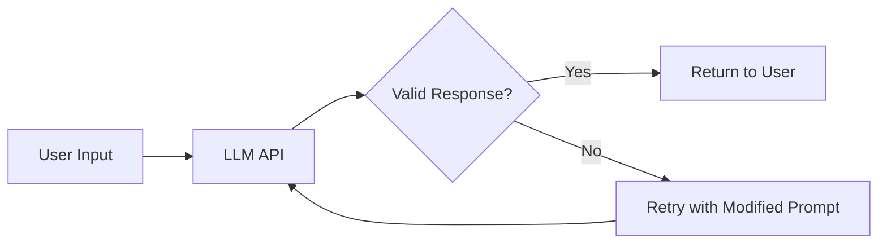

# BOOK_RULES.md — Editorial Standards & Conventions

> This document governs all content in the AI Engineering Handbook.
> Every chapter author (human or AI) must read and follow these rules before writing.
> When in doubt, refer here. Consistency is non-negotiable.

---

## 1. Writing Style

### Voice

- First person plural ("we") when guiding the reader through concepts.
- Second person ("you") when giving direct instructions or exercises.
- Never use "I" unless quoting a real person.

### Tone

| Do | Don't |
|----|-------|
| Professional, direct, peer-to-peer | Condescending, oversimplified |
| Friendly but not casual | Slang, emojis in prose, exclamation marks |
| Opinionated with reasoning | Dogmatic without explanation |
| Honest about tradeoffs | Marketing language, hype |
| Concise | Verbose, padded, repetitive |

### Sentences

- Prefer short sentences. Max 25 words where possible.
- One idea per sentence.
- Active voice over passive voice.
- Lead with the point, then explain.

### Paragraphs

- Max 4–5 sentences per paragraph.
- Each paragraph should have a single focus.
- Use whitespace generously.

### Explaining Concepts

Every concept must answer:

1. **What** is it?
2. **Why** does it exist? What problem does it solve?
3. **When** should you use it?
4. **When** should you NOT use it?
5. **What** are the alternatives?
6. **What** are the tradeoffs?

### Assumptions About the Reader

- Intermediate software developer (3+ years experience).
- Knows: programming, Git, REST APIs, JSON, OOP, databases, basic architecture.
- May know: Python, JavaScript/TypeScript, Flutter, React, Firebase, SQL.
- Does NOT know: AI/ML concepts, LLMs, embeddings, vector databases, prompt engineering.
- Never explain variables, loops, functions, or beginner programming.

---

## 2. Terminology

### Preferred Terms

| Use | Don't Use |
|-----|-----------|
| LLM | "AI model" (when referring specifically to language models) |
| inference | "thinking" |
| token | "word" (when discussing tokenization) |
| context window | "memory" (when discussing token limits) |
| embedding | "vector representation" (first mention can use both) |
| hallucination | "making things up" |
| prompt | "input" (when discussing LLM interaction) |
| completion | "output" / "response" (when discussing LLM output) |
| fine-tuning | "training" (unless discussing pre-training) |
| RAG | spell out on first use: "Retrieval-Augmented Generation (RAG)" |
| AI engineer | "AI developer" |
| agentic | acceptable after definition in Module 10 |
| tool use / function calling | "plugins" |
| structured output | "JSON mode" (JSON mode is one implementation) |

### Acronyms

- Spell out on first use in each chapter.
- After first use, acronym only.
- Maintain a glossary at chapter end.

### Product Names

- Always use official capitalization: OpenAI, Anthropic, Google, Supabase, LangChain, CrewAI, n8n.
- Never: openai, OPENAI, Open AI, langchain.

### Code Terminology

- "function" not "method" (unless discussing class methods specifically).
- "endpoint" not "route" (when discussing APIs).
- "request" and "response" (not "call" and "answer").
- "repository" not "repo" in formal prose (acceptable in casual references).

---

## 3. Formatting Conventions

### Headings

```markdown
# Chapter Title (H1 — one per file)
## Major Section (H2)
### Subsection (H3)
#### Detail (H4 — use sparingly)
```

- No H5 or H6.
- Headings use title case: "Building Your First RAG Pipeline"
- No punctuation at end of headings.

### Code Blocks

Always specify language:

````markdown
```python
def get_completion(prompt: str) -> str:
    """Get a completion from the LLM."""
    response = client.chat.completions.create(
        model="gpt-4o",
        messages=[{"role": "user", "content": prompt}]
    )
    return response.choices[0].message.content
```
````

- Include comments explaining non-obvious decisions.
- Use meaningful variable names.
- Include error handling in production examples.
- Show imports when introducing a new library.
- Max 40 lines per code block. Split longer examples with explanation between blocks.

### Inline Code

- Use backticks for: file names, function names, variable names, terminal commands, package names, API endpoints.
- Example: "The `temperature` parameter controls randomness."

### File Trees

```
project/
├── src/
│   ├── agents/
│   │   ├── planner.py
│   │   └── executor.py
│   ├── tools/
│   │   └── search.py
│   └── main.py
├── tests/
├── .env
├── requirements.txt
└── README.md
```

### Tables

Use tables for comparisons, feature matrices, and structured data:

```markdown
| Feature | OpenAI | Anthropic | Google |
|---------|--------|-----------|--------|
| Streaming | ✅ | ✅ | ✅ |
| Vision | ✅ | ✅ | ✅ |
| Function calling | ✅ | ✅ | ✅ |
```

### Lists

- Bullet points for unordered collections.
- Numbered lists for sequences, steps, or ranked items.
- Max 7 items before considering a table or subsection.

---

## 4. Callout Boxes

Use consistently across all chapters. Format:

```markdown
> 💡 **Developer Insight**
>
> Content here. Real engineering advice from production experience.

> ⚠️ **Common Mistake**
>
> Content here. What beginners get wrong and how to avoid it.

> 🏢 **Industry Note**
>
> Content here. How real companies handle this at scale.

> 🚀 **Portfolio Tip**
>
> Content here. How to leverage this for employability.

> 🔑 **Key Concept**
>
> Content here. Core idea that must be understood before proceeding.

> 📐 **Architecture Decision**
>
> Content here. Why we chose this approach over alternatives.

> 💰 **Cost Note**
>
> Content here. Pricing implications and optimization strategies.
```

Rules:
- Max 4 callouts per major section.
- Never stack two callouts back-to-back without prose between them.
- Callout content should be 1–3 sentences. Not paragraphs.

---

## 5. Chapter Structure

Every chapter follows this template:

```markdown
# Chapter N: Title

## Learning Objectives

By the end of this chapter, you will:
- [ ] Objective 1
- [ ] Objective 2
- [ ] Objective 3 (max 5–7)

## Prerequisites

- Chapter X: Concept Y
- Familiarity with Z

## Estimated Time

- Reading: X minutes
- Exercises: X minutes
- Project: X hours

---

## [Content Sections]

(Main chapter content with theory, examples, diagrams, code)

---

## Production Notes

Real-world considerations for deploying this in production.

## Common Mistakes

Numbered list of mistakes with explanations.

## Best Practices

Numbered list of best practices.

---

## Hands-On Exercises

### Exercise 1: [Title]
**Difficulty:** ⭐ / ⭐⭐ / ⭐⭐⭐
**Time:** X minutes

(Instructions)

### Exercise 2: [Title]
...

## Mini Project

**Title:** [Project Name]
**Difficulty:** ⭐⭐
**Time:** X hours
**What you'll build:** (1–2 sentences)

(Step-by-step instructions)

## Challenge Project

**Title:** [Project Name]
**Difficulty:** ⭐⭐⭐
**Time:** X hours
**What you'll build:** (1–2 sentences)

(High-level requirements — reader figures out implementation)

## Portfolio Milestone

What to add to your portfolio from this chapter.

---

## Chapter Summary

5–10 bullet points summarizing key takeaways.

## Cheat Sheet

Quick-reference table or list for the chapter's core content.

## Glossary

| Term | Definition |
|------|-----------|
| Term 1 | Definition |
| Term 2 | Definition |

## References

- [Official Doc](url) — Description
- [Resource](url) — Description

## Further Reading

- [Advanced Topic](url)
- [Deep Dive](url)

## Next Chapter Preview

2–3 sentences teasing the next chapter and connecting it to what was just learned.
```

---

## 6. Diagram Standards

### Preferred Tool

Mermaid (renders in GitHub, most Markdown editors, and PDF generators).

### Diagram Types by Use Case

| Use Case | Diagram Type |
|----------|-------------|
| System architecture | Mermaid flowchart (TB or LR) |
| Request/response flow | Mermaid sequence diagram |
| Decision logic | Mermaid flowchart with decision nodes |
| Data pipeline | Mermaid flowchart (LR) |
| Component relationships | Mermaid class diagram |
| State transitions | Mermaid state diagram |
| Timeline/process | Mermaid flowchart or gantt |

### Mermaid Style Rules



- Use descriptive node labels (not single letters in final diagrams).
- Keep diagrams under 15 nodes.
- Use consistent direction within a chapter (LR or TB).
- Add a caption below every diagram: `*Figure N: Description*`

### When Mermaid Isn't Enough

For complex architecture diagrams that exceed Mermaid's capabilities:
- Create as ASCII art with box-drawing characters.
- Or reference an image in `diagrams/` folder with description.

---

## 7. Code Standards

### Languages Used in This Book

| Language | Use Case |
|----------|----------|
| Python | Primary language for AI/ML, APIs, agents, automation |
| TypeScript | Web applications, some API examples |
| Dart/Flutter | Mobile AI applications (Module 11) |
| Bash | Terminal commands, scripts, deployment |
| SQL | Database queries |
| YAML | Configuration files |
| JSON | API payloads, structured output |

### Python Style

- Python 3.11+ syntax.
- Type hints on all function signatures.
- Docstrings on public functions.
- `snake_case` for functions and variables.
- `PascalCase` for classes.
- Use `pathlib` over `os.path`.
- Use `httpx` or `requests` for HTTP (prefer `httpx` for async).
- Use `pydantic` for data validation.
- Use virtual environments (`venv` or `uv`).

### TypeScript Style

- Strict mode enabled.
- Explicit return types on functions.
- `camelCase` for functions and variables.
- `PascalCase` for types and interfaces.
- Prefer `const` over `let`.
- Use `zod` for runtime validation.

### Environment Variables

- Never hardcode API keys in code examples.
- Always show `.env` file pattern:

```bash
# .env
OPENAI_API_KEY=sk-your-key-here
ANTHROPIC_API_KEY=sk-ant-your-key-here
```

- Always show loading pattern:

```python
import os
from dotenv import load_dotenv

load_dotenv()
api_key = os.getenv("OPENAI_API_KEY")
```

### Error Handling

Every production code example must include:
- Try/except (Python) or try/catch (TypeScript).
- Meaningful error messages.
- Graceful degradation where appropriate.
- Rate limit handling for API calls.

---

## 8. Project Standards

### Project Structure

Every project must include:

```
project-name/
├── README.md          # What it does, how to run it
├── requirements.txt   # or package.json
├── .env.example       # Required environment variables
├── .gitignore
├── src/               # Source code
├── tests/             # Tests (at minimum smoke tests)
└── docs/              # Any additional documentation
```

### README Template for Projects

```markdown
# Project Name

Brief description (1–2 sentences).

## What You'll Learn

- Concept 1
- Concept 2

## Prerequisites

- API key for X
- Python 3.11+

## Setup

(Step-by-step setup instructions)

## Usage

(How to run it)

## Architecture

(Brief architecture description or diagram)
```

### Difficulty Ratings

| Rating | Meaning | Time |
|--------|---------|------|
| ⭐ | Beginner exercise | 15–30 min |
| ⭐⭐ | Intermediate project | 1–3 hours |
| ⭐⭐⭐ | Advanced challenge | 4–8 hours |
| ⭐⭐⭐⭐ | Portfolio project | 1–3 days |
| ⭐⭐⭐⭐⭐ | Capstone / SaaS | 1–2 weeks |

---

## 9. Cross-Referencing

### Between Chapters

Use format: "As we covered in **Chapter 3: Working with APIs**, the streaming pattern..."

### Forward References

Use format: "We'll explore this in depth in **Chapter 7: RAG Pipelines**."

### Within a Chapter

Use format: "See the *Architecture* section above."

### Never

- Use page numbers (this is digital-first).
- Use "above" or "below" for sections in different chapters.
- Reference chapters by number alone ("Chapter 3") — always include the title.

---

## 10. Version and Currency

### API Versions

- Specify API versions when relevant.
- Use the latest stable version at time of writing.
- Note where APIs change frequently.

### Package Versions

- Pin major versions in requirements files.
- Note when a package is pre-1.0 (API may change).

### Evergreen Content

- Focus on concepts over specific implementations where possible.
- Separate "how it works" (evergreen) from "how to use library X" (may change).
- Flag rapidly-evolving sections with a note:

> ⚠️ **Evolving Landscape**
>
> This section covers tools as of [date]. Check official documentation for the latest APIs.

---

## 11. Accessibility and Inclusivity

- Use gender-neutral language ("they/them" for hypothetical people).
- Avoid cultural idioms that may not translate.
- Ensure code examples work on macOS, Linux, and Windows (note platform differences).
- Provide alt-text descriptions for any non-Mermaid images.
- Use high-contrast formatting (no color-only distinctions).

---

## 12. Editorial Checklist (Per Chapter)

Before marking any chapter complete:

- [ ] Follows chapter template structure
- [ ] All code blocks specify language
- [ ] All code runs without errors
- [ ] Callout boxes used appropriately (not excessive)
- [ ] At least 2 diagrams included
- [ ] Glossary complete for all new terms
- [ ] Cross-references use correct format
- [ ] Exercises include difficulty and time estimate
- [ ] No marketing language or hype
- [ ] Every concept answers the "5 Whats" (what, why, when, when not, alternatives)
- [ ] Production notes included
- [ ] Common mistakes listed
- [ ] References link to official docs first
- [ ] File names follow convention
- [ ] Transitions between sections are smooth
- [ ] Chapter connects to previous and next chapters

---

## 13. File Naming Conventions

### Chapters

```
book/
├── chapter-01-ai-landscape/
│   └── chapter-01.md
├── chapter-02-llm-fundamentals/
│   └── chapter-02.md
```

### Supporting Files

```
book/
├── diagrams/
│   ├── chapter-01/
│   │   └── ai-ecosystem-overview.mmd
│   └── chapter-02/
│       └── token-lifecycle.mmd
├── code/
│   ├── chapter-03/
│   │   └── streaming-example.py
│   └── chapter-05/
│       └── chat-interface/
├── exercises/
│   └── chapter-01/
│       └── exercises.md
├── projects/
│   ├── pdf-chatbot/
│   ├── resume-screener/
│   └── invoice-parser/
├── cheatsheets/
│   └── chapter-01-cheatsheet.md
├── resources/
│   └── tool-comparison.md
└── references/
    └── chapter-01-references.md
```

---

## 14. Quality Bar

Every piece of content must meet this bar:

1. **Would an experienced engineer find this useful?** If not, cut it.
2. **Would this survive a technical review?** If not, verify and fix.
3. **Does this respect the reader's time?** If not, tighten it.
4. **Could this go in a published O'Reilly book?** If not, raise the quality.
5. **Does this build on what came before?** If not, reorder or add context.

---

## 15. Anti-Patterns (Never Do These)

- ❌ "AI is revolutionizing everything!" (hype)
- ❌ "Simply call the API and you're done!" (oversimplification)
- ❌ "This is the best framework." (unsubstantiated superlative)
- ❌ Showing code without explaining the WHY
- ❌ Introducing a concept without prerequisites being covered
- ❌ Copy-pasting documentation without synthesis
- ❌ Explaining what a for-loop is
- ❌ Using "just" or "simply" (minimizes complexity)
- ❌ Walls of code without interleaved explanation
- ❌ Diagrams without captions
- ❌ Callout boxes used as filler
- ❌ Exercises without clear expected outcomes
- ❌ References to "the latest version" without specifying what version

---

*Last updated: June 2026*
*Version: 1.0*
