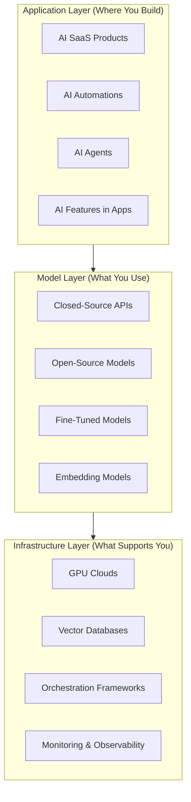
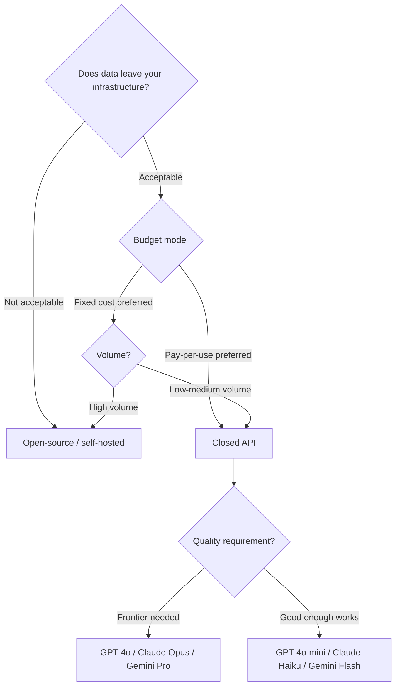
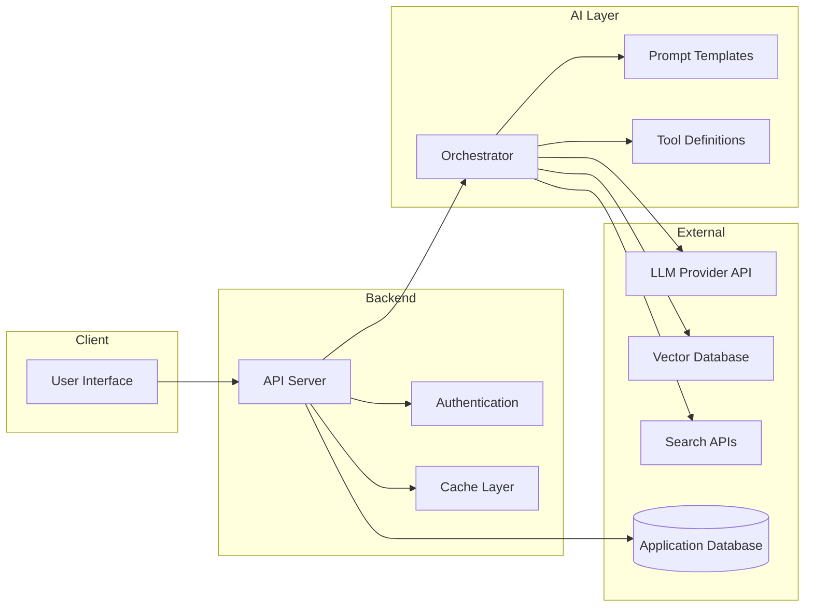
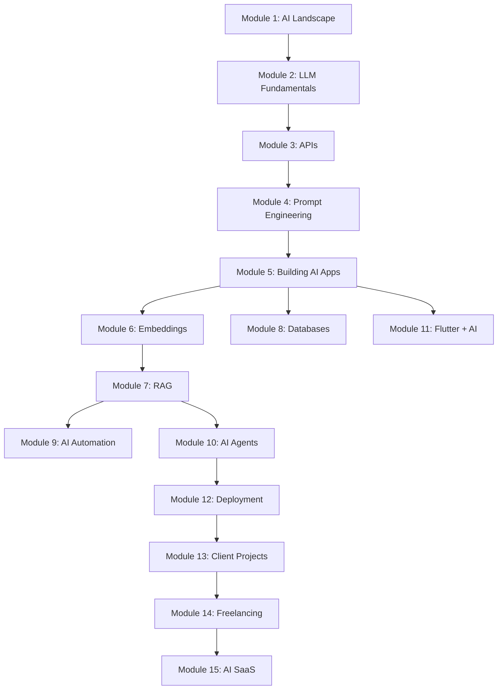

# Chapter 1: The Modern AI Landscape

## Learning Objectives

By the end of this chapter, you will:

- [ ] Understand the key milestones that led to the current AI engineering era
- [ ] Identify the major layers of the modern AI stack and how they relate
- [ ] Distinguish between closed-source and open-source model ecosystems
- [ ] Map the AI landscape into infrastructure, models, and applications
- [ ] Recognize where AI engineering fits relative to ML engineering and data science
- [ ] Evaluate which model providers and tools are relevant for production applications

## Prerequisites

- General software engineering experience (building and shipping applications)
- Familiarity with APIs, cloud services, and SaaS architecture
- No prior AI/ML knowledge required

## Estimated Time

- Reading: 45 minutes
- Exercises: 30 minutes
- Project: 1 hour

---

## Why This Chapter Matters

You already know how to build software. You've shipped applications, wrangled databases, debugged production issues at 2 AM, and argued about architecture in pull requests.

AI engineering is not a new discipline that replaces what you know. It's a new layer on top of it. The same engineering principles — separation of concerns, error handling, testing, monitoring, cost management — all apply. What changes is the primitive you're working with.

Traditional software: deterministic functions. You call `calculateTax(amount, rate)` and get the same answer every time.

AI-powered software: probabilistic functions. You call an LLM with a prompt and get a *likely good* answer that varies between calls.

This chapter maps the terrain. Before we write a single line of AI code, you need to understand what exists, who builds it, how the pieces connect, and where the opportunities are.

---

## A Brief History (That Actually Matters)

We're skipping the 1950s. You don't need to know about the Dartmouth Conference to build AI applications. Here's what matters for practitioners:

### The Timeline That Led to Now

| Year | Event | Why It Matters to You |
|------|-------|----------------------|
| 2017 | Google publishes "Attention Is All You Need" | Introduces the Transformer architecture. Every modern LLM is built on this. |
| 2018 | OpenAI releases GPT-1 (117M parameters) | Proves language models can be general-purpose. |
| 2019 | GPT-2 (1.5B parameters) | "Too dangerous to release." First public awareness of generation quality. |
| 2020 | GPT-3 (175B parameters), API access | The API moment. Developers can now use LLMs without training them. |
| 2022 | ChatGPT launches | 100M users in 2 months. Creates the market for AI applications. |
| 2023 | GPT-4, Claude, open-source explosion (LLaMA, Mistral) | Multi-provider ecosystem emerges. Competition drives quality up, costs down. |
| 2024 | Agents, RAG goes mainstream, multi-modal models | Production patterns solidify. AI engineering becomes a distinct role. |
| 2025 | Reasoning models, MCP protocol, AI SaaS market matures | Infrastructure stabilizes. Building AI products becomes accessible. |
| 2026 | Where we are now | Focus shifts from "can we?" to "should we?" and "how do we do it well?" |

> 🔑 **Key Concept**
>
> The 2020 GPT-3 API launch is the moment AI engineering was born. Before that, using AI required training models. After that, it required calling an API. That's the shift that makes this book possible.

### What Changed for Software Engineers

Before 2020, building AI features required:
- A machine learning team
- Training infrastructure (GPUs, data pipelines)
- Months of data collection and model training
- PhD-level expertise

After 2020:
- An API key
- A well-crafted prompt
- Standard software engineering skills
- Minutes to prototype, days to production

This is the transformation we're riding. The hard ML work has been abstracted behind an API. Your job is to build excellent software on top of that API.

---

## The AI Stack: Three Layers

The modern AI ecosystem has three distinct layers. Understanding them prevents confusion about what you're actually building versus what you're consuming.

*Figure 1: The three layers of the AI stack*

### Layer 1: Infrastructure

This is the foundation. You rarely build at this layer — you consume it.

| Component | What It Does | Examples |
|-----------|-------------|----------|
| GPU clouds | Train and serve models | AWS, GCP, Azure, Lambda Labs, CoreWeave |
| Vector databases | Store and search embeddings | Pinecone, Weaviate, Qdrant, pgvector, Chroma |
| Orchestration | Chain LLM calls, manage agents | LangChain, LlamaIndex, Haystack |
| Observability | Monitor AI systems | LangSmith, Helicone, Braintrust, Langfuse |
| Deployment | Serve models and apps | Modal, Replicate, Together AI, Railway |

As an AI engineer, you pick infrastructure the same way you pick a database or hosting provider. You evaluate, you integrate, you move on.

### Layer 2: Models

This is what gives AI applications their capabilities. You choose models, you don't build them (usually).

**Closed-source (API-based):**
- OpenAI (GPT-4o, o1, o3)
- Anthropic (Claude 3.5 Sonnet, Claude 4 Opus)
- Google (Gemini 2.0 Pro, Gemini 2.0 Flash)

**Open-source / Open-weight:**
- Meta (LLaMA 3, LLaMA 4)
- Mistral (Mistral Large, Mixtral)
- Qwen (Qwen 2.5)
- DeepSeek (DeepSeek-V3, DeepSeek-R1)

**Specialized models:**
- Embedding models (for search and retrieval)
- Vision models (for image understanding)
- Speech models (for transcription and generation)
- Code models (for programming tasks)

> 💡 **Developer Insight**
>
> You don't need to pick one provider and commit. Production AI applications frequently use multiple models — a fast cheap model for classification, a powerful expensive model for generation, an embedding model for search. Think of models like database engines: you use the right one for the job.

### Layer 3: Applications

This is where you build. This is the layer that creates business value.

| Application Type | Description | Example |
|-----------------|-------------|---------|
| AI features | AI added to existing products | Smart search, auto-complete, content generation |
| AI automations | Workflow automation using AI | Email triage, document processing, data extraction |
| AI agents | Autonomous systems that use tools | Customer support, research, scheduling |
| AI SaaS | Standalone AI-powered products | Writing assistants, analytics platforms, chatbots |

This book teaches you to build at this layer.

---

## Closed vs. Open: The Model Ecosystem

This is one of the most important architectural decisions you'll make. Let's break it down honestly.

### Closed-Source Models (API-based)

**How it works:** You send requests to a provider's API. They run the model on their infrastructure. You pay per token.

**Providers:**
- **OpenAI** — GPT-4o, o1, o3-mini. Market leader. Best ecosystem.
- **Anthropic** — Claude Sonnet, Opus, Haiku. Known for safety and instruction-following.
- **Google** — Gemini Pro, Flash. Largest context windows. Deep Google ecosystem integration.

**Advantages:**
- Zero infrastructure to manage
- Always the latest model version
- Highest quality (usually)
- Easy to start (API key and go)

**Disadvantages:**
- Data leaves your infrastructure
- Vendor lock-in risk
- Costs scale linearly with usage
- Rate limits and downtime outside your control
- No model customization beyond fine-tuning

### Open-Source / Open-Weight Models

**How it works:** You download model weights and run them on your own infrastructure (or a hosting provider like Together AI, Fireworks, or Replicate).

**Models:**
- **LLaMA (Meta)** — Most popular open model family
- **Mistral** — Strong European alternative, excellent at code
- **Qwen (Alibaba)** — Strong multilingual capabilities
- **DeepSeek** — Competitive reasoning, aggressive pricing

**Advantages:**
- Full data privacy (runs on your infrastructure)
- No per-token costs (fixed infrastructure cost)
- Customizable (fine-tuning, quantization)
- No rate limits
- No vendor dependency

**Disadvantages:**
- Infrastructure management required
- Generally lower quality than frontier closed models
- You handle scaling, updates, failovers
- Fine-tuning requires expertise and data

### The Decision Framework

*Figure 2: Model selection decision tree*

> 🏢 **Industry Note**
>
> Most production AI applications use closed APIs to start and evaluate open-source alternatives as they scale. The pattern: prototype with GPT-4o, validate the product-market fit, then optimize costs by moving appropriate workloads to cheaper or self-hosted models. Don't over-optimize before you have users.

---

## The AI Engineering Role

Let's clarify what you're learning to become and how it differs from adjacent roles.

| Role | Focus | Skills | Builds |
|------|-------|--------|--------|
| Data Scientist | Analysis, experimentation | Statistics, Python, notebooks | Insights, models |
| ML Engineer | Model training, infrastructure | PyTorch, distributed systems, MLOps | Training pipelines, model serving |
| **AI Engineer** | **Applications using AI** | **Software engineering, APIs, prompts, orchestration** | **Products, automations, agents** |
| Prompt Engineer | Prompt optimization | Writing, testing, evaluation | Prompts, evaluation suites |

AI engineering is closer to full-stack development than to machine learning. You're building applications. The LLM is a component — a powerful, probabilistic component — but still a component in a larger system.

Your existing skills map directly:

| Software Engineering Skill | AI Engineering Equivalent |
|---------------------------|--------------------------|
| API integration | LLM API integration |
| Database design | Vector database design |
| Error handling | Hallucination handling, fallback strategies |
| Caching | Prompt caching, response caching |
| Testing | Evaluation (evals), prompt testing |
| Monitoring | LLM observability, cost tracking |
| Architecture | AI system architecture (RAG, agents, pipelines) |

> 🚀 **Portfolio Tip**
>
> Position yourself as a software engineer who builds AI-powered products, not as an "AI person" who can kind of code. Companies want engineers who happen to know AI, not AI enthusiasts who are learning to ship software.

---

## The Modern AI Application Architecture

Let's look at what a production AI application actually looks like, architecturally.

*Figure 3: Production AI application architecture*

Notice: the AI layer is one part of a larger system. You still need authentication, a database, caching, error handling, monitoring, and all the standard infrastructure. The LLM doesn't replace your engineering — it augments it.

### Components You'll Build in This Book

| Component | What It Does | Chapters |
|-----------|-------------|----------|
| Prompt templates | Structured instructions for the LLM | 4, 5 |
| Orchestration logic | Chains multiple AI calls together | 5, 10 |
| RAG pipelines | Retrieves context before generating | 6, 7 |
| Tool interfaces | Lets AI call your functions | 5, 10 |
| Evaluation suites | Tests AI output quality | 4, 7 |
| Cost controls | Manages API spending | 3, 12 |
| Fallback strategies | Handles failures gracefully | 3, 5 |

---

## Market Landscape: Who's Building What

Understanding the market helps you identify opportunities and choose tools wisely.

### Model Providers

| Provider | Strengths | Best For |
|----------|-----------|----------|
| OpenAI | Ecosystem, developer experience, quality | General-purpose applications, rapid prototyping |
| Anthropic | Instruction following, safety, long context | Complex reasoning, enterprise, sensitive domains |
| Google | Multimodal, context length, integration | Google ecosystem apps, multimodal use cases |
| Meta (open) | Customizability, no API costs | Self-hosted, privacy-sensitive, high-volume |
| Mistral (open) | Code, European data sovereignty | EU compliance, code-heavy applications |

### Infrastructure Providers

| Category | Leaders | What They Provide |
|----------|---------|-------------------|
| Vector DBs | Pinecone, Weaviate, Qdrant, Chroma | Embedding storage and similarity search |
| Hosting | Railway, Render, Fly.io, Modal | Application and model deployment |
| Observability | Langfuse, Helicone, Braintrust | LLM call tracking, evaluation, cost monitoring |
| Orchestration | LangChain, LlamaIndex, Haystack | LLM chaining, RAG, agent frameworks |

### Application Categories (Where the Money Is)

| Category | Examples | Revenue Model |
|----------|----------|---------------|
| Writing assistance | Jasper, Copy.ai, Writer | SaaS subscription |
| Code assistance | GitHub Copilot, Cursor, Codeium | Per-seat subscription |
| Customer support | Intercom AI, Ada, Forethought | Per-resolution or seat |
| Document intelligence | Docugami, Sensible, Reducto | Per-document or subscription |
| Search & retrieval | Glean, Hebbia, Vectara | Enterprise subscription |
| Workflow automation | Relevance AI, Bardeen, Lindy | Usage-based or subscription |

> 💰 **Cost Note**
>
> AI API costs have dropped 90%+ since GPT-3 launched. GPT-4o-mini costs $0.15 per million input tokens (June 2025 pricing). A typical chatbot interaction costs less than $0.01. Cost is rarely the barrier to building — it's engineering quality that differentiates.

---

## The Build vs. Buy Decision

As an AI engineer, you'll constantly decide: build it or use an existing tool?

### Build When

- The AI capability IS your core product
- You need deep customization
- Data privacy requirements are strict
- You need to control the full pipeline
- Existing tools don't fit your specific use case

### Buy/Use Existing Tools When

- AI is a feature, not the product
- Time-to-market matters more than customization
- The tool does exactly what you need
- You don't have the team to maintain AI infrastructure

### The Hybrid Approach (Most Common)

Most real-world AI applications combine:
- A closed API for the LLM (buy)
- Custom orchestration logic (build)
- An existing vector database service (buy)
- Custom evaluation and monitoring (build)
- Standard authentication and hosting (buy)

---

## Case Studies: Real AI Applications

### Case Study 1: AI-Powered Customer Support

**Company type:** B2B SaaS with 5,000 support tickets/month

**Architecture:**
- RAG pipeline over help documentation
- GPT-4o-mini for draft responses
- Human-in-the-loop for review
- Escalation rules for complex tickets

**Results:** 60% of tickets get AI-drafted responses. Human agents edit ~30% of drafts. Average response time dropped from 4 hours to 20 minutes.

**Stack:** Python, FastAPI, Pinecone, OpenAI API, PostgreSQL.

### Case Study 2: Document Processing Automation

**Company type:** Law firm processing 200+ contracts/week

**Architecture:**
- PDF parsing pipeline
- Claude for extraction (long context handles full contracts)
- Structured output for standardized fields
- Human review dashboard

**Results:** Contract review time dropped from 2 hours to 15 minutes per document. Extraction accuracy: 94% (validated against human-reviewed ground truth).

**Stack:** Python, Anthropic API, Supabase, React frontend.

### Case Study 3: Internal Knowledge Base

**Company type:** Engineering team (150 engineers) with scattered documentation

**Architecture:**
- RAG over Confluence, GitHub, Slack archives
- Embedding pipeline with incremental updates
- Chat interface with source citations
- Feedback loop for quality improvement

**Results:** Engineers find answers 5x faster. "Tribal knowledge" became searchable. New hire onboarding time reduced by 40%.

**Stack:** Python, LangChain, Qdrant, OpenAI embeddings, Slack bot interface.

> 📐 **Architecture Decision**
>
> Notice all three case studies use relatively simple architectures. No multi-agent orchestration. No fine-tuned models. No complex ML pipelines. The pattern: RAG + good prompts + structured output + human-in-the-loop. This handles 80% of real business use cases.

---

## What AI Engineering Is NOT

Let's set honest expectations:

**It's not magic.** LLMs are sophisticated text prediction engines. They don't "understand" in the human sense. They produce statistically likely continuations. When you internalize this, you make better engineering decisions.

**It's not replacing developers.** AI tools augment developers. They handle boilerplate, suggest patterns, draft documentation. They don't replace the engineering judgment that decides what to build, how to architect it, and when to ship.

**It's not just prompting.** Prompt engineering is a skill, but AI engineering is building complete systems. That includes: data pipelines, error handling, evaluation, monitoring, scaling, security, and user experience.

**It's not always the right solution.** A well-crafted SQL query, a regex, or a rule-based system is often better than an LLM call. AI engineering means knowing when NOT to use AI.

### When to Use AI vs. Traditional Software

| Use AI When | Use Traditional Software When |
|-------------|-------------------------------|
| Input is unstructured (natural language, images) | Input is structured and predictable |
| Rules are hard to define explicitly | Rules are clear and finite |
| "Good enough" is acceptable | Exact correctness is required |
| The task requires understanding context | The task is deterministic |
| Edge cases are infinite | Edge cases are enumerable |

---

## Your Learning Path Through This Book

Here's how the modules build on each other:

*Figure 4: Book module dependency graph*

Each module builds on the previous ones. Don't skip ahead — concepts compound.

---

## Production Notes

- The AI landscape changes fast. Model providers release updates monthly. The concepts in this book (architecture patterns, engineering principles, evaluation strategies) are durable. Specific API parameters may shift.
- Always check official documentation for the latest API versions and pricing.
- The model leaderboards (LMSYS Chatbot Arena, Hugging Face Open LLM Leaderboard) are useful for staying current on model quality.
- Cost estimates in this book are based on mid-2025 pricing. Expect costs to continue decreasing.

## Common Mistakes

1. **Choosing a model before defining the problem.** Start with the use case. The model choice follows from requirements (quality, cost, latency, privacy).

2. **Over-engineering the first version.** Your first AI feature should be simple: one API call, one prompt, one use case. Complexity comes later.

3. **Ignoring cost until it's too late.** A prototype that costs $0.50/request seems fine until you have 10,000 users. Model costs into your architecture from day one.

4. **Treating LLMs as databases.** LLMs don't store facts reliably. They generate plausible text. For factual accuracy, use RAG (retrieve real data, then generate).

5. **Building without evaluation.** If you can't measure whether your AI output is good, you can't improve it. Set up evaluation before you optimize.

6. **Picking a framework before understanding the primitives.** Learn what an LLM API call does before wrapping it in LangChain. Frameworks abstract complexity — you need to understand what's being abstracted.

## Best Practices

1. **Start with the simplest architecture that could work.** Direct API call → prompt template → RAG → agents. Add complexity only when simpler approaches fail.

2. **Use multiple models.** Cheap models for simple tasks, expensive models for complex ones. Route intelligently.

3. **Always have a fallback.** LLM APIs go down. Have graceful degradation. Cache common responses.

4. **Version your prompts.** Treat prompts like code. Version control them. Test them. Review changes.

5. **Log everything.** Every LLM call, every prompt, every response, every token count, every latency measurement. You'll need this data.

6. **Design for human-in-the-loop.** Start with AI-assisted (human reviews AI output) before going fully autonomous.

---

## Hands-On Exercises

### Exercise 1: Map Your Current Stack

**Difficulty:** ⭐
**Time:** 15 minutes

Take an application you've built (or work on professionally). Identify three places where an LLM could add value. For each, answer:
- What's the input? (structured or unstructured?)
- What's the desired output?
- Is "good enough" acceptable, or do you need exact correctness?
- What happens when the AI is wrong?

### Exercise 2: Evaluate Three Model Providers

**Difficulty:** ⭐
**Time:** 20 minutes

Visit the documentation for OpenAI, Anthropic, and Google AI. For each:
- Find their model lineup (list model names and sizes)
- Find their pricing page
- Identify their rate limits for free/starter tiers
- Note one unique capability each provider offers

**Links:**
- https://platform.openai.com/docs
- https://docs.anthropic.com
- https://ai.google.dev/docs

### Exercise 3: Architecture Sketch

**Difficulty:** ⭐⭐
**Time:** 20 minutes

You're building an AI-powered FAQ bot for a company with 500 pages of documentation. Sketch the architecture:
- Where does the documentation live?
- How does the user interact with the system?
- What happens between the user's question and the AI's answer?
- What model would you choose and why?
- What's your fallback when the AI doesn't know?

Draw this as a flowchart (Mermaid, whiteboard, or paper).

---

## Mini Project

**Title:** AI Landscape Research Document
**Difficulty:** ⭐
**Time:** 1 hour
**What you'll build:** A structured reference document comparing AI model providers, tools, and services relevant to a specific use case you choose.

### Instructions

1. Choose a use case you'd realistically build (e.g., "customer support chatbot for an e-commerce store").
2. Research and document:
   - Which model provider(s) would you use? Why?
   - What vector database (if any)?
   - What hosting solution?
   - Estimated cost per 1,000 user interactions
   - What existing tools could you use vs. what you'd build custom?
3. Structure this as a proper technical decision document (not a blog post).
4. Include a Mermaid architecture diagram.

Save this — it becomes the foundation for projects in later chapters.

---

## Challenge Project

**Title:** AI Tool Landscape Tracker
**Difficulty:** ⭐⭐
**Time:** 3 hours
**What you'll build:** A living document (or simple web page) that tracks the AI tools and services relevant to your work, categorized by layer (infrastructure, models, applications).

Requirements:
- Categorize at least 20 tools/services
- Include: name, category, pricing model, primary use case, your assessment
- Update strategy: how will you keep this current?
- Format: Markdown table, Notion database, or simple static site

---

## Portfolio Milestone

After this chapter, you should have:
- A clear mental model of the AI landscape (documented in your research project)
- A decision framework for choosing between model providers
- An architecture sketch for a real AI application
- A reference document you'll use throughout the rest of the book

---

## Chapter Summary

- AI engineering emerged when LLMs became available via API (2020+). It's application building, not model training.
- The AI stack has three layers: infrastructure (consume it), models (choose them), applications (build them).
- Closed models (OpenAI, Anthropic, Google) offer quality and convenience. Open models (LLaMA, Mistral) offer control and privacy.
- AI engineering is software engineering with a probabilistic component. Your existing skills transfer directly.
- Production AI applications are mostly simple: API call + good prompt + RAG + structured output. Complexity is earned, not assumed.
- Always ask: "Is AI the right tool here?" Sometimes a SQL query is the answer.

---

## Cheat Sheet

| Concept | One-Line Summary |
|---------|-----------------|
| AI Engineering | Building applications that use LLMs as a component |
| Closed-source model | API-based, pay-per-token, no infrastructure management |
| Open-source model | Self-hosted, fixed cost, full control, more work |
| RAG | Retrieve relevant data, then generate with context |
| Embeddings | Numerical representations of text for similarity search |
| Vector database | Stores and searches embeddings efficiently |
| Prompt engineering | Crafting instructions that produce reliable LLM output |
| AI agent | System that uses LLMs + tools to accomplish goals autonomously |
| Orchestration | Chaining multiple AI calls and logic into a workflow |
| Evaluation (evals) | Measuring AI output quality systematically |

---

## Glossary

| Term | Definition |
|------|-----------|
| LLM | Large Language Model. A neural network trained on text data to predict and generate language. |
| Token | The basic unit of text processing for LLMs. Roughly 4 characters or 0.75 words in English. |
| Inference | The process of generating output from a trained model (as opposed to training it). |
| Context window | The maximum number of tokens an LLM can process in a single request (input + output). |
| API | Application Programming Interface. How you communicate with model providers programmatically. |
| Embedding | A dense numerical vector representing the semantic meaning of text. |
| RAG | Retrieval-Augmented Generation. Fetching relevant data before asking an LLM to generate a response. |
| Fine-tuning | Training an existing model further on domain-specific data to improve performance on specific tasks. |
| Hallucination | When an LLM generates plausible but factually incorrect information. |
| Prompt | The input instruction sent to an LLM to elicit a specific response. |
| Agent | An AI system that can plan, use tools, and take actions to accomplish goals. |
| MCP | Model Context Protocol. A standard for connecting AI models to external tools and data sources. |

---

## References

- [Attention Is All You Need (2017)](https://arxiv.org/abs/1706.03762) — The Transformer paper. Foundation of all modern LLMs.
- [OpenAI Platform Documentation](https://platform.openai.com/docs) — Official API docs, models, pricing.
- [Anthropic Documentation](https://docs.anthropic.com) — Claude models, API reference.
- [Google AI for Developers](https://ai.google.dev) — Gemini models, SDK documentation.
- [Hugging Face Model Hub](https://huggingface.co/models) — Open-source model repository.
- [LMSYS Chatbot Arena](https://chat.lmsys.org) — Community model quality rankings via blind comparison.
- [State of AI Report](https://www.stateof.ai) — Annual comprehensive AI landscape analysis.

## Further Reading

- [Building LLM Applications for Production](https://huyenchip.com/2023/04/11/llm-engineering.html) — Chip Huyen's overview of production considerations
- [What We Learned from a Year of Building with LLMs](https://www.oreilly.com/radar/what-we-learned-from-a-year-of-building-with-llms-part-i/) — O'Reilly practitioner report
- [The AI Engineering Stack](https://www.latent.space/p/ai-engineer) — Latent Space's definition of the role

---

## Next Chapter Preview

In **Chapter 2: LLM Fundamentals**, we'll open the hood. You'll learn exactly how LLMs process text (tokenization), why they sometimes hallucinate, what temperature and top-p actually control, how context windows constrain your architecture, and why the same prompt can give different results. This foundational knowledge will make every subsequent chapter click into place.
