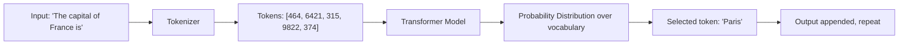
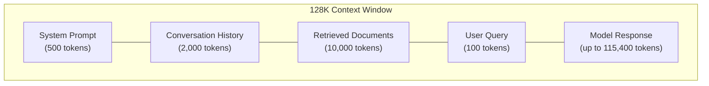
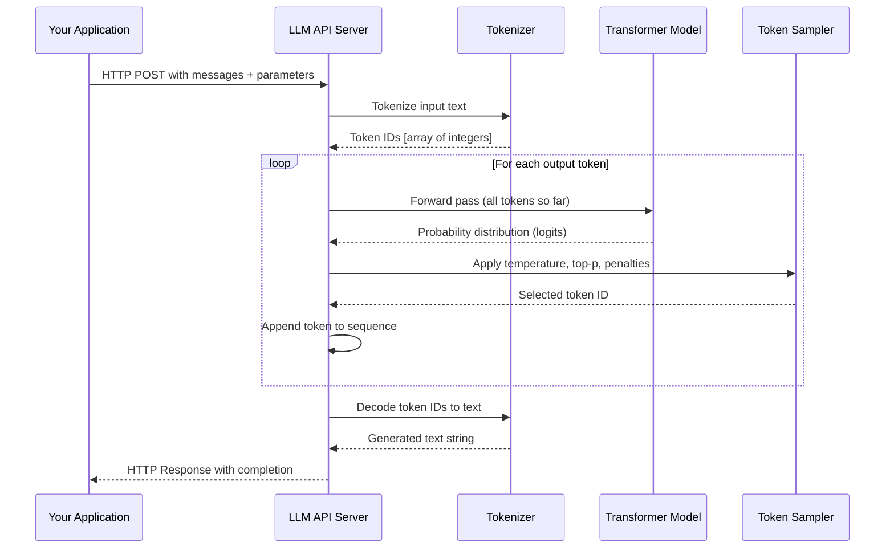
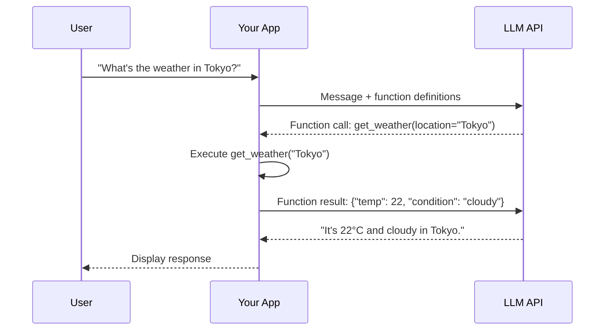
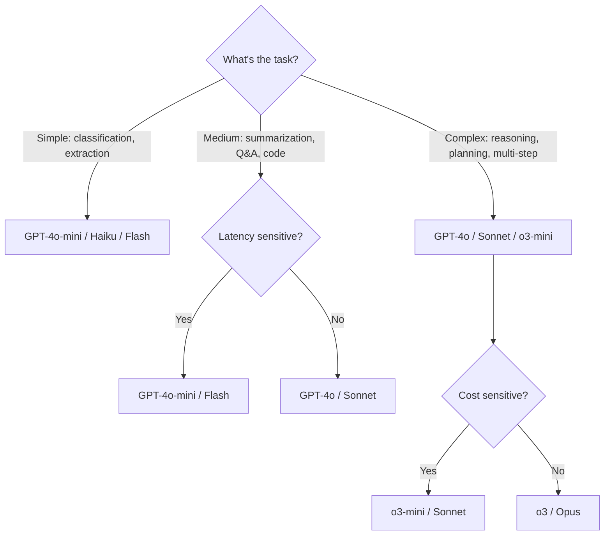

# Chapter 2: LLM Fundamentals

## Learning Objectives

By the end of this chapter, you will:

- [ ] Understand how LLMs process text through tokenization
- [ ] Explain context windows and their architectural implications
- [ ] Control output behavior using temperature, top-p, and other parameters
- [ ] Recognize why hallucinations occur and how to mitigate them
- [ ] Understand the inference pipeline from input to output
- [ ] Reason about costs based on token usage
- [ ] Use function calling and structured outputs effectively

## Prerequisites

- Chapter 1: The Modern AI Landscape
- Basic understanding of APIs and JSON

## Estimated Time

- Reading: 60 minutes
- Exercises: 45 minutes
- Project: 2 hours

---

## The Mental Model

Here's the most important thing to internalize about LLMs:

**An LLM is a next-token prediction engine.**

That's it. Given a sequence of tokens, it predicts the most likely next token. Then it appends that token to the sequence and predicts again. And again. Until it produces a stop token or hits a length limit.

Every impressive capability — writing code, answering questions, translating languages, reasoning through math problems — emerges from this single mechanism. The model doesn't "know" things. It has learned statistical patterns across vast amounts of text and produces continuations that match those patterns.

This isn't a limitation to apologize for. It's the engineering reality you design around.



*Figure 1: The core LLM inference loop — tokenize, predict, select, repeat*

> 🔑 **Key Concept**
>
> Every LLM interaction is autoregressive: the model generates one token at a time, using all previous tokens (input + already-generated output) as context. This is why generation is slower than a simple database lookup — it's iterative.

---

## Tokenization: How LLMs See Text

LLMs don't process characters or words. They process **tokens** — chunks of text that the model has learned to treat as atomic units.

### What Is a Token?

A token is a piece of text the model treats as a single unit. Tokens can be:
- A complete word: `"hello"` → 1 token
- A word fragment: `"unhappiness"` → `["un", "happiness"]` → 2 tokens
- A single character: `"!"` → 1 token
- A space + word: `" the"` → 1 token (space is part of the token)
- A code snippet: `"def "` → 1 token

### Tokenization Rules of Thumb

| Language | Approximate Ratio |
|----------|------------------|
| English | 1 token ≈ 4 characters ≈ 0.75 words |
| Code (Python) | 1 token ≈ 3 characters (more tokens per line) |
| Non-Latin scripts (Chinese, Japanese, Arabic) | 1 token ≈ 1–2 characters (much more expensive) |
| JSON/structured data | Higher token density than prose |

### Why Tokenization Matters to Engineers

1. **Cost.** You pay per token (input + output). Understanding tokenization helps you estimate and optimize costs.
2. **Context limits.** The context window is measured in tokens, not words. A verbose prompt wastes expensive context space.
3. **Precision.** Models operate at token boundaries. They can't reliably count characters, reverse words letter-by-letter, or do character-level operations because they don't "see" characters.
4. **Multilingual performance.** Languages that tokenize less efficiently (more tokens per concept) get less "thinking space" per dollar and per context window.

### Tokenizer Differences by Provider

Each model family uses its own tokenizer:

| Provider | Tokenizer | Vocabulary Size |
|----------|-----------|----------------|
| OpenAI (GPT-4o) | o200k_base | ~200,000 tokens |
| OpenAI (GPT-3.5/4) | cl100k_base | ~100,000 tokens |
| Anthropic (Claude) | Custom BPE | ~100,000 tokens |
| Google (Gemini) | SentencePiece | ~256,000 tokens |
| Meta (LLaMA 3) | Custom BPE | ~128,000 tokens |

> 💡 **Developer Insight**
>
> Use OpenAI's tokenizer tool (https://platform.openai.com/tokenizer) to visualize how text gets tokenized. Try pasting code, JSON, and non-English text to build intuition. When estimating costs, always measure actual token counts rather than estimating from word counts.

### Practical Example: Token Counting

```python
import tiktoken

# Initialize the tokenizer for GPT-4o
encoder = tiktoken.get_encoding("o200k_base")

text = "The quick brown fox jumps over the lazy dog."
tokens = encoder.encode(text)

print(f"Text: {text}")
print(f"Token count: {len(tokens)}")
print(f"Tokens: {tokens}")
print(f"Decoded tokens: {[encoder.decode([t]) for t in tokens]}")
```

Output:
```
Text: The quick brown fox jumps over the lazy dog.
Token count: 10
Tokens: [976, 4853, 14198, 39935, 35308, 916, 290, 31251, 5765, 13]
Decoded tokens: ['The', ' quick', ' brown', ' fox', ' jumps', ' over', ' the', ' lazy', ' dog', '.']
```

Notice: spaces are attached to the following word. The period is its own token. This is typical Byte-Pair Encoding (BPE) behavior.

---

## Context Windows: Your Architectural Constraint

The context window is the total number of tokens an LLM can process in a single request. This includes both the input (your prompt + any context) and the output (the model's response).

### Current Context Window Sizes (2025)

| Model | Context Window | Approx. Pages of Text |
|-------|---------------|----------------------|
| GPT-4o | 128K tokens | ~200 pages |
| GPT-4o-mini | 128K tokens | ~200 pages |
| Claude 3.5 Sonnet | 200K tokens | ~310 pages |
| Claude 4 Opus | 200K tokens | ~310 pages |
| Gemini 2.0 Pro | 2M tokens | ~3,100 pages |
| Gemini 2.0 Flash | 1M tokens | ~1,550 pages |
| LLaMA 3 (70B) | 128K tokens | ~200 pages |

### Context Window = Input + Output

This is a critical constraint:

```
Context Window = Input Tokens + Output Tokens
```

If your model has a 128K context window and your input uses 120K tokens, you only have 8K tokens left for the response. Plan accordingly.



*Figure 2: Context window budget allocation*

### Architectural Implications

| Context Need | Strategy |
|-------------|----------|
| Data exceeds context window | Use RAG: retrieve only relevant chunks |
| Conversation gets too long | Summarize older messages, keep recent ones |
| Multiple documents to process | Process sequentially, aggregate results |
| Need maximum output length | Minimize input, or use models with larger windows |
| Cost-sensitive application | Shorter prompts = fewer input tokens = lower cost |

> ⚠️ **Common Mistake**
>
> "Bigger context window = better" is not always true. Models often perform worse on tasks that require finding information buried deep in a long context (the "lost in the middle" problem). Shorter, focused context often produces better results than dumping everything into the window.

### Context Window Management Strategies

**1. Sliding Window**
Keep the most recent N messages. Discard older ones.
- Simple to implement
- Loses long-term context

**2. Summarization**
Periodically summarize the conversation history into a compact summary.
- Preserves key information
- Costs an extra LLM call to summarize

**3. RAG (Retrieval-Augmented Generation)**
Don't put everything in context. Store documents in a vector database. Retrieve only what's relevant.
- Scales to unlimited data
- Requires embedding infrastructure

**4. Hierarchical Context**
System prompt (always present) + recent messages (sliding) + relevant retrieved context (dynamic).
- Most production systems use this pattern
- Balances freshness with relevance

---

## Temperature and Sampling: Controlling Randomness

When the model predicts the next token, it produces a probability distribution over its entire vocabulary. The model doesn't simply pick the highest-probability token — sampling parameters control how the selection happens.

### Temperature

Temperature controls the "sharpness" of the probability distribution.

| Temperature | Behavior | Use Case |
|-------------|----------|----------|
| 0.0 | Nearly deterministic. Always picks the highest-probability token. | Factual queries, extraction, classification |
| 0.3–0.5 | Low randomness. Mostly predictable with slight variation. | Summarization, code generation |
| 0.7–0.9 | Moderate randomness. Creative but coherent. | General conversation, content writing |
| 1.0 | Full model distribution. High variety. | Brainstorming, creative writing |
| 1.5–2.0 | Amplified randomness. Often incoherent. | Almost never useful in production |

**The intuition:** At temperature 0, the model always picks the "safe" choice. At temperature 1, it explores alternatives proportional to their probability. Above 1, it over-amplifies unlikely tokens.

```python
from openai import OpenAI

client = OpenAI()

# Deterministic — same output every time
response_factual = client.chat.completions.create(
    model="gpt-4o-mini",
    messages=[{"role": "user", "content": "What is the capital of France?"}],
    temperature=0.0
)

# Creative — varied output each time
response_creative = client.chat.completions.create(
    model="gpt-4o-mini",
    messages=[{"role": "user", "content": "Write a tagline for a coffee shop."}],
    temperature=0.9
)
```

### Top-p (Nucleus Sampling)

Top-p is an alternative to temperature that controls randomness differently.

Instead of scaling all probabilities, top-p restricts the selection to the smallest set of tokens whose cumulative probability exceeds p.

| Top-p Value | Behavior |
|-------------|----------|
| 0.1 | Only considers the top ~10% most likely tokens |
| 0.5 | Considers tokens in the top 50% probability mass |
| 0.9 | Considers most tokens, excludes only very unlikely ones |
| 1.0 | Considers all tokens (no filtering) |

> 💡 **Developer Insight**
>
> Don't set both temperature and top-p in the same request. Pick one. OpenAI recommends adjusting temperature OR top-p, not both simultaneously. In practice, temperature is more intuitive and widely used. Set top-p to 1.0 (default) and adjust temperature only.

### Other Sampling Parameters

| Parameter | What It Does | When to Use |
|-----------|-------------|-------------|
| `max_tokens` | Maximum output length | Always set this. Prevents runaway generation and controls costs. |
| `stop` | Stop sequences | End generation at specific markers (e.g., `"\n\n"` or `"END"`) |
| `frequency_penalty` | Penalizes repeated tokens | Reduce repetitive output in long generations |
| `presence_penalty` | Penalizes tokens that appeared at all | Encourage topic diversity |
| `seed` | Deterministic sampling (best-effort) | Reproducible outputs for testing |

### The Production Settings

For most production applications:

```python
response = client.chat.completions.create(
    model="gpt-4o-mini",
    messages=messages,
    temperature=0.0,      # Deterministic for most business logic
    max_tokens=1000,      # Always set a ceiling
    # top_p=1.0,          # Leave at default when using temperature
)
```

For creative applications:

```python
response = client.chat.completions.create(
    model="gpt-4o",
    messages=messages,
    temperature=0.7,      # Balanced creativity
    max_tokens=2000,
    frequency_penalty=0.3 # Reduce repetition in long outputs
)
```

---

## The Inference Pipeline: From Input to Output

Let's trace exactly what happens when you send a request to an LLM API:



*Figure 3: The complete inference pipeline from API request to response*

### Key Performance Characteristics

**Time to First Token (TTFT):** How long before the model starts generating. Depends on input length (longer input = more processing).

**Tokens Per Second (TPS):** Generation speed. Typically 30–100 tokens/second for cloud APIs. Faster models (GPT-4o-mini, Claude Haiku) generate faster.

**Total Latency:** TTFT + (output tokens / TPS). A 500-token response at 50 TPS takes ~10 seconds plus TTFT.

| Factor | Effect on Latency |
|--------|------------------|
| Longer input | Increases TTFT |
| Longer output (max_tokens) | Increases total time linearly |
| Larger model | Slower per-token generation |
| Streaming enabled | Same total time, but user sees tokens as generated |

> 🏢 **Industry Note**
>
> Production applications almost always use streaming for user-facing responses. The perceived latency drops dramatically when users see tokens appearing in real-time rather than waiting for the full response. For backend processing (data extraction, classification), non-streaming is simpler and sufficient.

---

## Hallucinations: The Engineering Challenge

Hallucinations are not bugs — they're a fundamental property of how LLMs work. A model trained to produce statistically likely text will sometimes produce text that is plausible but factually wrong.

### Why Hallucinations Happen

1. **Statistical generation, not retrieval.** The model doesn't look up facts in a database. It generates text that matches patterns it learned during training.
2. **Confidence without knowledge.** The model has no concept of "I don't know." It will generate a plausible-sounding answer even when it shouldn't.
3. **Training data conflicts.** When training data contains contradictions, the model may reproduce any version.
4. **Extrapolation beyond training.** Ask about events after the training cutoff and the model may confabulate.

### Types of Hallucinations

| Type | Example | Risk Level |
|------|---------|-----------|
| Factual fabrication | "The Eiffel Tower was built in 1903" | High — user trusts incorrect facts |
| Citation invention | "According to Smith et al. (2021)..." (paper doesn't exist) | High — creates false attribution |
| Confident speculation | "This function returns a string" (it returns int) | Medium — causes bugs |
| Plausible interpolation | Filling in details that seem right but aren't verified | Medium — subtle errors |
| Instruction drift | Ignoring constraints over long outputs | Low-medium — output diverges from spec |

### Mitigation Strategies (Ranked by Effectiveness)

**1. Retrieval-Augmented Generation (RAG)** — Most effective
Provide the model with actual source data. Don't ask it to recall facts; give it the facts and ask it to synthesize.

**2. Structured output with validation** — High effectiveness
Force the model to output JSON matching a schema. Validate the output programmatically.

**3. Temperature 0** — Moderate effectiveness
Reduces variability but doesn't eliminate hallucinations. The most likely token can still be wrong.

**4. "Say I don't know" instructions** — Moderate effectiveness
Explicitly instruct: "If you're not certain, say 'I don't know' rather than guessing." Works better on Claude than GPT in practice.

**5. Citation requirements** — Moderate effectiveness
"Cite the specific passage from the provided context." Forces the model to ground responses in given text.

**6. Multi-pass verification** — High effectiveness, high cost
Generate a response, then ask another LLM call to verify factual claims. Double the cost but catches errors.

```python
# Strategy: RAG + structured output + citation
def answer_with_sources(question: str, context_chunks: list[str]) -> dict:
    """Generate an answer grounded in provided context."""
    
    context = "\n---\n".join(context_chunks)
    
    response = client.chat.completions.create(
        model="gpt-4o",
        temperature=0.0,
        response_format={"type": "json_object"},
        messages=[
            {
                "role": "system",
                "content": """Answer the question using ONLY the provided context.
                Return JSON with:
                - "answer": your response
                - "sources": list of quoted passages that support your answer
                - "confidence": "high", "medium", or "low"
                - "unsupported_claims": any parts of your answer not directly supported
                
                If the context doesn't contain enough information, set confidence to "low"
                and explain what's missing."""
            },
            {
                "role": "user",
                "content": f"Context:\n{context}\n\nQuestion: {question}"
            }
        ]
    )
    
    return json.loads(response.choices[0].message.content)
```

> ⚠️ **Common Mistake**
>
> Don't assume temperature=0 eliminates hallucinations. It doesn't. It only makes the model's output more deterministic — it will consistently pick the most likely token, but the most likely token can still be factually wrong. RAG and validation are the real solutions.

---

## Reasoning: How Models Think

Not all LLMs are created equal in their ability to reason. Understanding the distinction between standard models and reasoning models affects your architecture choices.

### Standard Models (Fast, Good Enough)

GPT-4o-mini, Claude 3.5 Haiku, Gemini Flash — these generate responses in a single forward pass per token. They're fast and cheap but may struggle with complex multi-step reasoning.

### Reasoning Models (Slow, More Accurate)

OpenAI's o1/o3, Claude with extended thinking — these models spend extra "thinking" tokens before producing their answer. They decompose problems, consider alternatives, and verify their logic.

| Characteristic | Standard Model | Reasoning Model |
|---------------|---------------|-----------------|
| Speed | Fast (50–100 TPS) | Slow (may "think" for 10–60 seconds) |
| Cost | Lower per-token | Higher (thinking tokens add up) |
| Simple tasks | Excellent | Overkill and expensive |
| Complex logic | May miss steps | Significantly better |
| Math/code | Good | Excellent |
| Creative writing | Good | Unnecessary |

### When to Use Reasoning Models

- Multi-step math or logic problems
- Complex code generation with many constraints
- Planning and strategy tasks
- Problems where correctness matters more than speed
- Tasks that benefit from self-verification

### When Standard Models Suffice

- Classification (sentiment, category, intent)
- Extraction (pull data from text)
- Summarization
- Translation
- Simple question-answering with provided context
- Creative content generation

> 📐 **Architecture Decision**
>
> A common production pattern: use a fast cheap model (GPT-4o-mini) for 90% of requests, and route complex queries to a reasoning model (o3, Claude Opus). Build a router that classifies query complexity and selects the appropriate model. This balances cost, speed, and quality.

---

## Function Calling: Making LLMs Do Things

Function calling (also called "tool use") is how you give an LLM the ability to interact with external systems. Instead of just generating text, the model can request that your application execute specific functions.

### How It Works

1. You define functions (name, description, parameters) in your API request.
2. The model reads the user's message and decides if a function call would help.
3. If yes, the model outputs a structured function call (name + arguments) instead of text.
4. Your application executes the function and returns the result.
5. The model uses the result to generate its final response.



*Figure 4: Function calling flow — the model decides when to use tools*

### Defining Functions

```python
tools = [
    {
        "type": "function",
        "function": {
            "name": "get_weather",
            "description": "Get the current weather for a location.",
            "parameters": {
                "type": "object",
                "properties": {
                    "location": {
                        "type": "string",
                        "description": "City name, e.g., 'Tokyo' or 'London, UK'"
                    },
                    "unit": {
                        "type": "string",
                        "enum": ["celsius", "fahrenheit"],
                        "description": "Temperature unit"
                    }
                },
                "required": ["location"]
            }
        }
    }
]

response = client.chat.completions.create(
    model="gpt-4o",
    messages=[{"role": "user", "content": "What's the weather in Tokyo?"}],
    tools=tools,
    tool_choice="auto"  # Let the model decide when to call functions
)
```

### Handling the Function Call Response

```python
import json

message = response.choices[0].message

if message.tool_calls:
    # Model wants to call a function
    tool_call = message.tool_calls[0]
    function_name = tool_call.function.name
    arguments = json.loads(tool_call.function.arguments)
    
    # Execute the function (your implementation)
    if function_name == "get_weather":
        result = get_weather(**arguments)
    
    # Send the result back to the model
    follow_up = client.chat.completions.create(
        model="gpt-4o",
        messages=[
            {"role": "user", "content": "What's the weather in Tokyo?"},
            message,  # The assistant's function call
            {
                "role": "tool",
                "tool_call_id": tool_call.id,
                "content": json.dumps(result)
            }
        ]
    )
    
    final_answer = follow_up.choices[0].message.content
```

### Function Calling Best Practices

1. **Write clear descriptions.** The model uses the description to decide when to call the function. Vague descriptions lead to incorrect calls.
2. **Validate arguments.** The model generates arguments as JSON. Always validate before executing — it can produce invalid values.
3. **Limit function count.** More functions = more tokens in every request. Keep the toolset focused.
4. **Use `tool_choice`** to control behavior:
   - `"auto"` — model decides (default)
   - `"required"` — model must call at least one function
   - `{"type": "function", "function": {"name": "specific_function"}}` — force a specific function

> 💡 **Developer Insight**
>
> Function calling is the foundation of AI agents. An agent is essentially: LLM + functions + a loop. The model decides what function to call, gets the result, decides the next step, and repeats until the task is done. We'll build this pattern fully in Chapter 10.

---

## Structured Outputs: Reliable JSON from LLMs

One of the most practically useful LLM capabilities is producing structured data. Instead of free-form text, you can constrain the model to output valid JSON matching a specific schema.

### The Problem

Without structure:
```
User: "Extract the name and email from this text: 'Contact John at john@example.com'"
Model: "The name is John and the email is john@example.com."
```

Parsing this reliably is fragile. What if the format changes? What if there are multiple contacts?

### The Solution: JSON Mode + Schema

```python
from pydantic import BaseModel

class ContactInfo(BaseModel):
    name: str
    email: str
    phone: str | None = None

response = client.beta.chat.completions.parse(
    model="gpt-4o",
    messages=[
        {
            "role": "system",
            "content": "Extract contact information from the provided text."
        },
        {
            "role": "user", 
            "content": "Contact John at john@example.com or call 555-0123"
        }
    ],
    response_format=ContactInfo
)

contact = response.choices[0].message.parsed
print(contact.name)   # "John"
print(contact.email)  # "john@example.com"
print(contact.phone)  # "555-0123"
```

### When to Use Structured Outputs

| Scenario | Use Structured Output? |
|----------|----------------------|
| Data extraction from documents | Yes — always |
| Classification / categorization | Yes — enum fields |
| API responses consumed by code | Yes — schema validation |
| Conversational chat | No — free text is fine |
| Creative writing | No — constraints hurt quality |
| Multi-step reasoning | Sometimes — structured intermediate steps |

> 🏢 **Industry Note**
>
> Structured outputs changed the game for production AI applications. Before this feature, developers used brittle regex parsing or retry loops to extract JSON from model outputs. Now, with schema-constrained generation, you get guaranteed valid JSON on every call. Use this everywhere your code consumes LLM output.

---

## Costs: The Engineering Economics

Understanding LLM pricing is essential for building sustainable applications. Costs are measured in tokens, split between input and output.

### Pricing Model

```
Total Cost = (Input Tokens × Input Price) + (Output Tokens × Output Price)
```

Output tokens are always more expensive than input tokens (typically 3–5x more) because generating tokens requires sequential computation.

### Current Pricing (Mid-2025, per 1M tokens)

| Model | Input Cost | Output Cost | Notes |
|-------|-----------|-------------|-------|
| GPT-4o | $2.50 | $10.00 | Frontier quality |
| GPT-4o-mini | $0.15 | $0.60 | Best value for most tasks |
| Claude 3.5 Sonnet | $3.00 | $15.00 | Strong reasoning |
| Claude 3.5 Haiku | $0.25 | $1.25 | Fast and cheap |
| Gemini 2.0 Flash | $0.075 | $0.30 | Cheapest major model |
| Gemini 2.0 Pro | $1.25 | $5.00 | Large context specialist |

### Cost Estimation Framework

```python
def estimate_cost(
    input_tokens: int,
    output_tokens: int,
    model: str = "gpt-4o-mini",
    requests_per_day: int = 1000
) -> dict:
    """Estimate daily and monthly API costs."""
    
    pricing = {
        "gpt-4o": {"input": 2.50, "output": 10.00},
        "gpt-4o-mini": {"input": 0.15, "output": 0.60},
        "claude-3.5-sonnet": {"input": 3.00, "output": 15.00},
        "claude-3.5-haiku": {"input": 0.25, "output": 1.25},
        "gemini-2.0-flash": {"input": 0.075, "output": 0.30},
    }
    
    rates = pricing[model]
    cost_per_request = (
        (input_tokens / 1_000_000 * rates["input"]) +
        (output_tokens / 1_000_000 * rates["output"])
    )
    
    daily_cost = cost_per_request * requests_per_day
    monthly_cost = daily_cost * 30
    
    return {
        "cost_per_request": f"${cost_per_request:.4f}",
        "daily_cost": f"${daily_cost:.2f}",
        "monthly_cost": f"${monthly_cost:.2f}",
        "model": model
    }

# Example: Customer support chatbot
# Average: 500 input tokens (system prompt + context + question)
# Average: 200 output tokens (response)
print(estimate_cost(500, 200, "gpt-4o-mini", requests_per_day=5000))
# {'cost_per_request': '$0.0002', 'daily_cost': '$0.98', 'monthly_cost': '$29.25'}
```

### Cost Optimization Strategies

| Strategy | Savings | Tradeoff |
|----------|---------|----------|
| Use smaller models for simple tasks | 90%+ | Slightly lower quality |
| Cache common responses | Variable | Stale responses possible |
| Shorten system prompts | 10–30% | Less instruction context |
| Limit max_tokens | Prevents runaway | May truncate valid responses |
| Batch requests | Lower per-token cost | Higher latency |
| Use prompt caching (Anthropic) | 90% on cached input | Initial cache miss is normal price |

> 💰 **Cost Note**
>
> A common mistake: optimizing costs before validating the product. A chatbot serving 1,000 users/day on GPT-4o-mini costs roughly $30/month. Don't spend a week optimizing to save $15/month. Optimize when you scale, not when you prototype.

---

## The Message Format: Roles and Conversations

LLM APIs use a conversation format with distinct message roles. Understanding these roles is essential for building effective applications.

### Message Roles

| Role | Purpose | Who Writes It |
|------|---------|---------------|
| `system` | Sets behavior, persona, constraints | You (the developer) |
| `user` | The human's input | Your user (or you simulating one) |
| `assistant` | The model's previous responses | The model (or you for few-shot examples) |
| `tool` | Function call results | Your application |

### The Conversation Structure

```python
messages = [
    {
        "role": "system",
        "content": "You are a helpful customer support agent for Acme Corp. "
                   "Be concise. If you don't know something, say so."
    },
    {
        "role": "user",
        "content": "What's your return policy?"
    },
    {
        "role": "assistant",
        "content": "We accept returns within 30 days of purchase with a receipt."
    },
    {
        "role": "user",
        "content": "What if I lost the receipt?"
    }
]
```

### System Prompt Principles

The system prompt is your most powerful lever. It defines:
- **Who** the model is (persona, role)
- **How** it should respond (format, tone, length)
- **What** it should and shouldn't do (constraints, boundaries)
- **When** to escalate or refuse (guardrails)

```python
system_prompt = """You are a senior Python developer assisting with code reviews.

BEHAVIOR:
- Focus on correctness, readability, and maintainability
- Suggest concrete improvements with code examples
- Rate severity: critical / major / minor / nitpick
- Be direct. No pleasantries.

CONSTRAINTS:
- Only review Python code
- If asked about other languages, decline politely
- Never write code from scratch — only review and suggest changes

OUTPUT FORMAT:
For each issue found:
1. Line reference
2. Severity
3. Description
4. Suggested fix (code snippet)
"""
```

> 💡 **Developer Insight**
>
> System prompts are invisible to your users but define the entire experience. Treat them as production code: version control them, test them against edge cases, review changes, and iterate based on real user interactions. A well-crafted system prompt can eliminate 80% of the "the AI gives weird responses" complaints.

---

## Latency: Engineering for Speed

LLM calls are inherently slow compared to database queries or cache lookups. Understanding latency helps you architect responsive applications.

### Latency Breakdown

```
Total Latency = Network RTT + Queue Wait + TTFT + Generation Time
```

| Component | Typical Range | You Can Control? |
|-----------|--------------|-----------------|
| Network RTT | 20–100ms | Choose region-close endpoints |
| Queue wait | 0–2000ms | Pay for priority / provisioned throughput |
| TTFT | 200–2000ms | Shorter input = faster TTFT |
| Generation | 5–60 seconds | max_tokens, model choice |

### Strategies for Reducing Perceived Latency

**1. Streaming**
Send tokens to the user as they're generated. User sees output starting in <500ms instead of waiting 5–10 seconds.

**2. Optimistic UI**
Show a loading state immediately. Pre-fill known information while waiting.

**3. Parallel requests**
If you need multiple LLM calls, fire them simultaneously rather than sequentially.

**4. Model selection**
Use faster models (GPT-4o-mini, Claude Haiku, Gemini Flash) for latency-sensitive paths.

**5. Caching**
Cache responses for identical or near-identical inputs. Semantic caching (similar inputs → same cached response) is an advanced pattern.

**6. Pre-computation**
For predictable queries, generate responses during off-peak and cache them.

```python
import asyncio
from openai import AsyncOpenAI

client = AsyncOpenAI()

async def parallel_analysis(document: str) -> dict:
    """Run multiple analyses in parallel to reduce total latency."""
    
    summary_task = client.chat.completions.create(
        model="gpt-4o-mini",
        messages=[{"role": "user", "content": f"Summarize in 2 sentences:\n{document}"}],
        max_tokens=100
    )
    
    sentiment_task = client.chat.completions.create(
        model="gpt-4o-mini",
        messages=[{"role": "user", "content": f"Classify sentiment (positive/negative/neutral):\n{document}"}],
        max_tokens=10
    )
    
    entities_task = client.chat.completions.create(
        model="gpt-4o-mini",
        messages=[{"role": "user", "content": f"Extract named entities as JSON:\n{document}"}],
        max_tokens=200
    )
    
    # All three run simultaneously
    summary, sentiment, entities = await asyncio.gather(
        summary_task, sentiment_task, entities_task
    )
    
    return {
        "summary": summary.choices[0].message.content,
        "sentiment": sentiment.choices[0].message.content,
        "entities": entities.choices[0].message.content
    }
```

---

## Model Selection: Choosing the Right Tool

With dozens of models available, selection can feel overwhelming. Here's a practical decision framework.

### The Decision Matrix



*Figure 5: Model selection decision tree*

### Model Selection by Use Case

| Use Case | Recommended Model | Why |
|----------|------------------|-----|
| Classification (sentiment, intent) | GPT-4o-mini | Fast, cheap, accurate enough |
| Data extraction | GPT-4o-mini with structured output | Schema enforcement, low cost |
| Summarization | GPT-4o-mini or Claude Haiku | Doesn't need frontier quality |
| Customer-facing chat | GPT-4o or Claude Sonnet | Quality matters for UX |
| Code generation | Claude Sonnet or GPT-4o | Strong at complex code |
| Complex reasoning | o3-mini or Claude with thinking | Needs step-by-step reasoning |
| Long document analysis | Gemini Pro (2M context) | Largest context window |
| Multilingual | GPT-4o or Gemini | Best cross-language performance |
| Privacy-sensitive | LLaMA 3 (self-hosted) | Data never leaves your infra |

### The Multi-Model Pattern

Production applications rarely use a single model. A typical setup:

```python
MODEL_CONFIG = {
    "classification": "gpt-4o-mini",      # Fast, cheap
    "extraction": "gpt-4o-mini",           # Structured output
    "generation": "gpt-4o",                # Quality matters
    "reasoning": "o3-mini",                # Complex logic
    "fallback": "claude-3.5-sonnet"        # If primary is down
}

def get_model_for_task(task_type: str) -> str:
    """Route to appropriate model based on task type."""
    return MODEL_CONFIG.get(task_type, MODEL_CONFIG["generation"])
```

---

## Production Notes

- **Rate limits are real.** Every provider enforces rate limits (requests/minute, tokens/minute). Build retry logic with exponential backoff from day one.
- **Models get updated.** GPT-4o today may behave differently from GPT-4o in 3 months. Pin model versions for critical applications (e.g., `gpt-4o-2024-11-20`).
- **Streaming changes error handling.** When streaming, a partial response might arrive before an error. Handle mid-stream failures gracefully.
- **Token counting is essential for production.** Track input/output tokens per request for cost monitoring and anomaly detection.
- **Context window ≠ optimal context.** Just because a model supports 128K tokens doesn't mean you should use all of them. Performance often degrades with very long contexts.

## Common Mistakes

1. **Not setting `max_tokens`.** Without a ceiling, the model may generate thousands of tokens when you expected a paragraph. Always set this.

2. **Using temperature > 0 for factual tasks.** If you're extracting data or answering factual questions, temperature should be 0. Randomness adds nothing here.

3. **Ignoring the system prompt.** Sending everything in user messages. The system prompt exists to set persistent behavior — use it.

4. **Treating all tokens as equal cost.** Output tokens cost 3–5x more than input tokens. A long, verbose response is significantly more expensive than a concise one.

5. **Not implementing retries.** API calls fail. Rate limits hit. Network issues happen. Implement retry with exponential backoff as standard practice.

6. **Testing with one example.** LLMs are non-deterministic. Test with dozens of inputs. One good result doesn't mean your prompt works reliably.

## Best Practices

1. **Always set `max_tokens`** to a reasonable ceiling for your use case.

2. **Use temperature 0 for deterministic tasks** (extraction, classification, factual Q&A).

3. **Use structured outputs** whenever your code needs to parse the LLM's response.

4. **Stream responses** for user-facing applications to reduce perceived latency.

5. **Log every request.** Token counts, latency, model version, prompt hash. You need this data for debugging and optimization.

6. **Build a model abstraction layer.** Don't hardcode model names throughout your codebase. Use a config that lets you swap models easily.

7. **Test prompts like code.** Version control them. Run them against test cases. Measure quality metrics.

8. **Implement graceful fallbacks.** If your primary model is down, fall back to an alternative rather than showing an error.

---

## Hands-On Exercises

### Exercise 1: Token Exploration

**Difficulty:** ⭐
**Time:** 15 minutes

Install the `tiktoken` library and explore tokenization:

```bash
pip install tiktoken
```

Tasks:
1. Tokenize the same sentence in English, Spanish, and Chinese. Compare token counts.
2. Tokenize a JSON object vs. the same data as plain text. Which uses more tokens?
3. Tokenize a Python function vs. the equivalent JavaScript. Compare counts.
4. Find a word that splits into unexpected sub-tokens.

### Exercise 2: Temperature Comparison

**Difficulty:** ⭐
**Time:** 20 minutes

Using any LLM API (OpenAI recommended for this exercise):

1. Send the same prompt 5 times at temperature 0. Verify outputs are identical (or near-identical).
2. Send the same prompt 5 times at temperature 1.0. Document the variation.
3. Find the "sweet spot" temperature for generating product descriptions — creative but not random.

### Exercise 3: Structured Output Challenge

**Difficulty:** ⭐⭐
**Time:** 30 minutes

Build a function that extracts structured data from unstructured text. Given a paragraph describing a restaurant review, extract:
- Restaurant name
- Cuisine type
- Rating (1–5)
- Price range ($ / $$ / $$$ / $$$$)
- Key positives (list)
- Key negatives (list)

Use structured outputs (JSON schema or Pydantic). Test with 5 different review texts and verify extraction accuracy.

### Exercise 4: Cost Calculator

**Difficulty:** ⭐
**Time:** 15 minutes

Build a cost estimation function for a hypothetical application:
- A customer support chatbot
- 10,000 messages/day
- Average input: 800 tokens (system prompt + history + user message)
- Average output: 300 tokens

Calculate monthly costs for: GPT-4o, GPT-4o-mini, Claude Sonnet, Claude Haiku, Gemini Flash. Present as a comparison table.

---

## Mini Project

**Title:** LLM Parameter Playground
**Difficulty:** ⭐⭐
**Time:** 2 hours
**What you'll build:** A Python script that systematically tests how different parameters affect LLM output quality, demonstrating the concepts from this chapter.

### Requirements

1. Create a test harness that sends the same prompt with varying parameters:
   - Temperature: [0, 0.3, 0.7, 1.0, 1.5]
   - Models: at least 2 (e.g., gpt-4o-mini and gpt-4o)
   - With and without structured output

2. For each combination, run 3 iterations and record:
   - Output text
   - Token counts (input/output)
   - Latency
   - Cost

3. Generate a markdown report summarizing findings:
   - Which temperature works best for factual tasks?
   - How much does model quality vary?
   - What's the cost difference between models?

4. Include a `requirements.txt` and `.env.example`.

### Starter Structure

```
llm-parameter-playground/
├── main.py              # Main experiment runner
├── config.py            # Model configs and test prompts
├── report.py            # Generate markdown report
├── results/             # JSON output files
├── .env.example
├── requirements.txt
└── README.md
```

---

## Challenge Project

**Title:** Multi-Model Router
**Difficulty:** ⭐⭐⭐
**Time:** 4 hours
**What you'll build:** A Python service that intelligently routes requests to different models based on task complexity, cost constraints, and latency requirements.

### Requirements

1. Build a `ModelRouter` class that accepts a request with:
   - The prompt/messages
   - Task type (classification, extraction, generation, reasoning)
   - Priority (speed, quality, cost)
   - Max acceptable latency
   - Budget per request

2. The router should:
   - Select the optimal model based on constraints
   - Implement fallback logic (if primary model fails, try secondary)
   - Track costs and latency per model
   - Log all decisions for analysis

3. Include at least 3 model providers (or simulate with different OpenAI models).

4. Write a test suite that verifies routing decisions for various constraint combinations.

---

## Portfolio Milestone

After this chapter, you should have:
- A working token-counting utility you'll use throughout the book
- A parameter comparison report showing you understand LLM behavior
- Code that demonstrates function calling and structured outputs
- A cost estimation tool for planning future projects

---

## Chapter Summary

- LLMs are next-token prediction engines. They generate one token at a time based on probability distributions.
- Tokens are the atomic unit of LLM processing. They're roughly 4 characters in English but vary by language and content type.
- Context windows constrain your architecture. Input + output must fit within the limit. RAG and summarization help manage this.
- Temperature controls randomness. Use 0 for factual tasks, 0.7 for creative tasks. Never set both temperature and top-p.
- Hallucinations are inherent, not bugs. Mitigate with RAG, structured outputs, and validation — not by hoping the model "gets it right."
- Function calling lets LLMs interact with external systems. It's the foundation for agents and tool use.
- Structured outputs guarantee valid JSON. Use them whenever code consumes LLM output.
- Costs scale with tokens. Output tokens cost 3–5x more than input. Monitor and optimize as you scale.
- Model selection is task-dependent. Cheap fast models for simple tasks, expensive powerful models for complex ones.

---

## Cheat Sheet

| Parameter | What It Controls | Default | Production Tip |
|-----------|-----------------|---------|---------------|
| `temperature` | Output randomness | 1.0 | Set to 0 for deterministic tasks |
| `max_tokens` | Maximum output length | Model-dependent | Always set explicitly |
| `top_p` | Nucleus sampling threshold | 1.0 | Leave at 1.0 if using temperature |
| `frequency_penalty` | Repeated token penalty | 0 | Use 0.3–0.5 for long outputs |
| `presence_penalty` | Topic diversity | 0 | Use sparingly |
| `stop` | Stop sequences | None | Useful for structured formats |
| `seed` | Reproducibility | None | Use for testing |
| `response_format` | Force JSON output | None | Use for structured extraction |
| `tools` | Available functions | None | Define with clear descriptions |
| `tool_choice` | Function calling behavior | "auto" | Use "required" when you always want a call |

---

## Glossary

| Term | Definition |
|------|-----------|
| Token | The smallest unit of text an LLM processes. Created by a tokenizer algorithm (typically BPE). |
| BPE | Byte-Pair Encoding. The algorithm most tokenizers use to split text into tokens. |
| Context window | The maximum total tokens (input + output) a model can handle in one request. |
| Temperature | A parameter that scales the probability distribution, controlling output randomness. |
| Top-p | Nucleus sampling. Restricts token selection to the smallest set exceeding cumulative probability p. |
| TTFT | Time to First Token. Latency before the model begins generating output. |
| Inference | Running a trained model to produce output (as opposed to training the model). |
| Hallucination | Model-generated content that is plausible but factually incorrect or unsupported. |
| Function calling | A model capability to output structured requests for your code to execute external functions. |
| Structured output | Constraining model output to valid JSON matching a predefined schema. |
| Streaming | Receiving model output token-by-token as generated, rather than waiting for the full response. |
| Autoregressive | Generating sequentially — each new token depends on all previously generated tokens. |
| Logits | Raw model output scores before being converted to probabilities via softmax. |
| Reasoning model | A model that spends extra compute on "thinking" before producing a final answer. |

---

## References

- [OpenAI API Reference](https://platform.openai.com/docs/api-reference) — Complete API documentation with all parameters.
- [OpenAI Tokenizer Tool](https://platform.openai.com/tokenizer) — Interactive token visualization.
- [Anthropic API Docs](https://docs.anthropic.com/en/api) — Claude API parameters and usage.
- [tiktoken Library](https://github.com/openai/tiktoken) — OpenAI's open-source tokenizer for Python.
- [OpenAI Structured Outputs Guide](https://platform.openai.com/docs/guides/structured-outputs) — Official guide to JSON schema enforcement.
- [OpenAI Function Calling Guide](https://platform.openai.com/docs/guides/function-calling) — Official tool use documentation.

## Further Reading

- [Understanding LLM Tokenizers](https://huggingface.co/docs/transformers/tokenizer_summary) — Hugging Face's deep dive into tokenization algorithms.
- [Lost in the Middle](https://arxiv.org/abs/2307.03172) — Research on how LLMs handle long contexts (attention degrades for middle content).
- [Let's Verify Step by Step](https://arxiv.org/abs/2305.20050) — OpenAI's research on reasoning verification that led to o1/o3 models.

---

## Next Chapter Preview

In **Chapter 3: Working with APIs**, we'll move from understanding to building. You'll make your first LLM API calls, handle streaming responses, implement authentication, manage rate limits and retries, and establish the production patterns you'll use throughout every project in this book.
