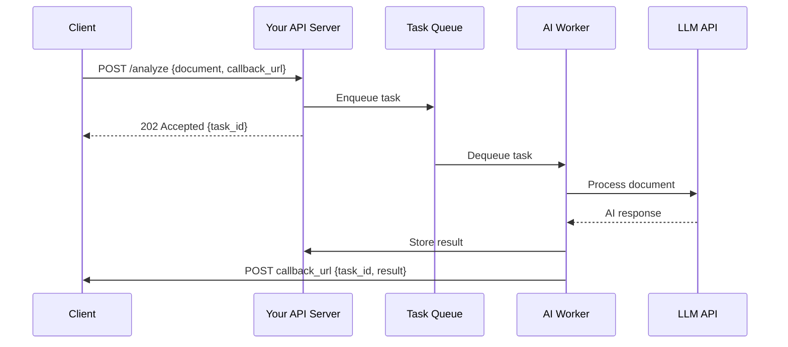
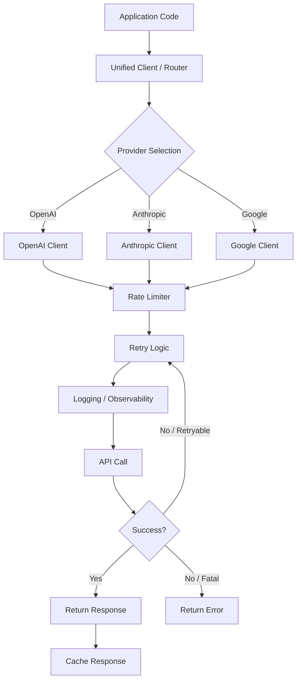
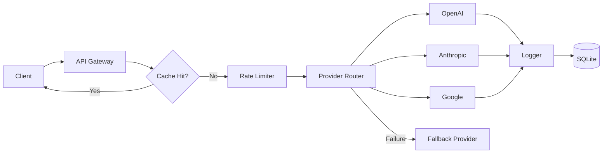

# Chapter 3: Working with LLM APIs

## Learning Objectives

By the end of this chapter, you will:

- [ ] Make API calls to OpenAI, Anthropic, and Google using their official SDKs
- [ ] Implement streaming responses for real-time user experiences
- [ ] Handle authentication, rate limits, and errors gracefully
- [ ] Build retry logic with exponential backoff
- [ ] Implement pagination for list-based API responses
- [ ] Set up webhooks for asynchronous processing
- [ ] Establish production-ready API patterns you'll reuse throughout the book

## Prerequisites

- Chapter 2: LLM Fundamentals (tokens, context windows, parameters)
- Familiarity with HTTP, REST APIs, and JSON
- Python 3.11+ installed
- At least one API key (OpenAI recommended for starting)

## Estimated Time

- Reading: 60 minutes
- Exercises: 60 minutes
- Project: 3 hours

---

## The Developer's API Landscape

You already know how to call APIs. You've integrated Stripe, Twilio, AWS, and dozens of others. LLM APIs are no different structurally — they're HTTP endpoints that accept JSON and return JSON.

What's different:
- **Responses are non-deterministic.** The same request can return different outputs.
- **Latency is high.** 2–30 seconds per call (vs. milliseconds for most APIs).
- **Costs scale with usage volume AND request size.** A single large request can cost more than 100 small ones.
- **Streaming is the norm** for user-facing applications.
- **Rate limits are aggressive** compared to most SaaS APIs.

This chapter establishes the patterns you'll use for every project in this book.

---

## Environment Setup

Before making any API calls, set up a clean project environment.

### Project Structure

```
llm-api-foundations/
├── .env.example
├── .env                  # Your actual keys (never commit)
├── .gitignore
├── requirements.txt
├── src/
│   ├── __init__.py
│   ├── openai_client.py
│   ├── anthropic_client.py
│   ├── google_client.py
│   ├── unified_client.py  # Provider-agnostic wrapper
│   └── utils/
│       ├── __init__.py
│       ├── retry.py
│       └── logging.py
└── examples/
    ├── basic_completion.py
    ├── streaming.py
    ├── function_calling.py
    └── multi_provider.py
```

### Dependencies

```txt
# requirements.txt
openai==1.52.0
anthropic==0.39.0
google-generativeai==0.8.3
python-dotenv==1.0.1
httpx==0.27.2
tenacity==9.0.0
pydantic==2.9.2
```

### Environment Variables

```bash
# .env.example
OPENAI_API_KEY=sk-your-key-here
ANTHROPIC_API_KEY=sk-ant-your-key-here
GOOGLE_API_KEY=your-google-ai-key-here
```

```python
# Load environment at the top of every script
import os
from dotenv import load_dotenv

load_dotenv()

# Validate keys exist before proceeding
def get_api_key(provider: str) -> str:
    """Get API key with clear error message if missing."""
    key_map = {
        "openai": "OPENAI_API_KEY",
        "anthropic": "ANTHROPIC_API_KEY",
        "google": "GOOGLE_API_KEY",
    }
    env_var = key_map.get(provider)
    if not env_var:
        raise ValueError(f"Unknown provider: {provider}")
    
    key = os.getenv(env_var)
    if not key:
        raise EnvironmentError(
            f"{env_var} not found. Add it to your .env file."
        )
    return key
```

> ⚠️ **Common Mistake**
>
> Never commit API keys to version control. Add `.env` to `.gitignore` immediately. Use `.env.example` with placeholder values to document required variables for collaborators.

---

## OpenAI API: The Foundation

OpenAI's API is the most widely used and best-documented. We'll start here, then show equivalent patterns for other providers.

### Your First API Call

```python
from openai import OpenAI

client = OpenAI()  # Reads OPENAI_API_KEY from environment automatically

response = client.chat.completions.create(
    model="gpt-4o-mini",
    messages=[
        {"role": "system", "content": "You are a helpful assistant."},
        {"role": "user", "content": "Explain recursion in one sentence."}
    ],
    temperature=0.0,
    max_tokens=100
)

# Access the response
print(response.choices[0].message.content)
# "Recursion is a technique where a function calls itself to solve
#  a problem by breaking it into smaller instances of the same problem."

# Access metadata
print(f"Model: {response.model}")
print(f"Input tokens: {response.usage.prompt_tokens}")
print(f"Output tokens: {response.usage.completion_tokens}")
print(f"Total tokens: {response.usage.total_tokens}")
```

### Understanding the Response Object

```python
# The full response structure
{
    "id": "chatcmpl-abc123",
    "object": "chat.completion",
    "created": 1719000000,
    "model": "gpt-4o-mini-2024-07-18",
    "choices": [
        {
            "index": 0,
            "message": {
                "role": "assistant",
                "content": "Recursion is..."
            },
            "finish_reason": "stop"  # or "length", "tool_calls"
        }
    ],
    "usage": {
        "prompt_tokens": 25,
        "completion_tokens": 32,
        "total_tokens": 57
    }
}
```

Key fields to check:
- `finish_reason`: `"stop"` means natural completion. `"length"` means you hit `max_tokens` — the response was truncated.
- `usage`: Always log this for cost tracking.

### Conversation Management

LLMs are stateless. They don't remember previous requests. You maintain conversation state by sending the full message history with each request.

```python
class Conversation:
    """Manages a stateful conversation with an LLM."""
    
    def __init__(
        self,
        model: str = "gpt-4o-mini",
        system_prompt: str = "You are a helpful assistant.",
        max_history: int = 20
    ):
        self.client = OpenAI()
        self.model = model
        self.max_history = max_history
        self.messages: list[dict] = [
            {"role": "system", "content": system_prompt}
        ]
    
    def send(self, user_message: str) -> str:
        """Send a message and get a response."""
        self.messages.append({"role": "user", "content": user_message})
        
        # Trim history if too long (keep system prompt + recent messages)
        if len(self.messages) > self.max_history + 1:
            self.messages = [self.messages[0]] + self.messages[-(self.max_history):]
        
        response = self.client.chat.completions.create(
            model=self.model,
            messages=self.messages,
            temperature=0.7,
            max_tokens=500
        )
        
        assistant_message = response.choices[0].message.content
        self.messages.append({"role": "assistant", "content": assistant_message})
        
        return assistant_message

# Usage
chat = Conversation(system_prompt="You are a Python tutor. Be concise.")
print(chat.send("What's a list comprehension?"))
print(chat.send("Show me a more complex example."))  # Model has context from first exchange
```

> 💡 **Developer Insight**
>
> Every message in the history costs input tokens on every subsequent request. A 20-message conversation with 100 tokens per message means you're sending 2,000 tokens of history with each new question. This is why context window management (covered in Chapter 2) matters in practice, not just theory.

---

## Streaming: Real-Time Responses

For user-facing applications, streaming is non-negotiable. Without it, users stare at a blank screen for 5–15 seconds. With streaming, they see tokens appearing within 500ms.

### Basic Streaming

```python
from openai import OpenAI

client = OpenAI()

stream = client.chat.completions.create(
    model="gpt-4o-mini",
    messages=[{"role": "user", "content": "Write a haiku about programming."}],
    stream=True
)

# Each chunk contains one or a few tokens
for chunk in stream:
    if chunk.choices[0].delta.content is not None:
        print(chunk.choices[0].delta.content, end="", flush=True)

print()  # Newline after streaming completes
```

### Production Streaming with Token Tracking

```python
from dataclasses import dataclass, field


@dataclass
class StreamResult:
    """Captures both the content and metadata from a streamed response."""
    content: str = ""
    finish_reason: str | None = None
    model: str = ""
    chunks_received: int = 0


def stream_completion(
    messages: list[dict],
    model: str = "gpt-4o-mini",
    on_token: callable = None,
    **kwargs
) -> StreamResult:
    """Stream a completion with callbacks and metadata tracking.
    
    Args:
        messages: Conversation messages.
        model: Model identifier.
        on_token: Callback function called with each token string.
        **kwargs: Additional parameters passed to the API.
    
    Returns:
        StreamResult with full content and metadata.
    """
    client = OpenAI()
    result = StreamResult()
    
    stream = client.chat.completions.create(
        model=model,
        messages=messages,
        stream=True,
        stream_options={"include_usage": True},  # Get token counts with streaming
        **kwargs
    )
    
    for chunk in stream:
        result.chunks_received += 1
        
        if chunk.model:
            result.model = chunk.model
        
        if chunk.choices and chunk.choices[0].delta.content:
            token = chunk.choices[0].delta.content
            result.content += token
            if on_token:
                on_token(token)
        
        if chunk.choices and chunk.choices[0].finish_reason:
            result.finish_reason = chunk.choices[0].finish_reason
    
    return result


# Usage with a callback
def print_token(token: str):
    print(token, end="", flush=True)

result = stream_completion(
    messages=[{"role": "user", "content": "Explain Docker in 3 sentences."}],
    on_token=print_token,
    temperature=0.0,
    max_tokens=200
)

print(f"\n\nFinish reason: {result.finish_reason}")
print(f"Chunks received: {result.chunks_received}")
```

### Async Streaming (For Web Servers)

When building a web server (FastAPI, Flask), you'll use async streaming to avoid blocking the event loop:

```python
from openai import AsyncOpenAI
import asyncio

async_client = AsyncOpenAI()


async def stream_response(messages: list[dict]):
    """Async generator for streaming responses — suitable for web frameworks."""
    stream = await async_client.chat.completions.create(
        model="gpt-4o-mini",
        messages=messages,
        stream=True
    )
    
    async for chunk in stream:
        if chunk.choices[0].delta.content:
            yield chunk.choices[0].delta.content


# FastAPI Server-Sent Events example
# from fastapi import FastAPI
# from fastapi.responses import StreamingResponse
#
# @app.post("/chat")
# async def chat(request: ChatRequest):
#     return StreamingResponse(
#         stream_response(request.messages),
#         media_type="text/event-stream"
#     )
```

> 🏢 **Industry Note**
>
> Server-Sent Events (SSE) is the standard transport for LLM streaming in web applications. The client opens an HTTP connection, and the server pushes tokens as they're generated. Every major provider uses this pattern. WebSockets are overkill for most LLM streaming use cases since communication is unidirectional (server to client).

---

## Anthropic API: Claude

Anthropic's API is similar in concept but different in structure. Claude excels at following complex instructions and handling long contexts.

### Basic Claude Call

```python
from anthropic import Anthropic

client = Anthropic()  # Reads ANTHROPIC_API_KEY from environment

response = client.messages.create(
    model="claude-sonnet-4-20250514",
    max_tokens=200,
    system="You are a senior software architect. Be concise and specific.",
    messages=[
        {"role": "user", "content": "When should I use microservices vs monolith?"}
    ]
)

print(response.content[0].text)
print(f"Input tokens: {response.usage.input_tokens}")
print(f"Output tokens: {response.usage.output_tokens}")
print(f"Stop reason: {response.stop_reason}")
```

### Key Differences from OpenAI

| Feature | OpenAI | Anthropic |
|---------|--------|-----------|
| System prompt | Inside `messages` array | Separate `system` parameter |
| Response content | `choices[0].message.content` (string) | `content[0].text` (content blocks) |
| Finish indicator | `finish_reason` | `stop_reason` |
| Token tracking | `usage.prompt_tokens` | `usage.input_tokens` |
| Max tokens | Optional (but recommended) | **Required** |
| Streaming | `stream=True` | `stream=True` or `client.messages.stream()` |

### Claude Streaming

```python
from anthropic import Anthropic

client = Anthropic()

# Context manager approach (recommended)
with client.messages.stream(
    model="claude-sonnet-4-20250514",
    max_tokens=300,
    messages=[{"role": "user", "content": "Explain event sourcing briefly."}]
) as stream:
    for text in stream.text_stream:
        print(text, end="", flush=True)

# Get the final message with usage stats
final_message = stream.get_final_message()
print(f"\nTokens used: {final_message.usage.input_tokens} in / {final_message.usage.output_tokens} out")
```

### Claude's Extended Thinking

For complex reasoning tasks, Claude can show its work:

```python
response = client.messages.create(
    model="claude-sonnet-4-20250514",
    max_tokens=8000,
    thinking={
        "type": "enabled",
        "budget_tokens": 5000  # Allow up to 5000 tokens for thinking
    },
    messages=[
        {"role": "user", "content": "Design a database schema for a multi-tenant SaaS."}
    ]
)

# Response contains thinking blocks + text blocks
for block in response.content:
    if block.type == "thinking":
        print(f"[Thinking]: {block.thinking[:200]}...")
    elif block.type == "text":
        print(f"[Answer]: {block.text}")
```

---

## Google Gemini API

Google's Gemini models offer the largest context windows and strong multimodal capabilities.

### Basic Gemini Call

```python
import google.generativeai as genai

genai.configure(api_key=os.getenv("GOOGLE_API_KEY"))

model = genai.GenerativeModel("gemini-2.0-flash")

response = model.generate_content("Explain CQRS in two paragraphs.")

print(response.text)
print(f"Token count: {response.usage_metadata.total_token_count}")
```

### Gemini with System Instructions

```python
model = genai.GenerativeModel(
    model_name="gemini-2.0-flash",
    system_instruction="You are a database expert. Respond with SQL examples when relevant.",
    generation_config=genai.GenerationConfig(
        temperature=0.0,
        max_output_tokens=500,
    )
)

chat = model.start_chat()
response = chat.send_message("How do I handle soft deletes?")
print(response.text)

# Conversation continues with context
response = chat.send_message("Show me the index strategy for that approach.")
print(response.text)
```

### Gemini Streaming

```python
model = genai.GenerativeModel("gemini-2.0-flash")

response = model.generate_content(
    "Explain the CAP theorem.",
    stream=True
)

for chunk in response:
    print(chunk.text, end="", flush=True)
```

> 💡 **Developer Insight**
>
> Gemini's 2M token context window makes it uniquely suited for analyzing entire codebases, long documents, or large datasets in a single request. For most tasks, GPT-4o-mini or Claude Haiku are cheaper and faster. Reserve Gemini's large context for problems that genuinely need it.

---

## Building a Provider-Agnostic Client

In production, you don't want your application code littered with provider-specific logic. Build an abstraction layer.

### The Unified Interface

```python
from abc import ABC, abstractmethod
from dataclasses import dataclass
from enum import Enum


class Provider(Enum):
    OPENAI = "openai"
    ANTHROPIC = "anthropic"
    GOOGLE = "google"


@dataclass
class LLMResponse:
    """Provider-agnostic response container."""
    content: str
    model: str
    input_tokens: int
    output_tokens: int
    finish_reason: str
    provider: Provider
    latency_ms: float = 0.0

    @property
    def total_tokens(self) -> int:
        return self.input_tokens + self.output_tokens


@dataclass
class Message:
    role: str  # "system", "user", "assistant"
    content: str


class LLMClient(ABC):
    """Abstract base for LLM provider clients."""
    
    @abstractmethod
    def complete(
        self,
        messages: list[Message],
        model: str,
        temperature: float = 0.0,
        max_tokens: int = 1000,
    ) -> LLMResponse:
        pass
    
    @abstractmethod
    async def stream(
        self,
        messages: list[Message],
        model: str,
        temperature: float = 0.0,
        max_tokens: int = 1000,
    ):
        """Async generator yielding token strings."""
        pass
```

### OpenAI Implementation

```python
import time
from openai import OpenAI


class OpenAIClient(LLMClient):
    def __init__(self):
        self.client = OpenAI()
        self.provider = Provider.OPENAI
    
    def complete(
        self,
        messages: list[Message],
        model: str = "gpt-4o-mini",
        temperature: float = 0.0,
        max_tokens: int = 1000,
    ) -> LLMResponse:
        start = time.perf_counter()
        
        api_messages = [{"role": m.role, "content": m.content} for m in messages]
        
        response = self.client.chat.completions.create(
            model=model,
            messages=api_messages,
            temperature=temperature,
            max_tokens=max_tokens,
        )
        
        elapsed = (time.perf_counter() - start) * 1000
        
        return LLMResponse(
            content=response.choices[0].message.content,
            model=response.model,
            input_tokens=response.usage.prompt_tokens,
            output_tokens=response.usage.completion_tokens,
            finish_reason=response.choices[0].finish_reason,
            provider=self.provider,
            latency_ms=elapsed,
        )
```

### Anthropic Implementation

```python
from anthropic import Anthropic


class AnthropicClient(LLMClient):
    def __init__(self):
        self.client = Anthropic()
        self.provider = Provider.ANTHROPIC
    
    def complete(
        self,
        messages: list[Message],
        model: str = "claude-sonnet-4-20250514",
        temperature: float = 0.0,
        max_tokens: int = 1000,
    ) -> LLMResponse:
        start = time.perf_counter()
        
        # Separate system message from conversation
        system_content = ""
        api_messages = []
        for m in messages:
            if m.role == "system":
                system_content = m.content
            else:
                api_messages.append({"role": m.role, "content": m.content})
        
        response = self.client.messages.create(
            model=model,
            system=system_content,
            messages=api_messages,
            temperature=temperature,
            max_tokens=max_tokens,
        )
        
        elapsed = (time.perf_counter() - start) * 1000
        
        return LLMResponse(
            content=response.content[0].text,
            model=response.model,
            input_tokens=response.usage.input_tokens,
            output_tokens=response.usage.output_tokens,
            finish_reason=response.stop_reason,
            provider=self.provider,
            latency_ms=elapsed,
        )
```

### The Router

```python
class LLMRouter:
    """Routes requests to the appropriate provider based on model name."""
    
    PROVIDER_MAP = {
        "gpt-4o": Provider.OPENAI,
        "gpt-4o-mini": Provider.OPENAI,
        "o3-mini": Provider.OPENAI,
        "claude-sonnet-4-20250514": Provider.ANTHROPIC,
        "claude-3-5-haiku-20241022": Provider.ANTHROPIC,
        "gemini-2.0-flash": Provider.GOOGLE,
        "gemini-2.0-pro": Provider.GOOGLE,
    }
    
    def __init__(self):
        self.clients = {
            Provider.OPENAI: OpenAIClient(),
            Provider.ANTHROPIC: AnthropicClient(),
            # Provider.GOOGLE: GoogleClient(),  # Implement similarly
        }
    
    def complete(self, messages: list[Message], model: str, **kwargs) -> LLMResponse:
        """Route to the correct provider based on model name."""
        provider = self.PROVIDER_MAP.get(model)
        if not provider:
            raise ValueError(f"Unknown model: {model}. Known models: {list(self.PROVIDER_MAP.keys())}")
        
        client = self.clients[provider]
        return client.complete(messages, model=model, **kwargs)


# Usage — provider-agnostic code
router = LLMRouter()

response = router.complete(
    messages=[
        Message(role="system", content="Be concise."),
        Message(role="user", content="What is Docker?")
    ],
    model="gpt-4o-mini"  # Swap to "claude-sonnet-4-20250514" with no other code changes
)

print(f"[{response.provider.value}] {response.content}")
print(f"Tokens: {response.total_tokens} | Latency: {response.latency_ms:.0f}ms")
```

> 📐 **Architecture Decision**
>
> This abstraction layer pays for itself immediately. When you need to swap providers (downtime, cost changes, quality issues), you change one config value instead of refactoring your entire application. Build this on day one of any serious project.

---

## Error Handling and Retries

LLM APIs fail. Rate limits hit. Networks glitch. Servers have bad days. Robust error handling is mandatory.

### Common Error Types

| Error | HTTP Code | Cause | Action |
|-------|-----------|-------|--------|
| Rate limit | 429 | Too many requests | Retry with backoff |
| Server error | 500, 502, 503 | Provider issues | Retry with backoff |
| Context length exceeded | 400 | Input too long | Truncate or chunk input |
| Invalid request | 400 | Bad parameters | Fix request (don't retry) |
| Authentication | 401 | Invalid API key | Fix key (don't retry) |
| Timeout | - | Slow response | Retry or use shorter max_tokens |
| Content filter | 400 | Content policy violation | Modify prompt |

### Retry with Exponential Backoff

```python
import time
import random
from functools import wraps
from openai import (
    RateLimitError,
    APITimeoutError,
    InternalServerError,
    APIConnectionError,
)


def retry_with_backoff(
    max_retries: int = 3,
    base_delay: float = 1.0,
    max_delay: float = 60.0,
    retryable_exceptions: tuple = (
        RateLimitError,
        APITimeoutError,
        InternalServerError,
        APIConnectionError,
    )
):
    """Decorator for retry logic with exponential backoff and jitter."""
    
    def decorator(func):
        @wraps(func)
        def wrapper(*args, **kwargs):
            last_exception = None
            
            for attempt in range(max_retries + 1):
                try:
                    return func(*args, **kwargs)
                except retryable_exceptions as e:
                    last_exception = e
                    
                    if attempt == max_retries:
                        break
                    
                    # Exponential backoff with jitter
                    delay = min(base_delay * (2 ** attempt), max_delay)
                    jitter = random.uniform(0, delay * 0.1)
                    wait_time = delay + jitter
                    
                    print(f"Attempt {attempt + 1} failed: {e}. "
                          f"Retrying in {wait_time:.1f}s...")
                    time.sleep(wait_time)
            
            raise last_exception
        
        return wrapper
    return decorator


# Usage
@retry_with_backoff(max_retries=3, base_delay=1.0)
def get_completion(messages: list[dict], model: str = "gpt-4o-mini") -> str:
    """Get a completion with automatic retry on transient failures."""
    client = OpenAI()
    response = client.chat.completions.create(
        model=model,
        messages=messages,
        temperature=0.0,
        max_tokens=500
    )
    return response.choices[0].message.content
```

### Using Tenacity (Production-Grade Retries)

For production code, the `tenacity` library provides more sophisticated retry logic:

```python
from tenacity import (
    retry,
    stop_after_attempt,
    wait_exponential,
    retry_if_exception_type,
    before_sleep_log,
)
import logging

logger = logging.getLogger(__name__)


@retry(
    stop=stop_after_attempt(4),
    wait=wait_exponential(multiplier=1, min=1, max=60),
    retry=retry_if_exception_type((RateLimitError, APITimeoutError, InternalServerError)),
    before_sleep=before_sleep_log(logger, logging.WARNING),
    reraise=True
)
def reliable_completion(messages: list[dict], **kwargs) -> str:
    """Production-grade completion with retry and logging."""
    client = OpenAI()
    response = client.chat.completions.create(
        model=kwargs.get("model", "gpt-4o-mini"),
        messages=messages,
        temperature=kwargs.get("temperature", 0.0),
        max_tokens=kwargs.get("max_tokens", 1000),
    )
    return response.choices[0].message.content
```

### Handling Rate Limits Proactively

```python
import time
from dataclasses import dataclass


@dataclass
class RateLimiter:
    """Simple token bucket rate limiter for API calls."""
    
    max_requests_per_minute: int = 60
    max_tokens_per_minute: int = 90_000
    _request_timestamps: list = None
    _token_counts: list = None
    
    def __post_init__(self):
        self._request_timestamps = []
        self._token_counts = []
    
    def wait_if_needed(self, estimated_tokens: int = 1000):
        """Block until we're within rate limits."""
        now = time.time()
        one_minute_ago = now - 60
        
        # Clean old entries
        self._request_timestamps = [
            t for t in self._request_timestamps if t > one_minute_ago
        ]
        self._token_counts = [
            (t, c) for t, c in self._token_counts if t > one_minute_ago
        ]
        
        # Check request limit
        if len(self._request_timestamps) >= self.max_requests_per_minute:
            wait_time = self._request_timestamps[0] - one_minute_ago
            time.sleep(wait_time + 0.1)
        
        # Check token limit
        total_tokens = sum(c for _, c in self._token_counts)
        if total_tokens + estimated_tokens > self.max_tokens_per_minute:
            wait_time = self._token_counts[0][0] - one_minute_ago
            time.sleep(wait_time + 0.1)
        
        # Record this request
        self._request_timestamps.append(time.time())
        self._token_counts.append((time.time(), estimated_tokens))


# Usage
rate_limiter = RateLimiter(max_requests_per_minute=50, max_tokens_per_minute=80_000)

def rate_limited_completion(messages: list[dict], **kwargs) -> str:
    """Completion that respects rate limits."""
    rate_limiter.wait_if_needed(estimated_tokens=kwargs.get("max_tokens", 1000))
    return reliable_completion(messages, **kwargs)
```

> ⚠️ **Common Mistake**
>
> Don't retry on 400 errors (bad request, context too long, invalid parameters). These won't succeed on retry — you need to fix the request itself. Only retry on transient errors: 429 (rate limit), 500/502/503 (server issues), and timeouts.

---

## Authentication Patterns

### API Key Management

```python
import os
from dataclasses import dataclass


@dataclass
class APIKeyManager:
    """Manages API keys with rotation support."""
    
    def __init__(self):
        self.keys = {
            "openai": self._load_keys("OPENAI_API_KEY"),
            "anthropic": self._load_keys("ANTHROPIC_API_KEY"),
        }
        self._current_index = {"openai": 0, "anthropic": 0}
    
    def _load_keys(self, prefix: str) -> list[str]:
        """Load keys from environment. Supports KEY, KEY_2, KEY_3 pattern."""
        keys = []
        primary = os.getenv(prefix)
        if primary:
            keys.append(primary)
        
        # Load additional keys for rotation
        for i in range(2, 10):
            key = os.getenv(f"{prefix}_{i}")
            if key:
                keys.append(key)
            else:
                break
        
        return keys
    
    def get_key(self, provider: str) -> str:
        """Get the current key for a provider."""
        keys = self.keys.get(provider, [])
        if not keys:
            raise ValueError(f"No API keys configured for {provider}")
        
        index = self._current_index.get(provider, 0)
        return keys[index]
    
    def rotate_key(self, provider: str):
        """Rotate to the next key (useful after rate limit)."""
        keys = self.keys.get(provider, [])
        if len(keys) > 1:
            current = self._current_index.get(provider, 0)
            self._current_index[provider] = (current + 1) % len(keys)
```

> 💰 **Cost Note**
>
> Key rotation is useful when you have multiple API keys with separate rate limits (e.g., multiple OpenAI organization accounts). Each key has its own rate limit bucket, so rotating between them effectively multiplies your throughput.

---

## Webhooks and Async Processing

For long-running AI tasks (document processing, batch analysis), synchronous requests don't scale. Use a webhook pattern instead.



*Figure 6: Webhook pattern for async AI processing*

### Implementation Pattern

```python
from fastapi import FastAPI, BackgroundTasks
from pydantic import BaseModel, HttpUrl
import httpx
import uuid

app = FastAPI()


class AnalyzeRequest(BaseModel):
    document: str
    callback_url: HttpUrl
    model: str = "gpt-4o-mini"


class TaskResponse(BaseModel):
    task_id: str
    status: str


# In-memory store (use Redis/DB in production)
tasks: dict = {}


@app.post("/analyze", response_model=TaskResponse, status_code=202)
async def submit_analysis(request: AnalyzeRequest, background_tasks: BackgroundTasks):
    """Submit a document for async AI analysis."""
    task_id = str(uuid.uuid4())
    tasks[task_id] = {"status": "queued", "result": None}
    
    background_tasks.add_task(
        process_document, task_id, request.document, 
        request.model, str(request.callback_url)
    )
    
    return TaskResponse(task_id=task_id, status="queued")


async def process_document(
    task_id: str, document: str, model: str, callback_url: str
):
    """Background worker that processes the document and sends webhook."""
    tasks[task_id]["status"] = "processing"
    
    try:
        # Call LLM
        client = OpenAI()
        response = client.chat.completions.create(
            model=model,
            messages=[
                {"role": "system", "content": "Analyze this document and extract key insights."},
                {"role": "user", "content": document}
            ],
            temperature=0.0,
            max_tokens=2000
        )
        
        result = {
            "task_id": task_id,
            "status": "completed",
            "analysis": response.choices[0].message.content,
            "tokens_used": response.usage.total_tokens,
        }
        tasks[task_id] = result
        
        # Send webhook callback
        async with httpx.AsyncClient() as http_client:
            await http_client.post(callback_url, json=result, timeout=10.0)
    
    except Exception as e:
        tasks[task_id] = {"status": "failed", "error": str(e)}
        async with httpx.AsyncClient() as http_client:
            await http_client.post(
                callback_url, 
                json={"task_id": task_id, "status": "failed", "error": str(e)},
                timeout=10.0
            )


@app.get("/tasks/{task_id}")
async def get_task_status(task_id: str):
    """Poll endpoint for clients that don't support webhooks."""
    task = tasks.get(task_id)
    if not task:
        return {"error": "Task not found"}, 404
    return task
```

---

## SDKs vs. Raw HTTP

You have two choices for calling LLM APIs: use the official SDK or make raw HTTP requests.

### When to Use SDKs (Almost Always)

- Type safety and auto-completion
- Automatic retry handling (some SDKs)
- Streaming helpers
- Request/response validation
- Keeps up with API changes

### When to Use Raw HTTP

- Your language doesn't have an official SDK
- You need precise control over the HTTP layer
- You're building your own SDK/wrapper
- Testing or debugging at the network level

### Raw HTTP Example (for understanding)

```python
import httpx

async def raw_openai_call(messages: list[dict], model: str = "gpt-4o-mini") -> dict:
    """Direct HTTP call to OpenAI — shows what the SDK does underneath."""
    async with httpx.AsyncClient() as client:
        response = await client.post(
            "https://api.openai.com/v1/chat/completions",
            headers={
                "Authorization": f"Bearer {os.getenv('OPENAI_API_KEY')}",
                "Content-Type": "application/json",
            },
            json={
                "model": model,
                "messages": messages,
                "temperature": 0.0,
                "max_tokens": 500,
            },
            timeout=30.0,
        )
        
        response.raise_for_status()
        return response.json()
```

> 💡 **Developer Insight**
>
> Use the SDK. The raw HTTP example above is for understanding what's happening under the hood, not for production use. SDKs handle edge cases (retry headers, streaming parsing, error types) that you don't want to reimplement.

---

## Logging and Observability

Every LLM call should be logged. This data is critical for debugging, cost tracking, and quality evaluation.

### What to Log

| Field | Why |
|-------|-----|
| Timestamp | Debugging timeline |
| Model | Cost calculation, quality correlation |
| Input tokens | Cost tracking |
| Output tokens | Cost tracking |
| Latency (ms) | Performance monitoring |
| Temperature | Reproducibility |
| Finish reason | Detect truncation issues |
| Prompt hash | Group identical prompts for analysis |
| User/session ID | Per-user usage tracking |
| Success/failure | Error rate monitoring |
| Error type | Identify systematic issues |

### Logging Implementation

```python
import json
import time
import hashlib
import logging
from dataclasses import dataclass, asdict
from datetime import datetime, timezone

logger = logging.getLogger("llm_calls")


@dataclass
class LLMCallLog:
    timestamp: str
    model: str
    input_tokens: int
    output_tokens: int
    latency_ms: float
    temperature: float
    finish_reason: str
    prompt_hash: str
    success: bool
    error: str | None = None
    session_id: str | None = None
    
    def to_json(self) -> str:
        return json.dumps(asdict(self))


def log_llm_call(func):
    """Decorator that logs every LLM call with full metadata."""
    
    @wraps(func)
    def wrapper(*args, **kwargs):
        start = time.perf_counter()
        log_entry = LLMCallLog(
            timestamp=datetime.now(timezone.utc).isoformat(),
            model=kwargs.get("model", "unknown"),
            input_tokens=0,
            output_tokens=0,
            latency_ms=0,
            temperature=kwargs.get("temperature", 0.0),
            finish_reason="",
            prompt_hash=hashlib.md5(
                json.dumps(kwargs.get("messages", [])).encode()
            ).hexdigest()[:8],
            success=True,
            session_id=kwargs.pop("session_id", None),
        )
        
        try:
            result = func(*args, **kwargs)
            elapsed = (time.perf_counter() - start) * 1000
            
            log_entry.latency_ms = elapsed
            log_entry.input_tokens = result.usage.prompt_tokens
            log_entry.output_tokens = result.usage.completion_tokens
            log_entry.finish_reason = result.choices[0].finish_reason
            
            logger.info(log_entry.to_json())
            return result
            
        except Exception as e:
            elapsed = (time.perf_counter() - start) * 1000
            log_entry.latency_ms = elapsed
            log_entry.success = False
            log_entry.error = f"{type(e).__name__}: {str(e)}"
            
            logger.error(log_entry.to_json())
            raise
    
    return wrapper
```

---

## Production Patterns Summary

Here's the complete production-ready pattern that combines everything in this chapter:



*Figure 7: Production LLM API call pipeline*

---

## Caching Strategies

LLM calls are expensive and slow. Caching identical (or similar) requests saves both money and latency.

### Exact-Match Caching

The simplest approach: cache responses for identical inputs.

```python
import hashlib
import json
from functools import lru_cache


def make_cache_key(messages: list[dict], model: str, temperature: float) -> str:
    """Create a deterministic cache key from request parameters."""
    payload = json.dumps({
        "messages": messages,
        "model": model,
        "temperature": temperature,
    }, sort_keys=True)
    return hashlib.sha256(payload.encode()).hexdigest()


class LLMCache:
    """Simple in-memory LLM response cache."""
    
    def __init__(self, max_size: int = 1000):
        self._cache: dict[str, str] = {}
        self._max_size = max_size
    
    def get(self, messages: list[dict], model: str, temperature: float) -> str | None:
        """Return cached response or None."""
        # Only cache deterministic requests
        if temperature > 0:
            return None
        
        key = make_cache_key(messages, model, temperature)
        return self._cache.get(key)
    
    def set(self, messages: list[dict], model: str, temperature: float, response: str):
        """Cache a response."""
        if temperature > 0:
            return  # Don't cache non-deterministic responses
        
        if len(self._cache) >= self._max_size:
            # Simple eviction: remove oldest entry
            oldest_key = next(iter(self._cache))
            del self._cache[oldest_key]
        
        key = make_cache_key(messages, model, temperature)
        self._cache[key] = response


# Integration with the completion function
cache = LLMCache()

def cached_completion(messages: list[dict], model: str = "gpt-4o-mini", **kwargs) -> str:
    """Completion with caching for deterministic requests."""
    temperature = kwargs.get("temperature", 0.0)
    
    # Check cache
    cached = cache.get(messages, model, temperature)
    if cached:
        return cached
    
    # Make API call
    response = reliable_completion(messages, model=model, **kwargs)
    
    # Cache result
    cache.set(messages, model, temperature, response)
    
    return response
```

### Provider-Native Caching

Anthropic offers **prompt caching** that caches the processed input on their servers:

```python
from anthropic import Anthropic

client = Anthropic()

# First call: processes and caches the system prompt
response = client.messages.create(
    model="claude-sonnet-4-20250514",
    max_tokens=500,
    system=[
        {
            "type": "text",
            "text": "Very long system prompt with documentation...",  # 5000+ tokens
            "cache_control": {"type": "ephemeral"}  # Cache this block
        }
    ],
    messages=[{"role": "user", "content": "Question about the documentation."}]
)

# Subsequent calls with the same system prompt: 90% cheaper on cached tokens
# The cache lasts 5 minutes (ephemeral)
```

> 💰 **Cost Note**
>
> Anthropic's prompt caching charges 25% extra to write to cache but gives 90% discount on cache hits. For applications with a long, stable system prompt used across many requests, this can reduce costs dramatically. The cache is per-model and lasts 5 minutes.

---

## Production Notes

- **Always set timeouts.** LLM APIs can hang. Set connection timeout (10s) and read timeout (60–120s depending on max_tokens).
- **Monitor finish_reason.** If you see frequent `"length"` finishes, your max_tokens is too low and responses are being truncated.
- **Use async for web servers.** Synchronous LLM calls block threads. In async frameworks (FastAPI, aiohttp), always use the async client.
- **Separate API keys per environment.** Use different keys for dev, staging, production. Makes cost attribution and rate limit management easier.
- **Implement circuit breakers.** If a provider fails 5 times in a row, stop trying for 30 seconds. Prevents cascading failures and wasted rate limit budget.
- **Version your prompts externally.** Don't embed prompts in application code. Load them from config files, a database, or a prompt management service. This allows A/B testing and rollbacks.

## Common Mistakes

1. **Not handling streaming errors.** A stream can fail mid-response. Always handle partial responses gracefully — show what was received, inform the user of the interruption.

2. **Ignoring `finish_reason: "length"`.** This means the response was cut off. Either increase max_tokens or redesign the prompt to produce shorter responses.

3. **Hardcoding model names.** Models change, get deprecated, or have outages. Use configuration, not string literals scattered through your code.

4. **Synchronous calls in async code.** Calling the synchronous OpenAI client inside an `async` function blocks the event loop. Use `AsyncOpenAI` in async contexts.

5. **No timeout on API calls.** A hanging API call with no timeout will block your application indefinitely. Always set explicit timeouts.

6. **Retrying non-retryable errors.** A 400 (bad request) won't succeed on retry. Only retry on 429, 5xx, and connection timeouts.

## Best Practices

1. **Build a unified client from day one.** Even if you start with one provider, the abstraction costs nothing and saves massive refactoring later.

2. **Implement retry with exponential backoff** as a standard wrapper around all API calls.

3. **Log every call.** Token counts, latency, model, success/failure. You need this data for cost monitoring and debugging.

4. **Cache deterministic responses.** If temperature is 0 and the input is identical, the output should be too.

5. **Use streaming for user-facing applications.** The perceived latency improvement is dramatic.

6. **Set up cost alerts.** Most providers offer spending limits or alerts. Configure them before you accidentally spend $500 in a debugging session.

7. **Implement fallback providers.** If OpenAI is down, route to Anthropic (or vice versa). Downtime shouldn't mean your application is down.

8. **Use provider-specific features when they matter.** Anthropic's prompt caching, OpenAI's batch API, Gemini's large context — don't abstract away advantages.

---

## Hands-On Exercises

### Exercise 1: First API Calls Across Providers

**Difficulty:** ⭐
**Time:** 20 minutes

Set up API access for at least two providers (OpenAI + one of Anthropic/Google). Send the same prompt to both:

- Prompt: "Explain the difference between SQL JOIN types in under 100 words."
- Temperature: 0
- Compare: response quality, token counts, latency

Document the differences in a markdown file.

### Exercise 2: Streaming Implementation

**Difficulty:** ⭐⭐
**Time:** 25 minutes

Build a terminal-based chat interface that:
1. Accepts user input in a loop
2. Streams the response token-by-token to stdout
3. Tracks and displays token usage after each response
4. Supports `/quit` to exit and `/clear` to reset conversation

### Exercise 3: Retry Logic Testing

**Difficulty:** ⭐⭐
**Time:** 20 minutes

Write a test that verifies your retry logic:
1. Create a mock that fails with a 429 error the first 2 times, then succeeds
2. Verify the retry decorator calls the function 3 times
3. Verify the wait time between retries increases exponentially
4. Verify that a 400 error is NOT retried

### Exercise 4: Cost Tracker

**Difficulty:** ⭐⭐
**Time:** 30 minutes

Build a `CostTracker` class that:
1. Accepts token counts and model name per call
2. Calculates cost per call using a pricing table
3. Tracks cumulative daily/monthly spend
4. Raises a warning when approaching a configurable budget limit
5. Provides a summary report (total calls, total tokens, total cost, average cost per call)

---

## Mini Project

**Title:** Multi-Provider Chat CLI
**Difficulty:** ⭐⭐
**Time:** 2 hours
**What you'll build:** A command-line chat application that supports multiple LLM providers with streaming, retry logic, cost tracking, and conversation export.

### Requirements

1. Support at least 2 providers (OpenAI + Anthropic)
2. Commands:
   - `/model <name>` — switch model mid-conversation
   - `/cost` — show session cost summary
   - `/export` — save conversation to JSON
   - `/clear` — reset conversation
   - `/quit` — exit
3. Stream responses to terminal
4. Implement retry with backoff on all API calls
5. Track and display token usage per message
6. Handle errors gracefully (show user-friendly message, don't crash)

### Starter Architecture

```
multi-provider-chat/
├── src/
│   ├── main.py           # CLI loop
│   ├── providers/
│   │   ├── base.py       # Abstract provider
│   │   ├── openai.py     # OpenAI implementation
│   │   └── anthropic.py  # Anthropic implementation
│   ├── conversation.py   # Message history management
│   ├── cost_tracker.py   # Usage and cost tracking
│   └── config.py         # Model configs and pricing
├── .env.example
├── requirements.txt
└── README.md
```

---

## Challenge Project

**Title:** LLM API Gateway
**Difficulty:** ⭐⭐⭐
**Time:** 5 hours
**What you'll build:** A FastAPI service that acts as a gateway between your applications and LLM providers, adding caching, logging, rate limiting, and failover.

### Requirements

1. **Unified endpoint:** `POST /v1/completions` accepts a provider-agnostic request format
2. **Provider routing:** Route to OpenAI, Anthropic, or Google based on model name
3. **Caching:** Cache deterministic responses (temperature=0) with configurable TTL
4. **Rate limiting:** Per-client rate limits with token bucket algorithm
5. **Logging:** Log every request with full metadata (store in SQLite for the project)
6. **Failover:** If primary provider returns 5xx, automatically retry on fallback provider
7. **Cost dashboard:** `GET /dashboard` returns per-client cost summary
8. **Streaming support:** Pass through streaming responses
9. **Health check:** `GET /health` returns provider status

### Architecture Hint



---

## Portfolio Milestone

After this chapter, you should have:
- Working API integrations with at least 2 LLM providers
- A provider-agnostic client you'll reuse in all future projects
- Production-ready retry and error handling patterns
- A cost tracking utility
- A streaming implementation suitable for user-facing applications

---

## Chapter Summary

- LLM APIs are standard HTTP/JSON endpoints, but with unique characteristics: high latency, non-deterministic, cost-per-token, and streaming as the norm.
- OpenAI, Anthropic, and Google have similar concepts but different interfaces. Build a unified abstraction to avoid lock-in.
- Streaming is essential for user-facing applications. Use Server-Sent Events for web, async generators for servers.
- Retry with exponential backoff is mandatory. Only retry transient errors (429, 5xx, timeouts). Never retry 400s.
- Rate limits require proactive management. Implement client-side rate limiting and key rotation for high-throughput applications.
- Cache deterministic responses. Temperature=0 + same input = same output (effectively). Save money and latency.
- Log everything. Token counts, latency, model, errors. This data drives optimization and debugging.
- Webhooks/async processing for long-running tasks. Don't block HTTP requests waiting for LLM completions.

---

## Cheat Sheet

| Pattern | When to Use | Key Library |
|---------|-------------|-------------|
| Synchronous call | Simple scripts, backend processing | `openai`, `anthropic` |
| Streaming | User-facing responses | `stream=True` parameter |
| Async streaming | Web servers (FastAPI, etc.) | `AsyncOpenAI`, `async for` |
| Retry with backoff | All production API calls | `tenacity` |
| Rate limiting | High-throughput applications | Custom token bucket |
| Caching | Repeated identical requests | Redis or in-memory dict |
| Webhook/async | Long-running document processing | FastAPI + BackgroundTasks |
| Provider fallback | High availability requirements | Router with health checks |
| Prompt caching | Large stable system prompts (Anthropic) | `cache_control` parameter |

| Provider | SDK | Install |
|----------|-----|---------|
| OpenAI | `openai` | `pip install openai` |
| Anthropic | `anthropic` | `pip install anthropic` |
| Google | `google-generativeai` | `pip install google-generativeai` |

---

## Glossary

| Term | Definition |
|------|-----------|
| SDK | Software Development Kit. A library that wraps API calls with language-native interfaces. |
| Streaming | Receiving response tokens incrementally as they're generated, rather than waiting for completion. |
| SSE | Server-Sent Events. The HTTP-based protocol used for streaming LLM responses to web clients. |
| Rate limit | Provider-imposed ceiling on requests or tokens per time period. Exceeding triggers 429 errors. |
| Exponential backoff | Retry strategy where wait time doubles between attempts (1s, 2s, 4s, 8s...). |
| Jitter | Random variation added to backoff timing to prevent thundering herd when multiple clients retry simultaneously. |
| Circuit breaker | Pattern that stops calling a failing service temporarily, allowing it to recover. |
| Token bucket | Rate limiting algorithm that allows bursts up to a capacity, then refills at a steady rate. |
| Webhook | A callback URL that receives HTTP POST notifications when an async task completes. |
| Prompt caching | Provider feature (Anthropic) that caches processed input tokens server-side for reuse across requests. |
| Finish reason | API field indicating why generation stopped: `stop` (natural), `length` (truncated), `tool_calls` (function requested). |

---

## References

- [OpenAI API Reference](https://platform.openai.com/docs/api-reference/chat/create) — Complete Chat Completions endpoint documentation.
- [Anthropic API Reference](https://docs.anthropic.com/en/api/messages) — Messages API documentation.
- [Google Gemini API](https://ai.google.dev/gemini-api/docs) — Gemini API getting started and reference.
- [OpenAI Rate Limits](https://platform.openai.com/docs/guides/rate-limits) — Rate limit tiers and strategies.
- [Anthropic Prompt Caching](https://docs.anthropic.com/en/docs/build-with-claude/prompt-caching) — Caching documentation.
- [Tenacity Library](https://tenacity.readthedocs.io/) — Python retry library documentation.
- [httpx Documentation](https://www.python-httpx.org/) — Modern async HTTP client for Python.

## Further Reading

- [OpenAI Cookbook](https://cookbook.openai.com/) — Official recipes and patterns for production usage.
- [Anthropic Cookbook](https://github.com/anthropics/anthropic-cookbook) — Claude-specific implementation patterns.
- [Building Reliable LLM Applications](https://huyenchip.com/2023/04/11/llm-engineering.html) — Production reliability patterns for LLM systems.

---

## Next Chapter Preview

In **Chapter 4: Prompt Engineering**, we'll shift from the mechanics of calling APIs to the art and science of crafting effective prompts. You'll learn structured prompting patterns, few-shot techniques, XML and JSON prompt formats, prompt evaluation frameworks, and how to defend against prompt injection attacks. The API patterns from this chapter become the foundation — now we'll focus on what you send through those pipes.
