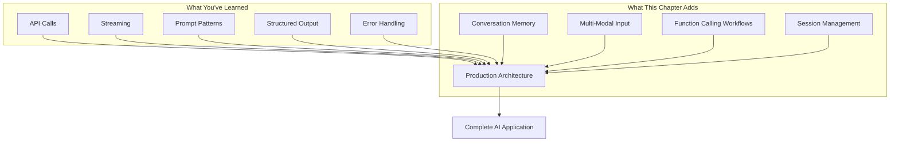
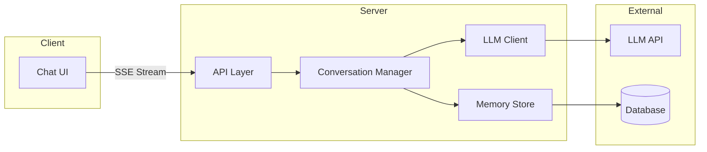
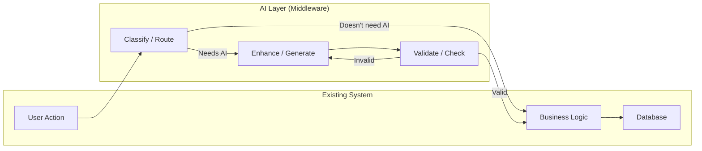

# Chapter 5: Building AI Applications

## Learning Objectives

By the end of this chapter, you will:

- [ ] Build a complete chat application with conversation memory and persistence
- [ ] Implement multi-modal AI features (images, audio, vision)
- [ ] Design streaming chat UIs that feel responsive
- [ ] Integrate function calling into real application workflows
- [ ] Handle conversation branching, editing, and regeneration
- [ ] Build production-ready AI features with error handling, fallbacks, and monitoring

## Prerequisites

- Chapter 3: Working with APIs (SDK usage, streaming, error handling)
- Chapter 4: Prompt Engineering (patterns, structured outputs, evaluation)
- Familiarity with web frameworks (FastAPI or equivalent)

## Estimated Time

- Reading: 75 minutes
- Exercises: 60 minutes
- Project: 4 hours

---

## From API Calls to Applications

Chapters 2–4 taught you the primitives: tokens, API calls, prompts, structured outputs. Now we assemble those primitives into complete applications.

The gap between "I can call an LLM API" and "I have a production AI application" is the same gap as between "I can write SQL queries" and "I have a production web application." The individual skill is necessary but insufficient.

An AI application needs:
- State management (conversations, user preferences, history)
- Error recovery (API failures, malformed responses, timeouts)
- User experience (streaming, loading states, error messages)
- Cost control (token budgets, model routing, caching)
- Security (input validation, output sanitization, rate limiting)
- Observability (logging, metrics, alerting)

This chapter builds real applications that handle all of these concerns.



*Figure 1: This chapter integrates all previous skills into complete applications*

---

## Building a Chat Application

A chat interface is the most common AI application pattern. Let's build one properly — not a toy demo, but a production-ready system.

### Architecture Overview



*Figure 2: Chat application architecture with conversation management*

### Conversation Manager

The conversation manager handles the core logic: maintaining history, managing context windows, and coordinating with the LLM.

```python
import uuid
import time
from dataclasses import dataclass, field
from typing import AsyncGenerator


@dataclass
class Message:
    """A single message in a conversation."""
    id: str = field(default_factory=lambda: str(uuid.uuid4()))
    role: str = ""  # system, user, assistant, tool
    content: str = ""
    timestamp: float = field(default_factory=time.time)
    model: str | None = None
    tokens: int | None = None
    metadata: dict = field(default_factory=dict)


@dataclass
class Conversation:
    """A complete conversation with metadata."""
    id: str = field(default_factory=lambda: str(uuid.uuid4()))
    title: str = "New Conversation"
    messages: list[Message] = field(default_factory=list)
    system_prompt: str = ""
    model: str = "gpt-4o-mini"
    created_at: float = field(default_factory=time.time)
    updated_at: float = field(default_factory=time.time)
    total_tokens: int = 0
    total_cost: float = 0.0


class ConversationManager:
    """Manages conversation state, context windows, and LLM interactions."""
    
    def __init__(
        self,
        model: str = "gpt-4o-mini",
        system_prompt: str = "You are a helpful assistant.",
        max_context_messages: int = 50,
        max_context_tokens: int = 100_000,
    ):
        self.model = model
        self.system_prompt = system_prompt
        self.max_context_messages = max_context_messages
        self.max_context_tokens = max_context_tokens
        self.conversations: dict[str, Conversation] = {}
    
    def create_conversation(self, title: str = "New Conversation") -> Conversation:
        """Create a new conversation."""
        conv = Conversation(
            title=title,
            system_prompt=self.system_prompt,
            model=self.model,
        )
        conv.messages.append(Message(role="system", content=self.system_prompt))
        self.conversations[conv.id] = conv
        return conv
    
    def _build_context(self, conversation: Conversation) -> list[dict]:
        """Build the message array for the API call, respecting context limits."""
        messages = conversation.messages
        
        # Always include system message
        context = [{"role": "system", "content": conversation.system_prompt}]
        
        # Take the most recent messages that fit within limits
        recent = messages[1:]  # Skip system message (we added it above)
        if len(recent) > self.max_context_messages:
            recent = recent[-self.max_context_messages:]
        
        for msg in recent:
            context.append({"role": msg.role, "content": msg.content})
        
        return context
    
    async def send_message(
        self,
        conversation_id: str,
        user_message: str,
    ) -> AsyncGenerator[str, None]:
        """Send a message and stream the response."""
        conv = self.conversations.get(conversation_id)
        if not conv:
            raise ValueError(f"Conversation {conversation_id} not found")
        
        # Add user message
        user_msg = Message(role="user", content=user_message)
        conv.messages.append(user_msg)
        
        # Build context
        context = self._build_context(conv)
        
        # Stream response
        from openai import AsyncOpenAI
        client = AsyncOpenAI()
        
        full_response = ""
        stream = await client.chat.completions.create(
            model=conv.model,
            messages=context,
            stream=True,
            temperature=0.7,
            max_tokens=2000,
        )
        
        async for chunk in stream:
            if chunk.choices[0].delta.content:
                token = chunk.choices[0].delta.content
                full_response += token
                yield token
        
        # Store assistant response
        assistant_msg = Message(
            role="assistant",
            content=full_response,
            model=conv.model,
        )
        conv.messages.append(assistant_msg)
        conv.updated_at = time.time()
```

### The API Layer (FastAPI)

```python
from fastapi import FastAPI, HTTPException
from fastapi.responses import StreamingResponse
from pydantic import BaseModel

app = FastAPI()
manager = ConversationManager(
    system_prompt="You are a helpful coding assistant. Be concise and precise."
)


class CreateConversationRequest(BaseModel):
    title: str = "New Conversation"
    model: str = "gpt-4o-mini"


class SendMessageRequest(BaseModel):
    message: str


@app.post("/conversations")
async def create_conversation(request: CreateConversationRequest):
    conv = manager.create_conversation(title=request.title)
    return {"id": conv.id, "title": conv.title}


@app.post("/conversations/{conv_id}/messages")
async def send_message(conv_id: str, request: SendMessageRequest):
    """Stream a response as Server-Sent Events."""
    try:
        async def event_stream():
            async for token in manager.send_message(conv_id, request.message):
                # SSE format: data: content\n\n
                yield f"data: {token}\n\n"
            yield "data: [DONE]\n\n"
        
        return StreamingResponse(
            event_stream(),
            media_type="text/event-stream",
            headers={
                "Cache-Control": "no-cache",
                "Connection": "keep-alive",
            }
        )
    except ValueError as e:
        raise HTTPException(status_code=404, detail=str(e))


@app.get("/conversations/{conv_id}")
async def get_conversation(conv_id: str):
    conv = manager.conversations.get(conv_id)
    if not conv:
        raise HTTPException(status_code=404, detail="Conversation not found")
    return {
        "id": conv.id,
        "title": conv.title,
        "messages": [
            {"role": m.role, "content": m.content, "timestamp": m.timestamp}
            for m in conv.messages if m.role != "system"
        ],
        "model": conv.model,
    }
```

> 💡 **Developer Insight**
>
> The SSE (Server-Sent Events) format is `data: <content>\n\n`. The client opens a persistent connection and receives tokens in real-time. When the stream ends, send `data: [DONE]\n\n` following OpenAI's convention. This pattern works with any frontend framework — React, Vue, vanilla JavaScript, or mobile apps.

---

## Conversation Memory Patterns

Real chat applications need memory beyond the current context window. Users expect the AI to remember things across conversations.

### Pattern 1: Summary Memory

Compress older messages into a summary when the conversation grows too long.

```python
class SummaryMemory:
    """Compresses old conversation history into summaries."""
    
    def __init__(self, summary_threshold: int = 20):
        self.summary_threshold = summary_threshold
        self.client = AsyncOpenAI()
    
    async def compress_if_needed(self, conversation: Conversation) -> Conversation:
        """Summarize older messages if conversation exceeds threshold."""
        non_system = [m for m in conversation.messages if m.role != "system"]
        
        if len(non_system) <= self.summary_threshold:
            return conversation
        
        # Take the oldest messages to summarize
        to_summarize = non_system[:len(non_system) - 10]  # Keep last 10
        to_keep = non_system[len(non_system) - 10:]
        
        # Generate summary
        summary_text = await self._create_summary(to_summarize)
        
        # Rebuild conversation
        summary_msg = Message(
            role="system",
            content=f"[Conversation summary: {summary_text}]",
            metadata={"type": "summary", "messages_compressed": len(to_summarize)}
        )
        
        conversation.messages = [
            conversation.messages[0],  # Original system prompt
            summary_msg,
            *to_keep
        ]
        
        return conversation
    
    async def _create_summary(self, messages: list[Message]) -> str:
        """Summarize a list of messages into a concise recap."""
        history = "\n".join(
            f"{m.role}: {m.content[:200]}" for m in messages
        )
        
        response = await self.client.chat.completions.create(
            model="gpt-4o-mini",
            messages=[{
                "role": "user",
                "content": f"Summarize this conversation in 3-4 sentences, preserving key facts, decisions, and context:\n\n{history}"
            }],
            temperature=0.0,
            max_tokens=200
        )
        
        return response.choices[0].message.content
```

### Pattern 2: Entity Memory

Extract and maintain a knowledge base of entities mentioned in conversation.

```python
class EntityMemory:
    """Tracks entities (people, preferences, facts) across conversations."""
    
    def __init__(self):
        self.entities: dict[str, dict] = {}  # user_id -> {entity: details}
        self.client = AsyncOpenAI()
    
    async def extract_entities(self, message: str, user_id: str):
        """Extract and store notable entities from a message."""
        response = await self.client.chat.completions.create(
            model="gpt-4o-mini",
            messages=[{
                "role": "user",
                "content": f"""Extract any personal facts, preferences, or notable entities from this message.
                Return JSON: {{"entities": [{{"name": "...", "type": "person|preference|fact", "detail": "..."}}]}}
                If no notable entities, return {{"entities": []}}
                
                Message: {message}"""
            }],
            temperature=0.0,
            response_format={"type": "json_object"},
            max_tokens=200
        )
        
        import json
        result = json.loads(response.choices[0].message.content)
        
        if user_id not in self.entities:
            self.entities[user_id] = {}
        
        for entity in result.get("entities", []):
            self.entities[user_id][entity["name"]] = entity
    
    def get_context(self, user_id: str) -> str:
        """Get entity context to inject into the system prompt."""
        user_entities = self.entities.get(user_id, {})
        if not user_entities:
            return ""
        
        lines = ["Known information about this user:"]
        for name, details in user_entities.items():
            lines.append(f"- {name} ({details['type']}): {details['detail']}")
        
        return "\n".join(lines)
```

### Pattern 3: Retrieval Memory (RAG-Based)

Store all messages in a vector database. Retrieve relevant past conversations as context.

```python
class RetrievalMemory:
    """Uses embeddings to retrieve relevant past conversations."""
    
    def __init__(self, embedding_model: str = "text-embedding-3-small"):
        self.embedding_model = embedding_model
        self.client = OpenAI()
        self.memory_store: list[dict] = []  # In production: vector database
    
    def store_exchange(self, user_message: str, assistant_response: str, metadata: dict):
        """Store a conversation exchange with its embedding."""
        text = f"User: {user_message}\nAssistant: {assistant_response}"
        embedding = self._get_embedding(text)
        
        self.memory_store.append({
            "text": text,
            "embedding": embedding,
            "metadata": metadata,
        })
    
    def retrieve_relevant(self, query: str, top_k: int = 3) -> list[str]:
        """Find the most relevant past exchanges for the current query."""
        query_embedding = self._get_embedding(query)
        
        # Calculate similarities
        scored = []
        for item in self.memory_store:
            similarity = self._cosine_similarity(query_embedding, item["embedding"])
            scored.append((similarity, item["text"]))
        
        # Return top-k most relevant
        scored.sort(reverse=True, key=lambda x: x[0])
        return [text for _, text in scored[:top_k]]
    
    def _get_embedding(self, text: str) -> list[float]:
        response = self.client.embeddings.create(
            model=self.embedding_model,
            input=text
        )
        return response.data[0].embedding
    
    def _cosine_similarity(self, a: list[float], b: list[float]) -> float:
        import math
        dot = sum(x * y for x, y in zip(a, b))
        norm_a = math.sqrt(sum(x * x for x in a))
        norm_b = math.sqrt(sum(x * x for x in b))
        return dot / (norm_a * norm_b) if norm_a and norm_b else 0.0
```

> 📐 **Architecture Decision**
>
> Choose your memory pattern based on the use case: Summary memory for general chatbots (cheapest), entity memory for personal assistants (remembers user preferences), retrieval memory for knowledge-heavy applications (finds relevant past context). Many production systems combine two or three patterns.

---

## Multi-Modal Applications

Modern LLMs process more than text. Vision, audio, and image generation open new application categories.

### Vision: Analyzing Images

```python
import base64
from pathlib import Path


async def analyze_image(image_path: str, question: str = "Describe this image.") -> str:
    """Send an image to GPT-4o for analysis."""
    client = AsyncOpenAI()
    
    # Read and encode the image
    image_data = Path(image_path).read_bytes()
    base64_image = base64.b64encode(image_data).decode("utf-8")
    
    # Determine MIME type
    suffix = Path(image_path).suffix.lower()
    mime_types = {".png": "image/png", ".jpg": "image/jpeg", ".jpeg": "image/jpeg", ".gif": "image/gif", ".webp": "image/webp"}
    mime_type = mime_types.get(suffix, "image/png")
    
    response = await client.chat.completions.create(
        model="gpt-4o",
        messages=[
            {
                "role": "user",
                "content": [
                    {"type": "text", "text": question},
                    {
                        "type": "image_url",
                        "image_url": {
                            "url": f"data:{mime_type};base64,{base64_image}",
                            "detail": "high"  # "low", "high", or "auto"
                        }
                    }
                ]
            }
        ],
        max_tokens=1000
    )
    
    return response.choices[0].message.content


# Usage examples:
# analyze_image("receipt.jpg", "Extract all line items with prices as JSON")
# analyze_image("diagram.png", "Explain this architecture diagram")
# analyze_image("screenshot.png", "Identify any UI bugs in this screenshot")
```

### Vision: Practical Applications

```python
class DocumentProcessor:
    """Process documents using vision capabilities."""
    
    def __init__(self, model: str = "gpt-4o"):
        self.client = AsyncOpenAI()
        self.model = model
    
    async def extract_invoice_data(self, image_path: str) -> dict:
        """Extract structured data from an invoice image."""
        response = await self.client.chat.completions.create(
            model=self.model,
            messages=[
                {
                    "role": "system",
                    "content": """Extract invoice data into this exact JSON structure:
                    {
                        "vendor": "company name",
                        "invoice_number": "string",
                        "date": "YYYY-MM-DD",
                        "items": [{"description": "...", "qty": N, "price": N}],
                        "subtotal": N,
                        "tax": N,
                        "total": N,
                        "currency": "USD/EUR/etc"
                    }
                    Use null for any field you cannot read clearly."""
                },
                {
                    "role": "user",
                    "content": [
                        {"type": "text", "text": "Extract all data from this invoice:"},
                        {
                            "type": "image_url",
                            "image_url": {
                                "url": f"data:image/png;base64,{self._encode(image_path)}",
                                "detail": "high"
                            }
                        }
                    ]
                }
            ],
            temperature=0.0,
            response_format={"type": "json_object"},
            max_tokens=1500
        )
        
        return json.loads(response.choices[0].message.content)
    
    async def compare_screenshots(self, before: str, after: str) -> str:
        """Compare two UI screenshots and describe differences."""
        response = await self.client.chat.completions.create(
            model=self.model,
            messages=[
                {
                    "role": "user",
                    "content": [
                        {"type": "text", "text": "Compare these two screenshots. List every visual difference:"},
                        {"type": "image_url", "image_url": {"url": f"data:image/png;base64,{self._encode(before)}"}},
                        {"type": "image_url", "image_url": {"url": f"data:image/png;base64,{self._encode(after)}"}},
                    ]
                }
            ],
            max_tokens=1000
        )
        
        return response.choices[0].message.content
    
    def _encode(self, path: str) -> str:
        return base64.b64encode(Path(path).read_bytes()).decode("utf-8")
```

> 💰 **Cost Note**
>
> Vision inputs are tokenized by image size. A "high detail" image costs roughly 765 tokens (for a 512x512 image) to 1,105+ tokens (larger images get tiled). For batch processing many images, use "low" detail mode (85 tokens fixed) unless you need to read fine text.

### Audio: Speech-to-Text and Text-to-Speech

```python
class AudioProcessor:
    """Handle speech-to-text and text-to-speech with OpenAI."""
    
    def __init__(self):
        self.client = OpenAI()
    
    def transcribe(self, audio_path: str, language: str = "en") -> dict:
        """Transcribe audio to text using Whisper."""
        with open(audio_path, "rb") as audio_file:
            transcript = self.client.audio.transcriptions.create(
                model="whisper-1",
                file=audio_file,
                language=language,
                response_format="verbose_json",  # Includes timestamps
                timestamp_granularities=["segment"]
            )
        
        return {
            "text": transcript.text,
            "segments": [
                {
                    "start": s.start,
                    "end": s.end,
                    "text": s.text
                }
                for s in (transcript.segments or [])
            ],
            "language": transcript.language,
            "duration": transcript.duration,
        }
    
    def synthesize(self, text: str, output_path: str, voice: str = "alloy"):
        """Convert text to speech."""
        response = self.client.audio.speech.create(
            model="tts-1",  # or "tts-1-hd" for higher quality
            voice=voice,    # alloy, echo, fable, onyx, nova, shimmer
            input=text,
            speed=1.0       # 0.25 to 4.0
        )
        
        response.stream_to_file(output_path)
        return output_path
    
    def voice_chat(self, audio_path: str, system_prompt: str = "You are a helpful assistant.") -> dict:
        """Complete voice interaction: transcribe → LLM → synthesize."""
        # 1. Transcribe user audio
        transcript = self.transcribe(audio_path)
        
        # 2. Get LLM response
        response = self.client.chat.completions.create(
            model="gpt-4o-mini",
            messages=[
                {"role": "system", "content": system_prompt},
                {"role": "user", "content": transcript["text"]}
            ],
            temperature=0.7,
            max_tokens=300
        )
        
        ai_text = response.choices[0].message.content
        
        # 3. Synthesize response
        output_path = "response.mp3"
        self.synthesize(ai_text, output_path)
        
        return {
            "user_text": transcript["text"],
            "ai_text": ai_text,
            "audio_path": output_path
        }
```

---

## Function Calling in Applications

In Chapter 2, we introduced function calling conceptually. Now let's build a complete application that uses tools to accomplish real tasks.

### Multi-Tool Agent Pattern

```python
import json
from datetime import datetime


# Define available tools
TOOLS = [
    {
        "type": "function",
        "function": {
            "name": "search_knowledge_base",
            "description": "Search the company knowledge base for information about products, policies, or procedures.",
            "parameters": {
                "type": "object",
                "properties": {
                    "query": {"type": "string", "description": "The search query"},
                    "category": {
                        "type": "string",
                        "enum": ["products", "policies", "procedures", "faq"],
                        "description": "Category to search within"
                    }
                },
                "required": ["query"]
            }
        }
    },
    {
        "type": "function",
        "function": {
            "name": "create_support_ticket",
            "description": "Create a new support ticket for issues that require human follow-up.",
            "parameters": {
                "type": "object",
                "properties": {
                    "title": {"type": "string", "description": "Brief title of the issue"},
                    "description": {"type": "string", "description": "Detailed description"},
                    "priority": {"type": "string", "enum": ["low", "medium", "high", "critical"]},
                    "category": {"type": "string", "enum": ["billing", "technical", "account", "other"]}
                },
                "required": ["title", "description", "priority", "category"]
            }
        }
    },
    {
        "type": "function",
        "function": {
            "name": "get_order_status",
            "description": "Look up the current status of a customer order by order ID.",
            "parameters": {
                "type": "object",
                "properties": {
                    "order_id": {"type": "string", "description": "The order ID (e.g., ORD-12345)"}
                },
                "required": ["order_id"]
            }
        }
    }
]


class ToolExecutor:
    """Executes tool calls and returns results."""
    
    def execute(self, function_name: str, arguments: dict) -> str:
        """Route tool call to the appropriate handler."""
        handlers = {
            "search_knowledge_base": self._search_kb,
            "create_support_ticket": self._create_ticket,
            "get_order_status": self._get_order,
        }
        
        handler = handlers.get(function_name)
        if not handler:
            return json.dumps({"error": f"Unknown function: {function_name}"})
        
        try:
            result = handler(**arguments)
            return json.dumps(result)
        except Exception as e:
            return json.dumps({"error": str(e)})
    
    def _search_kb(self, query: str, category: str = None) -> dict:
        """Simulated knowledge base search."""
        # In production: vector search over documentation
        return {
            "results": [
                {"title": "Return Policy", "content": "30-day returns with receipt..."},
                {"title": "Shipping FAQ", "content": "Free shipping over $50..."}
            ],
            "total_results": 2
        }
    
    def _create_ticket(self, title: str, description: str, priority: str, category: str) -> dict:
        """Create a support ticket."""
        ticket_id = f"TKT-{datetime.now().strftime('%Y%m%d')}-{hash(title) % 10000:04d}"
        # In production: create in ticketing system (Jira, Zendesk, etc.)
        return {"ticket_id": ticket_id, "status": "created", "priority": priority}
    
    def _get_order(self, order_id: str) -> dict:
        """Look up order status."""
        # In production: query order database
        return {
            "order_id": order_id,
            "status": "shipped",
            "tracking": "1Z999AA10123456784",
            "estimated_delivery": "2025-07-03"
        }
```

### The Tool Calling Loop

```python
class ToolCallingAgent:
    """Agent that uses tools to answer questions."""
    
    def __init__(self, system_prompt: str, tools: list[dict], max_iterations: int = 5):
        self.client = OpenAI()
        self.system_prompt = system_prompt
        self.tools = tools
        self.max_iterations = max_iterations
        self.executor = ToolExecutor()
    
    def run(self, user_message: str) -> str:
        """Process a user message, calling tools as needed."""
        messages = [
            {"role": "system", "content": self.system_prompt},
            {"role": "user", "content": user_message}
        ]
        
        for iteration in range(self.max_iterations):
            response = self.client.chat.completions.create(
                model="gpt-4o-mini",
                messages=messages,
                tools=self.tools,
                tool_choice="auto",
                temperature=0.0,
            )
            
            message = response.choices[0].message
            
            # If no tool calls, we have the final answer
            if not message.tool_calls:
                return message.content
            
            # Process tool calls
            messages.append(message)  # Add assistant's tool call message
            
            for tool_call in message.tool_calls:
                function_name = tool_call.function.name
                arguments = json.loads(tool_call.function.arguments)
                
                # Execute the tool
                result = self.executor.execute(function_name, arguments)
                
                # Add tool result to messages
                messages.append({
                    "role": "tool",
                    "tool_call_id": tool_call.id,
                    "content": result
                })
        
        # Safety: if we hit max iterations, return what we have
        return "I wasn't able to fully resolve your request. Let me connect you with a human agent."


# Usage
agent = ToolCallingAgent(
    system_prompt="""You are a customer support agent for TechStore.
    Use tools to look up information and help customers.
    If you can't resolve an issue, create a support ticket.""",
    tools=TOOLS
)

response = agent.run("Where's my order ORD-55421?")
print(response)
# "Your order ORD-55421 has shipped! Tracking number: 1Z999AA10123456784. 
#  Estimated delivery: July 3, 2025."
```

> ⚠️ **Common Mistake**
>
> Always set `max_iterations` on tool-calling loops. Without it, a model that keeps calling tools (or gets stuck in a loop) will burn tokens indefinitely. 3–5 iterations is reasonable for most customer support scenarios. Log when you hit the limit — it indicates a prompt or tool definition issue.

---

## Conversation Features: Edit, Regenerate, Branch

Production chat applications need more than send/receive. Users expect to edit messages, regenerate responses, and explore alternative answers.

### Message Regeneration

```python
class ConversationWithFeatures(ConversationManager):
    """Extended conversation manager with edit/regenerate/branch support."""
    
    async def regenerate_last(self, conversation_id: str) -> AsyncGenerator[str, None]:
        """Delete the last assistant message and generate a new one."""
        conv = self.conversations[conversation_id]
        
        # Remove last assistant message
        if conv.messages and conv.messages[-1].role == "assistant":
            conv.messages.pop()
        
        # Find the last user message to re-send
        last_user_msg = None
        for msg in reversed(conv.messages):
            if msg.role == "user":
                last_user_msg = msg.content
                break
        
        if not last_user_msg:
            return
        
        # Generate new response (with slight temperature increase for variety)
        context = self._build_context(conv)
        
        client = AsyncOpenAI()
        full_response = ""
        
        stream = await client.chat.completions.create(
            model=conv.model,
            messages=context,
            stream=True,
            temperature=0.9,  # Higher temperature for variety on regeneration
            max_tokens=2000,
        )
        
        async for chunk in stream:
            if chunk.choices[0].delta.content:
                token = chunk.choices[0].delta.content
                full_response += token
                yield token
        
        conv.messages.append(Message(role="assistant", content=full_response))
    
    async def edit_and_resend(
        self, 
        conversation_id: str, 
        message_index: int, 
        new_content: str
    ) -> AsyncGenerator[str, None]:
        """Edit a user message and regenerate everything after it."""
        conv = self.conversations[conversation_id]
        
        # Truncate conversation at the edited message
        conv.messages = conv.messages[:message_index]
        
        # Add the edited message
        conv.messages.append(Message(role="user", content=new_content))
        
        # Generate new response
        async for token in self.send_message(conversation_id, new_content):
            yield token
    
    def branch_conversation(self, conversation_id: str, at_index: int) -> str:
        """Create a new conversation branch from a specific point."""
        original = self.conversations[conversation_id]
        
        # Copy messages up to the branch point
        branched = Conversation(
            title=f"{original.title} (branch)",
            system_prompt=original.system_prompt,
            model=original.model,
        )
        branched.messages = [msg for msg in original.messages[:at_index + 1]]
        
        self.conversations[branched.id] = branched
        return branched.id
```

---

## Streaming UI Patterns

The server-side streaming is only half the story. The client needs to handle the stream gracefully.

### JavaScript Client (Frontend Pattern)

```javascript
// Generic SSE client for streaming LLM responses
class ChatClient {
  constructor(baseUrl) {
    this.baseUrl = baseUrl;
  }

  async sendMessage(conversationId, message, onToken, onComplete, onError) {
    try {
      const response = await fetch(
        `${this.baseUrl}/conversations/${conversationId}/messages`,
        {
          method: 'POST',
          headers: { 'Content-Type': 'application/json' },
          body: JSON.stringify({ message }),
        }
      );

      if (!response.ok) {
        throw new Error(`HTTP ${response.status}: ${response.statusText}`);
      }

      const reader = response.body.getReader();
      const decoder = new TextDecoder();
      let buffer = '';

      while (true) {
        const { done, value } = await reader.read();
        if (done) break;

        buffer += decoder.decode(value, { stream: true });
        
        // Parse SSE events from buffer
        const lines = buffer.split('\n');
        buffer = lines.pop(); // Keep incomplete line in buffer

        for (const line of lines) {
          if (line.startsWith('data: ')) {
            const data = line.slice(6);
            if (data === '[DONE]') {
              onComplete?.();
              return;
            }
            onToken?.(data);
          }
        }
      }

      onComplete?.();
    } catch (error) {
      onError?.(error);
    }
  }
}

// Usage
const chat = new ChatClient('http://localhost:8000');
let responseText = '';

chat.sendMessage(
  'conv-123',
  'Explain microservices',
  (token) => {
    responseText += token;
    document.getElementById('response').textContent = responseText;
  },
  () => console.log('Complete'),
  (err) => console.error('Error:', err)
);
```

> 🏢 **Industry Note**
>
> Production chat UIs handle several edge cases beyond basic streaming: auto-scroll to bottom as tokens arrive, markdown rendering of partial content, code block detection (don't render markdown until the block closes), typing indicators, message timestamps, and graceful handling of aborted streams (user navigates away mid-response).

---

## Building an AI Email Assistant

Let's build a complete, realistic application: an email assistant that reads emails, drafts replies, and manages follow-ups.

```python
from dataclasses import dataclass
from enum import Enum


class EmailPriority(Enum):
    URGENT = "urgent"
    HIGH = "high"
    NORMAL = "normal"
    LOW = "low"


@dataclass
class Email:
    id: str
    sender: str
    subject: str
    body: str
    received_at: str
    thread_id: str | None = None


@dataclass
class EmailAction:
    action_type: str  # "reply", "forward", "archive", "flag", "schedule_followup"
    draft_content: str | None = None
    priority: EmailPriority = EmailPriority.NORMAL
    reasoning: str = ""


class EmailAssistant:
    """AI-powered email assistant that triages and drafts responses."""
    
    SYSTEM_PROMPT = """You are an executive assistant managing email for a senior engineer.

    RESPONSIBILITIES:
    1. Triage emails by urgency and required action
    2. Draft professional replies matching the sender's formality level
    3. Identify emails that need human attention vs. routine responses
    4. Flag follow-ups and deadlines
    
    USER'S PREFERENCES:
    - Concise replies (3-5 sentences max for routine emails)
    - Professional but warm tone
    - Always acknowledge receipt for time-sensitive matters
    - Never commit to meetings without explicit approval
    - Auto-archive newsletters and marketing
    
    ESCALATION RULES:
    - Any email from C-level executives → flag as urgent
    - Legal or compliance topics → flag, don't draft
    - Budget/financial approvals → flag, don't draft
    - Technical questions from team → draft helpful response
    """
    
    def __init__(self):
        self.client = OpenAI()
    
    def triage(self, email: Email) -> EmailAction:
        """Determine the appropriate action for an email."""
        response = self.client.chat.completions.create(
            model="gpt-4o-mini",
            messages=[
                {"role": "system", "content": self.SYSTEM_PROMPT},
                {"role": "user", "content": f"""Triage this email:
                
From: {email.sender}
Subject: {email.subject}
Body: {email.body}

Respond with JSON:
{{
    "action": "reply|forward|archive|flag|schedule_followup",
    "priority": "urgent|high|normal|low",
    "needs_human": true/false,
    "reasoning": "brief explanation",
    "draft": "drafted reply text if action is 'reply', else null",
    "followup_date": "YYYY-MM-DD if scheduling followup, else null"
}}"""}
            ],
            temperature=0.0,
            response_format={"type": "json_object"},
            max_tokens=500
        )
        
        result = json.loads(response.choices[0].message.content)
        
        return EmailAction(
            action_type=result["action"],
            draft_content=result.get("draft"),
            priority=EmailPriority(result["priority"]),
            reasoning=result["reasoning"]
        )
    
    def draft_reply(self, email: Email, instructions: str = "") -> str:
        """Generate a reply draft with optional specific instructions."""
        prompt = f"""Draft a reply to this email:

From: {email.sender}
Subject: {email.subject}
Body: {email.body}
"""
        if instructions:
            prompt += f"\nSpecific instructions: {instructions}"
        
        response = self.client.chat.completions.create(
            model="gpt-4o",  # Use better model for user-facing content
            messages=[
                {"role": "system", "content": self.SYSTEM_PROMPT},
                {"role": "user", "content": prompt}
            ],
            temperature=0.3,
            max_tokens=500
        )
        
        return response.choices[0].message.content
    
    def batch_triage(self, emails: list[Email]) -> list[tuple[Email, EmailAction]]:
        """Triage a batch of emails and return sorted by priority."""
        results = [(email, self.triage(email)) for email in emails]
        
        # Sort by priority (urgent first)
        priority_order = {
            EmailPriority.URGENT: 0,
            EmailPriority.HIGH: 1,
            EmailPriority.NORMAL: 2,
            EmailPriority.LOW: 3,
        }
        results.sort(key=lambda x: priority_order[x[1].priority])
        
        return results
```

---

## Building a Meeting Summarizer

Another high-value application: automatically summarize meeting transcripts into actionable notes.

```python
class MeetingSummarizer:
    """Processes meeting transcripts into structured summaries."""
    
    SYSTEM_PROMPT = """You are a meeting note-taker for a tech company.
    
    OUTPUT FORMAT:
    Every summary must include:
    1. One-line summary (what was the meeting about)
    2. Key decisions made
    3. Action items (who, what, deadline)
    4. Open questions (unresolved topics needing follow-up)
    5. Next steps
    
    RULES:
    - Action items MUST have an owner. If no owner mentioned, mark as "TBD"
    - Deadlines are explicit dates, not "soon" or "next week"
    - Distinguish decisions (final) from discussions (ongoing)
    - Maximum 1 page of notes regardless of meeting length
    - Use bullet points, not paragraphs"""
    
    def __init__(self):
        self.client = OpenAI()
    
    def summarize(self, transcript: str, attendees: list[str] = None) -> dict:
        """Summarize a meeting transcript."""
        context = ""
        if attendees:
            context = f"\nATTENDEES: {', '.join(attendees)}\n"
        
        response = self.client.chat.completions.create(
            model="gpt-4o",
            messages=[
                {"role": "system", "content": self.SYSTEM_PROMPT},
                {"role": "user", "content": f"{context}\nTRANSCRIPT:\n{transcript}"}
            ],
            temperature=0.0,
            max_tokens=1500,
            response_format={"type": "json_object"}
        )
        
        # Also request structured format for integration
        structured_response = self.client.chat.completions.create(
            model="gpt-4o-mini",
            messages=[
                {"role": "system", "content": "Extract action items as structured JSON."},
                {"role": "user", "content": f"""From this meeting summary, extract action items:
                
{response.choices[0].message.content}

Return: {{"action_items": [{{"owner": "name", "task": "description", "deadline": "YYYY-MM-DD or null"}}]}}"""}
            ],
            temperature=0.0,
            response_format={"type": "json_object"},
            max_tokens=500
        )
        
        return {
            "summary": response.choices[0].message.content,
            "action_items": json.loads(structured_response.choices[0].message.content),
            "tokens_used": response.usage.total_tokens + structured_response.usage.total_tokens,
        }
    
    def summarize_from_audio(self, audio_path: str, attendees: list[str] = None) -> dict:
        """Full pipeline: audio → transcript → summary."""
        # Step 1: Transcribe
        with open(audio_path, "rb") as f:
            transcript = self.client.audio.transcriptions.create(
                model="whisper-1",
                file=f,
                response_format="text"
            )
        
        # Step 2: Summarize
        return self.summarize(transcript, attendees)
```

> 🚀 **Portfolio Tip**
>
> A meeting summarizer is an excellent portfolio project because it demonstrates multiple skills: audio processing, long-context handling, structured output, and real business value. Add a simple web UI and a calendar integration, and you have a product that companies will pay for.

---

## Application Architecture Patterns

### Pattern: The AI Middleware

For applications where AI augments an existing workflow:



*Figure 3: AI as middleware — augments existing workflows without replacing them*

### Pattern: Graceful Degradation

```python
class ResilientAIFeature:
    """AI feature that degrades gracefully when the AI layer fails."""
    
    def __init__(self):
        self.client = OpenAI()
        self.fallback_rules = {
            "greeting": "Hello! How can I help you today?",
            "unknown": "I'm having trouble processing that. Let me connect you with a human agent.",
        }
    
    async def get_response(self, user_message: str, context: dict) -> dict:
        """Get AI response with fallback to rules-based system."""
        try:
            # Primary: AI response
            response = await asyncio.wait_for(
                self._ai_response(user_message, context),
                timeout=10.0  # Hard timeout
            )
            return {"source": "ai", "response": response}
        
        except asyncio.TimeoutError:
            # Fallback 1: rule-based response
            rule_response = self._rules_based_response(user_message)
            return {"source": "rules", "response": rule_response}
        
        except Exception as e:
            # Fallback 2: generic helpful response
            return {
                "source": "fallback",
                "response": self.fallback_rules["unknown"],
                "error": str(e)
            }
    
    async def _ai_response(self, message: str, context: dict) -> str:
        response = await AsyncOpenAI().chat.completions.create(
            model="gpt-4o-mini",
            messages=[
                {"role": "system", "content": "You are a helpful assistant."},
                {"role": "user", "content": message}
            ],
            temperature=0.7,
            max_tokens=500
        )
        return response.choices[0].message.content
    
    def _rules_based_response(self, message: str) -> str:
        """Simple keyword-based fallback."""
        message_lower = message.lower()
        if any(word in message_lower for word in ["hi", "hello", "hey"]):
            return self.fallback_rules["greeting"]
        return self.fallback_rules["unknown"]
```

---

## Production Notes

- **Conversation persistence:** In-memory storage (as shown) is for demos only. Use PostgreSQL or Redis for production. Store messages, metadata, and token counts per conversation.
- **Concurrent access:** Multiple tabs or devices accessing the same conversation need optimistic locking or event sourcing.
- **Message ordering:** Use monotonically increasing timestamps or sequence numbers, not just `time.time()` — clock skew can reorder messages.
- **Content moderation:** For user-facing applications, implement content filtering on both input (user messages) and output (AI responses) to prevent policy violations.
- **File uploads:** When accepting images or audio, validate file types, enforce size limits, and scan for malicious content before processing.
- **Token budgets per user:** Implement per-user or per-organization token budgets to prevent cost overruns from heavy users.

## Common Mistakes

1. **No conversation length limits.** Without trimming, conversations grow until they exceed the context window and the API returns an error. Always implement context management.

2. **Blocking the event loop with synchronous calls.** In async web servers, one slow LLM call blocks all other requests. Use async clients exclusively in async contexts.

3. **Not handling partial stream failures.** A stream can disconnect mid-response. Save partial content, inform the user, and offer retry.

4. **Storing full conversation history forever.** Conversations accumulate fast. Implement retention policies (archive after 30 days, delete after 90).

5. **No rate limiting per user.** One user sending 100 messages/minute burns your API budget. Implement per-user rate limits.

6. **Ignoring multi-modal costs.** Image inputs are expensive (high-detail images = 1,000+ tokens each). A user uploading 20 screenshots in one conversation can cost more than a month of text-only usage.

## Best Practices

1. **Stream all user-facing responses.** The UX improvement is dramatic and users expect it from AI applications.

2. **Implement conversation titles.** Auto-generate a title from the first message exchange — helps users find past conversations.

3. **Log structured events.** Every message send/receive should log: conversation_id, user_id, model, tokens, latency, success/failure.

4. **Build regeneration from day one.** Users will want to try again when they don't like a response. This is trivial to implement and significantly improves UX.

5. **Use model routing per task.** Triage with GPT-4o-mini (fast, cheap), draft important responses with GPT-4o (quality). Route based on detected priority.

6. **Implement typing indicators.** Show "AI is thinking..." before the first token arrives. The few hundred milliseconds of TTFT feel shorter with feedback.

7. **Cache system prompts with Anthropic.** If using Claude, enable prompt caching for your system prompt — it's the same on every request and caching saves 90% on those tokens.

8. **Design for human-in-the-loop.** Especially for consequential actions (sending emails, creating tickets, scheduling meetings). Show the draft, get confirmation, then execute.

---

## Hands-On Exercises

### Exercise 1: Chat with Memory

**Difficulty:** ⭐⭐
**Time:** 25 minutes

Build a terminal chat application that:
1. Maintains conversation history
2. Implements summary memory (compress after 15 messages)
3. Shows token count after each response
4. Supports `/history` command to show the compressed summary
5. Persists conversation to a JSON file on exit, loads on start

### Exercise 2: Image Analysis Pipeline

**Difficulty:** ⭐⭐
**Time:** 20 minutes

Build a batch image processor that:
1. Takes a directory of images as input
2. Analyzes each image with a custom prompt (configurable)
3. Outputs structured JSON results for each image
4. Tracks cost per image and total batch cost
5. Handles errors gracefully (skip broken images, continue batch)

Test with: screenshots, receipts, diagrams, and photos.

### Exercise 3: Tool-Calling Weather Bot

**Difficulty:** ⭐⭐
**Time:** 30 minutes

Build a chatbot that uses function calling to:
1. Get current weather (use a free weather API)
2. Get weather forecast (next 5 days)
3. Convert between temperature units
4. Compare weather between two cities

The bot should:
- Decide when to call tools vs. answer from general knowledge
- Handle multi-step queries ("Is it warmer in Tokyo or London right now?")
- Present results in a user-friendly format

### Exercise 4: Streaming Markdown Renderer

**Difficulty:** ⭐⭐⭐
**Time:** 30 minutes

Build a streaming response handler that:
1. Receives tokens in real-time
2. Detects when a code block is opening (```)
3. Buffers code blocks until they close (don't render partial code)
4. Renders markdown formatting in real-time for non-code content
5. Handles edge cases: nested code blocks, incomplete responses

---

## Mini Project

**Title:** AI Email Triage System
**Difficulty:** ⭐⭐⭐
**Time:** 3 hours
**What you'll build:** A complete email assistant that reads emails from a JSON file (simulating an inbox), triages them, drafts replies, and produces a daily summary report.

### Requirements

1. **Email ingestion:** Read emails from `inbox.json` (provide 15+ sample emails of varying types)
2. **Triage:** Classify each email (urgent/routine/spam/FYI) with reasoning
3. **Draft replies:** Auto-draft responses for routine emails
4. **Action extraction:** Identify tasks/deadlines from emails
5. **Daily digest:** Generate a summary email: "You have 3 urgent items, 5 routine replies drafted, 2 follow-ups needed"
6. **Human-in-the-loop:** Present drafted replies for approval before "sending"
7. **Cost tracking:** Report total API cost for processing the batch

### Deliverables

```
ai-email-triage/
├── src/
│   ├── main.py           # Entry point
│   ├── triage.py         # Email classification
│   ├── drafter.py        # Reply generation
│   ├── digest.py         # Daily summary
│   └── models.py         # Data classes
├── data/
│   └── inbox.json        # Sample emails
├── output/
│   ├── triage_report.json
│   ├── drafts/
│   └── daily_digest.md
├── .env.example
├── requirements.txt
└── README.md
```

---

## Challenge Project

**Title:** Multi-Modal AI Assistant with Voice
**Difficulty:** ⭐⭐⭐⭐
**Time:** 8 hours
**What you'll build:** A voice-enabled AI assistant that can see (images), hear (audio), speak (TTS), and act (function calling) — a mini Jarvis.

### Requirements

1. **Voice input:** Record audio → transcribe → process
2. **Voice output:** Generate response → synthesize to audio → play
3. **Vision:** Accept image uploads and reason about them
4. **Tools:** Calendar management, note-taking, web search (simulated)
5. **Memory:** Remember user preferences and past interactions across sessions
6. **Multi-turn:** Handle conversations that combine text, voice, and images
7. **Graceful degradation:** Work in text-only mode if audio/vision services fail

### Architecture

```
voice-assistant/
├── src/
│   ├── main.py              # CLI/interface
│   ├── audio/
│   │   ├── recorder.py      # Microphone input
│   │   ├── transcriber.py   # Speech-to-text
│   │   └── synthesizer.py   # Text-to-speech
│   ├── vision/
│   │   └── analyzer.py      # Image processing
│   ├── agent/
│   │   ├── core.py          # Main agent loop
│   │   ├── memory.py        # Persistent memory
│   │   └── tools.py         # Available tools
│   └── config.py
├── data/
│   └── memory.json          # Persistent user memory
├── .env.example
├── requirements.txt
└── README.md
```

---

## Portfolio Milestone

After this chapter, you should have:
- A working chat application with streaming, memory, and persistence
- An email triage system demonstrating real business value
- Experience with multi-modal AI (vision + audio)
- A tool-calling agent that connects to external services
- Understanding of production patterns: graceful degradation, cost control, human-in-the-loop

---

## Chapter Summary

- AI applications are standard software applications with an LLM as one component. All normal engineering concerns (state, errors, UX, security) still apply.
- Conversation memory has three main patterns: summary (cheapest), entity (remembers facts), retrieval (finds relevant history). Production apps combine these.
- Multi-modal capabilities (vision, audio) open new application categories: document processing, voice interfaces, image analysis.
- Function calling transforms LLMs from text generators into agents that can take actions. Always implement iteration limits and tool execution validation.
- Streaming is non-negotiable for user-facing applications. Use SSE for web, async generators on the server.
- Graceful degradation means AI failures don't crash your application. Always have a fallback path (rules-based, cached, or human escalation).
- Human-in-the-loop is the right default for consequential actions. Show the draft, get confirmation, then execute.

---

## Cheat Sheet

| Application Type | Key Components | Model Choice |
|-----------------|----------------|--------------|
| Chatbot | Streaming + memory + context management | GPT-4o-mini (routine), GPT-4o (complex) |
| Document processor | Vision + structured output + batch processing | GPT-4o (accuracy) |
| Email assistant | Classification + drafting + action extraction | GPT-4o-mini (triage), GPT-4o (drafts) |
| Voice assistant | Whisper + LLM + TTS | Whisper-1 + GPT-4o-mini + TTS-1 |
| Tool-using agent | Function calling + loop + validation | GPT-4o (tool selection accuracy) |

| Memory Pattern | Best For | Token Cost | Persistence |
|---------------|----------|-----------|-------------|
| Sliding window | Simple chatbots | Low | In-memory |
| Summary memory | General assistants | Medium (summary calls) | Database |
| Entity memory | Personal assistants | Medium (extraction calls) | Database |
| Retrieval (RAG) | Knowledge-heavy apps | High (embeddings) | Vector DB |

---

## Glossary

| Term | Definition |
|------|-----------|
| SSE | Server-Sent Events. Unidirectional HTTP streaming protocol for pushing data from server to client. |
| Conversation memory | Any mechanism that gives an LLM awareness of past interactions beyond the current context window. |
| Summary memory | Compressing older conversation messages into a concise summary to save context space. |
| Entity memory | Extracting and storing specific facts (names, preferences) from conversations for later retrieval. |
| Tool calling loop | The iterative pattern where an LLM calls tools, receives results, and decides next steps until a task is complete. |
| Human-in-the-loop | Design pattern where AI generates suggestions but a human approves before execution. |
| Graceful degradation | System continues functioning (at reduced capability) when the AI component fails. |
| Multi-modal | AI that processes multiple input types: text, images, audio, video. |
| Whisper | OpenAI's speech-to-text model for audio transcription. |
| TTS | Text-to-Speech. Converting written text into spoken audio. |

---

## References

- [OpenAI Chat Completions API](https://platform.openai.com/docs/guides/chat-completions) — Official guide for building chat applications.
- [OpenAI Vision Guide](https://platform.openai.com/docs/guides/vision) — Image input documentation.
- [OpenAI Audio Guide](https://platform.openai.com/docs/guides/speech-to-text) — Whisper and TTS documentation.
- [FastAPI Streaming Response](https://fastapi.tiangolo.com/advanced/custom-response/#streamingresponse) — Server-Sent Events with FastAPI.
- [OpenAI Function Calling](https://platform.openai.com/docs/guides/function-calling) — Complete tool use documentation.

## Further Reading

- [Building ChatGPT-Like Applications](https://platform.openai.com/docs/guides/chat-completions/overview) — OpenAI's best practices for chat apps.
- [Patterns for Building LLM-based Systems & Products](https://eugeneyan.com/writing/llm-patterns/) — Eugene Yan's comprehensive patterns guide.
- [OpenAI Realtime API](https://platform.openai.com/docs/guides/realtime) — Voice-to-voice streaming (advanced, next-gen pattern).

---

## Next Chapter Preview

In **Chapter 6: Embeddings**, we'll dive into the technology that powers semantic search, similarity matching, and the retrieval half of RAG. You'll learn how text becomes vectors, how to measure similarity, and how to build search systems that understand meaning rather than just matching keywords. This is the foundation for Chapter 7's RAG pipelines.
