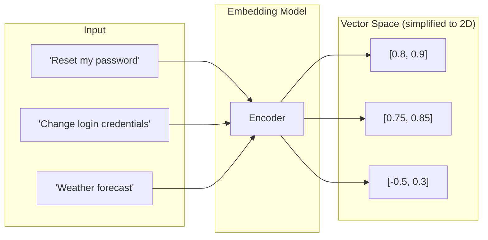
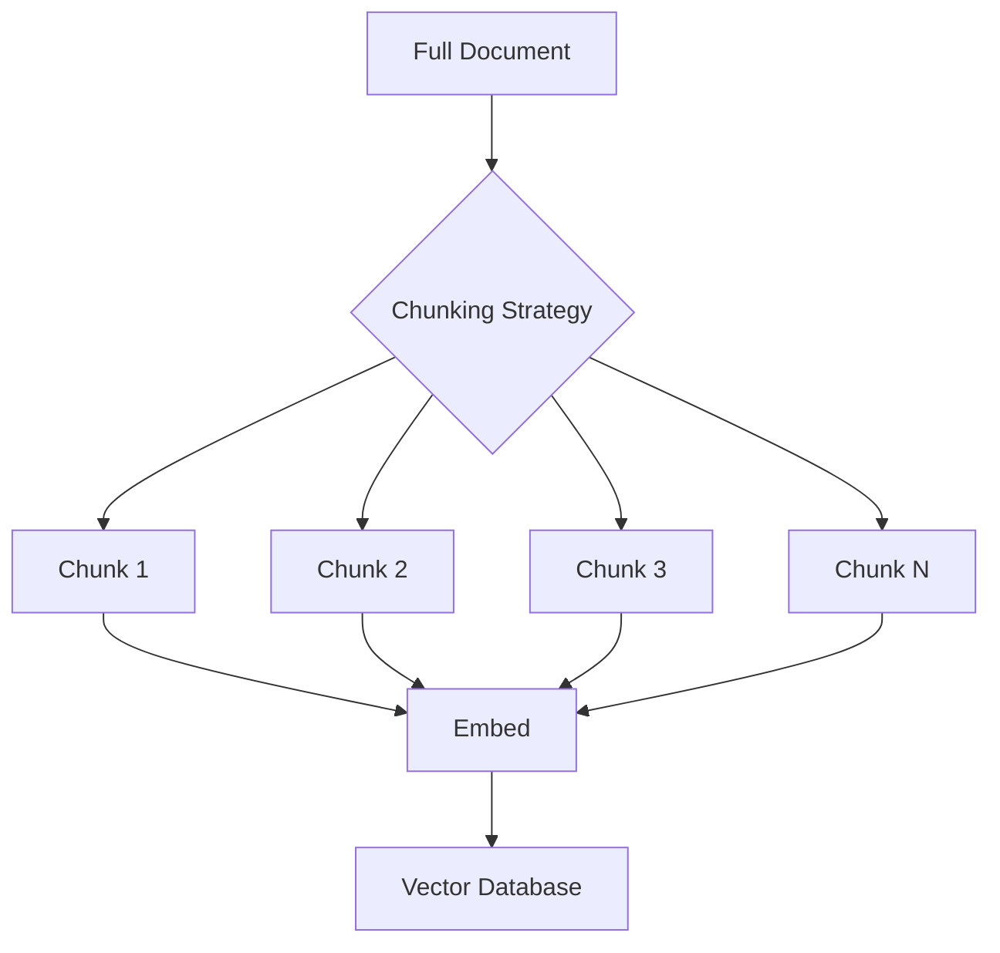
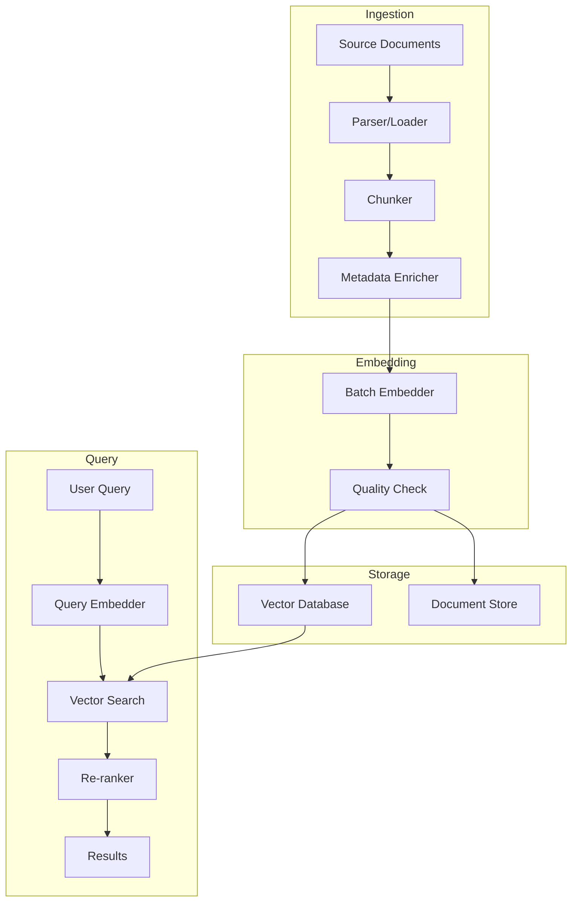

# Chapter 6: Embeddings and Semantic Search

## Learning Objectives

By the end of this chapter, you will:

- [ ] Understand what embeddings are and how they capture semantic meaning
- [ ] Generate embeddings using OpenAI, Cohere, and open-source models
- [ ] Measure similarity between texts using cosine similarity and other metrics
- [ ] Implement chunking strategies that preserve context and meaning
- [ ] Build a semantic search engine from scratch
- [ ] Design embedding pipelines for production workloads
- [ ] Evaluate retrieval quality with precision, recall, and MRR metrics

## Prerequisites

- Chapter 3: Working with APIs (SDK usage, authentication)
- Chapter 5: Building AI Applications (application architecture patterns)
- Basic linear algebra intuition (we'll cover what you need)

## Estimated Time

- Reading: 60 minutes
- Exercises: 60 minutes
- Project: 3 hours

---

## The Core Insight

Here's the mental model that makes embeddings click:

**An embedding is a numerical address for meaning.**

Just like geographic coordinates (40.7128, -74.0060) locate a point in physical space, an embedding (a vector of 1,536 numbers) locates a concept in semantic space.

In this space:
- Texts with similar meaning are located near each other
- Texts with different meaning are far apart
- You can measure "nearness" with simple math

```
"How do I reset my password?"  →  [0.023, -0.114, 0.842, ..., 0.031]
"I forgot my login credentials" →  [0.019, -0.108, 0.837, ..., 0.028]
"What's the weather today?"    →  [-0.412, 0.233, 0.091, ..., 0.567]
```

The first two vectors are close together (similar meaning). The third is far away (different meaning). This is true even though they share almost no words.

This ability — finding meaning-based similarity without keyword matching — is the foundation of:
- Semantic search (find documents by meaning, not exact words)
- RAG (retrieve relevant context for an LLM)
- Recommendation systems (find similar items)
- Clustering (group similar documents automatically)
- Anomaly detection (find things that don't belong)



*Figure 1: Texts with similar meaning produce vectors that are close together in the embedding space*

> 🔑 **Key Concept**
>
> Embeddings solve the vocabulary mismatch problem. Traditional keyword search fails when a user searches for "automobile" but the document says "car." Embeddings understand that these mean the same thing because they were trained on billions of examples where both words appeared in similar contexts.

---

## How Embeddings Work (The Intuition)

You don't need to understand transformer architectures in detail. You need the intuition.

### The Training Process (Simplified)

Embedding models are trained on massive text datasets with a simple objective: texts that appear in similar contexts should have similar vectors.

Think of it like this:
- The model reads billions of sentences
- It learns that "king" and "queen" appear in similar contexts (royalty, monarchy, ruling)
- So it assigns them nearby vectors
- It learns that "king" and "banana" rarely share context
- So it assigns them distant vectors

### What the Dimensions Represent

An embedding with 1,536 dimensions means 1,536 numbers describe each text. Each dimension captures some aspect of meaning:
- Some dimensions might correlate with "formality"
- Others with "topic domain"
- Others with "sentiment"
- Most aren't interpretable by humans — they're abstract features the model learned

You don't need to interpret individual dimensions. You just need to know: closer vectors = more similar meaning.

### Embedding Models Are NOT LLMs

This is a common confusion. Embedding models and text-generation LLMs are different:

| Embedding Model | Generation LLM (GPT-4, Claude) |
|----------------|-------------------------------|
| Input: text → Output: vector | Input: text → Output: text |
| Fixed-size output (e.g., 1536 numbers) | Variable-length output |
| Deterministic (same input → same vector) | Non-deterministic |
| Very fast (milliseconds) | Slow (seconds) |
| Very cheap ($0.02 per million tokens) | Expensive ($2.50+ per million tokens) |
| No generation capability | Generates new text |

> 💡 **Developer Insight**
>
> Embedding API calls are roughly 100x cheaper than generation calls and 10x faster. Don't worry about cost-optimizing embeddings the way you would LLM calls. The bottleneck in embedding pipelines is usually I/O (reading documents, writing to database) not the embedding API itself.

---

## Generating Embeddings

### OpenAI Embeddings

```python
from openai import OpenAI

client = OpenAI()


def get_embedding(text: str, model: str = "text-embedding-3-small") -> list[float]:
    """Generate an embedding vector for a single text."""
    response = client.embeddings.create(
        input=text,
        model=model
    )
    return response.data[0].embedding


def get_embeddings_batch(texts: list[str], model: str = "text-embedding-3-small") -> list[list[float]]:
    """Generate embeddings for multiple texts in one API call."""
    response = client.embeddings.create(
        input=texts,
        model=model
    )
    # Sort by index to maintain order
    return [item.embedding for item in sorted(response.data, key=lambda x: x.index)]


# Usage
embedding = get_embedding("How do I reset my password?")
print(f"Dimensions: {len(embedding)}")  # 1536 for text-embedding-3-small
print(f"First 5 values: {embedding[:5]}")
```

### Available Embedding Models

| Model | Dimensions | Max Tokens | Cost (per 1M tokens) | Best For |
|-------|-----------|-----------|---------------------|----------|
| text-embedding-3-small (OpenAI) | 1,536 | 8,191 | $0.02 | General purpose, cost-effective |
| text-embedding-3-large (OpenAI) | 3,072 | 8,191 | $0.13 | Higher accuracy, large-scale |
| embed-v4.0 (Cohere) | 1,024 | 512 | $0.10 | Multilingual, search-focused |
| Gemini text-embedding-004 | 768 | 2,048 | $0.00 (free tier) | Google ecosystem |
| all-MiniLM-L6-v2 (open) | 384 | 256 | Free (self-hosted) | On-device, privacy-sensitive |
| nomic-embed-text (open) | 768 | 8,192 | Free (self-hosted) | Long documents, self-hosted |

### Dimension Reduction (OpenAI Matryoshka Embeddings)

OpenAI's v3 models support dimension reduction — you can request shorter vectors for faster search at slight quality cost:

```python
def get_compact_embedding(text: str, dimensions: int = 256) -> list[float]:
    """Get a reduced-dimension embedding for faster search."""
    response = client.embeddings.create(
        input=text,
        model="text-embedding-3-small",
        dimensions=dimensions  # 256, 512, 1024, or full 1536
    )
    return response.data[0].embedding


# Trade-off: smaller dimensions = faster search, slightly lower accuracy
# 256 dims: ~95% of full accuracy, 6x less storage
# 512 dims: ~98% of full accuracy, 3x less storage
```

---

## Measuring Similarity

Once you have vectors, you need to measure how close they are. The standard metric is cosine similarity.

### Cosine Similarity

Measures the angle between two vectors, ignoring magnitude. Returns a value between -1 and 1 (practically, between 0 and 1 for modern embeddings).

```python
import math


def cosine_similarity(a: list[float], b: list[float]) -> float:
    """Calculate cosine similarity between two vectors."""
    dot_product = sum(x * y for x, y in zip(a, b))
    norm_a = math.sqrt(sum(x * x for x in a))
    norm_b = math.sqrt(sum(x * x for x in b))
    
    if norm_a == 0 or norm_b == 0:
        return 0.0
    
    return dot_product / (norm_a * norm_b)


# With numpy (much faster for batches)
import numpy as np


def cosine_similarity_np(a: np.ndarray, b: np.ndarray) -> float:
    """Numpy-optimized cosine similarity."""
    return np.dot(a, b) / (np.linalg.norm(a) * np.linalg.norm(b))


def batch_similarities(query: np.ndarray, candidates: np.ndarray) -> np.ndarray:
    """Calculate similarity between one query and many candidates at once."""
    # Normalize all vectors
    query_norm = query / np.linalg.norm(query)
    candidates_norm = candidates / np.linalg.norm(candidates, axis=1, keepdims=True)
    
    # Dot product gives cosine similarity when vectors are normalized
    return candidates_norm @ query_norm
```

### Interpreting Similarity Scores

| Score Range | Interpretation | Action |
|-------------|---------------|--------|
| 0.90–1.00 | Near-identical meaning | Almost certainly relevant |
| 0.80–0.90 | Very similar | Highly relevant |
| 0.70–0.80 | Related | Probably relevant |
| 0.50–0.70 | Somewhat related | Might be relevant (check) |
| 0.30–0.50 | Loosely related | Probably not relevant |
| 0.00–0.30 | Unrelated | Not relevant |

> ⚠️ **Common Mistake**
>
> These thresholds are approximate guidelines, not universal rules. The right threshold depends on your embedding model, your data, and your use case. Always calibrate thresholds empirically on your own dataset. What counts as "relevant" for a legal search system differs from a casual FAQ bot.

### Other Distance Metrics

| Metric | Formula | When to Use |
|--------|---------|-------------|
| Cosine similarity | cos(θ) between vectors | Default choice. Works best for semantic similarity. |
| Euclidean distance | L2 norm of difference | When magnitude matters (e.g., popularity-weighted) |
| Dot product | Raw dot product | When vectors are already normalized |
| Manhattan distance | Sum of absolute differences | Sparse vectors, high-dimensional data |

For semantic search with modern embedding models, cosine similarity is almost always correct.

---

## Chunking: Preparing Documents for Embedding

You can't embed an entire 100-page document as one vector. The embedding model has token limits, and a single vector for a large document loses granularity — you can't identify WHICH part is relevant.

Chunking splits documents into smaller pieces for individual embedding.

### The Chunking Challenge



*Figure 2: Documents are chunked, embedded individually, and stored for retrieval*

### Strategy 1: Fixed-Size Chunking

The simplest approach. Split text every N characters/tokens with overlap.

```python
def chunk_by_size(
    text: str, 
    chunk_size: int = 500, 
    overlap: int = 50
) -> list[str]:
    """Split text into fixed-size chunks with overlap.
    
    Args:
        text: The full text to chunk.
        chunk_size: Target size in characters.
        overlap: Number of characters to overlap between chunks.
    
    Returns:
        List of text chunks.
    """
    chunks = []
    start = 0
    
    while start < len(text):
        end = start + chunk_size
        chunk = text[start:end]
        
        # Try to break at a sentence boundary
        if end < len(text):
            # Look for the last period, question mark, or newline within the chunk
            for sep in ['. ', '? ', '! ', '\n']:
                last_sep = chunk.rfind(sep)
                if last_sep > chunk_size * 0.7:  # Don't break too early
                    chunk = chunk[:last_sep + 1]
                    end = start + last_sep + 1
                    break
        
        chunks.append(chunk.strip())
        start = end - overlap
    
    return [c for c in chunks if c]  # Remove empty chunks
```

**Pros:** Simple, predictable size, works with any text.
**Cons:** Can split mid-sentence or mid-thought, losing context.

### Strategy 2: Semantic Chunking (By Structure)

Split based on document structure: headings, paragraphs, sections.

```python
import re


def chunk_by_structure(text: str, max_chunk_size: int = 1000) -> list[dict]:
    """Split text by structural elements (headings, paragraphs).
    
    Returns chunks with metadata about their position and heading context.
    """
    chunks = []
    current_heading = ""
    current_chunk = ""
    
    lines = text.split('\n')
    
    for line in lines:
        # Detect headings (markdown-style)
        if re.match(r'^#{1,3}\s', line):
            # Save current chunk if it exists
            if current_chunk.strip():
                chunks.append({
                    "text": current_chunk.strip(),
                    "heading": current_heading,
                    "char_count": len(current_chunk.strip()),
                })
            current_heading = line.strip('# ').strip()
            current_chunk = ""
        else:
            # Add line to current chunk
            new_chunk = current_chunk + line + '\n'
            
            # If chunk gets too large, split at paragraph boundary
            if len(new_chunk) > max_chunk_size:
                if current_chunk.strip():
                    chunks.append({
                        "text": current_chunk.strip(),
                        "heading": current_heading,
                        "char_count": len(current_chunk.strip()),
                    })
                current_chunk = line + '\n'
            else:
                current_chunk = new_chunk
    
    # Don't forget the last chunk
    if current_chunk.strip():
        chunks.append({
            "text": current_chunk.strip(),
            "heading": current_heading,
            "char_count": len(current_chunk.strip()),
        })
    
    return chunks
```

**Pros:** Preserves logical boundaries, includes heading context.
**Cons:** Chunk sizes vary, some sections may still be too large.

### Strategy 3: Recursive Chunking

Split hierarchically: try large boundaries first, then progressively smaller ones.

```python
def chunk_recursive(
    text: str,
    chunk_size: int = 1000,
    overlap: int = 100,
    separators: list[str] = None
) -> list[str]:
    """Recursively split text using progressively smaller separators.
    
    Tries to split on the largest boundary first (double newline = paragraph),
    falls back to smaller boundaries if chunks are still too large.
    """
    if separators is None:
        separators = ["\n\n", "\n", ". ", " ", ""]
    
    separator = separators[0]
    remaining_separators = separators[1:]
    
    # Split on current separator
    if separator:
        splits = text.split(separator)
    else:
        # Final fallback: character-level split
        return chunk_by_size(text, chunk_size, overlap)
    
    chunks = []
    current_chunk = ""
    
    for split in splits:
        piece = split + separator if separator else split
        
        if len(current_chunk) + len(piece) <= chunk_size:
            current_chunk += piece
        else:
            if current_chunk:
                chunks.append(current_chunk.strip())
            
            # If this single piece is too large, recurse with smaller separators
            if len(piece) > chunk_size and remaining_separators:
                sub_chunks = chunk_recursive(piece, chunk_size, overlap, remaining_separators)
                chunks.extend(sub_chunks)
                current_chunk = ""
            else:
                current_chunk = piece
    
    if current_chunk.strip():
        chunks.append(current_chunk.strip())
    
    return chunks
```

### Strategy Comparison

| Strategy | Best For | Chunk Quality | Implementation Complexity |
|----------|----------|---------------|--------------------------|
| Fixed-size | Uniform text, simple needs | Medium | Low |
| Structure-based | Markdown, HTML, documented code | High | Medium |
| Recursive | General purpose, varied text | High | Medium |
| Sentence-based | Short passages, Q&A | High | Low |
| Semantic (embedding-based) | When boundaries are unclear | Highest | High |

### Chunking Best Practices

```python
from dataclasses import dataclass


@dataclass
class ChunkConfig:
    """Configuration for production chunking."""
    
    # Size targets (in tokens, not characters)
    target_size: int = 400       # Ideal chunk size
    max_size: int = 600          # Hard ceiling
    min_size: int = 100          # Below this, merge with adjacent
    overlap: int = 50            # Context overlap between chunks
    
    # Metadata to preserve
    include_heading: bool = True        # Prepend section heading
    include_document_title: bool = True # Prepend document title
    include_position: bool = True       # Store chunk position (1/N)


def create_production_chunks(
    text: str,
    title: str,
    config: ChunkConfig = ChunkConfig()
) -> list[dict]:
    """Create chunks with metadata for production embedding pipeline."""
    
    raw_chunks = chunk_recursive(text, config.target_size * 4)  # chars ≈ 4x tokens
    
    enriched_chunks = []
    for i, chunk_text in enumerate(raw_chunks):
        # Enrich with context
        enriched_text = ""
        if config.include_document_title:
            enriched_text += f"Document: {title}\n"
        enriched_text += chunk_text
        
        enriched_chunks.append({
            "text": enriched_text,
            "raw_text": chunk_text,
            "metadata": {
                "document_title": title,
                "chunk_index": i,
                "total_chunks": len(raw_chunks),
                "char_count": len(chunk_text),
                "estimated_tokens": len(chunk_text) // 4,
            }
        })
    
    return enriched_chunks
```

> 📐 **Architecture Decision**
>
> Include the document title and section heading in each chunk's embedded text. When a user searches for "password reset," a chunk that says "User Guide: Password Reset — Click the forgot password link..." will score higher than one that just says "Click the forgot password link..." without context. This small enrichment meaningfully improves retrieval quality.

---

## Building a Semantic Search Engine

Let's build a complete semantic search system from scratch. No vector database yet — just Python and embeddings.

```python
import json
import numpy as np
from pathlib import Path
from dataclasses import dataclass, field


@dataclass
class SearchResult:
    """A single search result with score and metadata."""
    text: str
    score: float
    metadata: dict = field(default_factory=dict)


class SemanticSearchEngine:
    """In-memory semantic search engine using embeddings."""
    
    def __init__(self, embedding_model: str = "text-embedding-3-small"):
        self.client = OpenAI()
        self.embedding_model = embedding_model
        self.documents: list[dict] = []      # Original text + metadata
        self.embeddings: np.ndarray | None = None  # Embedding matrix
    
    def add_documents(self, texts: list[str], metadata: list[dict] = None):
        """Add documents to the search index."""
        if metadata is None:
            metadata = [{}] * len(texts)
        
        # Generate embeddings in batches
        batch_size = 100  # OpenAI supports up to 2048 inputs per request
        all_embeddings = []
        
        for i in range(0, len(texts), batch_size):
            batch = texts[i:i + batch_size]
            response = self.client.embeddings.create(
                input=batch,
                model=self.embedding_model
            )
            batch_embeddings = [item.embedding for item in sorted(response.data, key=lambda x: x.index)]
            all_embeddings.extend(batch_embeddings)
        
        # Store documents
        for i, (text, meta) in enumerate(zip(texts, metadata)):
            self.documents.append({"text": text, "metadata": meta})
        
        # Update embedding matrix
        new_embeddings = np.array(all_embeddings)
        if self.embeddings is None:
            self.embeddings = new_embeddings
        else:
            self.embeddings = np.vstack([self.embeddings, new_embeddings])
    
    def search(self, query: str, top_k: int = 5, threshold: float = 0.0) -> list[SearchResult]:
        """Search for documents semantically similar to the query."""
        if self.embeddings is None or len(self.documents) == 0:
            return []
        
        # Embed the query
        response = self.client.embeddings.create(
            input=query,
            model=self.embedding_model
        )
        query_embedding = np.array(response.data[0].embedding)
        
        # Calculate similarities
        similarities = self._batch_cosine_similarity(query_embedding, self.embeddings)
        
        # Get top-k results above threshold
        top_indices = np.argsort(similarities)[::-1][:top_k]
        
        results = []
        for idx in top_indices:
            score = float(similarities[idx])
            if score >= threshold:
                results.append(SearchResult(
                    text=self.documents[idx]["text"],
                    score=score,
                    metadata=self.documents[idx]["metadata"],
                ))
        
        return results
    
    def _batch_cosine_similarity(self, query: np.ndarray, candidates: np.ndarray) -> np.ndarray:
        """Efficiently compute cosine similarity between query and all candidates."""
        query_norm = query / np.linalg.norm(query)
        candidates_norm = candidates / np.linalg.norm(candidates, axis=1, keepdims=True)
        return candidates_norm @ query_norm
    
    def save(self, path: str):
        """Persist the search index to disk."""
        data = {
            "documents": self.documents,
            "embeddings": self.embeddings.tolist() if self.embeddings is not None else None,
            "model": self.embedding_model,
        }
        Path(path).write_text(json.dumps(data))
    
    def load(self, path: str):
        """Load a search index from disk."""
        data = json.loads(Path(path).read_text())
        self.documents = data["documents"]
        self.embeddings = np.array(data["embeddings"]) if data["embeddings"] else None
        self.embedding_model = data["model"]
```

### Using the Search Engine

```python
# Build an index
engine = SemanticSearchEngine()

# Add your documents
docs = [
    "To reset your password, go to Settings > Security > Change Password.",
    "Our return policy allows returns within 30 days of purchase with a valid receipt.",
    "Shipping is free for orders over $50. Standard delivery takes 3-5 business days.",
    "To upgrade your plan, go to Billing > Subscription > Change Plan.",
    "Contact support at help@example.com or call 1-800-555-0123.",
    "Two-factor authentication can be enabled in Settings > Security > 2FA.",
    "Refunds are processed within 5-7 business days to your original payment method.",
    "Our API rate limit is 100 requests per minute for free tier accounts.",
]

metadata = [{"category": "account"}, {"category": "returns"}, {"category": "shipping"},
            {"category": "billing"}, {"category": "support"}, {"category": "security"},
            {"category": "returns"}, {"category": "api"}]

engine.add_documents(docs, metadata)

# Search
results = engine.search("I can't log in to my account", top_k=3)
for r in results:
    print(f"  [{r.score:.3f}] {r.text[:80]}...")
    # [0.847] To reset your password, go to Settings > Security > Change Password.
    # [0.791] Two-factor authentication can be enabled in Settings > Security > 2FA.
    # [0.712] Contact support at help@example.com or call 1-800-555-0123.
```

Notice: the query "I can't log in" doesn't share keywords with "reset your password," but the semantic search correctly identifies it as the most relevant result.

> 🏢 **Industry Note**
>
> The in-memory approach above works for up to ~100,000 documents. Beyond that, you need a vector database (Pinecone, Qdrant, Weaviate, pgvector) which provides: indexed search (milliseconds instead of seconds), persistence, filtering, scaling, and concurrent access. We'll cover vector databases in Chapter 7.

---

## Hybrid Search: Combining Semantic and Keyword

Pure semantic search sometimes misses exact keyword matches. Pure keyword search misses semantic relationships. The best systems combine both.

```python
import re
from collections import Counter


class HybridSearchEngine:
    """Combines semantic search with keyword (BM25-style) matching."""
    
    def __init__(self, semantic_weight: float = 0.7):
        self.semantic_engine = SemanticSearchEngine()
        self.semantic_weight = semantic_weight
        self.keyword_weight = 1.0 - semantic_weight
        self.document_texts: list[str] = []
    
    def add_documents(self, texts: list[str], metadata: list[dict] = None):
        """Add documents to both indexes."""
        self.document_texts.extend(texts)
        self.semantic_engine.add_documents(texts, metadata)
    
    def search(self, query: str, top_k: int = 5) -> list[SearchResult]:
        """Hybrid search combining semantic and keyword scores."""
        # Get semantic results
        semantic_results = self.semantic_engine.search(query, top_k=top_k * 2)
        
        # Get keyword scores for the same documents
        query_terms = self._tokenize(query)
        keyword_scores = {}
        
        for i, doc_text in enumerate(self.document_texts):
            score = self._keyword_score(query_terms, doc_text)
            keyword_scores[i] = score
        
        # Combine scores
        combined_results = []
        for result in semantic_results:
            # Find the document index
            doc_idx = next(
                i for i, d in enumerate(self.semantic_engine.documents)
                if d["text"] == result.text
            )
            
            # Normalize and combine
            keyword_score = keyword_scores.get(doc_idx, 0.0)
            combined_score = (
                self.semantic_weight * result.score + 
                self.keyword_weight * keyword_score
            )
            
            combined_results.append(SearchResult(
                text=result.text,
                score=combined_score,
                metadata={**result.metadata, "semantic_score": result.score, "keyword_score": keyword_score}
            ))
        
        # Sort by combined score and return top-k
        combined_results.sort(key=lambda x: x.score, reverse=True)
        return combined_results[:top_k]
    
    def _tokenize(self, text: str) -> list[str]:
        """Simple tokenization for keyword matching."""
        return re.findall(r'\w+', text.lower())
    
    def _keyword_score(self, query_terms: list[str], document: str) -> float:
        """Simple TF-based keyword relevance score."""
        doc_terms = self._tokenize(document)
        if not doc_terms:
            return 0.0
        
        doc_counter = Counter(doc_terms)
        matches = sum(doc_counter.get(term, 0) for term in query_terms)
        
        # Normalize by document length
        return matches / len(doc_terms) if doc_terms else 0.0
```

### When to Use Hybrid Search

| Scenario | Recommended Approach |
|----------|---------------------|
| User searches for exact product names/IDs | Keyword-heavy (0.3 semantic, 0.7 keyword) |
| User describes a problem in natural language | Semantic-heavy (0.8 semantic, 0.2 keyword) |
| Technical documentation with specific terms | Balanced (0.5/0.5) or hybrid with filters |
| FAQ/support content | Semantic-heavy (0.7 semantic, 0.3 keyword) |

---

## Embedding Pipeline Architecture

For production applications, you need a pipeline that handles ingestion, embedding, storage, and updates.



*Figure 3: Production embedding pipeline from ingestion to search*

### Production Embedding Pipeline

```python
from dataclasses import dataclass
from pathlib import Path
from enum import Enum
import hashlib


class DocumentStatus(Enum):
    PENDING = "pending"
    EMBEDDED = "embedded"
    FAILED = "failed"


@dataclass
class Document:
    id: str
    title: str
    content: str
    source: str
    status: DocumentStatus = DocumentStatus.PENDING
    content_hash: str = ""
    
    def __post_init__(self):
        self.content_hash = hashlib.md5(self.content.encode()).hexdigest()


class EmbeddingPipeline:
    """Production pipeline for processing and embedding documents."""
    
    def __init__(
        self,
        search_engine: SemanticSearchEngine,
        chunk_config: ChunkConfig = ChunkConfig(),
        batch_size: int = 50,
    ):
        self.search_engine = search_engine
        self.chunk_config = chunk_config
        self.batch_size = batch_size
        self.processed_hashes: set[str] = set()  # Track what's already embedded
    
    def ingest_documents(self, documents: list[Document]) -> dict:
        """Process a batch of documents through the full pipeline."""
        stats = {"total": len(documents), "embedded": 0, "skipped": 0, "failed": 0}
        
        for doc in documents:
            # Skip if already processed (deduplication)
            if doc.content_hash in self.processed_hashes:
                stats["skipped"] += 1
                continue
            
            try:
                # Chunk the document
                chunks = create_production_chunks(
                    doc.content, doc.title, self.chunk_config
                )
                
                # Prepare for embedding
                texts = [c["text"] for c in chunks]
                metadata = [
                    {**c["metadata"], "document_id": doc.id, "source": doc.source}
                    for c in chunks
                ]
                
                # Embed and store (in batches)
                self.search_engine.add_documents(texts, metadata)
                
                # Track as processed
                self.processed_hashes.add(doc.content_hash)
                doc.status = DocumentStatus.EMBEDDED
                stats["embedded"] += 1
                
            except Exception as e:
                doc.status = DocumentStatus.FAILED
                stats["failed"] += 1
                print(f"Failed to embed {doc.id}: {e}")
        
        return stats
    
    def update_document(self, old_doc: Document, new_doc: Document):
        """Handle document updates (re-embed if content changed)."""
        if old_doc.content_hash == new_doc.content_hash:
            return  # No change, skip
        
        # Remove old embeddings (by document_id in metadata)
        self._remove_by_document_id(old_doc.id)
        
        # Re-embed
        self.processed_hashes.discard(old_doc.content_hash)
        self.ingest_documents([new_doc])
    
    def _remove_by_document_id(self, doc_id: str):
        """Remove all chunks for a specific document."""
        # In production: vector DB delete by metadata filter
        indices_to_remove = [
            i for i, doc in enumerate(self.search_engine.documents)
            if doc.get("metadata", {}).get("document_id") == doc_id
        ]
        
        # Remove in reverse order to maintain indices
        for idx in sorted(indices_to_remove, reverse=True):
            self.search_engine.documents.pop(idx)
        
        # Rebuild embedding matrix (in production, vector DB handles this)
        if indices_to_remove:
            keep_mask = np.ones(len(self.search_engine.embeddings), dtype=bool)
            for idx in indices_to_remove:
                keep_mask[idx] = False
            self.search_engine.embeddings = self.search_engine.embeddings[keep_mask]
```

---

## Evaluating Retrieval Quality

How do you know if your search is returning good results? You need evaluation metrics.

### Key Metrics

| Metric | What It Measures | Formula |
|--------|-----------------|---------|
| Precision@K | % of top-K results that are relevant | relevant_in_top_k / k |
| Recall@K | % of all relevant docs found in top-K | relevant_in_top_k / total_relevant |
| MRR | How high the first relevant result ranks | 1 / rank_of_first_relevant |
| NDCG | Quality of ranking order | DCG / ideal_DCG |
| Hit Rate | % of queries where at least one relevant doc is in top-K | queries_with_hit / total_queries |

### Building an Evaluation Suite

```python
@dataclass
class RetrievalTestCase:
    """A test case for evaluating retrieval quality."""
    query: str
    relevant_doc_ids: list[str]  # IDs of documents that should be retrieved
    description: str = ""


class RetrievalEvaluator:
    """Evaluate search quality against labeled test cases."""
    
    def __init__(self, search_engine: SemanticSearchEngine):
        self.search_engine = search_engine
    
    def evaluate(self, test_cases: list[RetrievalTestCase], k: int = 5) -> dict:
        """Run evaluation across all test cases."""
        precisions = []
        recalls = []
        mrrs = []
        hit_rates = []
        
        for tc in test_cases:
            results = self.search_engine.search(tc.query, top_k=k)
            retrieved_ids = [
                r.metadata.get("document_id", "") for r in results
            ]
            
            # Precision@K
            relevant_retrieved = len(
                set(retrieved_ids) & set(tc.relevant_doc_ids)
            )
            precision = relevant_retrieved / k if k > 0 else 0
            precisions.append(precision)
            
            # Recall@K
            recall = (
                relevant_retrieved / len(tc.relevant_doc_ids) 
                if tc.relevant_doc_ids else 0
            )
            recalls.append(recall)
            
            # MRR (Mean Reciprocal Rank)
            mrr = 0.0
            for rank, doc_id in enumerate(retrieved_ids, 1):
                if doc_id in tc.relevant_doc_ids:
                    mrr = 1.0 / rank
                    break
            mrrs.append(mrr)
            
            # Hit Rate
            hit = 1 if any(rid in tc.relevant_doc_ids for rid in retrieved_ids) else 0
            hit_rates.append(hit)
        
        return {
            "precision_at_k": sum(precisions) / len(precisions),
            "recall_at_k": sum(recalls) / len(recalls),
            "mrr": sum(mrrs) / len(mrrs),
            "hit_rate": sum(hit_rates) / len(hit_rates),
            "test_cases": len(test_cases),
            "k": k,
        }
```

> 🏢 **Industry Note**
>
> Production RAG systems aim for a hit rate above 90% and MRR above 0.7 on their evaluation sets. If your hit rate is below 80%, fix retrieval before tuning generation prompts. Bad retrieval is the #1 cause of bad RAG outputs — no prompt can fix "the right document wasn't found."

---

## Advanced: Re-Ranking

Initial vector search returns candidates quickly but imprecisely. A re-ranker uses a more sophisticated model to re-score the top results.

```python
class ReRanker:
    """Re-rank initial search results using a cross-encoder or LLM."""
    
    def __init__(self):
        self.client = OpenAI()
    
    def rerank(
        self, 
        query: str, 
        results: list[SearchResult], 
        top_k: int = 3
    ) -> list[SearchResult]:
        """Re-rank results using LLM-based relevance scoring."""
        if not results:
            return []
        
        # Build a scoring prompt
        documents_text = "\n".join(
            f"[Doc {i}]: {r.text[:300]}" 
            for i, r in enumerate(results)
        )
        
        response = self.client.chat.completions.create(
            model="gpt-4o-mini",
            messages=[{
                "role": "user",
                "content": f"""Rate the relevance of each document to the query on a scale of 0-10.

Query: "{query}"

Documents:
{documents_text}

Return JSON: {{"scores": [score_for_doc_0, score_for_doc_1, ...]}}
Only rate based on relevance to answering the query."""
            }],
            temperature=0.0,
            response_format={"type": "json_object"},
            max_tokens=200
        )
        
        scores = json.loads(response.choices[0].message.content).get("scores", [])
        
        # Re-score results
        reranked = []
        for i, result in enumerate(results):
            if i < len(scores):
                reranked.append(SearchResult(
                    text=result.text,
                    score=scores[i] / 10.0,  # Normalize to 0-1
                    metadata={**result.metadata, "original_score": result.score}
                ))
        
        reranked.sort(key=lambda x: x.score, reverse=True)
        return reranked[:top_k]
```

> 💰 **Cost Note**
>
> LLM-based re-ranking is expensive (one API call per query with all candidate texts). For production, use dedicated re-ranking models (Cohere Rerank, or open-source cross-encoders like ms-marco-MiniLM) which are orders of magnitude cheaper. Reserve LLM re-ranking for high-value queries or evaluation.

---

## Production Notes

- **Embedding model consistency:** Always use the same embedding model for indexing and querying. You cannot search an index built with `text-embedding-3-small` using vectors from `text-embedding-3-large` — the dimensions don't match and the vector spaces are different.
- **Batch embedding:** Always batch your embedding requests. One call with 100 texts is faster and cheaper than 100 individual calls. OpenAI supports up to 2,048 inputs per request.
- **Incremental updates:** Don't re-embed your entire corpus when adding new documents. Add new embeddings incrementally. Only re-embed when the embedding model changes.
- **Content hashing:** Use content hashes to detect which documents have actually changed. Skip re-embedding unchanged content on re-ingestion.
- **Embedding storage:** Raw embedding vectors are large (1536 floats × 4 bytes = ~6KB per document). For 1M documents, that's ~6GB of vectors alone. Plan storage accordingly.
- **Normalize before storing:** Pre-normalize vectors (divide by L2 norm) so cosine similarity becomes a simple dot product. This makes search faster.

## Common Mistakes

1. **Chunking too large.** A 2,000-token chunk about 5 topics won't match well against a specific query about one topic. Smaller chunks (300–500 tokens) are more precise.

2. **Chunking too small.** A 50-token chunk loses context. The embedding doesn't have enough information to capture meaning. Minimum useful size is about 100 tokens.

3. **Ignoring metadata.** Embedding the text "Returns must be within 30 days" works. But adding metadata like `{category: "returns", document: "FAQ"}` enables filtering that dramatically improves relevance.

4. **Not evaluating retrieval.** Building a search system without eval is building in the dark. Create at minimum 20 test queries with known relevant documents.

5. **Using the wrong model for the task.** Embedding models are trained for specific tasks. A model trained for similarity might not work well for classification. Check the model card.

6. **Not handling duplicates.** The same content appearing multiple times inflates results with redundant information. Deduplicate at ingestion or at retrieval time.

## Best Practices

1. **Start with `text-embedding-3-small`.** It's cheap, fast, and good enough for most applications. Switch to `-large` only if evaluation shows you need more accuracy.

2. **Chunk at semantic boundaries.** Paragraphs, sections, and headings are natural boundaries. Splitting mid-sentence degrades quality.

3. **Include context in chunks.** Prepend the document title and section heading to each chunk before embedding. This gives the embedding more context.

4. **Overlap chunks by 10–20%.** The overlap ensures that information near chunk boundaries isn't lost.

5. **Build evaluation from day one.** 20 test queries with known-good results. Run eval after every pipeline change.

6. **Use hybrid search.** Pure semantic misses exact terms. Pure keyword misses paraphrases. Combine both with tunable weights.

7. **Cache embeddings for common queries.** If users ask similar questions repeatedly, cache the query embedding to save API calls and latency.

8. **Re-rank for high-stakes retrieval.** When retrieval quality directly impacts user experience (support, search, RAG), apply a re-ranker to the top 10–20 candidates.

---

## Hands-On Exercises

### Exercise 1: Embedding Explorer

**Difficulty:** ⭐
**Time:** 20 minutes

1. Generate embeddings for 20 sentences on 4 different topics (5 sentences each)
2. Calculate pairwise cosine similarities
3. Visualize: which sentences are most similar? Do the clusters match topics?
4. Find the pair with highest similarity and the pair with lowest
5. Try embedding the same sentence with minor variations (typos, rewording) — how stable are the vectors?

### Exercise 2: Chunking Comparison

**Difficulty:** ⭐⭐
**Time:** 25 minutes

Take a long document (Wikipedia article, technical documentation, or a book chapter) and:

1. Chunk with fixed-size (500 chars)
2. Chunk with structure-based (paragraphs/headings)
3. Chunk with recursive strategy
4. Search all three indexes with the same 5 queries
5. Compare results: which chunking strategy produces the best top-3 results?

### Exercise 3: Hybrid Search Calibration

**Difficulty:** ⭐⭐
**Time:** 25 minutes

Using the HybridSearchEngine:
1. Create a dataset of 30 documents
2. Write 10 test queries with known relevant documents
3. Test semantic_weight values: 0.3, 0.5, 0.7, 0.9
4. Measure MRR at each weight
5. Find the optimal balance for your dataset

### Exercise 4: Dimension Reduction Analysis

**Difficulty:** ⭐⭐
**Time:** 20 minutes

Using OpenAI's dimension parameter:
1. Embed 50 documents at full dimension (1536)
2. Embed the same documents at 256, 512, and 1024 dimensions
3. Search with the same queries across all four indexes
4. Compare: at what dimension does quality noticeably degrade?
5. Calculate storage savings at each dimension

---

## Mini Project

**Title:** Documentation Search Engine
**Difficulty:** ⭐⭐⭐
**Time:** 3 hours
**What you'll build:** A semantic search engine over a real documentation set (your choice: React docs, Python docs, FastAPI docs, or any technical documentation).

### Requirements

1. **Ingestion:** Parse at least 50 pages of documentation (markdown or HTML)
2. **Chunking:** Use structural chunking that preserves headings and code blocks
3. **Search:** Hybrid search with configurable semantic/keyword weights
4. **UI:** Simple CLI or web interface for searching
5. **Evaluation:** Create 15 test queries and measure MRR and hit rate
6. **Metadata filtering:** Support filtering by section/category
7. **Persistence:** Save and load the index to/from disk

### Deliverables

```
doc-search-engine/
├── src/
│   ├── ingest.py         # Document loading and parsing
│   ├── chunker.py        # Chunking strategies
│   ├── embedder.py       # Embedding pipeline
│   ├── search.py         # Search engine with hybrid scoring
│   ├── evaluate.py       # Evaluation framework
│   └── cli.py            # Command-line interface
├── data/
│   ├── raw/              # Downloaded documentation
│   └── index/            # Serialized search index
├── eval/
│   └── test_queries.json # Evaluation test set
├── requirements.txt
└── README.md
```

---

## Challenge Project

**Title:** Multi-Source Knowledge Base
**Difficulty:** ⭐⭐⭐⭐
**Time:** 6 hours
**What you'll build:** A knowledge base that ingests content from multiple sources (Markdown files, PDFs, web pages), embeds them, and provides intelligent search with source attribution.

### Requirements

1. **Multi-format ingestion:** Markdown, plain text, PDF (using `pymupdf` or `pdfplumber`), HTML (using `beautifulsoup4`)
2. **Intelligent chunking:** Different strategies per format (code-aware for markdown, paragraph-based for prose)
3. **Deduplication:** Detect and handle duplicate/overlapping content across sources
4. **Re-ranking:** Apply re-ranking to top results before returning
5. **Source attribution:** Every result links back to the original document + section
6. **Incremental updates:** Support adding new documents without re-embedding everything
7. **Quality dashboard:** Report on index health (document count, average chunk size, coverage gaps)
8. **Export for RAG:** Output format compatible with Chapter 7's RAG pipeline

---

## Portfolio Milestone

After this chapter, you should have:
- A working semantic search engine you'll reuse in Chapter 7
- Understanding of chunking strategies and their tradeoffs
- An evaluation framework for measuring retrieval quality
- A documentation search project demonstrating real utility
- The foundation for building RAG systems

---

## Chapter Summary

- Embeddings are numerical representations of meaning. Similar texts produce similar vectors. This enables search by meaning rather than keywords.
- Cosine similarity is the standard metric for comparing embeddings. Scores range from 0 (unrelated) to 1 (identical meaning).
- Chunking is critical for retrieval quality. Chunk at semantic boundaries (paragraphs, sections), target 300–500 tokens, and include document context.
- Hybrid search (semantic + keyword) outperforms either alone. Tune the weighting based on your use case and evaluation data.
- Evaluation is non-negotiable. Measure precision, recall, MRR, and hit rate on labeled test queries. Aim for >90% hit rate.
- Re-ranking improves precision but costs extra. Use for high-value retrieval; skip for high-volume low-stakes search.
- Production pipelines need: batching, deduplication, incremental updates, and content hashing to detect changes.

---

## Cheat Sheet

| Task | Approach | Model |
|------|----------|-------|
| General-purpose search | text-embedding-3-small | OpenAI |
| High-accuracy retrieval | text-embedding-3-large | OpenAI |
| Budget-sensitive / free tier | Gemini text-embedding-004 | Google |
| Self-hosted / privacy | nomic-embed-text or all-MiniLM | Open source |
| Multilingual search | embed-v4.0 | Cohere |
| Re-ranking top results | Cohere Rerank or LLM-based | Cohere / OpenAI |

| Chunk Size | Best For | Trade-off |
|------------|----------|-----------|
| 100–200 tokens | Q&A, FAQ, short answers | High precision, may lose context |
| 300–500 tokens | General documentation, articles | Good balance |
| 500–1000 tokens | Long-form analysis, reports | More context, less precision |
| Full document | Short documents (<500 tokens) | No chunking needed |

---

## Glossary

| Term | Definition |
|------|-----------|
| Embedding | A dense numerical vector representing the semantic meaning of text in high-dimensional space. |
| Cosine similarity | A metric measuring the angle between two vectors, ranging from -1 to 1. Standard for comparing embeddings. |
| Vector space | The mathematical space where embeddings live. Similar meanings cluster together. |
| Chunking | Splitting documents into smaller pieces for individual embedding and retrieval. |
| Semantic search | Finding documents by meaning similarity rather than exact keyword matching. |
| Hybrid search | Combining semantic (embedding) search with keyword (BM25/TF-IDF) search for better results. |
| Re-ranking | A second-pass scoring of initial search results using a more accurate (but slower) model. |
| BPE | Byte-Pair Encoding. The tokenization algorithm used by most embedding models. |
| Matryoshka embeddings | Embeddings designed so that truncating to fewer dimensions preserves most quality. |
| MRR | Mean Reciprocal Rank. Average of 1/rank_of_first_relevant_result across queries. |
| Hit rate | Percentage of queries where at least one relevant document appears in the top-K results. |
| Cross-encoder | A model that scores a query-document pair together (more accurate than embedding comparison, but slower). |

---

## References

- [OpenAI Embeddings Guide](https://platform.openai.com/docs/guides/embeddings) — Official documentation for embedding models.
- [OpenAI Embedding Models](https://platform.openai.com/docs/models/embeddings) — Model specifications and pricing.
- [Cohere Embed Documentation](https://docs.cohere.com/docs/embeddings) — Cohere's embedding API.
- [MTEB Leaderboard](https://huggingface.co/spaces/mteb/leaderboard) — Massive Text Embedding Benchmark comparing all models.
- [Sentence Transformers](https://www.sbert.net/) — Open-source embedding models and framework.

## Further Reading

- [Text Embeddings Reveal (Almost) As Much As Text](https://arxiv.org/abs/2310.06816) — Research on what embeddings capture.
- [Matryoshka Representation Learning](https://arxiv.org/abs/2205.13147) — The paper behind adaptive-dimension embeddings.
- [Chunking Strategies for RAG](https://www.pinecone.io/learn/chunking-strategies/) — Pinecone's practical guide to chunking.

---

## Next Chapter Preview

In **Chapter 7: RAG Pipelines**, we'll combine embeddings with LLM generation. You'll build complete Retrieval-Augmented Generation systems: ingest documents, retrieve relevant chunks when a user asks a question, and generate grounded answers with source citations. This is where embeddings become truly powerful — as the retrieval backbone of AI applications that can answer questions about your own data.
