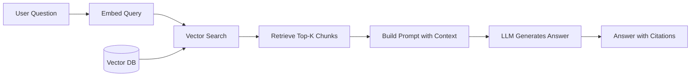
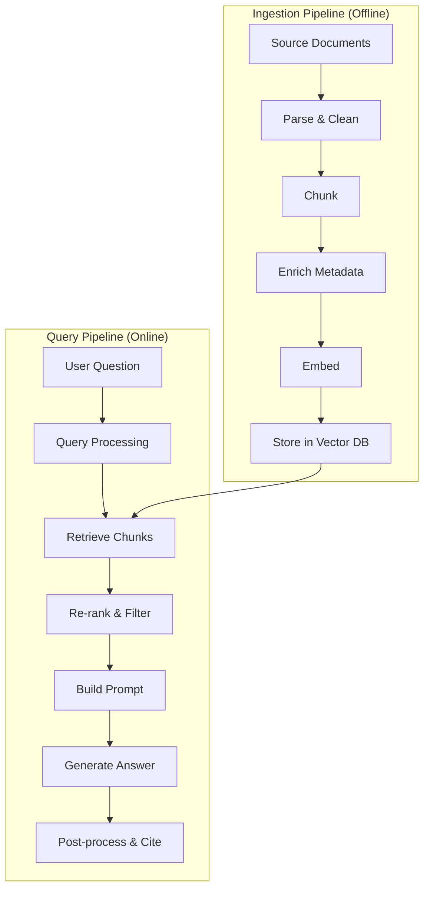
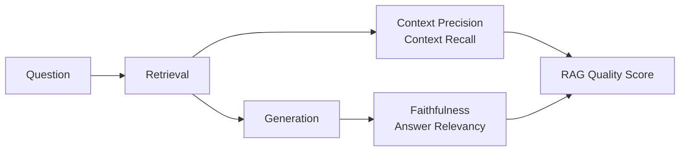

# Chapter 7: RAG — Retrieval-Augmented Generation

## Learning Objectives

By the end of this chapter, you will:

- [ ] Understand why RAG exists and what problems it solves
- [ ] Build a complete RAG pipeline from document ingestion to answer generation
- [ ] Integrate vector databases (Pinecone, Qdrant, pgvector) for production retrieval
- [ ] Implement advanced retrieval patterns: multi-query, contextual compression, parent-child
- [ ] Generate grounded answers with source citations
- [ ] Evaluate RAG systems end-to-end (retrieval + generation quality)
- [ ] Diagnose and fix common RAG failure modes

## Prerequisites

- Chapter 5: Building AI Applications (application architecture, streaming)
- Chapter 6: Embeddings and Semantic Search (embeddings, chunking, similarity)

## Estimated Time

- Reading: 75 minutes
- Exercises: 60 minutes
- Project: 4 hours

---

## Why RAG Exists

LLMs have two fundamental limitations that RAG solves:

1. **Knowledge cutoff.** Models are trained on data up to a specific date. They can't answer questions about anything that happened after training.
2. **No access to private data.** Your company's documentation, internal knowledge base, product database — the model has never seen any of it.

RAG is the solution: instead of asking the model to recall facts from training, you **retrieve** relevant information from your own data and **inject** it into the prompt. The model then generates an answer grounded in that retrieved context.

```
Without RAG:
  User: "What's our refund policy for enterprise clients?"
  LLM: "I don't have information about your specific refund policy." (or worse, hallucinated answer)

With RAG:
  User: "What's our refund policy for enterprise clients?"
  → Retrieve: [policy_doc_chunk: "Enterprise refund: 60 days, pro-rated, requires VP approval..."]
  → LLM + Context: "Enterprise clients can request a pro-rated refund within 60 days. 
                     This requires VP-level approval. (Source: Enterprise Policy v3.2)"
```



*Figure 1: The core RAG pipeline — retrieve context, then generate with it*

> 🔑 **Key Concept**
>
> RAG is not a product or a library. It's an architecture pattern: retrieve relevant context → augment the prompt → generate a grounded response. Every implementation of this pattern is "RAG" regardless of which tools you use.

### RAG vs. Fine-Tuning vs. Long Context

| Approach | When to Use | Pros | Cons |
|----------|-------------|------|------|
| **RAG** | Dynamic data, many documents, need citations | Fresh data, traceable sources, cheap to update | Retrieval quality is a bottleneck |
| **Fine-tuning** | Consistent style/behavior changes, small domain | Embedded knowledge, no retrieval latency | Expensive, hard to update, no citations |
| **Long context** | Small, complete documents (< context limit) | Simple, no retrieval needed | Expensive per query, "lost in middle" problem |

> 💡 **Developer Insight**
>
> RAG is the right default for 90% of "use my own data" use cases. Fine-tuning is for behavior changes, not knowledge injection. If someone says "just fine-tune the model on our docs" — that's almost always wrong. Fine-tuning teaches style; RAG provides knowledge.

---

## The Complete RAG Architecture



*Figure 2: The two halves of a RAG system — offline ingestion and online query*

Let's build each component.

---

## Part 1: Document Ingestion

### Loading Documents from Multiple Sources

```python
from abc import ABC, abstractmethod
from dataclasses import dataclass, field
from pathlib import Path
from typing import Generator
import hashlib


@dataclass
class RawDocument:
    """A document loaded from any source."""
    id: str
    content: str
    metadata: dict = field(default_factory=dict)
    source: str = ""
    content_hash: str = ""
    
    def __post_init__(self):
        if not self.content_hash:
            self.content_hash = hashlib.sha256(self.content.encode()).hexdigest()[:16]


class DocumentLoader(ABC):
    """Base class for document loaders."""
    
    @abstractmethod
    def load(self) -> Generator[RawDocument, None, None]:
        pass


class MarkdownLoader(DocumentLoader):
    """Load markdown files from a directory."""
    
    def __init__(self, directory: str, glob_pattern: str = "**/*.md"):
        self.directory = Path(directory)
        self.glob_pattern = glob_pattern
    
    def load(self) -> Generator[RawDocument, None, None]:
        for file_path in self.directory.glob(self.glob_pattern):
            content = file_path.read_text(encoding="utf-8")
            yield RawDocument(
                id=str(file_path.relative_to(self.directory)),
                content=content,
                metadata={
                    "file_name": file_path.name,
                    "file_path": str(file_path),
                    "file_size": file_path.stat().st_size,
                },
                source=f"file://{file_path}"
            )


class PDFLoader(DocumentLoader):
    """Load PDF files using pymupdf."""
    
    def __init__(self, file_path: str):
        self.file_path = Path(file_path)
    
    def load(self) -> Generator[RawDocument, None, None]:
        import fitz  # pymupdf
        
        doc = fitz.open(self.file_path)
        
        for page_num, page in enumerate(doc):
            text = page.get_text()
            if text.strip():
                yield RawDocument(
                    id=f"{self.file_path.stem}_page_{page_num + 1}",
                    content=text,
                    metadata={
                        "page_number": page_num + 1,
                        "total_pages": len(doc),
                        "file_name": self.file_path.name,
                    },
                    source=f"pdf://{self.file_path}#page={page_num + 1}"
                )


class WebLoader(DocumentLoader):
    """Load content from web URLs."""
    
    def __init__(self, urls: list[str]):
        self.urls = urls
    
    def load(self) -> Generator[RawDocument, None, None]:
        import httpx
        from bs4 import BeautifulSoup
        
        for url in self.urls:
            try:
                response = httpx.get(url, timeout=30, follow_redirects=True)
                response.raise_for_status()
                
                soup = BeautifulSoup(response.text, "html.parser")
                
                # Remove scripts, styles, nav
                for tag in soup(["script", "style", "nav", "footer", "header"]):
                    tag.decompose()
                
                text = soup.get_text(separator="\n", strip=True)
                title = soup.title.string if soup.title else url
                
                yield RawDocument(
                    id=url,
                    content=text,
                    metadata={"url": url, "title": title},
                    source=url
                )
            except Exception as e:
                print(f"Failed to load {url}: {e}")
```

### The Ingestion Pipeline

```python
from openai import OpenAI
import numpy as np


@dataclass
class Chunk:
    """A processed chunk ready for embedding and storage."""
    id: str
    text: str
    embedding: list[float] | None = None
    metadata: dict = field(default_factory=dict)


class IngestionPipeline:
    """Processes documents from raw to stored embeddings."""
    
    def __init__(
        self,
        embedding_model: str = "text-embedding-3-small",
        chunk_size: int = 500,
        chunk_overlap: int = 50,
        batch_size: int = 100,
    ):
        self.client = OpenAI()
        self.embedding_model = embedding_model
        self.chunk_size = chunk_size
        self.chunk_overlap = chunk_overlap
        self.batch_size = batch_size
    
    def process(self, documents: list[RawDocument]) -> list[Chunk]:
        """Full ingestion: load → chunk → embed → return stored chunks."""
        all_chunks = []
        
        # Step 1: Chunk all documents
        for doc in documents:
            chunks = self._chunk_document(doc)
            all_chunks.extend(chunks)
        
        # Step 2: Embed in batches
        self._embed_chunks(all_chunks)
        
        return all_chunks
    
    def _chunk_document(self, doc: RawDocument) -> list[Chunk]:
        """Chunk a single document with metadata preservation."""
        text = doc.content
        chunks = []
        
        # Use recursive chunking from Chapter 6
        raw_chunks = self._recursive_chunk(text, self.chunk_size * 4)
        
        for i, chunk_text in enumerate(raw_chunks):
            # Enrich with document context
            enriched_text = chunk_text
            if doc.metadata.get("title"):
                enriched_text = f"[{doc.metadata['title']}]\n{chunk_text}"
            
            chunks.append(Chunk(
                id=f"{doc.id}::chunk_{i}",
                text=enriched_text,
                metadata={
                    **doc.metadata,
                    "document_id": doc.id,
                    "chunk_index": i,
                    "source": doc.source,
                    "content_hash": doc.content_hash,
                }
            ))
        
        return chunks
    
    def _embed_chunks(self, chunks: list[Chunk]):
        """Embed all chunks in batches."""
        for i in range(0, len(chunks), self.batch_size):
            batch = chunks[i:i + self.batch_size]
            texts = [c.text for c in batch]
            
            response = self.client.embeddings.create(
                input=texts,
                model=self.embedding_model
            )
            
            for j, item in enumerate(sorted(response.data, key=lambda x: x.index)):
                batch[j].embedding = item.embedding
    
    def _recursive_chunk(self, text: str, max_chars: int) -> list[str]:
        """Recursive chunking (simplified from Chapter 6)."""
        separators = ["\n\n", "\n", ". ", " "]
        
        if len(text) <= max_chars:
            return [text] if text.strip() else []
        
        for sep in separators:
            parts = text.split(sep)
            if len(parts) > 1:
                chunks = []
                current = ""
                for part in parts:
                    piece = part + sep
                    if len(current) + len(piece) <= max_chars:
                        current += piece
                    else:
                        if current.strip():
                            chunks.append(current.strip())
                        current = piece
                if current.strip():
                    chunks.append(current.strip())
                if chunks:
                    return chunks
        
        # Final fallback: hard split
        return [text[i:i+max_chars] for i in range(0, len(text), max_chars)]
```

---

## Part 2: Vector Database Integration

In Chapter 6, we used in-memory storage. Production RAG requires a vector database for persistence, scalability, and filtering.

### Option A: Qdrant (Recommended for Learning)

Open-source, runs locally, great Python SDK.

```python
from qdrant_client import QdrantClient
from qdrant_client.models import (
    Distance, VectorParams, PointStruct, Filter, FieldCondition, MatchValue
)


class QdrantVectorStore:
    """Vector store using Qdrant."""
    
    def __init__(
        self,
        collection_name: str = "documents",
        embedding_dim: int = 1536,
        url: str = "http://localhost:6333"
    ):
        self.client = QdrantClient(url=url)
        self.collection_name = collection_name
        self.embedding_dim = embedding_dim
        self._ensure_collection()
    
    def _ensure_collection(self):
        """Create collection if it doesn't exist."""
        collections = [c.name for c in self.client.get_collections().collections]
        
        if self.collection_name not in collections:
            self.client.create_collection(
                collection_name=self.collection_name,
                vectors_config=VectorParams(
                    size=self.embedding_dim,
                    distance=Distance.COSINE
                )
            )
    
    def upsert(self, chunks: list[Chunk]):
        """Store chunks with embeddings in Qdrant."""
        points = [
            PointStruct(
                id=hash(chunk.id) % (2**63),  # Qdrant needs integer IDs
                vector=chunk.embedding,
                payload={
                    "text": chunk.text,
                    "chunk_id": chunk.id,
                    **chunk.metadata,
                }
            )
            for chunk in chunks
            if chunk.embedding is not None
        ]
        
        # Upsert in batches
        batch_size = 100
        for i in range(0, len(points), batch_size):
            self.client.upsert(
                collection_name=self.collection_name,
                points=points[i:i + batch_size]
            )
    
    def search(
        self,
        query_embedding: list[float],
        top_k: int = 5,
        filters: dict = None
    ) -> list[dict]:
        """Search for similar vectors with optional metadata filtering."""
        query_filter = None
        if filters:
            conditions = [
                FieldCondition(key=k, match=MatchValue(value=v))
                for k, v in filters.items()
            ]
            query_filter = Filter(must=conditions)
        
        results = self.client.search(
            collection_name=self.collection_name,
            query_vector=query_embedding,
            limit=top_k,
            query_filter=query_filter,
        )
        
        return [
            {
                "text": hit.payload.get("text", ""),
                "score": hit.score,
                "metadata": {k: v for k, v in hit.payload.items() if k != "text"},
            }
            for hit in results
        ]
    
    def delete_by_document(self, document_id: str):
        """Delete all chunks for a specific document."""
        self.client.delete(
            collection_name=self.collection_name,
            points_selector=Filter(
                must=[FieldCondition(key="document_id", match=MatchValue(value=document_id))]
            )
        )
```

### Option B: pgvector (PostgreSQL Extension)

If you already have PostgreSQL, pgvector adds vector search without a new service.

```python
import psycopg2
from psycopg2.extras import execute_values


class PgVectorStore:
    """Vector store using PostgreSQL with pgvector extension."""
    
    def __init__(self, connection_string: str, table_name: str = "document_chunks"):
        self.conn = psycopg2.connect(connection_string)
        self.table_name = table_name
        self._setup_table()
    
    def _setup_table(self):
        """Create table with vector column if it doesn't exist."""
        with self.conn.cursor() as cur:
            cur.execute("CREATE EXTENSION IF NOT EXISTS vector")
            cur.execute(f"""
                CREATE TABLE IF NOT EXISTS {self.table_name} (
                    id TEXT PRIMARY KEY,
                    text TEXT NOT NULL,
                    embedding vector(1536),
                    document_id TEXT,
                    source TEXT,
                    metadata JSONB DEFAULT '{{}}',
                    created_at TIMESTAMP DEFAULT NOW()
                )
            """)
            cur.execute(f"""
                CREATE INDEX IF NOT EXISTS {self.table_name}_embedding_idx
                ON {self.table_name} USING ivfflat (embedding vector_cosine_ops)
                WITH (lists = 100)
            """)
            self.conn.commit()
    
    def upsert(self, chunks: list[Chunk]):
        """Store chunks in PostgreSQL."""
        with self.conn.cursor() as cur:
            values = [
                (chunk.id, chunk.text, chunk.embedding,
                 chunk.metadata.get("document_id"), chunk.metadata.get("source"),
                 json.dumps(chunk.metadata))
                for chunk in chunks if chunk.embedding
            ]
            
            execute_values(cur, f"""
                INSERT INTO {self.table_name} (id, text, embedding, document_id, source, metadata)
                VALUES %s
                ON CONFLICT (id) DO UPDATE SET
                    text = EXCLUDED.text,
                    embedding = EXCLUDED.embedding,
                    metadata = EXCLUDED.metadata
            """, values)
            self.conn.commit()
    
    def search(self, query_embedding: list[float], top_k: int = 5, filters: dict = None) -> list[dict]:
        """Cosine similarity search with optional filtering."""
        where_clause = ""
        params = [query_embedding, top_k]
        
        if filters:
            conditions = []
            for key, value in filters.items():
                conditions.append(f"metadata->>'{key}' = %s")
                params.insert(-1, value)
            where_clause = "WHERE " + " AND ".join(conditions)
        
        with self.conn.cursor() as cur:
            cur.execute(f"""
                SELECT text, 1 - (embedding <=> %s::vector) as score,
                       metadata, document_id, source
                FROM {self.table_name}
                {where_clause}
                ORDER BY embedding <=> %s::vector
                LIMIT %s
            """, [query_embedding, *params[1:-1], query_embedding, top_k])
            
            results = []
            for row in cur.fetchall():
                results.append({
                    "text": row[0],
                    "score": float(row[1]),
                    "metadata": row[2],
                })
            return results
```

### Vector Database Comparison

| Database | Type | Hosting | Best For |
|----------|------|---------|----------|
| Qdrant | Dedicated vector DB | Self-hosted or cloud | Full-featured, great DX |
| Pinecone | Managed vector DB | Cloud only | Zero-ops, enterprise scale |
| Weaviate | Dedicated vector DB | Self-hosted or cloud | Multi-modal, GraphQL API |
| pgvector | PostgreSQL extension | Wherever you run Postgres | Existing Postgres stack |
| Chroma | Embedded vector DB | In-process | Prototyping, small datasets |

> 📐 **Architecture Decision**
>
> Use pgvector if you already have PostgreSQL and your dataset is under 5 million vectors. Use Qdrant or Pinecone if you need dedicated vector search infrastructure, metadata filtering at scale, or more than 10M vectors. Chroma is for prototypes and local development only.

---

## Part 3: The Query Pipeline

This is where RAG comes together: user asks a question → retrieve context → generate answer.

### Basic RAG Pipeline

```python
class RAGPipeline:
    """Complete RAG pipeline: retrieve → augment → generate."""
    
    def __init__(
        self,
        vector_store: QdrantVectorStore,
        embedding_model: str = "text-embedding-3-small",
        generation_model: str = "gpt-4o-mini",
        top_k: int = 5,
        similarity_threshold: float = 0.5,
    ):
        self.client = OpenAI()
        self.vector_store = vector_store
        self.embedding_model = embedding_model
        self.generation_model = generation_model
        self.top_k = top_k
        self.similarity_threshold = similarity_threshold
    
    def query(self, question: str, filters: dict = None) -> dict:
        """Answer a question using RAG."""
        # Step 1: Embed the query
        query_embedding = self._embed_query(question)
        
        # Step 2: Retrieve relevant chunks
        results = self.vector_store.search(
            query_embedding=query_embedding,
            top_k=self.top_k,
            filters=filters
        )
        
        # Step 3: Filter by similarity threshold
        relevant_chunks = [
            r for r in results if r["score"] >= self.similarity_threshold
        ]
        
        # Step 4: Generate answer with context
        if not relevant_chunks:
            return {
                "answer": "I don't have enough information to answer that question based on the available documents.",
                "sources": [],
                "confidence": "low",
            }
        
        answer = self._generate_answer(question, relevant_chunks)
        
        return {
            "answer": answer,
            "sources": [
                {"text": c["text"][:200], "score": c["score"], "source": c["metadata"].get("source", "")}
                for c in relevant_chunks
            ],
            "chunks_retrieved": len(relevant_chunks),
            "top_score": relevant_chunks[0]["score"] if relevant_chunks else 0,
        }
    
    def _embed_query(self, text: str) -> list[float]:
        response = self.client.embeddings.create(
            input=text,
            model=self.embedding_model
        )
        return response.data[0].embedding
    
    def _generate_answer(self, question: str, chunks: list[dict]) -> str:
        """Generate a grounded answer using retrieved context."""
        context = "\n\n---\n\n".join(
            f"[Source {i+1}]: {chunk['text']}" 
            for i, chunk in enumerate(chunks)
        )
        
        response = self.client.chat.completions.create(
            model=self.generation_model,
            messages=[
                {
                    "role": "system",
                    "content": """Answer the user's question based ONLY on the provided context.

RULES:
1. Only use information from the provided sources
2. If the context doesn't contain enough information, say so clearly
3. Cite sources using [Source N] notation
4. Be concise and direct
5. Never make up information not present in the sources"""
                },
                {
                    "role": "user",
                    "content": f"CONTEXT:\n{context}\n\nQUESTION: {question}"
                }
            ],
            temperature=0.0,
            max_tokens=500,
        )
        
        return response.choices[0].message.content
    
    def _embed_query(self, text: str) -> list[float]:
        response = self.client.embeddings.create(input=text, model=self.embedding_model)
        return response.data[0].embedding


# Usage
pipeline = RAGPipeline(vector_store=QdrantVectorStore())
result = pipeline.query("What's the refund policy for enterprise customers?")
print(result["answer"])
print(f"Sources: {len(result['sources'])}, Top score: {result['top_score']:.3f}")
```

---

## Advanced Retrieval Patterns

Basic RAG retrieves the top-K chunks by embedding similarity. Advanced patterns significantly improve retrieval quality.

### Pattern 1: Multi-Query Retrieval

A single query might not capture all angles of the question. Generate multiple query variations to cast a wider net.

```python
class MultiQueryRetriever:
    """Generate multiple query variations to improve recall."""
    
    def __init__(self, vector_store, generation_model: str = "gpt-4o-mini"):
        self.vector_store = vector_store
        self.client = OpenAI()
        self.generation_model = generation_model
    
    def retrieve(self, question: str, top_k: int = 5) -> list[dict]:
        """Retrieve using multiple generated query variations."""
        # Generate query variations
        variations = self._generate_variations(question)
        
        # Retrieve for each variation
        all_results = {}
        for query in [question] + variations:
            embedding = self._embed(query)
            results = self.vector_store.search(embedding, top_k=top_k)
            
            for r in results:
                chunk_id = r["metadata"].get("chunk_id", r["text"][:50])
                if chunk_id not in all_results or r["score"] > all_results[chunk_id]["score"]:
                    all_results[chunk_id] = r
        
        # Sort by best score and return top-k
        sorted_results = sorted(all_results.values(), key=lambda x: x["score"], reverse=True)
        return sorted_results[:top_k]
    
    def _generate_variations(self, question: str, n: int = 3) -> list[str]:
        """Generate alternative phrasings of the question."""
        response = self.client.chat.completions.create(
            model=self.generation_model,
            messages=[{
                "role": "user",
                "content": f"""Generate {n} alternative ways to ask this question.
Each variation should approach the topic from a different angle.
Return only the questions, one per line.

Original: {question}"""
            }],
            temperature=0.7,
            max_tokens=200
        )
        
        return [
            line.strip().lstrip("0123456789.-) ")
            for line in response.choices[0].message.content.strip().split("\n")
            if line.strip()
        ][:n]
    
    def _embed(self, text: str) -> list[float]:
        response = self.client.embeddings.create(input=text, model="text-embedding-3-small")
        return response.data[0].embedding
```

### Pattern 2: Parent-Child Retrieval

Embed small chunks for precision but return the larger parent section for context.

```python
class ParentChildRetriever:
    """Embed small chunks, return large parent chunks as context."""
    
    def __init__(self, vector_store):
        self.vector_store = vector_store
        self.client = OpenAI()
        self.parent_store: dict[str, str] = {}  # parent_id -> full text
    
    def ingest(self, document: RawDocument, parent_chunk_size: int = 2000, child_chunk_size: int = 300):
        """Create parent and child chunks. Embed children, store parents."""
        # Create large parent chunks
        parent_chunks = self._chunk(document.content, parent_chunk_size)
        
        all_child_chunks = []
        for parent_idx, parent_text in enumerate(parent_chunks):
            parent_id = f"{document.id}::parent_{parent_idx}"
            self.parent_store[parent_id] = parent_text
            
            # Create small child chunks from each parent
            child_texts = self._chunk(parent_text, child_chunk_size)
            for child_idx, child_text in enumerate(child_texts):
                all_child_chunks.append(Chunk(
                    id=f"{parent_id}::child_{child_idx}",
                    text=child_text,
                    metadata={
                        "parent_id": parent_id,
                        "document_id": document.id,
                    }
                ))
        
        # Embed and store children
        pipeline = IngestionPipeline()
        pipeline._embed_chunks(all_child_chunks)
        self.vector_store.upsert(all_child_chunks)
    
    def retrieve(self, question: str, top_k: int = 3) -> list[str]:
        """Search by child chunks, return parent chunks."""
        embedding = self._embed(question)
        child_results = self.vector_store.search(embedding, top_k=top_k * 2)
        
        # Deduplicate parents
        seen_parents = set()
        parent_texts = []
        
        for result in child_results:
            parent_id = result["metadata"].get("parent_id")
            if parent_id and parent_id not in seen_parents:
                seen_parents.add(parent_id)
                parent_texts.append(self.parent_store[parent_id])
                if len(parent_texts) >= top_k:
                    break
        
        return parent_texts
    
    def _chunk(self, text: str, size: int) -> list[str]:
        """Simple chunking by character count."""
        chunks = []
        for i in range(0, len(text), size):
            chunk = text[i:i + size]
            if chunk.strip():
                chunks.append(chunk.strip())
        return chunks
    
    def _embed(self, text: str) -> list[float]:
        response = self.client.embeddings.create(input=text, model="text-embedding-3-small")
        return response.data[0].embedding
```

### Pattern 3: Contextual Compression

After retrieval, compress each chunk to only the relevant portions.

```python
class ContextualCompressor:
    """Compress retrieved chunks to only the relevant portions."""
    
    def __init__(self, model: str = "gpt-4o-mini"):
        self.client = OpenAI()
        self.model = model
    
    def compress(self, question: str, chunks: list[dict]) -> list[dict]:
        """Extract only the relevant sentences from each chunk."""
        compressed = []
        
        for chunk in chunks:
            response = self.client.chat.completions.create(
                model=self.model,
                messages=[{
                    "role": "user",
                    "content": f"""Extract ONLY the sentences relevant to the question.
If nothing is relevant, respond with "NOT_RELEVANT".

Question: {question}
Text: {chunk['text']}

Relevant excerpt:"""
                }],
                temperature=0.0,
                max_tokens=300
            )
            
            excerpt = response.choices[0].message.content.strip()
            if excerpt != "NOT_RELEVANT" and excerpt:
                compressed.append({
                    **chunk,
                    "text": excerpt,
                    "original_text": chunk["text"],
                })
        
        return compressed
```

> ⚠️ **Common Mistake**
>
> Multi-query and contextual compression both add LLM calls to the retrieval pipeline. For a single user query, multi-query adds 1 call (generating variations) and compression adds N calls (one per chunk). Monitor latency — these patterns trade speed for quality. Use them for high-value queries, not real-time autocomplete.

---

## Generation: Building the Answer

The generation phase takes retrieved context and produces a grounded answer. Here's how to do it well.

### Citation Patterns

```python
CITATION_PROMPT = """Answer the question using the provided sources.

RULES:
- Cite every claim with [1], [2], etc. matching the source number
- If sources conflict, mention both and note the discrepancy
- If no source supports a claim, don't make it
- End with a "Sources" section listing cited sources

SOURCES:
{sources}

QUESTION: {question}
"""


def generate_with_citations(question: str, chunks: list[dict], model: str = "gpt-4o") -> dict:
    """Generate answer with inline citations and source list."""
    sources_text = "\n\n".join(
        f"[{i+1}] {chunk['text']}\n    Source: {chunk['metadata'].get('source', 'Unknown')}"
        for i, chunk in enumerate(chunks)
    )
    
    client = OpenAI()
    response = client.chat.completions.create(
        model=model,
        messages=[
            {"role": "system", "content": "You are a research assistant. Always cite sources."},
            {"role": "user", "content": CITATION_PROMPT.format(
                sources=sources_text, question=question
            )}
        ],
        temperature=0.0,
        max_tokens=800,
    )
    
    answer = response.choices[0].message.content
    
    # Extract which sources were actually cited
    import re
    cited_numbers = set(int(n) for n in re.findall(r'\[(\d+)\]', answer))
    cited_sources = [
        chunks[n-1]["metadata"].get("source", "Unknown") 
        for n in cited_numbers if n <= len(chunks)
    ]
    
    return {
        "answer": answer,
        "cited_sources": cited_sources,
        "all_sources": [c["metadata"].get("source", "") for c in chunks],
    }
```

### Handling "I Don't Know"

```python
HONEST_RAG_PROMPT = """You are a knowledge assistant. Answer questions using ONLY the provided context.

CRITICAL RULES:
1. If the context clearly answers the question → answer it with citations
2. If the context partially answers → give what you can, note what's missing
3. If the context doesn't address the question at all → say "I don't have information about this in my knowledge base"

NEVER:
- Guess or extrapolate beyond what the sources state
- Use general knowledge not in the provided context
- Pretend to have information you don't

CONTEXT:
{context}

QUESTION: {question}

Respond with JSON:
{{
    "answer": "your response",
    "confidence": "high" | "medium" | "low",
    "sources_used": [list of source numbers],
    "missing_info": "what additional info would help, or null"
}}
"""
```

> 🏢 **Industry Note**
>
> The best RAG systems explicitly handle uncertainty. Users trust a system that says "I don't know" over one that confabulates. Implement confidence scoring: if top retrieval scores are below your threshold or the LLM can't ground its answer in sources, surface that uncertainty to the user.

---

## Evaluating RAG Systems

RAG evaluation has two dimensions: retrieval quality (did we find the right chunks?) and generation quality (did we answer correctly given those chunks?).

### The RAGAS Framework



*Figure 4: RAG evaluation measures both retrieval and generation quality*

### Evaluation Metrics

| Metric | What It Measures | How to Compute |
|--------|-----------------|----------------|
| **Context Precision** | Are retrieved chunks relevant? | % of retrieved chunks that are actually relevant |
| **Context Recall** | Did we find all relevant chunks? | % of relevant chunks that were retrieved |
| **Faithfulness** | Is the answer grounded in context? | Claims in answer ÷ claims supported by context |
| **Answer Relevancy** | Does the answer address the question? | LLM-judged relevance of answer to question |
| **Answer Correctness** | Is the answer factually correct? | Compare to ground-truth answer |

### Building a RAG Evaluator

```python
@dataclass
class RAGTestCase:
    """A test case for RAG evaluation."""
    question: str
    expected_answer: str
    relevant_chunk_ids: list[str]  # Chunks that should be retrieved
    category: str = "general"


@dataclass
class RAGEvalResult:
    """Evaluation result for a single RAG query."""
    question: str
    generated_answer: str
    retrieved_chunk_ids: list[str]
    context_precision: float
    context_recall: float
    faithfulness: float
    answer_relevancy: float


class RAGEvaluator:
    """Evaluates end-to-end RAG quality."""
    
    def __init__(self, rag_pipeline: RAGPipeline):
        self.pipeline = rag_pipeline
        self.client = OpenAI()
    
    def evaluate(self, test_cases: list[RAGTestCase]) -> dict:
        """Run full evaluation across all test cases."""
        results = []
        
        for tc in test_cases:
            result = self.pipeline.query(tc.question)
            
            # Get retrieved chunk IDs
            retrieved_ids = [
                s.get("metadata", {}).get("chunk_id", "")
                for s in result.get("sources", [])
            ]
            
            # Context Precision: what % of retrieved is relevant?
            relevant_retrieved = set(retrieved_ids) & set(tc.relevant_chunk_ids)
            ctx_precision = len(relevant_retrieved) / len(retrieved_ids) if retrieved_ids else 0
            
            # Context Recall: what % of relevant was retrieved?
            ctx_recall = len(relevant_retrieved) / len(tc.relevant_chunk_ids) if tc.relevant_chunk_ids else 0
            
            # Faithfulness: is the answer grounded in context? (LLM-judged)
            faithfulness = self._judge_faithfulness(
                result["answer"], 
                [s["text"] for s in result.get("sources", [])]
            )
            
            # Answer Relevancy: does it answer the question? (LLM-judged)
            relevancy = self._judge_relevancy(tc.question, result["answer"])
            
            results.append(RAGEvalResult(
                question=tc.question,
                generated_answer=result["answer"],
                retrieved_chunk_ids=retrieved_ids,
                context_precision=ctx_precision,
                context_recall=ctx_recall,
                faithfulness=faithfulness,
                answer_relevancy=relevancy,
            ))
        
        # Aggregate metrics
        n = len(results)
        return {
            "context_precision": sum(r.context_precision for r in results) / n,
            "context_recall": sum(r.context_recall for r in results) / n,
            "faithfulness": sum(r.faithfulness for r in results) / n,
            "answer_relevancy": sum(r.answer_relevancy for r in results) / n,
            "test_cases": n,
            "failures": [r for r in results if r.faithfulness < 0.5 or r.answer_relevancy < 0.5],
        }
    
    def _judge_faithfulness(self, answer: str, context_chunks: list[str]) -> float:
        """LLM-judged: is the answer grounded in the provided context?"""
        context = "\n---\n".join(context_chunks)
        
        response = self.client.chat.completions.create(
            model="gpt-4o-mini",
            messages=[{
                "role": "user",
                "content": f"""Rate how well the answer is supported by the context (0.0 to 1.0).
1.0 = every claim is directly supported by the context
0.5 = some claims are supported, others are not
0.0 = the answer contradicts or ignores the context

Context: {context[:3000]}
Answer: {answer}

Return ONLY a number between 0.0 and 1.0."""
            }],
            temperature=0.0,
            max_tokens=10
        )
        
        try:
            return float(response.choices[0].message.content.strip())
        except ValueError:
            return 0.5
    
    def _judge_relevancy(self, question: str, answer: str) -> float:
        """LLM-judged: does the answer address the question?"""
        response = self.client.chat.completions.create(
            model="gpt-4o-mini",
            messages=[{
                "role": "user",
                "content": f"""Rate how relevant the answer is to the question (0.0 to 1.0).
1.0 = directly and completely answers the question
0.5 = partially answers or is tangentially related  
0.0 = completely irrelevant

Question: {question}
Answer: {answer}

Return ONLY a number between 0.0 and 1.0."""
            }],
            temperature=0.0,
            max_tokens=10
        )
        
        try:
            return float(response.choices[0].message.content.strip())
        except ValueError:
            return 0.5
```

---

## Diagnosing RAG Failures

When your RAG system gives bad answers, you need to pinpoint whether the problem is retrieval or generation.

### The Diagnostic Framework

```
Bad Answer → Was the right context retrieved?
  ├── No  → Retrieval problem
  │         ├── Query doesn't match chunk embeddings → Improve chunking or add query expansion
  │         ├── Relevant chunk not in database → Data ingestion gap
  │         └── Threshold too high → Lower similarity threshold
  └── Yes → Generation problem
            ├── Model ignores context → Improve RAG prompt
            ├── Context too long/noisy → Add re-ranking or compression
            └── Conflicting sources → Add conflict resolution logic
```

### Common Failure Modes and Fixes

| Failure | Symptom | Fix |
|---------|---------|-----|
| Chunks too large | Retrieves correct doc but irrelevant section | Reduce chunk size (300–500 tokens) |
| Chunks too small | Retrieves relevant sentence but not enough context | Use parent-child retrieval |
| Wrong chunks retrieved | Top results are irrelevant | Add metadata filtering, improve embedding enrichment |
| Answer ignores context | Model uses training knowledge instead of context | Strengthen "only use provided context" instruction |
| Answer hallucsinates details | Makes up facts not in sources | Add citation requirements, lower temperature to 0 |
| "I don't know" too often | Valid questions get no answer | Lower similarity threshold, add multi-query |
| Slow response time | User waits 10+ seconds | Cache common queries, use smaller model, reduce top_k |

> 💡 **Developer Insight**
>
> When debugging RAG, always check retrieval FIRST. Log the retrieved chunks for every query. 80% of "the AI gives wrong answers" issues are actually "the right document wasn't found." No generation prompt can fix bad retrieval.

---

## Production RAG Patterns

### Streaming RAG

```python
async def stream_rag_response(question: str, pipeline: RAGPipeline):
    """Stream a RAG answer with sources shown after completion."""
    
    # Step 1: Retrieve (fast, not streamed)
    query_embedding = pipeline._embed_query(question)
    chunks = pipeline.vector_store.search(query_embedding, top_k=5)
    relevant = [c for c in chunks if c["score"] >= pipeline.similarity_threshold]
    
    if not relevant:
        yield {"type": "answer", "content": "I don't have information about this."}
        return
    
    # Step 2: Stream the generation
    context = "\n---\n".join(f"[{i+1}]: {c['text']}" for i, c in enumerate(relevant))
    
    client = AsyncOpenAI()
    stream = await client.chat.completions.create(
        model="gpt-4o-mini",
        messages=[
            {"role": "system", "content": "Answer using only the provided context. Cite with [N]."},
            {"role": "user", "content": f"Context:\n{context}\n\nQuestion: {question}"}
        ],
        temperature=0.0,
        max_tokens=500,
        stream=True
    )
    
    async for chunk in stream:
        if chunk.choices[0].delta.content:
            yield {"type": "token", "content": chunk.choices[0].delta.content}
    
    # Step 3: Send sources after answer is complete
    yield {
        "type": "sources",
        "content": [
            {"text": c["text"][:150], "score": c["score"], "source": c["metadata"].get("source")}
            for c in relevant
        ]
    }
```

### Conversational RAG (Chat + Retrieval)

```python
class ConversationalRAG:
    """RAG that understands conversation context for follow-up questions."""
    
    def __init__(self, rag_pipeline: RAGPipeline):
        self.pipeline = rag_pipeline
        self.client = OpenAI()
        self.history: list[dict] = []
    
    def query(self, question: str) -> dict:
        """Handle a question in conversational context."""
        # Step 1: Rewrite the question to be self-contained
        standalone_question = self._make_standalone(question)
        
        # Step 2: Run RAG with the standalone question
        result = self.pipeline.query(standalone_question)
        
        # Step 3: Update history
        self.history.append({"role": "user", "content": question})
        self.history.append({"role": "assistant", "content": result["answer"]})
        
        return {**result, "standalone_question": standalone_question}
    
    def _make_standalone(self, question: str) -> str:
        """Rewrite a follow-up question to be self-contained."""
        if not self.history:
            return question  # First question, no context needed
        
        # Only use last 4 messages for context
        recent_history = self.history[-4:]
        history_text = "\n".join(f"{m['role']}: {m['content']}" for m in recent_history)
        
        response = self.client.chat.completions.create(
            model="gpt-4o-mini",
            messages=[{
                "role": "user",
                "content": f"""Rewrite the follow-up question to be self-contained (understandable without conversation history).
If it's already self-contained, return it unchanged.

Conversation:
{history_text}

Follow-up question: {question}

Self-contained question:"""
            }],
            temperature=0.0,
            max_tokens=100
        )
        
        return response.choices[0].message.content.strip()
```

### Caching RAG Results

```python
import hashlib
from datetime import datetime, timedelta


class RAGCache:
    """Cache RAG results to avoid re-embedding and re-generating for common queries."""
    
    def __init__(self, ttl_minutes: int = 60):
        self.cache: dict[str, dict] = {}
        self.ttl = timedelta(minutes=ttl_minutes)
    
    def get(self, question: str) -> dict | None:
        """Return cached result if available and fresh."""
        key = self._make_key(question)
        
        if key in self.cache:
            entry = self.cache[key]
            if datetime.now() - entry["timestamp"] < self.ttl:
                return entry["result"]
            else:
                del self.cache[key]
        
        return None
    
    def set(self, question: str, result: dict):
        """Cache a RAG result."""
        key = self._make_key(question)
        self.cache[key] = {
            "result": result,
            "timestamp": datetime.now(),
        }
    
    def _make_key(self, question: str) -> str:
        """Normalize and hash the question for cache key."""
        normalized = question.lower().strip()
        return hashlib.md5(normalized.encode()).hexdigest()
```

---

## Production Notes

- **Index freshness matters.** If your source documents change, your RAG index becomes stale. Implement incremental re-indexing on a schedule (hourly, daily) depending on how often docs change.
- **Metadata filtering is critical at scale.** With 1M+ chunks, you need metadata filters (by document type, date, team, product) to narrow search before vector similarity.
- **Monitor retrieval scores.** If average top-1 scores trend downward, your index quality is degrading or user queries are shifting outside your content coverage.
- **Log queries with no good retrieval.** These reveal content gaps — topics users ask about that aren't in your knowledge base.
- **Separate retrieval from generation.** They can use different models, scale independently, and be cached separately.
- **Test with real user queries.** Synthetic test cases miss the weird phrasings, typos, and ambiguity of real users.

## Common Mistakes

1. **Skipping evaluation.** Building RAG without measuring quality is flying blind. Create eval sets before launching.

2. **Using too few chunks (top_k=1).** One chunk rarely provides enough context. Start with top_k=5 and reduce if context gets too noisy.

3. **Using too many chunks (top_k=20).** Stuffing irrelevant context confuses the model. Quality over quantity.

4. **Not handling "I don't know."** If retrieval scores are low, the system should admit uncertainty rather than hallucinate.

5. **Embedding queries and documents differently.** Some models produce different vectors for "questions" vs. "statements." Check if your model has this distinction and use the correct mode.

6. **Not versioning your index.** When you re-index, keep the old version available for rollback if quality drops.

## Best Practices

1. **Always include source citations.** Users need to verify answers. Citations build trust and enable fact-checking.

2. **Implement hybrid search.** Combine vector similarity with keyword matching for robust retrieval.

3. **Use metadata filtering.** Narrow the search space before vector comparison for better precision and speed.

4. **Cache common queries.** FAQ-style questions appear repeatedly. Cache both the embedding and the generated answer.

5. **Stream the answer.** Retrieval takes <500ms. Generation takes 2–5 seconds. Stream the generation while showing sources.

6. **Log everything.** Query, retrieved chunks, scores, generated answer, user feedback. This data drives all improvements.

7. **Implement feedback loops.** Let users flag bad answers. Use this to expand your eval set and identify content gaps.

8. **Start with the simplest pipeline that works.** Basic RAG (embed → search → generate) handles most use cases. Add multi-query, re-ranking, and compression only when basic RAG falls short on specific failure modes.

---

## Hands-On Exercises

### Exercise 1: Basic RAG Pipeline

**Difficulty:** ⭐⭐
**Time:** 25 minutes

Build a minimal RAG pipeline over a single markdown file:
1. Load a README.md or documentation file (at least 2,000 words)
2. Chunk it using recursive chunking (target 400 tokens per chunk)
3. Embed and store in-memory (use the SemanticSearchEngine from Chapter 6)
4. Query with 5 natural language questions
5. Print: question → retrieved chunks → generated answer → sources

### Exercise 2: Retrieval Diagnosis

**Difficulty:** ⭐⭐
**Time:** 20 minutes

Take your Exercise 1 pipeline and intentionally break it:
1. Ask a question about something NOT in the document — does it say "I don't know"?
2. Ask a question that requires combining information from two different chunks — does it handle multi-chunk synthesis?
3. Ask the same question with very different wording — does retrieval still find the right chunks?
4. Log and compare retrieval scores for successful vs. failed queries
5. Identify the minimum similarity threshold that separates good from bad retrieval

### Exercise 3: Multi-Query Improvement

**Difficulty:** ⭐⭐
**Time:** 25 minutes

Using the MultiQueryRetriever:
1. Pick 5 questions where basic single-query retrieval underperforms
2. Generate 3 variations per question
3. Compare: does multi-query find relevant chunks that single-query missed?
4. Measure: MRR improvement with multi-query vs. single-query
5. Track: how much latency does multi-query add?

### Exercise 4: End-to-End Evaluation

**Difficulty:** ⭐⭐⭐
**Time:** 30 minutes

1. Create 10 test cases with: question, expected answer, relevant chunk IDs
2. Run the RAGEvaluator on your pipeline
3. Calculate all four metrics: context precision, context recall, faithfulness, answer relevancy
4. Identify the weakest metric and propose a fix
5. Implement the fix and re-evaluate — did the metric improve?

---

## Mini Project

**Title:** PDF Knowledge Base with RAG
**Difficulty:** ⭐⭐⭐
**Time:** 3 hours
**What you'll build:** A RAG system that ingests PDF documents (technical documentation or research papers) and answers questions with source citations.

### Requirements

1. **Ingestion:** Load 3–5 PDF files using pymupdf
2. **Chunking:** Structure-aware chunking that preserves headings and page numbers
3. **Storage:** Vector database (Qdrant running locally via Docker, or Chroma for simplicity)
4. **Query:** Natural language questions → answers with page citations
5. **Evaluation:** 15 test cases with ground-truth answers
6. **UI:** CLI interface with formatted output (question, answer, sources, confidence)
7. **Features:**
   - Filter by document name
   - Show "I don't know" for out-of-scope questions
   - Display source page numbers

### Setup Commands

```bash
# Start Qdrant locally
docker run -p 6333:6333 qdrant/qdrant

# Install dependencies
pip install pymupdf qdrant-client openai python-dotenv
```

### Deliverables

```
pdf-rag-system/
├── src/
│   ├── ingest.py         # PDF loading + chunking
│   ├── store.py          # Vector DB operations
│   ├── query.py          # RAG query pipeline
│   ├── evaluate.py       # Evaluation framework
│   └── cli.py            # Interactive CLI
├── data/
│   ├── pdfs/             # Source PDF files
│   └── eval/
│       └── test_cases.json
├── docker-compose.yml    # Qdrant service
├── .env.example
├── requirements.txt
└── README.md
```

---

## Challenge Project

**Title:** Multi-Source Conversational RAG System
**Difficulty:** ⭐⭐⭐⭐
**Time:** 8 hours
**What you'll build:** A production-quality RAG system that handles multiple document sources, conversational follow-ups, streaming answers, and comprehensive evaluation.

### Requirements

1. **Multi-source ingestion:** Markdown, PDF, and web pages
2. **Conversational:** Handles follow-up questions using query rewriting
3. **Advanced retrieval:** Hybrid search (semantic + keyword) with re-ranking
4. **Streaming answers:** Token-by-token response with sources appended at end
5. **Confidence scoring:** Low/medium/high confidence based on retrieval scores
6. **Evaluation dashboard:** Run evals and display metrics (precision, recall, faithfulness)
7. **Incremental updates:** Add new documents without re-indexing everything
8. **API:** FastAPI with streaming endpoint + conversation management
9. **Caching:** Cache frequent queries for instant responses
10. **Monitoring:** Log all queries, retrieval scores, and generation metrics

### Architecture

```
conversational-rag/
├── src/
│   ├── api/
│   │   ├── routes.py         # FastAPI endpoints
│   │   └── models.py         # Request/response schemas
│   ├── ingestion/
│   │   ├── loaders.py        # Multi-format document loaders
│   │   ├── chunker.py        # Chunking strategies
│   │   └── pipeline.py       # Orchestrates ingestion
│   ├── retrieval/
│   │   ├── vector_store.py   # Vector DB client
│   │   ├── hybrid.py         # Hybrid search
│   │   └── reranker.py       # Re-ranking
│   ├── generation/
│   │   ├── rag_chain.py      # RAG generation logic
│   │   └── prompts.py        # Prompt templates
│   ├── evaluation/
│   │   ├── evaluator.py      # RAG evaluator
│   │   └── dashboard.py      # Metrics display
│   └── conversation/
│       ├── manager.py        # Conversation state
│       └── rewriter.py       # Query rewriting
├── data/
├── eval/
├── docker-compose.yml
├── requirements.txt
└── README.md
```

---

## Portfolio Milestone

After this chapter, you should have:
- A working RAG system capable of answering questions about any document set
- Experience with vector databases (Qdrant or pgvector)
- Advanced retrieval patterns (multi-query, parent-child, compression)
- An evaluation framework for measuring RAG quality
- Understanding of failure modes and how to diagnose them
- A production-ready architecture pattern you can apply to any client project

---

## Chapter Summary

- RAG solves two LLM limitations: knowledge cutoff and lack of access to private data. It retrieves relevant information from your own data and injects it as context.
- The architecture has two halves: offline ingestion (load → chunk → embed → store) and online query (embed query → search → re-rank → generate).
- Vector databases (Qdrant, Pinecone, pgvector) are essential for production. Choose based on your existing stack and scale requirements.
- Advanced retrieval patterns (multi-query, parent-child, contextual compression) address specific failure modes. Start basic, add complexity when evaluation shows need.
- Citations are non-negotiable. Users must be able to trace answers back to source documents.
- Evaluation measures both retrieval (precision, recall) and generation (faithfulness, relevancy). Aim for >90% hit rate and >0.8 faithfulness.
- Most RAG failures are retrieval failures. Always check what chunks were retrieved before blaming the generation model.

---

## Cheat Sheet

| Component | Recommended Default | Alternative |
|-----------|-------------------|-------------|
| Embedding model | text-embedding-3-small | text-embedding-3-large (higher accuracy) |
| Vector database | Qdrant (Docker) | pgvector (existing Postgres), Pinecone (managed) |
| Chunk size | 400–500 tokens | 200 (Q&A), 800 (long-form) |
| Top-K retrieval | 5 | 3 (precise), 10 (recall-focused) |
| Similarity threshold | 0.5 | Calibrate on your data |
| Generation model | gpt-4o-mini | gpt-4o (complex answers), Claude Sonnet (long context) |
| Re-ranking | Skip for MVP | Add when precision matters |
| Multi-query | Skip for MVP | Add when recall is low |

| Failure Mode | Diagnosis | Fix |
|-------------|-----------|-----|
| Wrong chunks retrieved | Log retrieval results, check scores | Improve chunking, add metadata filters |
| Right chunks, wrong answer | Check generation prompt | Strengthen grounding instructions |
| "I don't know" too much | Threshold too high | Lower threshold, add multi-query |
| Hallucination in answer | Model ignoring context | Add citation requirement, temperature=0 |
| Slow responses | Time each step | Cache, smaller model, reduce top_k |

---

## Glossary

| Term | Definition |
|------|-----------|
| RAG | Retrieval-Augmented Generation. Architecture that retrieves relevant context before generating an answer. |
| Ingestion pipeline | The offline process of loading, chunking, embedding, and storing documents. |
| Query pipeline | The online process of embedding a query, retrieving context, and generating an answer. |
| Grounding | Ensuring LLM output is based on provided factual context rather than training knowledge. |
| Citation | Reference linking a generated claim back to its source document/chunk. |
| Faithfulness | Metric measuring how well a generated answer is supported by the retrieved context. |
| Context precision | Percentage of retrieved chunks that are actually relevant to the question. |
| Context recall | Percentage of all relevant chunks that were successfully retrieved. |
| Multi-query | Generating multiple variations of a question to improve retrieval recall. |
| Parent-child retrieval | Embedding small chunks for search precision but returning larger parent sections as context. |
| Contextual compression | Post-retrieval step that extracts only the relevant portions of each retrieved chunk. |
| Query rewriting | Transforming a conversational follow-up question into a standalone query for retrieval. |
| Hybrid search | Combining vector (semantic) search with keyword (BM25) search for robust retrieval. |

---

## References

- [Pinecone RAG Guide](https://www.pinecone.io/learn/retrieval-augmented-generation/) — Comprehensive RAG tutorial.
- [Qdrant Documentation](https://qdrant.tech/documentation/) — Vector database setup and usage.
- [pgvector GitHub](https://github.com/pgvector/pgvector) — PostgreSQL vector extension.
- [OpenAI Embeddings Guide](https://platform.openai.com/docs/guides/embeddings) — Embedding API documentation.
- [RAGAS Framework](https://docs.ragas.io/) — Automated RAG evaluation framework.

## Further Reading

- [Retrieval-Augmented Generation for Knowledge-Intensive NLP Tasks](https://arxiv.org/abs/2005.11401) — The original RAG paper (2020).
- [Seven Failure Points When Engineering a RAG System](https://arxiv.org/abs/2401.05856) — Systematic analysis of RAG failures.
- [Advanced RAG Techniques](https://www.pinecone.io/learn/advanced-rag/) — Survey of retrieval improvements.

---

## Next Chapter Preview

In **Chapter 8: Databases for AI Applications**, we'll expand beyond vector databases to cover the full data layer: Supabase and PostgreSQL for application data, Redis for caching and session management, and how to design database schemas that support AI features. You'll learn to combine traditional databases with vector search for complete application backends.
