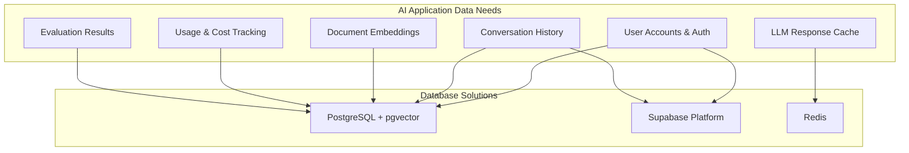
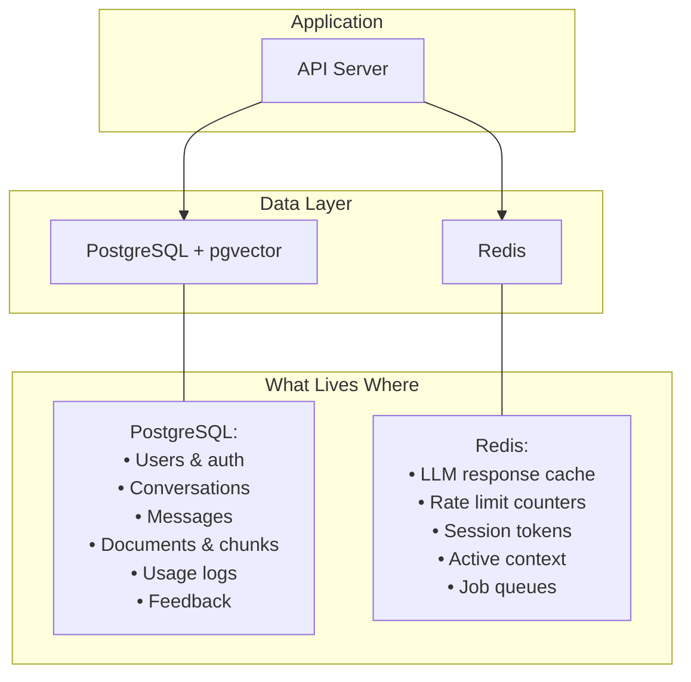

# Chapter 8: Databases for AI Applications

## Learning Objectives

By the end of this chapter, you will:

- [ ] Design database schemas that support AI features (conversations, embeddings, user data)
- [ ] Use Supabase as a complete backend (auth, database, storage, realtime)
- [ ] Implement PostgreSQL with pgvector for combined relational + vector storage
- [ ] Use Redis for caching LLM responses, session management, and rate limiting
- [ ] Build a user management system with usage tracking and token budgets
- [ ] Design schemas for conversations, documents, and evaluation data

## Prerequisites

- Chapter 5: Building AI Applications (application architecture)
- Chapter 7: RAG Pipelines (vector storage concepts)
- Basic SQL knowledge (SELECT, INSERT, JOIN, indexes)

## Estimated Time

- Reading: 60 minutes
- Exercises: 45 minutes
- Project: 3 hours

---

## Why This Chapter Matters

Every AI application from Chapters 5–7 stored data in memory. That works for demos. Production requires:

- **Persistence:** Conversations survive server restarts
- **Multi-user:** Each user has their own data, limits, and history
- **Scalability:** Handle thousands of concurrent users
- **Analytics:** Track usage, costs, and quality metrics

This chapter covers the data layer for AI applications — not database theory, but practical patterns for storing conversations, embeddings, user data, and usage metrics.



*Figure 1: AI application data needs mapped to database solutions*

---

## Choosing Your Data Stack

| Need | Solution | Why |
|------|----------|-----|
| User accounts, auth, sessions | Supabase / PostgreSQL | Relational data with auth built in |
| Conversation storage | PostgreSQL | Structured, queryable, ACID-compliant |
| Vector embeddings (< 5M) | pgvector | One database for everything |
| Vector embeddings (> 5M) | Dedicated vector DB (Qdrant, Pinecone) | Purpose-built for scale |
| LLM response caching | Redis | Sub-millisecond reads, TTL support |
| Rate limiting | Redis | Atomic counters, expiring keys |
| File/document storage | Supabase Storage / S3 | Binary blobs, CDN delivery |
| Real-time subscriptions | Supabase Realtime | Live updates for chat UIs |

> 📐 **Architecture Decision**
>
> For most AI applications (up to ~5M embeddings), PostgreSQL with pgvector handles everything: relational data, vector search, and JSON storage in one database. This reduces operational complexity dramatically. Only introduce Redis (for caching) or a dedicated vector DB (for scale) when PostgreSQL becomes a bottleneck.

---

## PostgreSQL + pgvector: The Unified Database

pgvector turns PostgreSQL into both a relational database and a vector database. One system for structured data, embeddings, and full-text search.

### Schema Design for AI Applications

```sql
-- Enable extensions
CREATE EXTENSION IF NOT EXISTS vector;
CREATE EXTENSION IF NOT EXISTS "uuid-ossp";

-- Users
CREATE TABLE users (
    id UUID PRIMARY KEY DEFAULT uuid_generate_v4(),
    email TEXT UNIQUE NOT NULL,
    name TEXT,
    plan TEXT DEFAULT 'free',  -- free, pro, enterprise
    token_budget_monthly INT DEFAULT 100000,
    tokens_used_this_month INT DEFAULT 0,
    created_at TIMESTAMPTZ DEFAULT NOW(),
    updated_at TIMESTAMPTZ DEFAULT NOW()
);

-- Conversations
CREATE TABLE conversations (
    id UUID PRIMARY KEY DEFAULT uuid_generate_v4(),
    user_id UUID REFERENCES users(id) ON DELETE CASCADE,
    title TEXT DEFAULT 'New Conversation',
    model TEXT DEFAULT 'gpt-4o-mini',
    system_prompt TEXT,
    total_tokens INT DEFAULT 0,
    total_cost DECIMAL(10, 6) DEFAULT 0,
    created_at TIMESTAMPTZ DEFAULT NOW(),
    updated_at TIMESTAMPTZ DEFAULT NOW()
);

-- Messages
CREATE TABLE messages (
    id UUID PRIMARY KEY DEFAULT uuid_generate_v4(),
    conversation_id UUID REFERENCES conversations(id) ON DELETE CASCADE,
    role TEXT NOT NULL CHECK (role IN ('system', 'user', 'assistant', 'tool')),
    content TEXT NOT NULL,
    model TEXT,
    input_tokens INT,
    output_tokens INT,
    latency_ms INT,
    metadata JSONB DEFAULT '{}',
    created_at TIMESTAMPTZ DEFAULT NOW()
);

-- Documents (for RAG)
CREATE TABLE documents (
    id UUID PRIMARY KEY DEFAULT uuid_generate_v4(),
    user_id UUID REFERENCES users(id),
    title TEXT NOT NULL,
    source TEXT,  -- file path, URL, etc.
    content_hash TEXT,  -- for deduplication
    chunk_count INT DEFAULT 0,
    status TEXT DEFAULT 'pending',  -- pending, processing, indexed, failed
    metadata JSONB DEFAULT '{}',
    created_at TIMESTAMPTZ DEFAULT NOW()
);

-- Document chunks with embeddings
CREATE TABLE document_chunks (
    id UUID PRIMARY KEY DEFAULT uuid_generate_v4(),
    document_id UUID REFERENCES documents(id) ON DELETE CASCADE,
    chunk_index INT NOT NULL,
    content TEXT NOT NULL,
    embedding vector(1536),  -- OpenAI text-embedding-3-small
    metadata JSONB DEFAULT '{}',
    created_at TIMESTAMPTZ DEFAULT NOW()
);

-- Indexes for performance
CREATE INDEX idx_messages_conversation ON messages(conversation_id, created_at);
CREATE INDEX idx_conversations_user ON conversations(user_id, updated_at DESC);
CREATE INDEX idx_chunks_document ON document_chunks(document_id);
CREATE INDEX idx_chunks_embedding ON document_chunks 
    USING ivfflat (embedding vector_cosine_ops) WITH (lists = 100);

-- Usage tracking
CREATE TABLE usage_logs (
    id BIGSERIAL PRIMARY KEY,
    user_id UUID REFERENCES users(id),
    model TEXT NOT NULL,
    input_tokens INT NOT NULL,
    output_tokens INT NOT NULL,
    cost DECIMAL(10, 6) NOT NULL,
    endpoint TEXT,  -- which feature used this
    created_at TIMESTAMPTZ DEFAULT NOW()
);

CREATE INDEX idx_usage_user_date ON usage_logs(user_id, created_at DESC);
```

### Python Data Access Layer

```python
import asyncpg
import json
from dataclasses import dataclass
from datetime import datetime
from uuid import UUID, uuid4


class Database:
    """Async PostgreSQL database client for AI applications."""
    
    def __init__(self, dsn: str):
        self.dsn = dsn
        self.pool: asyncpg.Pool | None = None
    
    async def connect(self):
        self.pool = await asyncpg.create_pool(self.dsn, min_size=5, max_size=20)
    
    async def disconnect(self):
        if self.pool:
            await self.pool.close()
    
    # --- Conversations ---
    
    async def create_conversation(self, user_id: UUID, title: str, model: str, system_prompt: str) -> UUID:
        """Create a new conversation and return its ID."""
        async with self.pool.acquire() as conn:
            row = await conn.fetchrow("""
                INSERT INTO conversations (user_id, title, model, system_prompt)
                VALUES ($1, $2, $3, $4)
                RETURNING id
            """, user_id, title, model, system_prompt)
            return row["id"]
    
    async def get_conversation_messages(self, conversation_id: UUID, limit: int = 50) -> list[dict]:
        """Get messages for a conversation, ordered by time."""
        async with self.pool.acquire() as conn:
            rows = await conn.fetch("""
                SELECT role, content, model, input_tokens, output_tokens, created_at
                FROM messages
                WHERE conversation_id = $1
                ORDER BY created_at ASC
                LIMIT $2
            """, conversation_id, limit)
            return [dict(row) for row in rows]
    
    async def add_message(
        self, conversation_id: UUID, role: str, content: str,
        model: str = None, input_tokens: int = None,
        output_tokens: int = None, latency_ms: int = None
    ) -> UUID:
        """Add a message to a conversation."""
        async with self.pool.acquire() as conn:
            row = await conn.fetchrow("""
                INSERT INTO messages (conversation_id, role, content, model, input_tokens, output_tokens, latency_ms)
                VALUES ($1, $2, $3, $4, $5, $6, $7)
                RETURNING id
            """, conversation_id, role, content, model, input_tokens, output_tokens, latency_ms)
            
            # Update conversation token totals
            if input_tokens or output_tokens:
                await conn.execute("""
                    UPDATE conversations 
                    SET total_tokens = total_tokens + $1, updated_at = NOW()
                    WHERE id = $2
                """, (input_tokens or 0) + (output_tokens or 0), conversation_id)
            
            return row["id"]
    
    # --- Vector Search ---
    
    async def vector_search(
        self, embedding: list[float], top_k: int = 5,
        user_id: UUID = None, document_id: UUID = None
    ) -> list[dict]:
        """Cosine similarity search on document chunks."""
        filters = []
        params = [str(embedding), top_k]
        param_idx = 3
        
        if user_id:
            filters.append(f"d.user_id = ${param_idx}")
            params.append(user_id)
            param_idx += 1
        
        if document_id:
            filters.append(f"dc.document_id = ${param_idx}")
            params.append(document_id)
            param_idx += 1
        
        where_clause = f"WHERE {' AND '.join(filters)}" if filters else ""
        
        async with self.pool.acquire() as conn:
            rows = await conn.fetch(f"""
                SELECT dc.content, dc.metadata,
                       1 - (dc.embedding <=> $1::vector) as similarity,
                       d.title as document_title, d.source
                FROM document_chunks dc
                JOIN documents d ON dc.document_id = d.id
                {where_clause}
                ORDER BY dc.embedding <=> $1::vector
                LIMIT $2
            """, *params)
            
            return [
                {
                    "content": row["content"],
                    "similarity": float(row["similarity"]),
                    "document_title": row["document_title"],
                    "source": row["source"],
                    "metadata": json.loads(row["metadata"]) if row["metadata"] else {},
                }
                for row in rows
            ]
    
    # --- Usage Tracking ---
    
    async def log_usage(self, user_id: UUID, model: str, input_tokens: int, output_tokens: int, cost: float, endpoint: str):
        """Log an LLM API usage event."""
        async with self.pool.acquire() as conn:
            await conn.execute("""
                INSERT INTO usage_logs (user_id, model, input_tokens, output_tokens, cost, endpoint)
                VALUES ($1, $2, $3, $4, $5, $6)
            """, user_id, model, input_tokens, output_tokens, cost, endpoint)
            
            # Update user's monthly token count
            await conn.execute("""
                UPDATE users SET tokens_used_this_month = tokens_used_this_month + $1
                WHERE id = $2
            """, input_tokens + output_tokens, user_id)
    
    async def get_user_usage_summary(self, user_id: UUID, days: int = 30) -> dict:
        """Get usage summary for a user over the last N days."""
        async with self.pool.acquire() as conn:
            row = await conn.fetchrow("""
                SELECT 
                    COUNT(*) as total_requests,
                    COALESCE(SUM(input_tokens), 0) as total_input_tokens,
                    COALESCE(SUM(output_tokens), 0) as total_output_tokens,
                    COALESCE(SUM(cost), 0) as total_cost
                FROM usage_logs
                WHERE user_id = $1 AND created_at > NOW() - INTERVAL '%s days'
            """ % days, user_id)
            return dict(row)
    
    async def check_token_budget(self, user_id: UUID) -> dict:
        """Check if user is within their token budget."""
        async with self.pool.acquire() as conn:
            row = await conn.fetchrow("""
                SELECT token_budget_monthly, tokens_used_this_month
                FROM users WHERE id = $1
            """, user_id)
            
            if not row:
                return {"allowed": False, "reason": "user_not_found"}
            
            remaining = row["token_budget_monthly"] - row["tokens_used_this_month"]
            return {
                "allowed": remaining > 0,
                "budget": row["token_budget_monthly"],
                "used": row["tokens_used_this_month"],
                "remaining": max(0, remaining),
            }
```

> 💡 **Developer Insight**
>
> Always check the token budget BEFORE making an LLM call, not after. If the user is over budget, reject the request immediately rather than incurring cost and then refusing to show the result. This is a business logic check, not just accounting.

---

## Supabase: The Complete Backend

Supabase wraps PostgreSQL with authentication, storage, real-time subscriptions, and edge functions. It's the fastest path to a production backend for AI applications.

### Why Supabase for AI Apps

| Feature | What It Gives You |
|---------|-------------------|
| Auth | User registration, login, OAuth, JWTs — zero custom code |
| Database | Managed PostgreSQL with pgvector support |
| Storage | File uploads (PDFs, images) with access control |
| Realtime | WebSocket subscriptions for live chat updates |
| Edge Functions | Serverless compute for webhooks and processing |
| Row Level Security | Per-user data isolation without application code |

### Setup and Schema

```python
from supabase import create_client, Client
import os

# Initialize Supabase client
supabase: Client = create_client(
    os.getenv("SUPABASE_URL"),
    os.getenv("SUPABASE_SERVICE_KEY")  # Use service key for server-side operations
)
```

### Row Level Security (RLS)

Supabase uses RLS to ensure users can only access their own data:

```sql
-- Enable RLS on all tables
ALTER TABLE conversations ENABLE ROW LEVEL SECURITY;
ALTER TABLE messages ENABLE ROW LEVEL SECURITY;
ALTER TABLE documents ENABLE ROW LEVEL SECURITY;

-- Users can only see their own conversations
CREATE POLICY "Users see own conversations" ON conversations
    FOR SELECT USING (auth.uid() = user_id);

CREATE POLICY "Users insert own conversations" ON conversations
    FOR INSERT WITH CHECK (auth.uid() = user_id);

-- Messages accessible through conversation ownership
CREATE POLICY "Users see own messages" ON messages
    FOR SELECT USING (
        conversation_id IN (
            SELECT id FROM conversations WHERE user_id = auth.uid()
        )
    );

-- Documents accessible by owner
CREATE POLICY "Users manage own documents" ON documents
    FOR ALL USING (user_id = auth.uid());
```

### Supabase Python Client Usage

```python
class SupabaseDB:
    """Supabase-based data layer for AI applications."""
    
    def __init__(self):
        self.client = create_client(
            os.getenv("SUPABASE_URL"),
            os.getenv("SUPABASE_SERVICE_KEY")
        )
    
    # --- Auth ---
    
    def create_user(self, email: str, password: str) -> dict:
        """Create a new user account."""
        response = self.client.auth.sign_up({
            "email": email,
            "password": password
        })
        return {"user_id": response.user.id, "email": email}
    
    # --- Conversations ---
    
    def create_conversation(self, user_id: str, title: str, model: str) -> dict:
        """Create a conversation."""
        result = self.client.table("conversations").insert({
            "user_id": user_id,
            "title": title,
            "model": model,
        }).execute()
        return result.data[0]
    
    def get_user_conversations(self, user_id: str, limit: int = 20) -> list[dict]:
        """Get a user's recent conversations."""
        result = self.client.table("conversations") \
            .select("id, title, model, total_tokens, updated_at") \
            .eq("user_id", user_id) \
            .order("updated_at", desc=True) \
            .limit(limit) \
            .execute()
        return result.data
    
    def add_message(self, conversation_id: str, role: str, content: str, **kwargs) -> dict:
        """Add a message to a conversation."""
        data = {
            "conversation_id": conversation_id,
            "role": role,
            "content": content,
            **{k: v for k, v in kwargs.items() if v is not None}
        }
        result = self.client.table("messages").insert(data).execute()
        return result.data[0]
    
    # --- Documents & RAG ---
    
    def store_document(self, user_id: str, title: str, source: str, content_hash: str) -> dict:
        """Register a document for RAG."""
        result = self.client.table("documents").insert({
            "user_id": user_id,
            "title": title,
            "source": source,
            "content_hash": content_hash,
            "status": "pending"
        }).execute()
        return result.data[0]
    
    def vector_search(self, embedding: list[float], user_id: str, top_k: int = 5) -> list[dict]:
        """Vector similarity search using Supabase's pgvector RPC."""
        result = self.client.rpc("search_documents", {
            "query_embedding": embedding,
            "match_count": top_k,
            "filter_user_id": user_id
        }).execute()
        return result.data
    
    # --- File Storage ---
    
    def upload_document_file(self, user_id: str, file_path: str, file_name: str) -> str:
        """Upload a document file to Supabase Storage."""
        storage_path = f"{user_id}/{file_name}"
        
        with open(file_path, "rb") as f:
            self.client.storage.from_("documents").upload(
                storage_path, f, {"content-type": "application/pdf"}
            )
        
        # Get public URL
        return self.client.storage.from_("documents").get_public_url(storage_path)
```

The vector search RPC function in PostgreSQL:

```sql
-- Supabase RPC function for vector search
CREATE OR REPLACE FUNCTION search_documents(
    query_embedding vector(1536),
    match_count INT DEFAULT 5,
    filter_user_id UUID DEFAULT NULL
)
RETURNS TABLE (
    content TEXT,
    similarity FLOAT,
    document_title TEXT,
    source TEXT,
    metadata JSONB
)
LANGUAGE plpgsql
AS $$
BEGIN
    RETURN QUERY
    SELECT 
        dc.content,
        1 - (dc.embedding <=> query_embedding) as similarity,
        d.title as document_title,
        d.source,
        dc.metadata
    FROM document_chunks dc
    JOIN documents d ON dc.document_id = d.id
    WHERE (filter_user_id IS NULL OR d.user_id = filter_user_id)
    ORDER BY dc.embedding <=> query_embedding
    LIMIT match_count;
END;
$$;
```

> 🚀 **Portfolio Tip**
>
> Supabase gives you auth, database, storage, and real-time in one hosted service with a generous free tier. For portfolio projects and client demos, it's the fastest path from "I have code" to "I have a deployed product with user accounts." Many Y Combinator startups use it in production.

---

## Redis: Caching and Rate Limiting

Redis complements PostgreSQL by handling ephemeral, high-speed data: response caching, rate limiting, session state, and queues.

### LLM Response Caching

```python
import redis
import json
import hashlib
from datetime import timedelta


class LLMCache:
    """Cache LLM responses in Redis for instant replay."""
    
    def __init__(self, redis_url: str = "redis://localhost:6379", default_ttl: int = 3600):
        self.redis = redis.from_url(redis_url, decode_responses=True)
        self.default_ttl = default_ttl  # 1 hour default
    
    def _make_key(self, messages: list[dict], model: str, temperature: float) -> str:
        """Create a deterministic cache key from request parameters."""
        payload = json.dumps({"messages": messages, "model": model, "temperature": temperature}, sort_keys=True)
        return f"llm:response:{hashlib.sha256(payload.encode()).hexdigest()}"
    
    def get(self, messages: list[dict], model: str, temperature: float) -> dict | None:
        """Get cached response if available."""
        # Only cache deterministic responses
        if temperature > 0:
            return None
        
        key = self._make_key(messages, model, temperature)
        cached = self.redis.get(key)
        
        if cached:
            return json.loads(cached)
        return None
    
    def set(self, messages: list[dict], model: str, temperature: float, response: dict, ttl: int = None):
        """Cache a response."""
        if temperature > 0:
            return
        
        key = self._make_key(messages, model, temperature)
        self.redis.setex(
            key,
            ttl or self.default_ttl,
            json.dumps(response)
        )
    
    def invalidate_pattern(self, pattern: str):
        """Invalidate cached responses matching a pattern."""
        keys = self.redis.keys(f"llm:response:{pattern}")
        if keys:
            self.redis.delete(*keys)
    
    def get_stats(self) -> dict:
        """Get cache statistics."""
        info = self.redis.info("stats")
        return {
            "hits": info.get("keyspace_hits", 0),
            "misses": info.get("keyspace_misses", 0),
            "hit_rate": info.get("keyspace_hits", 0) / max(1, info.get("keyspace_hits", 0) + info.get("keyspace_misses", 0)),
        }
```

### Rate Limiting with Redis

```python
class RateLimiter:
    """Token-bucket rate limiter using Redis."""
    
    def __init__(self, redis_url: str = "redis://localhost:6379"):
        self.redis = redis.from_url(redis_url)
    
    def check_rate_limit(
        self,
        user_id: str,
        max_requests: int = 60,
        window_seconds: int = 60
    ) -> dict:
        """Check if user is within rate limit. Returns remaining quota."""
        key = f"rate:{user_id}:{window_seconds}"
        
        pipe = self.redis.pipeline()
        pipe.incr(key)
        pipe.expire(key, window_seconds)
        results = pipe.execute()
        
        current_count = results[0]
        
        return {
            "allowed": current_count <= max_requests,
            "current": current_count,
            "limit": max_requests,
            "remaining": max(0, max_requests - current_count),
            "reset_in_seconds": self.redis.ttl(key),
        }
    
    def check_token_rate(
        self,
        user_id: str,
        tokens_requested: int,
        max_tokens_per_minute: int = 100_000
    ) -> dict:
        """Check token-based rate limit (more granular than request count)."""
        key = f"tokens:{user_id}:minute"
        
        current = int(self.redis.get(key) or 0)
        
        if current + tokens_requested > max_tokens_per_minute:
            return {
                "allowed": False,
                "current_tokens": current,
                "limit": max_tokens_per_minute,
                "retry_after_seconds": self.redis.ttl(key),
            }
        
        pipe = self.redis.pipeline()
        pipe.incrby(key, tokens_requested)
        pipe.expire(key, 60)  # Reset every minute
        pipe.execute()
        
        return {"allowed": True, "current_tokens": current + tokens_requested, "limit": max_tokens_per_minute}
```

### Session Management

```python
class SessionStore:
    """Manage user sessions and conversation state in Redis."""
    
    def __init__(self, redis_url: str = "redis://localhost:6379"):
        self.redis = redis.from_url(redis_url, decode_responses=True)
        self.session_ttl = 24 * 3600  # 24 hours
    
    def create_session(self, user_id: str, metadata: dict = None) -> str:
        """Create a new session for a user."""
        import uuid
        session_id = str(uuid.uuid4())
        
        session_data = {
            "user_id": user_id,
            "created_at": datetime.now().isoformat(),
            **(metadata or {})
        }
        
        self.redis.setex(
            f"session:{session_id}",
            self.session_ttl,
            json.dumps(session_data)
        )
        
        return session_id
    
    def get_session(self, session_id: str) -> dict | None:
        """Get session data. Returns None if expired/invalid."""
        data = self.redis.get(f"session:{session_id}")
        if data:
            # Refresh TTL on access
            self.redis.expire(f"session:{session_id}", self.session_ttl)
            return json.loads(data)
        return None
    
    def store_conversation_context(self, session_id: str, conversation_id: str, context: dict):
        """Store active conversation context for quick access."""
        self.redis.setex(
            f"context:{session_id}:{conversation_id}",
            3600,  # 1 hour
            json.dumps(context)
        )
    
    def get_conversation_context(self, session_id: str, conversation_id: str) -> dict | None:
        """Get cached conversation context."""
        data = self.redis.get(f"context:{session_id}:{conversation_id}")
        return json.loads(data) if data else None
```

> ⚠️ **Common Mistake**
>
> Don't use Redis as your primary data store for conversations or user data. Redis is volatile by default — data can be lost on restart unless you configure persistence (RDB/AOF). Use PostgreSQL for durable data, Redis for ephemeral caching and rate limiting.

---

## Designing for Multi-Tenancy

AI SaaS applications need data isolation between organizations/users. Here are the common patterns.

### Approach 1: Row-Level Isolation (Recommended for Start)

All tenants share tables, filtered by `user_id` or `org_id`:

```sql
-- Every query includes the user/org filter
SELECT * FROM conversations WHERE user_id = $1;
SELECT * FROM documents WHERE org_id = $1;
```

**Pros:** Simple, one schema, easy migrations.
**Cons:** Must never forget the filter (RLS helps), shared resources.

### Approach 2: Schema-Per-Tenant

Each tenant gets their own PostgreSQL schema:

```sql
-- Create schema for each tenant
CREATE SCHEMA tenant_acme;
CREATE TABLE tenant_acme.conversations (...);
CREATE TABLE tenant_acme.documents (...);
```

**Pros:** Strong isolation, independent indexes, easy deletion.
**Cons:** Complex migrations, connection management, more operational overhead.

### The Token Budget System

```python
class TokenBudgetManager:
    """Manage per-user and per-org token budgets."""
    
    PLAN_LIMITS = {
        "free": {"monthly_tokens": 100_000, "max_conversations": 10},
        "pro": {"monthly_tokens": 2_000_000, "max_conversations": 100},
        "enterprise": {"monthly_tokens": 50_000_000, "max_conversations": -1},  # unlimited
    }
    
    def __init__(self, db: Database):
        self.db = db
    
    async def can_make_request(self, user_id: UUID, estimated_tokens: int) -> dict:
        """Check if user has budget for this request."""
        budget = await self.db.check_token_budget(user_id)
        
        if not budget["allowed"]:
            return {
                "allowed": False,
                "reason": "monthly_token_limit_exceeded",
                "used": budget["used"],
                "limit": budget["budget"],
                "suggestion": "Upgrade your plan or wait for monthly reset."
            }
        
        if budget["remaining"] < estimated_tokens:
            return {
                "allowed": False,
                "reason": "insufficient_remaining_budget",
                "remaining": budget["remaining"],
                "estimated_needed": estimated_tokens,
            }
        
        return {"allowed": True, "remaining": budget["remaining"]}
    
    async def record_usage(self, user_id: UUID, model: str, input_tokens: int, output_tokens: int):
        """Record actual usage after a successful LLM call."""
        cost = self._calculate_cost(model, input_tokens, output_tokens)
        await self.db.log_usage(user_id, model, input_tokens, output_tokens, cost, "chat")
    
    def _calculate_cost(self, model: str, input_tokens: int, output_tokens: int) -> float:
        """Calculate cost based on model pricing."""
        pricing = {
            "gpt-4o": {"input": 2.50, "output": 10.00},
            "gpt-4o-mini": {"input": 0.15, "output": 0.60},
            "claude-sonnet-4-20250514": {"input": 3.00, "output": 15.00},
        }
        
        rates = pricing.get(model, {"input": 1.0, "output": 4.0})
        return (input_tokens / 1_000_000 * rates["input"]) + (output_tokens / 1_000_000 * rates["output"])
```

---

## Migrations and Schema Evolution

AI application schemas evolve frequently. New features mean new tables and columns.

### Migration Strategy

```python
# migrations/001_initial.sql
"""
CREATE TABLE users (...);
CREATE TABLE conversations (...);
CREATE TABLE messages (...);
"""

# migrations/002_add_documents.sql
"""
CREATE TABLE documents (...);
CREATE TABLE document_chunks (...);
"""

# migrations/003_add_usage_tracking.sql
"""
CREATE TABLE usage_logs (...);
ALTER TABLE users ADD COLUMN tokens_used_this_month INT DEFAULT 0;
ALTER TABLE users ADD COLUMN token_budget_monthly INT DEFAULT 100000;
"""

# migrations/004_add_feedback.sql
"""
CREATE TABLE feedback (
    id UUID PRIMARY KEY DEFAULT uuid_generate_v4(),
    message_id UUID REFERENCES messages(id),
    user_id UUID REFERENCES users(id),
    rating INT CHECK (rating BETWEEN 1 AND 5),
    comment TEXT,
    created_at TIMESTAMPTZ DEFAULT NOW()
);
"""
```

### Using Alembic (Python ORM Migrations)

```bash
# Initialize
alembic init migrations

# Create a migration
alembic revision --autogenerate -m "add feedback table"

# Apply migrations
alembic upgrade head

# Rollback one step
alembic downgrade -1
```

> 🏢 **Industry Note**
>
> Never modify production schemas without a migration. "Just ALTER TABLE in production" leads to inconsistency between environments. Use Alembic (Python), Flyway (Java), or Supabase's built-in migration system. Run migrations in CI/CD as part of your deployment.

---

## Putting It Together: The Complete Data Layer

Here's how all database components integrate in a production AI application:



*Figure 2: Data layer architecture — PostgreSQL for durable data, Redis for ephemeral/fast-access data*

### Integration Example

```python
class AIApplicationBackend:
    """Complete backend integrating all data services."""
    
    def __init__(self, postgres_dsn: str, redis_url: str):
        self.db = Database(postgres_dsn)
        self.cache = LLMCache(redis_url)
        self.rate_limiter = RateLimiter(redis_url)
        self.budget_manager = TokenBudgetManager(self.db)
    
    async def handle_chat_message(self, user_id: UUID, conversation_id: UUID, message: str) -> dict:
        """Process a chat message through the full pipeline."""
        
        # 1. Rate limit check
        rate_check = self.rate_limiter.check_rate_limit(str(user_id))
        if not rate_check["allowed"]:
            return {"error": "rate_limited", "retry_after": rate_check["reset_in_seconds"]}
        
        # 2. Budget check
        budget_check = await self.budget_manager.can_make_request(user_id, estimated_tokens=2000)
        if not budget_check["allowed"]:
            return {"error": "budget_exceeded", "details": budget_check}
        
        # 3. Get conversation context from cache (or DB fallback)
        context = await self._get_context(user_id, conversation_id)
        
        # 4. Check LLM cache
        messages = context + [{"role": "user", "content": message}]
        cached = self.cache.get(messages, model="gpt-4o-mini", temperature=0.0)
        if cached:
            return {"response": cached["content"], "source": "cache"}
        
        # 5. Store user message
        await self.db.add_message(conversation_id, "user", message)
        
        # 6. Call LLM (actual API call here)
        response = await self._call_llm(messages)
        
        # 7. Store assistant response
        await self.db.add_message(
            conversation_id, "assistant", response["content"],
            model=response["model"],
            input_tokens=response["input_tokens"],
            output_tokens=response["output_tokens"],
            latency_ms=response["latency_ms"]
        )
        
        # 8. Record usage
        await self.budget_manager.record_usage(
            user_id, response["model"],
            response["input_tokens"], response["output_tokens"]
        )
        
        # 9. Cache response
        self.cache.set(messages, response["model"], 0.0, response)
        
        return {"response": response["content"], "source": "llm"}
    
    async def _get_context(self, user_id: UUID, conversation_id: UUID) -> list[dict]:
        """Get conversation context, preferring cache."""
        # Try Redis cache first
        cached_context = self.cache.redis.get(f"context:{conversation_id}")
        if cached_context:
            return json.loads(cached_context)
        
        # Fallback to database
        messages = await self.db.get_conversation_messages(conversation_id, limit=20)
        context = [{"role": m["role"], "content": m["content"]} for m in messages]
        
        # Cache for next time
        self.cache.redis.setex(f"context:{conversation_id}", 300, json.dumps(context))
        
        return context
    
    async def _call_llm(self, messages: list[dict]) -> dict:
        """Make the actual LLM API call."""
        import time
        from openai import AsyncOpenAI
        
        client = AsyncOpenAI()
        start = time.perf_counter()
        
        response = await client.chat.completions.create(
            model="gpt-4o-mini",
            messages=messages,
            temperature=0.0,
            max_tokens=1000
        )
        
        latency = int((time.perf_counter() - start) * 1000)
        
        return {
            "content": response.choices[0].message.content,
            "model": response.model,
            "input_tokens": response.usage.prompt_tokens,
            "output_tokens": response.usage.completion_tokens,
            "latency_ms": latency,
        }
```

---

## Production Notes

- **Connection pooling is essential.** Never open a new database connection per request. Use connection pools (`asyncpg.Pool`, `psycopg2.pool`). Size your pool to match your expected concurrency.
- **Index your queries.** The `WHERE conversation_id = $1 ORDER BY created_at` pattern needs a composite index. PostgreSQL's `EXPLAIN ANALYZE` shows you which indexes are used.
- **Vacuum and analyze.** PostgreSQL needs periodic maintenance. In Supabase this is automatic. Self-hosted: configure `autovacuum` properly.
- **pgvector index tuning.** IVFFlat indexes need `lists` parameter tuned to your dataset size. Rule of thumb: `lists = sqrt(row_count)`. For HNSW indexes, default parameters usually work well.
- **Redis persistence.** If caching is critical (not just a performance optimization), enable Redis AOF persistence. Otherwise, treat Redis as ephemeral and rebuild from source on failure.
- **Backup strategy.** PostgreSQL: daily full backup + continuous WAL archiving (point-in-time recovery). Supabase handles this automatically.

## Common Mistakes

1. **Storing embeddings as JSON arrays.** JSON arrays are slow to query for similarity. Use pgvector's `vector` type or a dedicated vector database. They're purpose-built for this.

2. **Not indexing the embedding column.** Without an index, vector search scans every row (O(n)). With IVFFlat or HNSW indexes, it's O(log n). This matters at 100K+ vectors.

3. **Forgetting to reset monthly token counters.** Implement a cron job or scheduled function that resets `tokens_used_this_month` on the first of each month.

4. **No connection pooling.** Opening a new PostgreSQL connection takes 50–100ms. With pooling, acquiring a connection takes <1ms. This compounds with every request.

5. **Storing full conversation history in Redis.** Redis is RAM-based. Storing millions of messages there is expensive. Keep only active conversation context in Redis; full history belongs in PostgreSQL.

6. **Not using transactions for multi-table writes.** Adding a message + updating token count + logging usage should be atomic. If one fails, none should commit.

## Best Practices

1. **Use pgvector for unified storage** unless you have >5M vectors. One database is operationally simpler than two.

2. **Implement RLS or application-level filters** for multi-tenancy from day one. Retrofitting data isolation is painful.

3. **Cache conversation context in Redis.** Loading 20 messages from PostgreSQL for every request adds latency. Cache the active context for 5 minutes.

4. **Log everything to a usage table.** Cost, tokens, model, latency, endpoint. This data drives business decisions (pricing, plan limits) and technical decisions (model optimization).

5. **Use database migrations.** Never ad-hoc ALTER TABLE in production. Migrations are version-controlled, reversible, and reproducible.

6. **Implement soft deletes for conversations.** Users want to "delete" conversations but you may need them for compliance or debugging. Use a `deleted_at` timestamp instead of actual deletion.

7. **Separate read and write paths** for high-traffic applications. Use read replicas for vector search and conversation display. Write to the primary for message insertion and usage logging.

---

## Hands-On Exercises

### Exercise 1: Schema Design

**Difficulty:** ⭐⭐
**Time:** 20 minutes

Design a database schema for an AI-powered customer support system:
- Multiple organizations (tenants)
- Each org has multiple agents (AI configs with different prompts)
- Conversations belong to an org and optionally an agent
- Messages track which model was used and token counts
- Knowledge base documents per organization
- Feedback ratings per message

Write the full SQL DDL including indexes and constraints.

### Exercise 2: Redis Caching Integration

**Difficulty:** ⭐⭐
**Time:** 20 minutes

Implement a caching layer for a RAG pipeline:
1. Cache embedding vectors for queries (avoid re-embedding identical queries)
2. Cache search results for identical queries + filters
3. Cache generated answers for identical context + question combinations
4. Implement TTL: embeddings cache for 24h, answers cache for 1h
5. Measure: what's the hit rate after 50 queries with some repetition?

### Exercise 3: Usage Dashboard Query

**Difficulty:** ⭐⭐
**Time:** 15 minutes

Write SQL queries for a usage analytics dashboard:
1. Total tokens and cost per user for the current month
2. Top 5 most expensive conversations (by total tokens)
3. Average latency per model over the last 7 days
4. Token usage trend (daily totals for the last 30 days)
5. Users approaching their monthly limit (>80% used)

### Exercise 4: Migration Exercise

**Difficulty:** ⭐
**Time:** 15 minutes

Write a database migration that adds:
1. A `feedback` table (message_id, rating 1-5, comment, user_id)
2. An `api_keys` table (user_id, key_hash, name, last_used, rate_limit)
3. An index on feedback for quick per-conversation aggregation
4. A view that shows average rating per conversation

---

## Mini Project

**Title:** AI Chat Backend with Full Data Layer
**Difficulty:** ⭐⭐⭐
**Time:** 3 hours
**What you'll build:** A complete FastAPI backend for an AI chat application with PostgreSQL storage, Redis caching, user management, and usage tracking.

### Requirements

1. **Auth:** Simple API key-based authentication (store hashed keys)
2. **Conversations:** CRUD operations with message history
3. **Chat:** Send message → check rate limit → check budget → LLM call → store → respond
4. **Caching:** Cache identical queries, cache conversation context
5. **Usage:** Track tokens, cost, latency per request
6. **Dashboard:** Endpoint returning user's usage summary (tokens, cost, conversations)
7. **Budget enforcement:** Reject requests when monthly budget is exceeded

### Tech Stack

- FastAPI for the API
- PostgreSQL (Docker) for persistent storage
- Redis (Docker) for caching + rate limiting
- OpenAI for LLM calls

### Deliverables

```
ai-chat-backend/
├── src/
│   ├── main.py           # FastAPI app
│   ├── routes/
│   │   ├── auth.py
│   │   ├── conversations.py
│   │   └── usage.py
│   ├── db/
│   │   ├── postgres.py   # PostgreSQL client
│   │   ├── redis_client.py
│   │   └── migrations/
│   ├── services/
│   │   ├── chat.py       # Chat logic
│   │   ├── budget.py     # Token budget management
│   │   └── cache.py      # Caching logic
│   └── models.py         # Pydantic schemas
├── docker-compose.yml    # Postgres + Redis
├── .env.example
├── requirements.txt
└── README.md
```

---

## Challenge Project

**Title:** Multi-Tenant AI Platform Backend
**Difficulty:** ⭐⭐⭐⭐
**Time:** 8 hours
**What you'll build:** A complete multi-tenant backend that could power a SaaS AI product — organizations, team members, shared knowledge bases, usage billing, and admin dashboard.

### Requirements

1. **Multi-tenancy:** Organizations with members, roles (admin/member)
2. **Auth:** Supabase Auth with JWT validation
3. **Knowledge base:** Per-org document upload, embedding, and RAG search
4. **Chat:** Per-user conversations with org-level knowledge access
5. **Usage billing:** Track per-org usage, enforce plan limits, usage alerts
6. **Admin API:** Org admins can manage members, view usage, configure AI settings
7. **Rate limiting:** Per-user and per-org limits with Redis
8. **Audit log:** Track all admin actions and configuration changes
9. **API keys:** Programmatic access with scoped permissions
10. **Health monitoring:** Database connection health, queue depth, cache hit rates

---

## Portfolio Milestone

After this chapter, you should have:
- A production database schema for AI applications
- Working PostgreSQL + pgvector integration with vector search
- Redis caching and rate limiting implementations
- A complete backend demonstrating user management, budgets, and usage tracking
- Understanding of multi-tenancy patterns for SaaS

---

## Chapter Summary

- PostgreSQL + pgvector handles most AI application data needs in a single database: relational data, vector embeddings, and JSON metadata.
- Supabase wraps PostgreSQL with auth, storage, realtime, and RLS — the fastest path to a production backend.
- Redis is for ephemeral, high-speed data: LLM response caching, rate limiting, session management. Not for durable storage.
- Token budget management is a business-critical feature. Check budget before LLM calls, log usage after, enforce limits per plan.
- Row-Level Security ensures multi-tenant data isolation without relying on application code to remember WHERE clauses.
- Schema migrations are non-negotiable. Version control your schema changes just like application code.
- Separate concerns: PostgreSQL for truth, Redis for speed. Don't mix their roles.

---

## Cheat Sheet

| Data Type | Store In | Why |
|-----------|----------|-----|
| User accounts | PostgreSQL | Durable, relational, auth integration |
| Conversations + messages | PostgreSQL | Queryable history, ACID compliance |
| Document embeddings | PostgreSQL (pgvector) | Co-located with metadata, RLS |
| LLM response cache | Redis | Fast, TTL support, ephemeral |
| Rate limit counters | Redis | Atomic operations, auto-expire |
| Session tokens | Redis | Short-lived, fast lookup |
| File uploads (PDFs) | Supabase Storage / S3 | Binary blobs, CDN |
| Usage logs | PostgreSQL | Analytics, billing, retention |
| Active conversation context | Redis (cache from PG) | Avoid DB roundtrip per message |

| Tool | Use Case | Setup |
|------|----------|-------|
| Supabase | Full platform (auth + DB + storage) | `npx supabase init` or cloud console |
| PostgreSQL + pgvector | Self-hosted unified DB | Docker: `postgres:16` + `CREATE EXTENSION vector` |
| Redis | Caching + rate limiting | Docker: `redis:7-alpine` |
| asyncpg | Async Python PostgreSQL driver | `pip install asyncpg` |
| Alembic | Schema migrations | `pip install alembic` |

---

## Glossary

| Term | Definition |
|------|-----------|
| pgvector | PostgreSQL extension that adds vector data types and similarity search operations. |
| RLS | Row Level Security. PostgreSQL feature that filters rows per-user based on policies, enforced at the database level. |
| Connection pool | A cache of database connections reused across requests, avoiding the overhead of creating new connections. |
| TTL | Time To Live. Duration after which a cached value expires and is deleted. |
| Token bucket | Rate limiting algorithm where tokens refill at a fixed rate and each request consumes tokens. |
| Multi-tenancy | Architecture where a single application instance serves multiple organizations with data isolation. |
| Migration | A versioned, incremental change to a database schema that can be applied and rolled back. |
| IVFFlat | Inverted File Flat index. A pgvector index type that partitions vectors into lists for approximate nearest neighbor search. |
| HNSW | Hierarchical Navigable Small World. A graph-based index for approximate nearest neighbor search (more accurate than IVFFlat, uses more memory). |
| Soft delete | Marking a record as deleted (with a timestamp) without physically removing it from the database. |

---

## References

- [pgvector Documentation](https://github.com/pgvector/pgvector) — Extension setup and usage guide.
- [Supabase Documentation](https://supabase.com/docs) — Full platform documentation.
- [Supabase pgvector Guide](https://supabase.com/docs/guides/ai/vector-columns) — Vector search with Supabase.
- [Redis Documentation](https://redis.io/docs/) — Commands, data types, persistence.
- [asyncpg Documentation](https://magicstack.github.io/asyncpg/) — Async PostgreSQL driver for Python.
- [Alembic Tutorial](https://alembic.sqlalchemy.org/en/latest/tutorial.html) — Schema migration tool.

## Further Reading

- [Choosing a Vector Database](https://www.pinecone.io/learn/vector-database/) — Comparison of vector database options.
- [PostgreSQL Performance Tuning](https://wiki.postgresql.org/wiki/Tuning_Your_PostgreSQL_Server) — Production optimization guide.
- [Redis Best Practices](https://redis.io/docs/management/optimization/) — Performance and memory optimization.

---

## Next Chapter Preview

In **Chapter 9: AI Automation**, we'll shift from building user-facing applications to building automated workflows. You'll learn to connect AI with tools like n8n, Zapier, Google Workspace, Slack, and Notion to automate business processes — email triage, document processing, CRM updates, and scheduled reports — without requiring a user interface.
