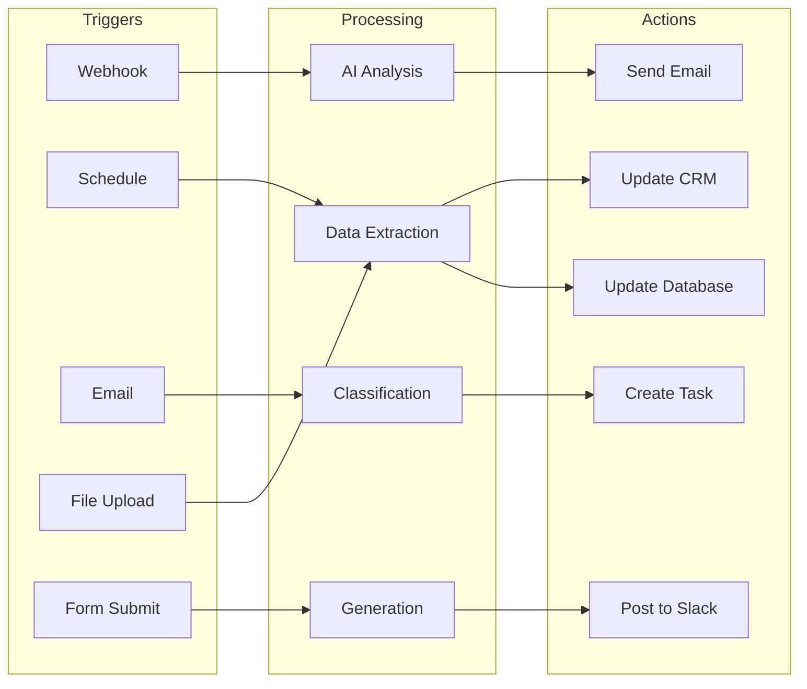
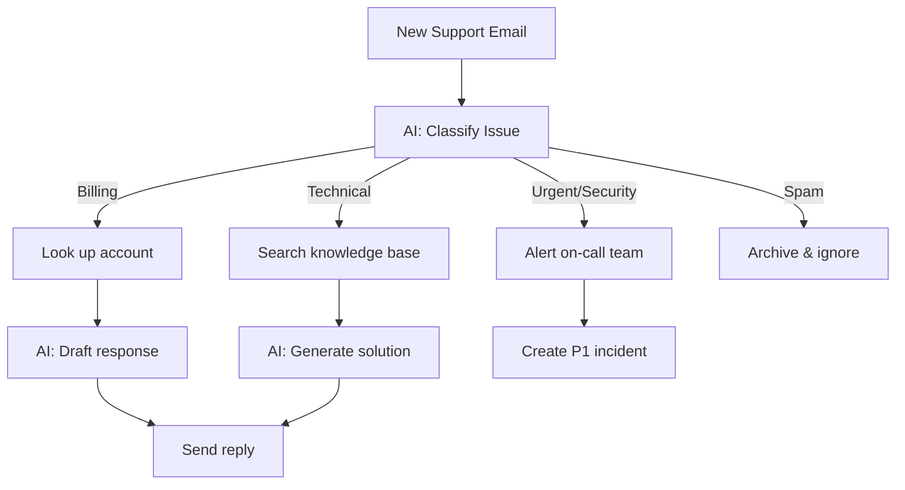

# Chapter 9: AI Automation

## Learning Objectives

By the end of this chapter, you will:

- [ ] Design AI automation workflows that connect multiple services
- [ ] Build automations using n8n (self-hosted) and understand Zapier/Make patterns
- [ ] Connect AI to Google Workspace, Slack, Notion, email, and CRMs
- [ ] Implement webhook-driven AI processing pipelines
- [ ] Build scheduled automations (daily reports, batch processing)
- [ ] Handle errors, retries, and monitoring in automated workflows
- [ ] Estimate ROI for automation projects and price them for clients

## Prerequisites

- Chapter 5: Building AI Applications (application patterns, function calling)
- Chapter 7: RAG Pipelines (document processing)
- Chapter 8: Databases (data persistence, caching)

## Estimated Time

- Reading: 60 minutes
- Exercises: 45 minutes
- Project: 4 hours

---

## What AI Automation Is

AI automation sits between "AI chatbot" and "AI agent." It's not conversational — there's no user sitting and waiting. It's triggered by events, runs in the background, and produces results without human interaction.

Examples of AI automations:
- New email arrives → AI classifies priority → routes to correct team → drafts response
- Meeting ends → transcript generated → AI extracts action items → creates Jira tickets
- Customer submits support form → AI analyzes issue → searches knowledge base → sends resolution
- Daily at 9am → AI summarizes overnight Slack messages → posts digest to #team-updates
- Invoice PDF uploaded → AI extracts data → creates entry in accounting system
- New blog post published → AI generates social media posts for 3 platforms



*Figure 1: AI automations connect triggers (events) to AI processing to actions (side effects)*

### Automation vs. Agents

| Characteristic | AI Automation | AI Agent |
|---------------|--------------|----------|
| Flow | Predefined (you design the steps) | Dynamic (model decides the steps) |
| Control | You control the logic | Model controls the logic |
| Reliability | High (deterministic flow) | Medium (model can make unexpected choices) |
| Complexity | Low–medium per workflow | High (planning, memory, tool use) |
| Best for | Repetitive business processes | Open-ended tasks requiring judgment |
| Debugging | Easy (trace the flow) | Harder (trace the model's reasoning) |

> 🔑 **Key Concept**
>
> Start with automations, not agents. Automations are predictable, debuggable, and immediately valuable to businesses. Most "we need an AI agent" requests are actually better served by a well-designed automation. Reserve agents (Chapter 10) for tasks where the steps genuinely can't be predefined.

---

## Automation Architecture Patterns

### Pattern 1: Event → Process → Act

The most common pattern. A single trigger leads to a linear sequence.

```python
from dataclasses import dataclass
from typing import Callable, Any


@dataclass
class AutomationStep:
    """A single step in an automation workflow."""
    name: str
    handler: Callable
    retry_count: int = 2
    timeout_seconds: int = 30


class AutomationPipeline:
    """Runs a sequence of steps with error handling and logging."""
    
    def __init__(self, name: str, steps: list[AutomationStep]):
        self.name = name
        self.steps = steps
        self.results: dict[str, Any] = {}
    
    async def run(self, trigger_data: dict) -> dict:
        """Execute all steps in sequence."""
        context = {"trigger": trigger_data, "results": {}}
        
        for step in self.steps:
            try:
                result = await self._execute_step(step, context)
                context["results"][step.name] = result
                self.results[step.name] = result
            except Exception as e:
                return {
                    "status": "failed",
                    "failed_step": step.name,
                    "error": str(e),
                    "completed_steps": list(context["results"].keys()),
                }
        
        return {"status": "completed", "results": context["results"]}
    
    async def _execute_step(self, step: AutomationStep, context: dict) -> Any:
        """Execute a step with retry logic."""
        import asyncio
        
        last_error = None
        for attempt in range(step.retry_count + 1):
            try:
                result = await asyncio.wait_for(
                    step.handler(context),
                    timeout=step.timeout_seconds
                )
                return result
            except asyncio.TimeoutError:
                last_error = TimeoutError(f"Step '{step.name}' timed out after {step.timeout_seconds}s")
            except Exception as e:
                last_error = e
                if attempt < step.retry_count:
                    await asyncio.sleep(2 ** attempt)  # Exponential backoff
        
        raise last_error
```

### Pattern 2: Fan-Out (Parallel Processing)

One trigger spawns multiple parallel AI tasks.

```python
import asyncio


async def fan_out_automation(document: str) -> dict:
    """Process a document through multiple AI analyses in parallel."""
    
    async def summarize(doc: str) -> str:
        # LLM call: summarize
        return await llm_call("Summarize this document in 3 sentences.", doc)
    
    async def extract_entities(doc: str) -> list:
        # LLM call: entity extraction
        return await llm_call("Extract all named entities as JSON array.", doc)
    
    async def classify_topic(doc: str) -> str:
        # LLM call: classification
        return await llm_call("Classify into: legal, financial, technical, hr, other", doc)
    
    async def detect_sentiment(doc: str) -> str:
        # LLM call: sentiment
        return await llm_call("Rate sentiment: positive, neutral, negative", doc)
    
    # All four run simultaneously
    summary, entities, topic, sentiment = await asyncio.gather(
        summarize(document),
        extract_entities(document),
        classify_topic(document),
        detect_sentiment(document),
    )
    
    return {
        "summary": summary,
        "entities": entities,
        "topic": topic,
        "sentiment": sentiment,
    }
```

### Pattern 3: Conditional Routing

Different processing paths based on AI classification.



*Figure 2: Conditional routing — AI classification determines the processing path*

```python
class ConditionalRouter:
    """Routes data through different paths based on AI classification."""
    
    def __init__(self):
        self.client = OpenAI()
        self.routes: dict[str, Callable] = {}
    
    def register_route(self, category: str, handler: Callable):
        """Register a handler for a specific category."""
        self.routes[category] = handler
    
    async def process(self, input_data: dict) -> dict:
        """Classify and route to the appropriate handler."""
        # Step 1: AI classification
        category = await self._classify(input_data)
        
        # Step 2: Route to handler
        handler = self.routes.get(category, self.routes.get("default"))
        if not handler:
            return {"error": f"No handler for category: {category}"}
        
        # Step 3: Execute handler
        result = await handler(input_data, category)
        
        return {"category": category, "result": result}
    
    async def _classify(self, data: dict) -> str:
        """Use LLM to classify the input."""
        categories = list(self.routes.keys())
        
        response = self.client.chat.completions.create(
            model="gpt-4o-mini",
            messages=[{
                "role": "user",
                "content": f"""Classify this into exactly one category: {', '.join(categories)}

Content: {data.get('content', data.get('text', str(data)))}

Return ONLY the category name."""
            }],
            temperature=0.0,
            max_tokens=20,
        )
        
        return response.choices[0].message.content.strip().lower()
```

---

## n8n: Self-Hosted Automation Platform

n8n is an open-source workflow automation tool. Think of it as a self-hosted Zapier with native AI nodes and full code access.

### Why n8n for AI Engineers

| Feature | Value for AI Work |
|---------|-------------------|
| Self-hosted | Your data stays on your infrastructure |
| Code nodes | Write Python/JavaScript within visual flows |
| AI nodes | Built-in OpenAI, Anthropic, vector store integrations |
| 400+ integrations | Connect to any SaaS tool |
| Webhook triggers | Receive events from any system |
| Free (self-hosted) | No per-execution costs |
| Visual debugging | See data at each step |

### Setting Up n8n

```bash
# Docker (quickest start)
docker run -d --name n8n \
  -p 5678:5678 \
  -v n8n_data:/home/node/.n8n \
  -e N8N_AI_ENABLED=true \
  n8nio/n8n

# Access at http://localhost:5678
```

### Example: Email-to-Action Automation

Here's an n8n workflow described as code (equivalent to the visual editor):

```json
{
  "name": "Email Triage & Response",
  "nodes": [
    {
      "type": "n8n-nodes-base.emailTrigger",
      "name": "New Email",
      "parameters": {
        "protocol": "IMAP",
        "mailbox": "INBOX"
      }
    },
    {
      "type": "@n8n/n8n-nodes-langchain.openAi",
      "name": "Classify Email",
      "parameters": {
        "model": "gpt-4o-mini",
        "prompt": "Classify this email as: billing, technical, feature_request, spam.\nSubject: {{$json.subject}}\nBody: {{$json.text}}\nReturn ONLY the category."
      }
    },
    {
      "type": "n8n-nodes-base.switch",
      "name": "Route by Category",
      "parameters": {
        "rules": [
          {"value": "billing", "output": 0},
          {"value": "technical", "output": 1},
          {"value": "feature_request", "output": 2},
          {"value": "spam", "output": 3}
        ]
      }
    },
    {
      "type": "@n8n/n8n-nodes-langchain.openAi",
      "name": "Draft Response",
      "parameters": {
        "model": "gpt-4o",
        "prompt": "Draft a professional reply to this email...\n{{$json.text}}"
      }
    },
    {
      "type": "n8n-nodes-base.gmail",
      "name": "Send Draft",
      "parameters": {
        "operation": "reply",
        "message": "{{$json.response}}"
      }
    }
  ]
}
```

> 💡 **Developer Insight**
>
> n8n's AI nodes abstract away the boilerplate (API keys, retry logic, response parsing). But for complex AI logic (multi-step reasoning, custom prompts, structured output), use n8n's Code node with your own Python/JavaScript. The visual nodes handle orchestration; your code handles AI complexity.

---

## Building Automations with Python (Code-First)

For engineers, code-first automations are often more maintainable than visual tools. Here's a production-ready framework.

### The Automation Framework

```python
import asyncio
import logging
from datetime import datetime
from dataclasses import dataclass, field
from typing import Any, Callable
from enum import Enum

logger = logging.getLogger("automations")


class TriggerType(Enum):
    WEBHOOK = "webhook"
    SCHEDULE = "schedule"
    EVENT = "event"


@dataclass
class AutomationConfig:
    """Configuration for an automation workflow."""
    name: str
    description: str
    trigger_type: TriggerType
    schedule: str | None = None  # cron expression for scheduled triggers
    enabled: bool = True
    max_retries: int = 3
    timeout_seconds: int = 60
    notify_on_failure: bool = True


@dataclass
class AutomationResult:
    """Result of an automation run."""
    automation_name: str
    status: str  # "success", "failed", "partial"
    started_at: datetime = field(default_factory=datetime.now)
    completed_at: datetime | None = None
    steps_completed: list[str] = field(default_factory=list)
    output: Any = None
    error: str | None = None
    duration_ms: int = 0


class AutomationEngine:
    """Engine for registering and running automations."""
    
    def __init__(self):
        self.automations: dict[str, dict] = {}
        self.history: list[AutomationResult] = []
    
    def register(self, config: AutomationConfig, handler: Callable):
        """Register an automation workflow."""
        self.automations[config.name] = {
            "config": config,
            "handler": handler,
        }
        logger.info(f"Registered automation: {config.name} ({config.trigger_type.value})")
    
    async def trigger(self, name: str, data: dict) -> AutomationResult:
        """Trigger an automation by name."""
        automation = self.automations.get(name)
        if not automation:
            raise ValueError(f"Unknown automation: {name}")
        
        config = automation["config"]
        if not config.enabled:
            return AutomationResult(automation_name=name, status="disabled")
        
        result = AutomationResult(automation_name=name, status="running")
        
        try:
            output = await asyncio.wait_for(
                automation["handler"](data),
                timeout=config.timeout_seconds
            )
            result.status = "success"
            result.output = output
        except asyncio.TimeoutError:
            result.status = "failed"
            result.error = f"Timeout after {config.timeout_seconds}s"
        except Exception as e:
            result.status = "failed"
            result.error = str(e)
            logger.error(f"Automation '{name}' failed: {e}")
        
        result.completed_at = datetime.now()
        result.duration_ms = int((result.completed_at - result.started_at).total_seconds() * 1000)
        self.history.append(result)
        
        return result


# Initialize global engine
engine = AutomationEngine()
```

### Real Automation: Slack Digest

```python
import httpx
from openai import OpenAI


async def slack_daily_digest(data: dict) -> dict:
    """Summarize yesterday's Slack messages and post a digest."""
    
    client = OpenAI()
    
    # Step 1: Fetch messages from Slack
    slack_token = os.getenv("SLACK_BOT_TOKEN")
    channel_id = data.get("channel_id", "C01234567")
    
    async with httpx.AsyncClient() as http:
        # Get messages from the last 24 hours
        response = await http.get(
            "https://slack.com/api/conversations.history",
            headers={"Authorization": f"Bearer {slack_token}"},
            params={
                "channel": channel_id,
                "oldest": str(int((datetime.now() - timedelta(hours=24)).timestamp())),
                "limit": 100
            }
        )
        messages = response.json().get("messages", [])
    
    if not messages:
        return {"status": "no_messages", "digest": None}
    
    # Step 2: Format messages for AI processing
    message_text = "\n".join(
        f"[{m.get('user', 'unknown')}]: {m.get('text', '')}"
        for m in messages if m.get("text")
    )
    
    # Step 3: AI summarization
    ai_response = client.chat.completions.create(
        model="gpt-4o-mini",
        messages=[
            {
                "role": "system",
                "content": """Create a concise daily digest of Slack messages.
                
FORMAT:
## Daily Digest — [channel name]

### Key Discussions
- [Topic]: [1-sentence summary]

### Decisions Made
- [Decision]

### Action Items
- [ ] [Person]: [Task]

### FYI / Announcements
- [Item]

Keep it under 300 words. Skip casual chat and reactions."""
            },
            {"role": "user", "content": f"Messages from #general:\n{message_text}"}
        ],
        temperature=0.3,
        max_tokens=500
    )
    
    digest = ai_response.choices[0].message.content
    
    # Step 4: Post digest back to Slack
    async with httpx.AsyncClient() as http:
        await http.post(
            "https://slack.com/api/chat.postMessage",
            headers={"Authorization": f"Bearer {slack_token}"},
            json={
                "channel": data.get("digest_channel", channel_id),
                "text": digest,
                "mrkdwn": True
            }
        )
    
    return {"status": "posted", "digest": digest, "message_count": len(messages)}


# Register the automation
engine.register(
    AutomationConfig(
        name="slack_daily_digest",
        description="Summarize yesterday's Slack messages",
        trigger_type=TriggerType.SCHEDULE,
        schedule="0 9 * * 1-5",  # 9am weekdays
    ),
    handler=slack_daily_digest
)
```

### Real Automation: Google Workspace Integration

```python
async def process_google_form_submission(data: dict) -> dict:
    """When a Google Form is submitted, process with AI and update a Sheet."""
    
    client = OpenAI()
    
    # data comes from webhook: form responses
    form_data = data.get("responses", {})
    company_name = form_data.get("company_name", "")
    project_description = form_data.get("project_description", "")
    budget_range = form_data.get("budget", "")
    timeline = form_data.get("timeline", "")
    
    # Step 1: AI analysis of the lead
    analysis = client.chat.completions.create(
        model="gpt-4o-mini",
        messages=[{
            "role": "user",
            "content": f"""Analyze this incoming lead and provide:
1. Lead quality score (1-10)
2. Suggested service category
3. Estimated project complexity (low/medium/high)
4. Recommended next action
5. Any red flags

Company: {company_name}
Project: {project_description}
Budget: {budget_range}
Timeline: {timeline}

Return as JSON."""
        }],
        temperature=0.0,
        response_format={"type": "json_object"},
        max_tokens=300
    )
    
    lead_analysis = json.loads(analysis.choices[0].message.content)
    
    # Step 2: Update Google Sheet via API
    sheet_row = {
        "company": company_name,
        "project": project_description[:100],
        "budget": budget_range,
        "timeline": timeline,
        "ai_score": lead_analysis.get("lead_quality_score"),
        "ai_category": lead_analysis.get("service_category"),
        "ai_complexity": lead_analysis.get("complexity"),
        "ai_recommendation": lead_analysis.get("next_action"),
        "processed_at": datetime.now().isoformat(),
    }
    
    await append_to_google_sheet(sheet_row)
    
    # Step 3: Send notification if high-quality lead
    score = lead_analysis.get("lead_quality_score", 0)
    if score >= 7:
        await send_slack_notification(
            channel="#sales",
            message=f"🔥 High-quality lead: {company_name} (score: {score}/10)\n"
                    f"Project: {project_description[:100]}\n"
                    f"Budget: {budget_range}\n"
                    f"Recommendation: {lead_analysis.get('next_action')}"
        )
    
    return {"status": "processed", "score": score, "analysis": lead_analysis}
```

### Real Automation: Document Processing Pipeline

```python
async def process_uploaded_invoice(data: dict) -> dict:
    """Process an uploaded invoice: extract data, validate, store."""
    
    file_url = data.get("file_url")
    user_id = data.get("user_id")
    
    # Step 1: Download and convert to image/text
    async with httpx.AsyncClient() as http:
        response = await http.get(file_url)
        file_bytes = response.content
    
    # Step 2: AI extraction (using vision for PDFs)
    import base64
    encoded = base64.b64encode(file_bytes).decode()
    
    client = OpenAI()
    extraction = client.chat.completions.create(
        model="gpt-4o",
        messages=[
            {
                "role": "system",
                "content": """Extract invoice data into this exact JSON structure:
{
    "vendor_name": "string",
    "invoice_number": "string",
    "date": "YYYY-MM-DD",
    "due_date": "YYYY-MM-DD or null",
    "line_items": [{"description": "string", "quantity": number, "unit_price": number, "total": number}],
    "subtotal": number,
    "tax": number,
    "total": number,
    "currency": "3-letter code",
    "payment_terms": "string or null"
}
Use null for any field not clearly readable."""
            },
            {
                "role": "user",
                "content": [
                    {"type": "text", "text": "Extract all data from this invoice:"},
                    {"type": "image_url", "image_url": {"url": f"data:application/pdf;base64,{encoded}", "detail": "high"}}
                ]
            }
        ],
        temperature=0.0,
        response_format={"type": "json_object"},
        max_tokens=1000
    )
    
    invoice_data = json.loads(extraction.choices[0].message.content)
    
    # Step 3: Validate extracted data
    validation_issues = []
    if not invoice_data.get("vendor_name"):
        validation_issues.append("Missing vendor name")
    if not invoice_data.get("total"):
        validation_issues.append("Missing total amount")
    if invoice_data.get("total") and invoice_data.get("subtotal"):
        if abs(invoice_data["total"] - invoice_data["subtotal"] - (invoice_data.get("tax") or 0)) > 1:
            validation_issues.append("Total doesn't match subtotal + tax")
    
    # Step 4: Store in database
    invoice_record = {
        **invoice_data,
        "user_id": user_id,
        "file_url": file_url,
        "validation_issues": validation_issues,
        "status": "needs_review" if validation_issues else "validated",
        "processed_at": datetime.now().isoformat(),
    }
    
    # In production: await db.insert("invoices", invoice_record)
    
    return {
        "status": "processed",
        "invoice": invoice_record,
        "validation_passed": len(validation_issues) == 0,
        "issues": validation_issues,
    }
```

> 🏢 **Industry Note**
>
> Invoice processing is one of the highest-ROI AI automations for small businesses. A typical bookkeeper spends 5–10 minutes per invoice on data entry. At 100 invoices/month, that's 8–16 hours/month. An AI automation reduces this to seconds per invoice with human review only for flagged items. This is a $500–2,000/month service you can sell.

---

## Webhook-Driven Automations

Webhooks are the standard trigger mechanism for automations. Any SaaS tool can send a webhook when something happens.

### Webhook Receiver (FastAPI)

```python
from fastapi import FastAPI, Request, HTTPException, BackgroundTasks
from pydantic import BaseModel
import hmac
import hashlib

app = FastAPI()


class WebhookPayload(BaseModel):
    event_type: str
    data: dict
    timestamp: str


def verify_webhook_signature(payload: bytes, signature: str, secret: str) -> bool:
    """Verify webhook signature for security."""
    expected = hmac.new(secret.encode(), payload, hashlib.sha256).hexdigest()
    return hmac.compare_digest(expected, signature)


@app.post("/webhooks/{automation_name}")
async def receive_webhook(
    automation_name: str,
    request: Request,
    background_tasks: BackgroundTasks
):
    """Generic webhook receiver that routes to the correct automation."""
    
    body = await request.body()
    
    # Verify signature (if configured)
    signature = request.headers.get("X-Webhook-Signature", "")
    # verify_webhook_signature(body, signature, secret)
    
    payload = await request.json()
    
    # Route to automation
    if automation_name not in engine.automations:
        raise HTTPException(status_code=404, detail=f"Unknown automation: {automation_name}")
    
    # Process in background (don't block webhook response)
    background_tasks.add_task(engine.trigger, automation_name, payload)
    
    # Respond immediately (webhooks expect fast response)
    return {"status": "accepted", "automation": automation_name}


@app.get("/automations")
async def list_automations():
    """List all registered automations and their status."""
    return {
        name: {
            "description": auto["config"].description,
            "trigger": auto["config"].trigger_type.value,
            "enabled": auto["config"].enabled,
        }
        for name, auto in engine.automations.items()
    }


@app.get("/automations/history")
async def automation_history(limit: int = 20):
    """Get recent automation run history."""
    return [
        {
            "name": r.automation_name,
            "status": r.status,
            "duration_ms": r.duration_ms,
            "started_at": r.started_at.isoformat(),
            "error": r.error,
        }
        for r in engine.history[-limit:]
    ]
```

### Scheduling with APScheduler

```python
from apscheduler.schedulers.asyncio import AsyncIOScheduler
from apscheduler.triggers.cron import CronTrigger


def setup_scheduler():
    """Configure scheduled automations."""
    scheduler = AsyncIOScheduler()
    
    # Register all scheduled automations
    for name, auto in engine.automations.items():
        config = auto["config"]
        if config.trigger_type == TriggerType.SCHEDULE and config.schedule:
            scheduler.add_job(
                engine.trigger,
                CronTrigger.from_crontab(config.schedule),
                args=[name, {}],
                id=name,
                replace_existing=True,
            )
            logger.info(f"Scheduled '{name}': {config.schedule}")
    
    scheduler.start()
    return scheduler
```

---

## Connecting to Common Services

### Slack Integration

```python
class SlackClient:
    """Minimal Slack client for automations."""
    
    def __init__(self, bot_token: str):
        self.token = bot_token
        self.base_url = "https://slack.com/api"
    
    async def post_message(self, channel: str, text: str, blocks: list = None):
        """Post a message to a channel."""
        async with httpx.AsyncClient() as client:
            response = await client.post(
                f"{self.base_url}/chat.postMessage",
                headers={"Authorization": f"Bearer {self.token}"},
                json={"channel": channel, "text": text, "blocks": blocks}
            )
            return response.json()
    
    async def get_channel_history(self, channel: str, hours: int = 24) -> list[dict]:
        """Get recent messages from a channel."""
        oldest = str(int((datetime.now() - timedelta(hours=hours)).timestamp()))
        
        async with httpx.AsyncClient() as client:
            response = await client.get(
                f"{self.base_url}/conversations.history",
                headers={"Authorization": f"Bearer {self.token}"},
                params={"channel": channel, "oldest": oldest, "limit": 200}
            )
            data = response.json()
            return data.get("messages", [])
```

### Notion Integration

```python
class NotionClient:
    """Minimal Notion client for creating and updating pages."""
    
    def __init__(self, api_key: str):
        self.api_key = api_key
        self.base_url = "https://api.notion.com/v1"
        self.headers = {
            "Authorization": f"Bearer {api_key}",
            "Notion-Version": "2022-06-28",
            "Content-Type": "application/json",
        }
    
    async def create_page(self, database_id: str, properties: dict, content: str = "") -> dict:
        """Create a page in a Notion database."""
        body = {
            "parent": {"database_id": database_id},
            "properties": properties,
        }
        
        if content:
            body["children"] = [
                {
                    "object": "block",
                    "type": "paragraph",
                    "paragraph": {
                        "rich_text": [{"type": "text", "text": {"content": content}}]
                    }
                }
            ]
        
        async with httpx.AsyncClient() as client:
            response = await client.post(
                f"{self.base_url}/pages",
                headers=self.headers,
                json=body
            )
            return response.json()
    
    async def query_database(self, database_id: str, filter_obj: dict = None) -> list[dict]:
        """Query a Notion database."""
        body = {}
        if filter_obj:
            body["filter"] = filter_obj
        
        async with httpx.AsyncClient() as client:
            response = await client.post(
                f"{self.base_url}/databases/{database_id}/query",
                headers=self.headers,
                json=body
            )
            data = response.json()
            return data.get("results", [])
```

### Email Sending (SendGrid/SMTP)

```python
class EmailSender:
    """Send emails via SendGrid API."""
    
    def __init__(self, api_key: str, from_email: str):
        self.api_key = api_key
        self.from_email = from_email
    
    async def send(self, to: str, subject: str, body_html: str, body_text: str = ""):
        """Send an email."""
        async with httpx.AsyncClient() as client:
            response = await client.post(
                "https://api.sendgrid.com/v3/mail/send",
                headers={
                    "Authorization": f"Bearer {self.api_key}",
                    "Content-Type": "application/json",
                },
                json={
                    "personalizations": [{"to": [{"email": to}]}],
                    "from": {"email": self.from_email},
                    "subject": subject,
                    "content": [
                        {"type": "text/plain", "value": body_text or body_html},
                        {"type": "text/html", "value": body_html},
                    ]
                }
            )
            return response.status_code == 202
```

> 💰 **Cost Note**
>
> AI automations are incredibly cost-effective. A typical automation that processes 100 emails/day using GPT-4o-mini costs about $0.30/day ($9/month). The time saved is usually 2–4 hours/day of human work. This is why AI automation is one of the best freelancing opportunities — the ROI is obvious and immediate.

---

## Error Handling and Monitoring

Automations run unattended. When they fail, nobody is watching. Robust error handling and alerting are critical.

### Dead Letter Queue Pattern

```python
class DeadLetterQueue:
    """Stores failed automation runs for later inspection and retry."""
    
    def __init__(self):
        self.failed_runs: list[dict] = []
    
    def add(self, automation_name: str, trigger_data: dict, error: str, attempt: int):
        """Record a failed run."""
        self.failed_runs.append({
            "automation": automation_name,
            "data": trigger_data,
            "error": error,
            "attempt": attempt,
            "failed_at": datetime.now().isoformat(),
            "retryable": self._is_retryable(error),
        })
    
    def _is_retryable(self, error: str) -> bool:
        """Determine if the error is transient (worth retrying)."""
        retryable_patterns = ["timeout", "rate limit", "503", "502", "connection"]
        return any(pattern in error.lower() for pattern in retryable_patterns)
    
    def get_retryable(self) -> list[dict]:
        """Get all failed runs that can be retried."""
        return [r for r in self.failed_runs if r["retryable"]]


class AutomationMonitor:
    """Monitor automation health and alert on issues."""
    
    def __init__(self, alert_channel: str = "#automation-alerts"):
        self.slack = SlackClient(os.getenv("SLACK_BOT_TOKEN"))
        self.alert_channel = alert_channel
        self.failure_counts: dict[str, int] = {}
        self.alert_threshold = 3  # Alert after 3 consecutive failures
    
    async def on_result(self, result: AutomationResult):
        """Process an automation result and alert if needed."""
        if result.status == "success":
            self.failure_counts[result.automation_name] = 0
            return
        
        # Track consecutive failures
        count = self.failure_counts.get(result.automation_name, 0) + 1
        self.failure_counts[result.automation_name] = count
        
        if count >= self.alert_threshold:
            await self._send_alert(result, count)
    
    async def _send_alert(self, result: AutomationResult, consecutive_failures: int):
        """Send an alert for repeated automation failures."""
        await self.slack.post_message(
            self.alert_channel,
            text=f"🚨 Automation '{result.automation_name}' has failed {consecutive_failures} times consecutively.\n"
                 f"Latest error: {result.error}\n"
                 f"Duration: {result.duration_ms}ms"
        )
```

---

## Zapier and Make: When to Use Low-Code

Not every automation needs custom code. Zapier and Make handle simple workflows faster.

### When to Use Low-Code (Zapier/Make)

- Non-technical stakeholders need to modify the workflow
- Simple A → B → C flows with standard integrations
- You need it running in 30 minutes, not 3 hours
- The workflow won't need complex AI logic (just basic GPT prompts)

### When to Use Code-First (n8n/Custom)

- Complex AI logic (multi-step reasoning, RAG, custom models)
- High volume (1,000+ runs/day — Zapier costs become prohibitive)
- Data privacy requirements (data must stay on your infrastructure)
- Custom integrations with internal APIs
- Need version control, testing, and CI/CD

### Cost Comparison

| Platform | Free Tier | Pro Price | Per-Run Cost at 10,000/month |
|----------|-----------|-----------|------------------------------|
| Zapier | 100 tasks/month | $29.99/month | ~$0.006/run (Starter plan) |
| Make | 1,000 ops/month | $10.59/month | ~$0.002/run |
| n8n (self-hosted) | Unlimited | $0 (+ hosting) | ~$0.0001/run (just compute) |
| Custom code | Unlimited | Hosting cost | ~$0.0001/run |

> ⚠️ **Common Mistake**
>
> Don't build a custom automation system when Zapier would work. The engineering time to build, deploy, and maintain a custom solution needs to be justified by either volume (cost savings at scale), complexity (Zapier can't do it), or privacy (data can't leave your infrastructure). For a client's 50 invoices/month, Zapier + GPT is fine.

---

## Production Notes

- **Idempotency matters.** Webhooks can be delivered more than once. Design automations to handle duplicate triggers gracefully (use unique IDs, check-before-insert patterns).
- **Timeouts on every step.** External APIs can hang. Set explicit timeouts on every HTTP call within an automation. 30 seconds is a good default.
- **Log trigger data.** Store the raw webhook payload for every automation run. When debugging failures, you need to reproduce the exact input.
- **Test with real data.** Automation edge cases come from real-world messiness: emails with unusual formatting, PDFs with scanned images, Slack messages with emojis and links.
- **Rate limit your automations.** If a batch of 500 emails triggers 500 simultaneous AI calls, you'll hit API rate limits immediately. Add concurrency controls.
- **Version your automations.** When you update an automation's AI logic, keep the ability to rollback. Changes to prompts can have unexpected downstream effects.

## Common Mistakes

1. **No error handling for AI output.** AI might return unexpected formats, empty responses, or hallucinated data. Always validate AI output before using it to take actions.

2. **Synchronous webhook processing.** Webhook senders expect a fast response (< 3 seconds). Process AI logic in the background; respond to the webhook immediately.

3. **Not testing edge cases.** The automation works for normal emails but crashes on: empty body, very long text (exceeds context window), non-English content, HTML-only emails with no plain text.

4. **Ignoring costs at scale.** An automation processing 10 items/day costs pennies. The same automation processing 10,000 items/day might cost $100+/day. Model costs before scaling.

5. **No human-in-the-loop for critical actions.** Automations that send emails, create invoices, or modify CRM data should have a review step for edge cases (low AI confidence, high-value transactions).

## Best Practices

1. **Start with one trigger → one action.** Get a simple automation working, then add complexity. Don't design a 10-step workflow upfront.

2. **Validate AI output before acting.** Parse JSON, check required fields, verify ranges. If validation fails, route to a human review queue.

3. **Implement circuit breakers.** If an automation fails 5 times in a row, disable it and alert. Don't spam APIs with failing requests.

4. **Use structured output for all AI extraction.** JSON mode or Pydantic validation. Never rely on parsing free-text AI output with regex.

5. **Build a monitoring dashboard.** Show: automations running, success/failure rates, average duration, costs. This is table stakes for production.

6. **Document each automation.** What triggers it, what it does, what can go wrong, who to contact. Future-you (or the client) will need this.

7. **Separate AI logic from integration logic.** The prompt and AI call should be a pure function. The Slack/email/CRM integration should be a separate layer. This makes testing and debugging much easier.

---

## Hands-On Exercises

### Exercise 1: Email Classifier Automation

**Difficulty:** ⭐⭐
**Time:** 25 minutes

Build an automation that:
1. Accepts email data via webhook (sender, subject, body)
2. Classifies into: urgent, normal, spam, auto-reply
3. For "urgent": sends a Slack notification (simulated with print)
4. For "normal": drafts a response
5. For "spam": logs and ignores
6. For "auto-reply": generates and "sends" an auto-response

### Exercise 2: Batch Document Processor

**Difficulty:** ⭐⭐
**Time:** 20 minutes

Build a scheduled automation that:
1. Reads a directory of text files
2. For each new file (not previously processed):
   - Extracts key information (title, dates, people mentioned)
   - Classifies the document type
   - Generates a 2-sentence summary
3. Outputs a JSON report of all processed files
4. Tracks which files have been processed (don't re-process)

### Exercise 3: Webhook Pipeline

**Difficulty:** ⭐⭐
**Time:** 25 minutes

Build a FastAPI webhook receiver that:
1. Accepts POST requests at `/webhook/form-submit`
2. Validates the payload (required fields: name, email, message)
3. Processes the message with AI (classify intent, extract key info)
4. Stores the result (in-memory list for this exercise)
5. Returns 202 Accepted immediately (process in background)
6. Provides a GET `/results` endpoint to see processed items

### Exercise 4: Monitoring Dashboard

**Difficulty:** ⭐⭐
**Time:** 20 minutes

Build a simple monitoring system for automations:
1. Track: runs count, success/failure, average duration, total AI cost
2. Calculate: success rate, p95 duration, daily cost
3. Alert condition: success rate drops below 90%
4. Output: formatted report showing all metrics

---

## Mini Project

**Title:** AI Email Automation System
**Difficulty:** ⭐⭐⭐
**Time:** 3 hours
**What you'll build:** A complete email automation system that triages incoming emails, drafts responses, escalates urgent items, and provides a daily digest.

### Requirements

1. **Webhook receiver:** Accept email data via POST endpoint
2. **Classification:** Route emails by type (support, sales, spam, internal)
3. **Auto-response:** Draft and "send" responses for routine support emails
4. **Escalation:** Alert via webhook for urgent/VIP emails
5. **Daily digest:** Scheduled summary of all processed emails
6. **Monitoring:** Track success rates, processing times, costs
7. **Dead letter queue:** Store and retry failed processing attempts

### Deliverables

```
ai-email-automation/
├── src/
│   ├── main.py           # FastAPI app with webhook endpoint
│   ├── automations/
│   │   ├── classify.py   # Email classification
│   │   ├── respond.py    # Auto-response generation
│   │   ├── escalate.py   # Urgent email handling
│   │   └── digest.py     # Daily digest
│   ├── integrations/
│   │   ├── email.py      # Email sending (simulated)
│   │   └── slack.py      # Slack notifications (simulated)
│   ├── monitoring.py     # Health and metrics
│   └── engine.py         # Automation orchestration
├── data/
│   └── sample_emails.json  # Test data
├── .env.example
├── requirements.txt
└── README.md
```

---

## Challenge Project

**Title:** Multi-Channel Business Automation Platform
**Difficulty:** ⭐⭐⭐⭐
**Time:** 8 hours
**What you'll build:** A platform that connects multiple business tools (email, Slack, forms, CRM) with AI processing, providing a unified automation layer.

### Requirements

1. **Multi-trigger:** Webhooks from Slack, email, forms, and scheduled cron
2. **AI processing:** Classification, extraction, summarization, generation
3. **Multi-action:** Post to Slack, send email, create Notion page, update spreadsheet (simulated)
4. **Conditional routing:** Different paths based on AI classification
5. **Human-in-the-loop:** Queue items needing approval before action
6. **Dashboard:** Web UI showing automation health, recent runs, and queue
7. **Configuration:** YAML-based automation definitions (no code changes for new simple workflows)
8. **Testing:** Dry-run mode that simulates all actions without side effects
9. **Cost tracking:** Per-automation cost reporting
10. **Replay:** Ability to re-run a failed automation with the same trigger data

---

## Portfolio Milestone

After this chapter, you should have:
- A working automation framework you can deploy for clients
- Experience connecting AI to real business tools (Slack, email, forms)
- Understanding of webhook-driven architectures
- Monitoring and error handling patterns for unattended systems
- The ability to estimate ROI and price automation projects

---

## Chapter Summary

- AI automations are event-driven workflows that run without user interaction. They're triggered by webhooks, schedules, or events and produce actions (emails, notifications, database updates).
- Start with automations, not agents. Automations are predictable, debuggable, and immediately valuable. Reserve agents for tasks where steps genuinely can't be predefined.
- n8n is the best tool for self-hosted automations with AI. Zapier/Make are faster for simple workflows but expensive at scale and limited for complex AI logic.
- Three core patterns: linear (event → process → act), fan-out (parallel processing), and conditional routing (classify → route → act).
- Error handling is critical because automations run unattended. Implement: retries, dead letter queues, circuit breakers, and alerting.
- Validate AI output before taking actions. AI can return unexpected formats, empty responses, or hallucinated data. Never blindly trust AI output in an automation.
- AI automations have excellent ROI. Processing 100 emails/day with GPT-4o-mini costs ~$9/month but saves hours of human time daily.

---

## Cheat Sheet

| Automation Type | Trigger | AI Step | Action |
|----------------|---------|---------|--------|
| Email triage | IMAP/webhook | Classify + draft response | Send reply or escalate |
| Meeting notes | Calendar event end | Summarize transcript | Create Notion page |
| Lead scoring | Form submission | Analyze and score | Update CRM + alert |
| Invoice processing | File upload webhook | Extract data (vision) | Create accounting entry |
| Daily digest | Cron (9am) | Summarize channel | Post to Slack |
| Content repurposing | Blog post published | Generate variants | Post to social media |
| Support routing | New ticket webhook | Classify + search KB | Auto-respond or route |

| Tool | Best For | Cost Model |
|------|----------|-----------|
| n8n (self-hosted) | Complex AI workflows, privacy, high volume | Hosting only (~$5–20/month) |
| Zapier | Simple workflows, non-technical users | Per-task ($29–$299/month) |
| Make | Medium complexity, better pricing than Zapier | Per-operation ($10–$99/month) |
| Custom Python | Maximum control, complex AI logic | Hosting + development time |

---

## Glossary

| Term | Definition |
|------|-----------|
| Automation | A predefined workflow triggered by events that runs without human interaction. |
| Webhook | An HTTP POST sent by one service to notify another that an event occurred. |
| Trigger | The event that initiates an automation (webhook, schedule, file upload, etc.). |
| Dead letter queue | Storage for failed automation runs that couldn't be processed, enabling retry or inspection. |
| Circuit breaker | Pattern that stops calling a failing service after repeated failures, preventing cascade. |
| Idempotency | Property where processing the same trigger multiple times produces the same result (safe to retry). |
| Fan-out | Pattern where one trigger spawns multiple parallel processing tasks. |
| Conditional routing | Pattern where AI classification determines which processing path to follow. |
| n8n | Open-source workflow automation platform with native AI integrations. |
| Cron | Scheduling syntax for defining recurring time-based triggers (e.g., "0 9 * * 1-5" = 9am weekdays). |

---

## References

- [n8n Documentation](https://docs.n8n.io/) — Self-hosted automation platform.
- [Zapier Developer Platform](https://platform.zapier.com/) — Building Zapier integrations.
- [Make (Integromat) Docs](https://www.make.com/en/help/) — Make automation platform.
- [Slack API Documentation](https://api.slack.com/) — Bot tokens, webhooks, message formatting.
- [Notion API Reference](https://developers.notion.com/) — Pages, databases, blocks.
- [SendGrid API](https://docs.sendgrid.com/api-reference) — Transactional email sending.

## Further Reading

- [n8n AI Workflows](https://docs.n8n.io/advanced-ai/) — Building AI-powered automations in n8n.
- [Temporal.io](https://temporal.io/) — Durable workflow execution for complex automations.
- [The Automation Economy](https://www.mckinsey.com/capabilities/mckinsey-digital/our-insights/) — Business case for workflow automation.

---

## Next Chapter Preview

In **Chapter 10: AI Agents**, we'll move from predefined workflows to dynamic systems that can plan, reason, and use tools autonomously. You'll build agents using the OpenAI Agents SDK, PydanticAI, and LangGraph — systems that decide their own steps rather than following a predefined path. This is where AI engineering gets truly powerful (and where disciplined engineering prevents chaos).
