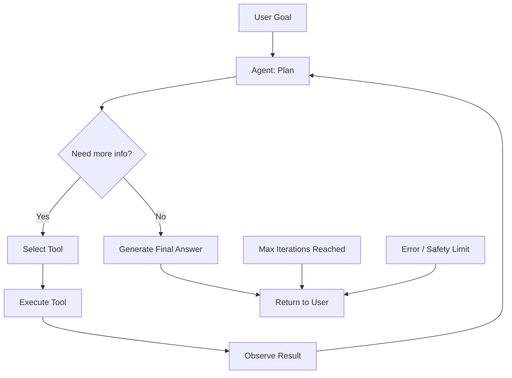
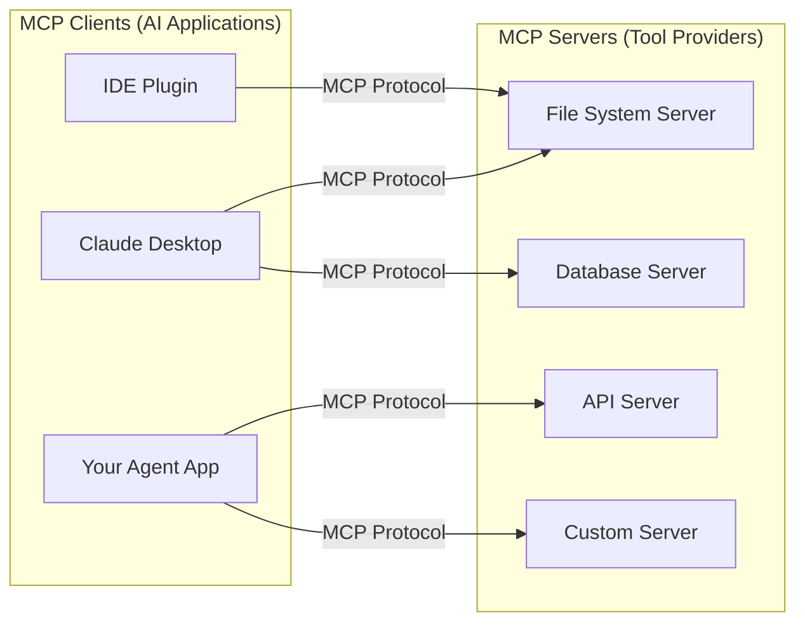
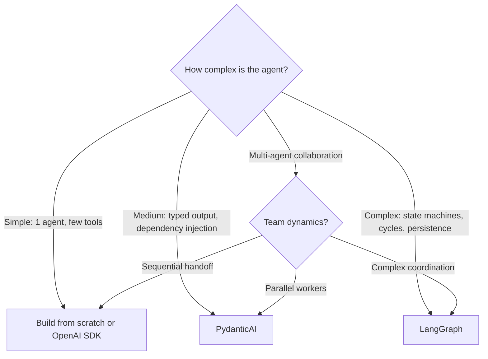

# Chapter 10: AI Agents

## Learning Objectives

By the end of this chapter, you will:

- [ ] Understand agent architectures and when to use them (vs. automations)
- [ ] Build agents from scratch using the ReAct pattern (Reason + Act)
- [ ] Implement agents with the OpenAI Agents SDK
- [ ] Build type-safe agents with PydanticAI
- [ ] Design multi-agent systems where agents collaborate
- [ ] Implement MCP (Model Context Protocol) for standardized tool connectivity
- [ ] Handle agent failure modes: loops, hallucinated actions, scope creep

## Prerequisites

- Chapter 5: Building AI Applications (function calling, tool use)
- Chapter 9: AI Automation (workflow patterns, error handling)

## Estimated Time

- Reading: 75 minutes
- Exercises: 60 minutes
- Project: 5 hours

---

## What Makes an Agent Different

In Chapter 9, we built automations: predefined workflows where YOU decide the steps. An agent is fundamentally different — the MODEL decides the steps.

```
Automation: Trigger → Step 1 → Step 2 → Step 3 → Done
Agent:      Goal → Think → Act → Observe → Think → Act → ... → Done
```

An agent is:
1. Given a **goal** (not a sequence of steps)
2. Has access to **tools** (functions it can call)
3. **Decides** which tools to use, in what order, with what arguments
4. **Observes** results and **adapts** its plan
5. **Repeats** until the goal is achieved (or gives up)

This is powerful but dangerous. Agents can:
- Loop indefinitely (calling the same tool repeatedly)
- Hallucinate tool names or arguments
- Take unintended actions with real consequences
- Spend unlimited tokens without producing results
- Creep beyond their intended scope

Engineering discipline is what separates a useful agent from an expensive token-burning machine.



*Figure 1: The agent loop — plan, act, observe, repeat until goal is met or limits are hit*

> 🔑 **Key Concept**
>
> Agents earn their complexity when the task genuinely requires dynamic decision-making. "Process this invoice" is an automation (steps are known). "Research this company and draft a personalized sales email using their latest news" is an agent (steps depend on what's found).

---

## The ReAct Pattern: Foundation of All Agents

ReAct (Reason + Act) is the core pattern underlying every agent framework. Understanding it means you can build agents with any tool.

### ReAct from Scratch

```python
import json
from openai import OpenAI
from typing import Callable


class ReActAgent:
    """Minimal ReAct agent built from primitives."""
    
    def __init__(
        self,
        system_prompt: str,
        tools: dict[str, Callable],
        tool_descriptions: list[dict],
        model: str = "gpt-4o",
        max_iterations: int = 10,
    ):
        self.client = OpenAI()
        self.system_prompt = system_prompt
        self.tools = tools  # name -> callable
        self.tool_descriptions = tool_descriptions  # OpenAI function format
        self.model = model
        self.max_iterations = max_iterations
    
    def run(self, task: str) -> dict:
        """Execute the agent loop until the task is complete."""
        messages = [
            {"role": "system", "content": self.system_prompt},
            {"role": "user", "content": task},
        ]
        
        iterations = 0
        tool_calls_made = []
        
        while iterations < self.max_iterations:
            iterations += 1
            
            # Think: Ask the model what to do
            response = self.client.chat.completions.create(
                model=self.model,
                messages=messages,
                tools=self.tool_descriptions,
                tool_choice="auto",
                temperature=0.0,
            )
            
            message = response.choices[0].message
            
            # Check if the model is done (no more tool calls)
            if not message.tool_calls:
                return {
                    "answer": message.content,
                    "iterations": iterations,
                    "tool_calls": tool_calls_made,
                    "status": "completed",
                }
            
            # Act: Execute the requested tools
            messages.append(message)
            
            for tool_call in message.tool_calls:
                func_name = tool_call.function.name
                arguments = json.loads(tool_call.function.arguments)
                
                # Execute the tool
                if func_name in self.tools:
                    try:
                        result = self.tools[func_name](**arguments)
                        result_str = json.dumps(result) if not isinstance(result, str) else result
                    except Exception as e:
                        result_str = json.dumps({"error": str(e)})
                else:
                    result_str = json.dumps({"error": f"Unknown tool: {func_name}"})
                
                tool_calls_made.append({
                    "tool": func_name,
                    "arguments": arguments,
                    "result_preview": result_str[:200],
                })
                
                # Observe: Add the result to messages
                messages.append({
                    "role": "tool",
                    "tool_call_id": tool_call.id,
                    "content": result_str,
                })
        
        # Max iterations reached
        return {
            "answer": "I wasn't able to complete the task within the allowed steps.",
            "iterations": iterations,
            "tool_calls": tool_calls_made,
            "status": "max_iterations_reached",
        }
```

### Using the ReAct Agent

```python
# Define tools
def search_web(query: str) -> dict:
    """Simulated web search."""
    # In production: call a search API (SerpAPI, Tavily, Brave)
    return {"results": [
        {"title": "Example Result", "snippet": f"Results for: {query}", "url": "https://example.com"}
    ]}

def calculate(expression: str) -> dict:
    """Evaluate a math expression."""
    try:
        result = eval(expression, {"__builtins__": {}}, {})
        return {"result": result}
    except Exception as e:
        return {"error": str(e)}

def get_current_time() -> dict:
    """Get current date and time."""
    from datetime import datetime
    return {"datetime": datetime.now().isoformat()}


# Tool descriptions (OpenAI format)
tool_descriptions = [
    {
        "type": "function",
        "function": {
            "name": "search_web",
            "description": "Search the web for current information.",
            "parameters": {
                "type": "object",
                "properties": {"query": {"type": "string", "description": "Search query"}},
                "required": ["query"]
            }
        }
    },
    {
        "type": "function",
        "function": {
            "name": "calculate",
            "description": "Evaluate a mathematical expression.",
            "parameters": {
                "type": "object",
                "properties": {"expression": {"type": "string", "description": "Math expression to evaluate"}},
                "required": ["expression"]
            }
        }
    },
    {
        "type": "function",
        "function": {
            "name": "get_current_time",
            "description": "Get the current date and time.",
            "parameters": {"type": "object", "properties": {}}
        }
    },
]

# Create and run agent
agent = ReActAgent(
    system_prompt="""You are a helpful research assistant. 
Use tools to find information and answer questions accurately.
Always verify your answers with tool results rather than guessing.""",
    tools={"search_web": search_web, "calculate": calculate, "get_current_time": get_current_time},
    tool_descriptions=tool_descriptions,
    max_iterations=5,
)

result = agent.run("What is 15% of the current year?")
print(result["answer"])
print(f"Tools used: {len(result['tool_calls'])} calls in {result['iterations']} iterations")
```

---

## OpenAI Agents SDK

OpenAI provides a first-party agent framework that handles the loop, tool execution, and handoffs between agents.

### Basic Agent

```python
from openai import OpenAI
from agents import Agent, Runner, function_tool


@function_tool
def lookup_customer(email: str) -> str:
    """Look up a customer's account information by email."""
    # Simulated database lookup
    customers = {
        "alice@example.com": {"name": "Alice Chen", "plan": "pro", "balance": 150.00},
        "bob@example.com": {"name": "Bob Smith", "plan": "free", "balance": 0},
    }
    customer = customers.get(email)
    if customer:
        return json.dumps(customer)
    return json.dumps({"error": "Customer not found"})


@function_tool
def create_support_ticket(title: str, description: str, priority: str) -> str:
    """Create a new support ticket."""
    ticket_id = f"TKT-{hash(title) % 10000:04d}"
    return json.dumps({"ticket_id": ticket_id, "status": "created"})


@function_tool  
def send_email(to: str, subject: str, body: str) -> str:
    """Send an email to a customer."""
    return json.dumps({"status": "sent", "to": to})


# Define the agent
support_agent = Agent(
    name="Customer Support Agent",
    instructions="""You are a customer support agent for TechCo.

CAPABILITIES:
- Look up customer accounts
- Create support tickets for issues requiring follow-up
- Send emails to customers

RULES:
- Always look up the customer first before helping
- For billing issues, create a ticket (don't resolve directly)
- Be concise and professional
- If you can't help, create a ticket and inform the customer""",
    tools=[lookup_customer, create_support_ticket, send_email],
    model="gpt-4o-mini",
)

# Run the agent
result = Runner.run_sync(
    support_agent,
    "A customer at alice@example.com says she was charged twice for her Pro subscription."
)
print(result.final_output)
```

### Agent Handoffs (Multi-Agent)

OpenAI's SDK supports transferring control between specialized agents:

```python
from agents import Agent, Runner, function_tool, handoff

# Specialist agents
billing_agent = Agent(
    name="Billing Specialist",
    instructions="""You handle billing inquiries: refunds, charges, plan changes.
You have access to the billing system to look up and modify charges.""",
    tools=[lookup_customer, process_refund, modify_subscription],
    model="gpt-4o",
)

technical_agent = Agent(
    name="Technical Specialist",
    instructions="""You handle technical issues: bugs, API problems, integration help.
You can access logs and documentation.""",
    tools=[search_docs, check_api_status, lookup_error_logs],
    model="gpt-4o",
)

# Triage agent that routes to specialists
triage_agent = Agent(
    name="Support Triage",
    instructions="""You are the first point of contact for support requests.
Determine the nature of the issue and hand off to the appropriate specialist:
- Billing issues → billing_specialist
- Technical issues → technical_specialist
If unclear, ask the user for clarification.""",
    handoffs=[
        handoff(billing_agent, description="Transfer to billing specialist for payment/subscription issues"),
        handoff(technical_agent, description="Transfer to technical specialist for bugs/API issues"),
    ],
    model="gpt-4o-mini",
)

# The triage agent will automatically route to the right specialist
result = Runner.run_sync(triage_agent, "My API calls are returning 500 errors since yesterday")
```

> 📐 **Architecture Decision**
>
> Multi-agent handoffs work best when each agent has a clearly bounded domain and distinct tools. If two agents overlap significantly in capability, merge them into one with a broader prompt. Handoffs add latency and complexity — use them only when specialization genuinely improves quality.

---

## PydanticAI: Type-Safe Agents

PydanticAI brings type safety and dependency injection to agent development. It's particularly good for production systems where you need validation guarantees.

### Basic PydanticAI Agent

```python
from pydantic_ai import Agent, RunContext
from pydantic import BaseModel
from dataclasses import dataclass


# Define structured output
class ResearchReport(BaseModel):
    """Structured output from the research agent."""
    summary: str
    key_findings: list[str]
    confidence: float  # 0.0 to 1.0
    sources_used: list[str]


# Define dependencies (injected at runtime)
@dataclass
class ResearchDeps:
    """Dependencies available to the agent's tools."""
    search_api_key: str
    max_results: int = 5


# Create the agent with typed output
research_agent = Agent(
    "openai:gpt-4o",
    result_type=ResearchReport,
    system_prompt="""You are a research analyst. When given a topic:
1. Search for relevant information
2. Analyze findings
3. Produce a structured report with confidence score

Only include findings you can support with search results.""",
    deps_type=ResearchDeps,
)


# Define tools with type safety
@research_agent.tool
async def search(ctx: RunContext[ResearchDeps], query: str) -> str:
    """Search the web for information on a topic."""
    # Access typed dependencies
    api_key = ctx.deps.search_api_key
    max_results = ctx.deps.max_results
    
    # Simulated search
    return json.dumps({
        "results": [
            {"title": f"Result for: {query}", "snippet": "Relevant information..."}
        ]
    })


@research_agent.tool
async def get_company_info(ctx: RunContext[ResearchDeps], company_name: str) -> str:
    """Get basic information about a company."""
    return json.dumps({
        "name": company_name,
        "industry": "Technology",
        "employees": "1000-5000",
        "founded": "2015"
    })


# Run with typed dependencies and output
async def main():
    deps = ResearchDeps(search_api_key="sk-...", max_results=3)
    
    result = await research_agent.run(
        "Research the current state of AI automation tools for small businesses",
        deps=deps
    )
    
    # result.data is typed as ResearchReport
    report: ResearchReport = result.data
    print(f"Summary: {report.summary}")
    print(f"Confidence: {report.confidence}")
    print(f"Findings: {len(report.key_findings)}")
    print(f"Cost: ${result.cost().total_cost:.4f}")
```

### Why PydanticAI for Production

| Feature | Benefit |
|---------|---------|
| Typed outputs | Guaranteed output structure — no parsing surprises |
| Dependency injection | Testable, configurable tools without globals |
| Multi-model support | Swap between OpenAI, Anthropic, Gemini with one line |
| Cost tracking | Built-in token/cost monitoring per run |
| Streaming support | Type-safe streaming with partial results |
| Retry logic | Automatic retries with configurable strategy |

> 💡 **Developer Insight**
>
> PydanticAI's dependency injection is the killer feature for production agents. In tests, you inject mock dependencies. In staging, you inject sandboxed services. In production, you inject real services. Same agent code, different environments. This is proper software engineering applied to AI.

---

## MCP: Model Context Protocol

MCP standardizes how AI models connect to external tools and data sources. Instead of each agent framework having its own tool format, MCP provides a universal protocol.

### What MCP Solves

```
Before MCP:
  Agent Framework A → Custom tool format A
  Agent Framework B → Custom tool format B
  Agent Framework C → Custom tool format C
  (Same tool reimplemented 3 times)

With MCP:
  Agent Framework A ─┐
  Agent Framework B ──┼── MCP Protocol ──→ MCP Server (tool implementation)
  Agent Framework C ─┘
  (One tool implementation serves all frameworks)
```

### MCP Architecture



*Figure 2: MCP connects any client to any server through a standard protocol*

### Building an MCP Server

```python
from mcp.server import Server
from mcp.types import Tool, TextContent
import mcp.server.stdio

# Create MCP server
server = Server("knowledge-base-server")


@server.list_tools()
async def list_tools() -> list[Tool]:
    """Declare available tools to MCP clients."""
    return [
        Tool(
            name="search_knowledge_base",
            description="Search the company knowledge base for information",
            inputSchema={
                "type": "object",
                "properties": {
                    "query": {"type": "string", "description": "Search query"},
                    "category": {
                        "type": "string",
                        "enum": ["product", "policy", "technical", "all"],
                        "description": "Category to search in"
                    }
                },
                "required": ["query"]
            }
        ),
        Tool(
            name="get_document",
            description="Retrieve a specific document by ID",
            inputSchema={
                "type": "object",
                "properties": {
                    "document_id": {"type": "string", "description": "Document identifier"}
                },
                "required": ["document_id"]
            }
        ),
    ]


@server.call_tool()
async def call_tool(name: str, arguments: dict) -> list[TextContent]:
    """Handle tool execution requests."""
    if name == "search_knowledge_base":
        # Your search implementation
        results = await perform_search(arguments["query"], arguments.get("category", "all"))
        return [TextContent(type="text", text=json.dumps(results))]
    
    elif name == "get_document":
        doc = await get_document_by_id(arguments["document_id"])
        return [TextContent(type="text", text=json.dumps(doc))]
    
    else:
        return [TextContent(type="text", text=f"Unknown tool: {name}")]


# Run the server
async def main():
    async with mcp.server.stdio.stdio_server() as (read_stream, write_stream):
        await server.run(read_stream, write_stream, server.create_initialization_options())
```

### Using MCP in Your Agent

```python
from mcp import ClientSession, StdioServerParameters
from mcp.client.stdio import stdio_client


async def agent_with_mcp():
    """Agent that connects to MCP servers for tools."""
    
    # Connect to MCP server
    server_params = StdioServerParameters(
        command="python",
        args=["knowledge_base_server.py"]
    )
    
    async with stdio_client(server_params) as (read, write):
        async with ClientSession(read, write) as session:
            await session.initialize()
            
            # Discover available tools
            tools = await session.list_tools()
            print(f"Available tools: {[t.name for t in tools.tools]}")
            
            # Call a tool
            result = await session.call_tool(
                "search_knowledge_base",
                arguments={"query": "refund policy", "category": "policy"}
            )
            print(f"Search results: {result.content[0].text}")
```

> 🏢 **Industry Note**
>
> MCP is gaining rapid adoption because it solves the "N × M integration problem." Without MCP, every AI application needs custom integrations for every tool. With MCP, tool providers build one server, and every MCP-compatible client can use it. Think of it like USB for AI tools.

---

## Multi-Agent Systems

When a task is too complex for one agent, decompose it across multiple specialized agents.

### Patterns for Multi-Agent Systems

| Pattern | Description | Use Case |
|---------|-------------|----------|
| **Sequential handoff** | Agent A completes, passes output to Agent B | Pipeline (research → write → edit) |
| **Router/dispatch** | One agent classifies, routes to specialists | Customer support triage |
| **Collaborative** | Agents work on sub-tasks in parallel, results merged | Complex research with multiple angles |
| **Supervisor** | One agent manages others, delegates tasks | Project planning with sub-agents |
| **Debate/critique** | One generates, another critiques, iterate | Quality-critical content generation |

### Building a Supervisor Agent

```python
class SupervisorAgent:
    """A supervisor that decomposes tasks and delegates to worker agents."""
    
    def __init__(self, workers: dict[str, ReActAgent]):
        self.client = OpenAI()
        self.workers = workers
    
    async def run(self, task: str) -> dict:
        """Decompose a task and delegate to workers."""
        
        # Step 1: Plan — decompose the task
        plan = await self._create_plan(task)
        
        # Step 2: Delegate — assign sub-tasks to workers
        results = {}
        for step in plan["steps"]:
            worker_name = step["assigned_to"]
            worker = self.workers.get(worker_name)
            
            if not worker:
                results[step["id"]] = {"error": f"No worker named '{worker_name}'"}
                continue
            
            # Execute the sub-task
            result = worker.run(step["task"])
            results[step["id"]] = result
        
        # Step 3: Synthesize — combine results into final answer
        final = await self._synthesize(task, results)
        
        return {
            "plan": plan,
            "sub_results": results,
            "final_answer": final,
        }
    
    async def _create_plan(self, task: str) -> dict:
        """Use LLM to decompose a task into sub-tasks."""
        worker_descriptions = "\n".join(
            f"- {name}: {agent.system_prompt[:100]}..."
            for name, agent in self.workers.items()
        )
        
        response = self.client.chat.completions.create(
            model="gpt-4o",
            messages=[{
                "role": "user",
                "content": f"""Decompose this task into sub-tasks for available workers.

AVAILABLE WORKERS:
{worker_descriptions}

TASK: {task}

Return JSON:
{{"steps": [{{"id": "step_1", "task": "specific sub-task description", "assigned_to": "worker_name", "depends_on": []}}]}}

Rules:
- Each step should be independently executable
- Use only available workers
- Keep to 2-4 steps maximum"""
            }],
            temperature=0.0,
            response_format={"type": "json_object"},
            max_tokens=500,
        )
        
        return json.loads(response.choices[0].message.content)
    
    async def _synthesize(self, original_task: str, results: dict) -> str:
        """Combine sub-task results into a coherent final answer."""
        results_text = "\n\n".join(
            f"Step {k}:\n{json.dumps(v, indent=2)[:500]}"
            for k, v in results.items()
        )
        
        response = self.client.chat.completions.create(
            model="gpt-4o",
            messages=[{
                "role": "user",
                "content": f"""Original task: {original_task}

Sub-task results:
{results_text}

Synthesize these results into a coherent, complete answer to the original task."""
            }],
            temperature=0.3,
            max_tokens=1000,
        )
        
        return response.choices[0].message.content
```

---

## Agent Safety and Guardrails

Agents can take real actions. Without guardrails, they can send emails to the wrong people, delete data, or spend money. Safety is not optional.

### Guardrail Patterns

```python
from dataclasses import dataclass
from enum import Enum


class ActionRisk(Enum):
    READ_ONLY = "read_only"       # No side effects
    LOW_RISK = "low_risk"         # Reversible side effects
    HIGH_RISK = "high_risk"       # Irreversible or expensive
    CRITICAL = "critical"         # Needs human approval


@dataclass
class ToolPolicy:
    """Policy for how a tool can be used by an agent."""
    name: str
    risk_level: ActionRisk
    max_calls_per_run: int = 10
    requires_confirmation: bool = False
    allowed_arguments: dict | None = None  # Restrict argument values


class AgentGuardrails:
    """Safety layer between the agent and tool execution."""
    
    def __init__(self, policies: list[ToolPolicy]):
        self.policies = {p.name: p for p in policies}
        self.call_counts: dict[str, int] = {}
        self.pending_confirmations: list[dict] = []
    
    def check_tool_call(self, tool_name: str, arguments: dict) -> dict:
        """Validate a tool call against policies before execution."""
        policy = self.policies.get(tool_name)
        
        if not policy:
            return {"allowed": False, "reason": f"Unknown tool: {tool_name}. Not in policy."}
        
        # Check call count
        count = self.call_counts.get(tool_name, 0)
        if count >= policy.max_calls_per_run:
            return {"allowed": False, "reason": f"Tool '{tool_name}' exceeded max calls ({policy.max_calls_per_run})"}
        
        # Check argument restrictions
        if policy.allowed_arguments:
            for key, allowed_values in policy.allowed_arguments.items():
                if key in arguments and arguments[key] not in allowed_values:
                    return {"allowed": False, "reason": f"Argument '{key}' value not in allowed set"}
        
        # Check if confirmation needed
        if policy.requires_confirmation:
            self.pending_confirmations.append({
                "tool": tool_name,
                "arguments": arguments,
                "risk": policy.risk_level.value,
            })
            return {"allowed": False, "reason": "requires_human_confirmation", "pending": True}
        
        # Track the call
        self.call_counts[tool_name] = count + 1
        return {"allowed": True}
    
    def confirm_pending(self, index: int) -> dict:
        """Human confirms a pending action."""
        if index < len(self.pending_confirmations):
            confirmed = self.pending_confirmations.pop(index)
            return {"confirmed": True, "action": confirmed}
        return {"confirmed": False, "reason": "Invalid index"}


# Usage
guardrails = AgentGuardrails(policies=[
    ToolPolicy("search_web", ActionRisk.READ_ONLY, max_calls_per_run=20),
    ToolPolicy("read_file", ActionRisk.READ_ONLY, max_calls_per_run=10),
    ToolPolicy("send_email", ActionRisk.HIGH_RISK, max_calls_per_run=3, requires_confirmation=True),
    ToolPolicy("delete_record", ActionRisk.CRITICAL, max_calls_per_run=1, requires_confirmation=True),
    ToolPolicy("create_ticket", ActionRisk.LOW_RISK, max_calls_per_run=5),
])
```

### Token Budget Limits

```python
class AgentBudget:
    """Enforce token/cost budgets on agent runs."""
    
    def __init__(self, max_tokens: int = 50_000, max_cost: float = 1.0, max_iterations: int = 15):
        self.max_tokens = max_tokens
        self.max_cost = max_cost
        self.max_iterations = max_iterations
        self.tokens_used = 0
        self.cost_incurred = 0.0
        self.iterations = 0
    
    def record_usage(self, input_tokens: int, output_tokens: int, model: str):
        """Record token usage for budget tracking."""
        self.tokens_used += input_tokens + output_tokens
        self.iterations += 1
        
        # Calculate cost
        pricing = {"gpt-4o": (2.5, 10.0), "gpt-4o-mini": (0.15, 0.6)}
        rates = pricing.get(model, (1.0, 4.0))
        self.cost_incurred += (input_tokens / 1e6 * rates[0]) + (output_tokens / 1e6 * rates[1])
    
    def check_budget(self) -> dict:
        """Check if the agent is within budget."""
        if self.tokens_used >= self.max_tokens:
            return {"within_budget": False, "reason": "token_limit", "used": self.tokens_used}
        if self.cost_incurred >= self.max_cost:
            return {"within_budget": False, "reason": "cost_limit", "cost": self.cost_incurred}
        if self.iterations >= self.max_iterations:
            return {"within_budget": False, "reason": "iteration_limit", "iterations": self.iterations}
        return {"within_budget": True, "tokens_remaining": self.max_tokens - self.tokens_used}
```

> ⚠️ **Common Mistake**
>
> Never deploy an agent without both iteration limits AND token/cost limits. An agent stuck in a loop can burn through your entire API budget in minutes. A well-configured budget ($1 max per run, 15 iterations max) prevents runaway costs while allowing enough room for complex tasks.

---

## Framework Comparison: Choosing Your Tool

| Framework | Best For | Complexity | Learning Curve |
|-----------|----------|-----------|----------------|
| **From scratch (ReAct)** | Understanding fundamentals, simple agents | Low | Low |
| **OpenAI Agents SDK** | OpenAI-exclusive apps, handoffs | Medium | Low |
| **PydanticAI** | Production Python apps, type safety | Medium | Medium |
| **LangGraph** | Complex stateful agents, cycles, persistence | High | High |
| **CrewAI** | Multi-agent role-play collaboration | Medium | Medium |
| **AutoGen** | Research, multi-agent conversations | High | High |

### Decision Framework



*Figure 3: Agent framework selection based on complexity*

> 💡 **Developer Insight**
>
> Start with the simplest approach that could work. A 50-line ReAct agent from scratch is easier to debug than a 500-line LangGraph configuration. Add framework complexity only when you need specific features: state persistence (LangGraph), type safety (PydanticAI), or multi-agent handoffs (OpenAI SDK). Most production agents don't need a framework at all.

---

## Production Notes

- **Agent observability is critical.** Log every tool call, every LLM response, and every decision. When an agent does something unexpected, you need the trace to understand why.
- **Test agents with deterministic scenarios.** Set temperature to 0, use seeded responses, and build regression tests for known-good behavior.
- **Deploy agents behind human review initially.** Let the agent draft actions, but require human approval before execution. Loosen controls as you build confidence.
- **Version your agent configurations.** System prompts, tool lists, and guardrail policies are all configuration that should be version-controlled and deployable.
- **Monitor cost per agent run.** Track P50, P90, and P99 costs. A small percentage of runaway runs can dominate your bill.
- **Implement graceful degradation.** When an agent hits its budget or iteration limit, it should produce a partial result ("Here's what I found so far...") rather than failing silently.

## Common Mistakes

1. **Using an agent when an automation suffices.** If the steps are known in advance, use an automation (Chapter 9). Agents add non-determinism, cost, and latency for no benefit when the workflow is predefined.

2. **Too many tools.** Each tool's description consumes context tokens on every LLM call. An agent with 30 tools is slow, expensive, and often confused. Limit to 5–10 focused tools.

3. **No iteration limits.** An agent without max_iterations can loop forever. Always set limits (5–15 iterations for most tasks).

4. **Vague system prompts.** "You are a helpful assistant with tools" produces unreliable behavior. Be specific about when to use tools, when to stop, and what success looks like.

5. **Not handling tool errors.** Tools fail (timeouts, auth errors, invalid data). The agent needs to see error messages and adapt — don't silently swallow exceptions.

6. **Deploying agents that take irreversible actions without confirmation.** Sending emails, deleting data, making purchases — these should always require human approval until the agent has proven reliability.

## Best Practices

1. **Define clear success criteria.** The agent needs to know when it's done. "Research until you have 5 key findings" is better than "do some research."

2. **Implement progressive disclosure of tools.** Start an agent with few tools. Add more only as the task requires. Fewer tools = better tool selection.

3. **Use typed outputs (PydanticAI or structured output).** Force the agent's final answer into a validated schema. This catches malformed outputs before they reach users.

4. **Log everything, trace everything.** Agent traces (the sequence of thoughts and actions) are essential for debugging, evaluation, and improvement.

5. **Budget aggressively.** Set token budgets well below what you'd be "willing" to spend. Agents optimize within constraints. Without constraints, they meander.

6. **Test with adversarial inputs.** What does the agent do with ambiguous goals? Contradictory information? Invalid tool results? Design for these cases.

7. **Start supervised, earn autonomy.** Deploy with human-in-the-loop. As success rate proves out, reduce oversight for well-understood task types.

---

## Hands-On Exercises

### Exercise 1: Build a ReAct Agent

**Difficulty:** ⭐⭐
**Time:** 25 minutes

Build a ReAct agent from scratch (no frameworks) that can:
1. Search the web (simulated)
2. Do math calculations
3. Read files from a directory

Give it the task: "Find the total size of all Python files in the current directory and convert it to kilobytes." Verify it uses tools in the right order.

### Exercise 2: Guardrails Implementation

**Difficulty:** ⭐⭐
**Time:** 20 minutes

Add guardrails to your Exercise 1 agent:
1. Read-only tools: unlimited calls
2. Write tools: max 3 calls, require confirmation
3. Token budget: max 10,000 tokens per run
4. Test: give the agent a task that would normally exceed limits. Verify it stops gracefully.

### Exercise 3: Multi-Agent Debate

**Difficulty:** ⭐⭐⭐
**Time:** 30 minutes

Build a debate system with two agents:
1. **Proposer:** Given a code snippet, suggests an improvement
2. **Critic:** Reviews the suggestion and either approves or requests revision
3. Loop until the Critic approves (max 3 rounds)
4. Output: final approved suggestion with reasoning from both agents

### Exercise 4: MCP Server

**Difficulty:** ⭐⭐
**Time:** 25 minutes

Build a minimal MCP server that exposes:
1. A `search_notes` tool (searches a local directory of .txt files)
2. A `create_note` tool (creates a new .txt file)
3. A `list_notes` tool (lists all notes with their first line)

Test it by connecting from a simple client that calls each tool.

---

## Mini Project

**Title:** Research Agent with Guardrails
**Difficulty:** ⭐⭐⭐
**Time:** 3 hours
**What you'll build:** A research agent that can search the web, read documents, take notes, and produce a structured research report — with full safety guardrails.

### Requirements

1. **Tools:** Web search (simulated), file reading, note-taking, calculation
2. **Output:** Structured report (ResearchReport model with title, findings, sources, confidence)
3. **Guardrails:** Token budget, iteration limit, tool call limits
4. **Observability:** Full trace of every thought/action/observation
5. **Evaluation:** Test with 5 different research tasks, measure completion rate and quality

### Deliverables

```
research-agent/
├── src/
│   ├── agent.py          # ReAct agent implementation
│   ├── tools.py          # Tool implementations
│   ├── guardrails.py     # Safety policies
│   ├── tracing.py        # Execution trace logging
│   └── evaluate.py       # Quality evaluation
├── traces/               # Saved execution traces
├── test_tasks.json       # Evaluation tasks
├── requirements.txt
└── README.md
```

---

## Challenge Project

**Title:** Multi-Agent Customer Service System
**Difficulty:** ⭐⭐⭐⭐
**Time:** 8 hours
**What you'll build:** A multi-agent system that handles customer service across billing, technical support, and sales — with triage routing, specialist handoffs, escalation, and human-in-the-loop for critical actions.

### Requirements

1. **Triage agent:** Classifies incoming requests and routes to specialists
2. **Billing agent:** Handles payment inquiries, refund requests, plan changes
3. **Technical agent:** Troubleshoots issues using RAG over documentation
4. **Sales agent:** Handles upgrade inquiries, feature questions
5. **Escalation:** Auto-escalate when agent confidence is low or customer is frustrated
6. **Human-in-the-loop:** Queue for actions requiring approval (refunds > $100, account deletion)
7. **Memory:** Persist conversation context across agent handoffs
8. **Guardrails:** Per-agent tool policies, global budget limits
9. **Evaluation:** Test suite with 20 scenarios covering happy paths and edge cases
10. **Dashboard:** Show agent activity, handoff patterns, escalation rate

---

## Portfolio Milestone

After this chapter, you should have:
- A working agent built from scratch (understanding the fundamentals)
- Experience with at least one agent framework (OpenAI SDK or PydanticAI)
- A multi-agent system demonstrating handoffs and collaboration
- Guardrail and safety patterns you'll use in every agent project
- Understanding of when agents are appropriate vs. overkill

---

## Chapter Summary

- Agents differ from automations: the model decides the steps, not you. Use agents only when the task genuinely requires dynamic decision-making.
- The ReAct pattern (Reason → Act → Observe → Repeat) underlies all agent frameworks. Understanding it lets you build agents with any tool.
- OpenAI Agents SDK handles the loop and supports multi-agent handoffs. Good for OpenAI-exclusive applications.
- PydanticAI adds type safety, dependency injection, and multi-model support. Best for production Python applications.
- MCP standardizes tool connectivity. Build one MCP server, connect from any MCP-compatible client.
- Multi-agent systems decompose complex tasks. Patterns: sequential handoff, router/dispatch, supervisor, debate.
- Guardrails are non-negotiable: iteration limits, token budgets, tool call limits, human-in-the-loop for high-risk actions.
- Start with the simplest approach. Most "agent" requirements are better served by a well-designed automation or a single-agent ReAct loop.

---

## Cheat Sheet

| When to Use | Approach |
|-------------|----------|
| Steps are known in advance | Automation (Chapter 9) |
| Simple tool use, 2-3 iterations | ReAct from scratch |
| Need typed output, testability | PydanticAI |
| OpenAI-only, handoff between specialists | OpenAI Agents SDK |
| Complex state machines, persistence | LangGraph |
| Research/exploration tasks | Single agent with search tools |
| Multi-domain support routing | Multi-agent with triage |

| Safety Measure | Implementation |
|---------------|---------------|
| Max iterations | `while iterations < max_iterations` |
| Token budget | Track cumulative tokens, abort at limit |
| Tool call limits | Per-tool counter with max |
| Action confirmation | Human approval queue for high-risk tools |
| Output validation | Pydantic/structured output schema |
| Trace logging | Record every thought, action, observation |

---

## Glossary

| Term | Definition |
|------|-----------|
| Agent | An AI system that dynamically decides which tools to use and in what order to accomplish a goal. |
| ReAct | Reason + Act. The core agent pattern: think about what to do, do it, observe the result, repeat. |
| Tool | A function the agent can call to interact with external systems or get information. |
| Handoff | Transferring control from one agent to another specialized agent. |
| Guardrails | Safety constraints that prevent agents from taking unintended or harmful actions. |
| MCP | Model Context Protocol. Standard protocol for connecting AI models to external tools and data. |
| Multi-agent | System architecture where multiple specialized agents collaborate on a task. |
| Supervisor | An agent that coordinates and delegates work to other agents. |
| Iteration limit | Maximum number of think-act-observe cycles before the agent must stop. |
| Token budget | Maximum total tokens (across all LLM calls) an agent can consume in one run. |
| Human-in-the-loop | Design pattern where critical agent actions require human approval before execution. |
| Trace | The complete log of an agent's reasoning steps, tool calls, and observations. |

---

## References

- [OpenAI Agents SDK](https://github.com/openai/openai-agents-python) — Official agent framework documentation.
- [PydanticAI Documentation](https://ai.pydantic.dev/) — Type-safe agent framework.
- [Model Context Protocol](https://modelcontextprotocol.io/) — MCP specification and guides.
- [LangGraph Documentation](https://langchain-ai.github.io/langgraph/) — Stateful agent orchestration.
- [ReAct Paper](https://arxiv.org/abs/2210.03629) — Original Reason + Act research paper.

## Further Reading

- [Building Effective Agents](https://www.anthropic.com/research/building-effective-agents) — Anthropic's guide to practical agent design.
- [Agent Engineering](https://newsletter.pragmaticengineer.com/) — Industry patterns for production agents.
- [MCP Servers Registry](https://github.com/modelcontextprotocol/servers) — Community MCP server implementations.

---

## Next Chapter Preview

In **Chapter 11: Flutter + AI**, we'll bring AI capabilities into mobile applications. You'll build streaming chat UIs, integrate speech and vision, implement on-device AI for offline use, and deploy AI-powered Flutter apps with Firebase and Supabase backends. This is where your AI engineering skills meet mobile development.
