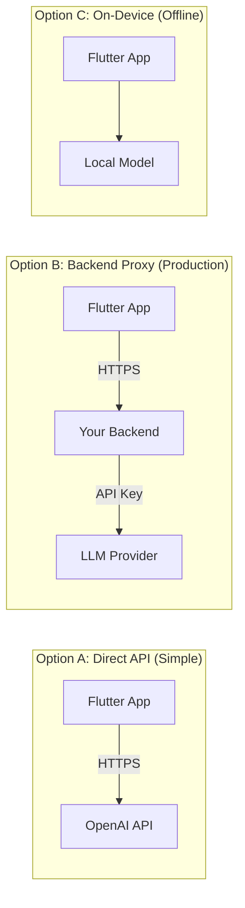

# Chapter 11: Flutter + AI

## Learning Objectives

By the end of this chapter, you will:

- [ ] Build a streaming chat UI in Flutter with real-time token display
- [ ] Integrate LLM APIs from a Flutter app (directly and via backend)
- [ ] Implement speech-to-text and text-to-speech for voice interfaces
- [ ] Use the device camera for image-based AI features (OCR, analysis)
- [ ] Connect Flutter apps to AI backends using Supabase and Firebase
- [ ] Handle offline scenarios and local AI capabilities
- [ ] Deploy production AI-powered Flutter applications

## Prerequisites

- Chapter 5: Building AI Applications (streaming, API patterns)
- Flutter fundamentals (widgets, state management, navigation)
- Dart programming (async/await, streams)

## Estimated Time

- Reading: 75 minutes
- Exercises: 60 minutes
- Project: 5 hours

---

## Architecture: Where Does AI Live?

The first decision for any AI-powered mobile app: where does the AI processing happen?



*Figure 1: Three architectures for AI in mobile apps*

| Approach | Pros | Cons | Use When |
|----------|------|------|----------|
| **Direct API** | Simple, fast to build | API key exposed in app, no control | Prototypes, hackathons |
| **Backend proxy** | Secure, controllable, cacheable | More infrastructure | Production apps |
| **On-device** | Works offline, zero API cost | Limited model quality, large app size | Privacy-sensitive, offline-first |

> ⚠️ **Common Mistake**
>
> Never ship API keys in a mobile app binary. Anyone can decompile your app and extract the key. Always proxy LLM calls through your own backend where the key is stored server-side. The only exception is development/prototyping.

---

## Project Setup

### Dependencies

```yaml
# pubspec.yaml
dependencies:
  flutter:
    sdk: flutter
  
  # Networking
  dio: ^5.4.3+1
  
  # State Management
  get: ^4.6.6
  
  # AI-specific
  dart_openai: ^5.1.0          # OpenAI Dart SDK (optional, for prototyping)
  speech_to_text: ^6.6.0       # Speech recognition
  flutter_tts: ^4.0.2          # Text-to-speech
  camera: ^0.11.0              # Camera access
  image_picker: ^1.1.2         # Image selection
  
  # Backend connectivity
  supabase_flutter: ^2.5.0     # Supabase client
  
  # UI
  flutter_markdown: ^0.7.1     # Render markdown responses
  shimmer: ^3.0.0              # Loading skeletons
  flutter_screenutil: ^5.9.0   # Responsive sizing
```

### Project Structure

```
lib/
├── main.dart
└── src/
    ├── app.dart
    ├── application/
    │   └── chat/
    │       └── chat_controller.dart
    ├── data/
    │   ├── models/
    │   │   ├── chat_message.dart
    │   │   └── conversation.dart
    │   └── repositories/
    │       └── ai_repository_impl.dart
    ├── domain/
    │   ├── repositories/
    │   │   └── ai_repository.dart
    │   └── use_cases/
    │       └── chat_use_case.dart
    ├── presentation/
    │   └── chat/
    │       ├── chat_screen.dart
    │       ├── widgets/
    │       │   ├── message_bubble.dart
    │       │   ├── streaming_text.dart
    │       │   └── typing_indicator.dart
    │       └── chat_input.dart
    └── service/
        ├── ai_service.dart
        ├── speech_service.dart
        └── camera_service.dart
```

---

## Building the AI Service Layer

### The Repository Pattern for AI Calls

```dart
// domain/repositories/ai_repository.dart
import 'package:dartz/dartz.dart';

abstract class AIRepository {
  /// Send a message and receive a streaming response
  Stream<String> streamChatResponse({
    required String message,
    required List<Map<String, String>> history,
    String model = 'gpt-4o-mini',
  });
  
  /// Send a message and get a complete response
  Future<Either<Failure, String>> getChatResponse({
    required String message,
    required List<Map<String, String>> history,
  });
  
  /// Transcribe audio to text
  Future<Either<Failure, String>> transcribeAudio({
    required String audioPath,
  });
  
  /// Analyze an image with a question
  Future<Either<Failure, String>> analyzeImage({
    required String imagePath,
    required String question,
  });
}
```

### Backend Proxy Implementation

```dart
// data/repositories/ai_repository_impl.dart
import 'package:dio/dio.dart';

class AIRepositoryImpl implements AIRepository {
  final Dio _dio;
  final ConnectivityService _connectivityService;
  
  // Your backend URL (not the OpenAI URL directly)
  static const _baseUrl = 'https://your-backend.com/api/v1';
  
  AIRepositoryImpl(Dio dio, ConnectivityService connectivityService)
      : _dio = dio,
        _connectivityService = connectivityService;
  
  @override
  Stream<String> streamChatResponse({
    required String message,
    required List<Map<String, String>> history,
    String model = 'gpt-4o-mini',
  }) async* {
    if (!await _connectivityService.isInternetAvailable()) {
      yield '[ERROR] No internet connection';
      return;
    }
    
    try {
      final response = await _dio.post(
        '$_baseUrl/chat/stream',
        data: {
          'message': message,
          'history': history,
          'model': model,
        },
        options: Options(
          responseType: ResponseType.stream,
          headers: {'Accept': 'text/event-stream'},
        ),
      );
      
      // Parse SSE stream
      final stream = response.data.stream as Stream<List<int>>;
      String buffer = '';
      
      await for (final chunk in stream) {
        buffer += String.fromCharCodes(chunk);
        
        // Parse SSE events
        final lines = buffer.split('\n');
        buffer = lines.removeLast(); // Keep incomplete line
        
        for (final line in lines) {
          if (line.startsWith('data: ')) {
            final data = line.substring(6);
            if (data == '[DONE]') return;
            yield data;
          }
        }
      }
    } on DioException catch (e) {
      yield '[ERROR] ${e.message}';
    }
  }
  
  @override
  Future<Either<Failure, String>> getChatResponse({
    required String message,
    required List<Map<String, String>> history,
  }) async {
    if (!await _connectivityService.isInternetAvailable()) {
      return left(const Failure.noInternetConnection());
    }
    
    try {
      final response = await _dio.post(
        '$_baseUrl/chat',
        data: {'message': message, 'history': history},
      );
      
      if (response.statusCode == 200) {
        return right(response.data['response'] as String);
      }
      return left(const Failure.internalServerError());
    } on DioException catch (e) {
      return left(Failure.getDioException(e));
    }
  }
  
  @override
  Future<Either<Failure, String>> analyzeImage({
    required String imagePath,
    required String question,
  }) async {
    if (!await _connectivityService.isInternetAvailable()) {
      return left(const Failure.noInternetConnection());
    }
    
    try {
      final formData = FormData.fromMap({
        'image': await MultipartFile.fromFile(imagePath),
        'question': question,
      });
      
      final response = await _dio.post(
        '$_baseUrl/vision/analyze',
        data: formData,
      );
      
      if (response.statusCode == 200) {
        return right(response.data['analysis'] as String);
      }
      return left(const Failure.internalServerError());
    } on DioException catch (e) {
      return left(Failure.getDioException(e));
    }
  }
  
  @override
  Future<Either<Failure, String>> transcribeAudio({
    required String audioPath,
  }) async {
    if (!await _connectivityService.isInternetAvailable()) {
      return left(const Failure.noInternetConnection());
    }
    
    try {
      final formData = FormData.fromMap({
        'audio': await MultipartFile.fromFile(audioPath),
      });
      
      final response = await _dio.post(
        '$_baseUrl/audio/transcribe',
        data: formData,
      );
      
      if (response.statusCode == 200) {
        return right(response.data['text'] as String);
      }
      return left(const Failure.internalServerError());
    } on DioException catch (e) {
      return left(Failure.getDioException(e));
    }
  }
}
```

---

## Streaming Chat UI

The most important UI pattern for AI apps: showing tokens as they arrive, just like ChatGPT.

### The Chat Controller

```dart
// application/chat/chat_controller.dart
import 'package:get/get.dart';

class ChatMessage {
  final String id;
  final String role; // 'user' or 'assistant'
  final RxString content;
  final DateTime timestamp;
  final bool isStreaming;
  
  ChatMessage({
    required this.id,
    required this.role,
    required String initialContent,
    required this.timestamp,
    this.isStreaming = false,
  }) : content = initialContent.obs;
}

class ChatController extends GetxController {
  final AIRepository _aiRepository;
  
  ChatController(this._aiRepository);
  
  RxList<ChatMessage> messages = <ChatMessage>[].obs;
  RxBool isGenerating = false.obs;
  RxBool isRecording = false.obs;
  
  final TextEditingController inputController = TextEditingController();
  final ScrollController scrollController = ScrollController();
  
  Future<void> sendMessage(String text) async {
    if (text.trim().isEmpty || isGenerating.value) return;
    
    // Add user message
    final userMessage = ChatMessage(
      id: DateTime.now().millisecondsSinceEpoch.toString(),
      role: 'user',
      initialContent: text,
      timestamp: DateTime.now(),
    );
    messages.add(userMessage);
    inputController.clear();
    _scrollToBottom();
    
    // Add placeholder for assistant response
    final assistantMessage = ChatMessage(
      id: '${DateTime.now().millisecondsSinceEpoch}_assistant',
      role: 'assistant',
      initialContent: '',
      timestamp: DateTime.now(),
      isStreaming: true,
    );
    messages.add(assistantMessage);
    isGenerating.value = true;
    
    // Build conversation history
    final history = messages
        .where((m) => m.content.value.isNotEmpty && m != assistantMessage)
        .map((m) => {'role': m.role, 'content': m.content.value})
        .toList();
    
    // Stream the response
    try {
      await for (final token in _aiRepository.streamChatResponse(
        message: text,
        history: history,
      )) {
        if (token.startsWith('[ERROR]')) {
          assistantMessage.content.value = 'Sorry, something went wrong. Please try again.';
          break;
        }
        assistantMessage.content.value += token;
        _scrollToBottom();
      }
    } catch (e) {
      assistantMessage.content.value = 'An error occurred: ${e.toString()}';
    } finally {
      isGenerating.value = false;
    }
  }
  
  void regenerateLastResponse() {
    if (messages.length < 2) return;
    
    // Remove last assistant message
    messages.removeLast();
    
    // Get the last user message and resend
    final lastUserMessage = messages.last;
    if (lastUserMessage.role == 'user') {
      messages.removeLast();
      sendMessage(lastUserMessage.content.value);
    }
  }
  
  void _scrollToBottom() {
    Future.delayed(const Duration(milliseconds: 50), () {
      if (scrollController.hasClients) {
        scrollController.animateTo(
          scrollController.position.maxScrollExtent,
          duration: const Duration(milliseconds: 200),
          curve: Curves.easeOut,
        );
      }
    });
  }
}
```

### The Chat Screen

```dart
// presentation/chat/chat_screen.dart
import 'package:flutter/material.dart';
import 'package:get/get.dart';

class ChatScreen extends StatelessWidget {
  const ChatScreen({super.key});
  
  @override
  Widget build(BuildContext context) {
    final controller = Get.find<ChatController>();
    
    return Scaffold(
      appBar: AppBar(
        title: const Text('AI Assistant'),
        actions: [
          IconButton(
            icon: const Icon(Icons.refresh),
            onPressed: controller.regenerateLastResponse,
            tooltip: 'Regenerate',
          ),
        ],
      ),
      body: Column(
        children: [
          // Message list
          Expanded(
            child: Obx(() => ListView.builder(
              controller: controller.scrollController,
              padding: const EdgeInsets.all(16),
              itemCount: controller.messages.length,
              itemBuilder: (context, index) {
                final message = controller.messages[index];
                return MessageBubble(message: message);
              },
            )),
          ),
          
          // Typing indicator
          Obx(() => controller.isGenerating.value
              ? const TypingIndicator()
              : const SizedBox.shrink()),
          
          // Input area
          ChatInput(
            controller: controller.inputController,
            onSend: controller.sendMessage,
            isGenerating: controller.isGenerating,
          ),
        ],
      ),
    );
  }
}
```

### The Message Bubble with Streaming Support

```dart
// presentation/chat/widgets/message_bubble.dart
import 'package:flutter/material.dart';
import 'package:flutter_markdown/flutter_markdown.dart';
import 'package:get/get.dart';

class MessageBubble extends StatelessWidget {
  final ChatMessage message;
  
  const MessageBubble({super.key, required this.message});
  
  @override
  Widget build(BuildContext context) {
    final isUser = message.role == 'user';
    
    return Align(
      alignment: isUser ? Alignment.centerRight : Alignment.centerLeft,
      child: Container(
        margin: const EdgeInsets.symmetric(vertical: 4),
        padding: const EdgeInsets.all(12),
        constraints: BoxConstraints(
          maxWidth: MediaQuery.of(context).size.width * 0.8,
        ),
        decoration: BoxDecoration(
          color: isUser
              ? Theme.of(context).colorScheme.primary.withOpacity(0.1)
              : Theme.of(context).colorScheme.surface,
          borderRadius: BorderRadius.circular(12),
          border: Border.all(
            color: Theme.of(context).dividerColor.withOpacity(0.2),
          ),
        ),
        child: Obx(() => message.content.value.isEmpty
            ? const ShimmerPlaceholder()
            : MarkdownBody(
                data: message.content.value,
                selectable: true,
                styleSheet: MarkdownStyleSheet(
                  p: Theme.of(context).textTheme.bodyMedium,
                  code: TextStyle(
                    fontFamily: 'monospace',
                    backgroundColor: Theme.of(context).colorScheme.surfaceVariant,
                  ),
                ),
              )),
      ),
    );
  }
}
```

> 💡 **Developer Insight**
>
> Using `Obx(() => ...)` on the message content makes the bubble rebuild on every new token. For long messages (hundreds of tokens), this can cause frame drops. Optimize by using a `StreamBuilder` with a debounced stream, or by appending text to a `TextSpan` instead of re-rendering the full markdown on each token.

---

## Voice Interface: Speech-to-Text + TTS

### Speech Service

```dart
// service/speech_service.dart
import 'package:speech_to_text/speech_to_text.dart';
import 'package:flutter_tts/flutter_tts.dart';
import 'package:get/get.dart';

class SpeechService extends GetxService {
  final SpeechToText _speechToText = SpeechToText();
  final FlutterTts _tts = FlutterTts();
  
  RxBool isListening = false.obs;
  RxString recognizedText = ''.obs;
  RxBool isSpeaking = false.obs;
  
  Future<void> initialize() async {
    // Initialize speech recognition
    await _speechToText.initialize(
      onStatus: (status) {
        isListening.value = status == 'listening';
      },
    );
    
    // Configure TTS
    await _tts.setLanguage('en-US');
    await _tts.setSpeechRate(0.5);
    await _tts.setVolume(1.0);
    
    _tts.setCompletionHandler(() {
      isSpeaking.value = false;
    });
  }
  
  Future<String?> listen({Duration timeout = const Duration(seconds: 10)}) async {
    """Start listening for speech and return the transcribed text."""
    if (!_speechToText.isAvailable) return null;
    
    recognizedText.value = '';
    
    await _speechToText.listen(
      onResult: (result) {
        recognizedText.value = result.recognizedWords;
      },
      listenFor: timeout,
      pauseFor: const Duration(seconds: 3),
      cancelOnError: true,
    );
    
    // Wait for speech to complete
    await Future.delayed(timeout + const Duration(seconds: 1));
    await _speechToText.stop();
    
    return recognizedText.value.isNotEmpty ? recognizedText.value : null;
  }
  
  Future<void> speak(String text) async {
    """Speak the provided text aloud."""
    if (text.isEmpty) return;
    
    isSpeaking.value = true;
    await _tts.speak(text);
  }
  
  Future<void> stopSpeaking() async {
    await _tts.stop();
    isSpeaking.value = false;
  }
  
  Future<void> stopListening() async {
    await _speechToText.stop();
    isListening.value = false;
  }
}
```

### Voice Chat Integration

```dart
// In ChatController — add voice methods

extension VoiceChatExtension on ChatController {
  SpeechService get _speechService => Get.find<SpeechService>();
  
  Future<void> startVoiceInput() async {
    isRecording.value = true;
    
    final text = await _speechService.listen();
    isRecording.value = false;
    
    if (text != null && text.isNotEmpty) {
      // Automatically send the transcribed message
      await sendMessage(text);
    }
  }
  
  Future<void> speakLastResponse() async {
    if (messages.isEmpty) return;
    
    final lastAssistant = messages.lastWhere(
      (m) => m.role == 'assistant' && m.content.value.isNotEmpty,
      orElse: () => messages.last,
    );
    
    await _speechService.speak(lastAssistant.content.value);
  }
}
```

---

## Camera and Vision Features

### Image Analysis

```dart
// service/camera_service.dart
import 'package:image_picker/image_picker.dart';

class CameraService {
  final ImagePicker _picker = ImagePicker();
  
  Future<String?> captureImage() async {
    """Take a photo with the camera."""
    final XFile? photo = await _picker.pickImage(
      source: ImageSource.camera,
      maxWidth: 1024,
      maxHeight: 1024,
      imageQuality: 85,
    );
    return photo?.path;
  }
  
  Future<String?> pickFromGallery() async {
    """Select an image from the gallery."""
    final XFile? image = await _picker.pickImage(
      source: ImageSource.gallery,
      maxWidth: 1024,
      maxHeight: 1024,
      imageQuality: 85,
    );
    return image?.path;
  }
}
```

### Using Vision in Chat

```dart
// In ChatController — add image analysis

extension ImageChatExtension on ChatController {
  CameraService get _cameraService => Get.find<CameraService>();
  
  Future<void> analyzeImageFromCamera() async {
    final imagePath = await _cameraService.captureImage();
    if (imagePath == null) return;
    
    // Show the image in chat
    final userMessage = ChatMessage(
      id: DateTime.now().millisecondsSinceEpoch.toString(),
      role: 'user',
      initialContent: '[Image captured] What do you see in this image?',
      timestamp: DateTime.now(),
    );
    messages.add(userMessage);
    
    // Get AI analysis
    isGenerating.value = true;
    final assistantMessage = ChatMessage(
      id: '${DateTime.now().millisecondsSinceEpoch}_assistant',
      role: 'assistant',
      initialContent: '',
      timestamp: DateTime.now(),
    );
    messages.add(assistantMessage);
    
    final result = await _aiRepository.analyzeImage(
      imagePath: imagePath,
      question: 'Describe what you see in this image.',
    );
    
    result.fold(
      (failure) {
        assistantMessage.content.value = 'Failed to analyze image.';
      },
      (analysis) {
        assistantMessage.content.value = analysis;
      },
    );
    
    isGenerating.value = false;
  }
}
```

> 🚀 **Portfolio Tip**
>
> A Flutter app with voice input + camera analysis + streaming AI chat demonstrates three AI modalities in one mobile app. Add a clean UI with proper loading states and error handling, and this becomes an impressive portfolio piece that shows full-stack AI mobile development.

---

## Supabase Backend Integration

### Setting Up Supabase in Flutter

```dart
// main.dart
import 'package:supabase_flutter/supabase_flutter.dart';

Future<void> main() async {
  WidgetsFlutterBinding.ensureInitialized();
  
  await Supabase.initialize(
    url: const String.fromEnvironment('SUPABASE_URL'),
    anonKey: const String.fromEnvironment('SUPABASE_ANON_KEY'),
  );
  
  runApp(const MyApp());
}

// Access Supabase anywhere
final supabase = Supabase.instance.client;
```

### Storing Conversations in Supabase

```dart
class SupabaseChatRepository {
  final SupabaseClient _client;
  
  SupabaseChatRepository(this._client);
  
  Future<String> createConversation(String title) async {
    final userId = _client.auth.currentUser?.id;
    if (userId == null) throw Exception('Not authenticated');
    
    final response = await _client.from('conversations').insert({
      'user_id': userId,
      'title': title,
      'model': 'gpt-4o-mini',
    }).select('id').single();
    
    return response['id'] as String;
  }
  
  Future<void> saveMessage({
    required String conversationId,
    required String role,
    required String content,
    int? inputTokens,
    int? outputTokens,
  }) async {
    await _client.from('messages').insert({
      'conversation_id': conversationId,
      'role': role,
      'content': content,
      'input_tokens': inputTokens,
      'output_tokens': outputTokens,
    });
  }
  
  Future<List<Map<String, dynamic>>> getConversations() async {
    final userId = _client.auth.currentUser?.id;
    
    final response = await _client
        .from('conversations')
        .select('id, title, updated_at, total_tokens')
        .eq('user_id', userId!)
        .order('updated_at', ascending: false)
        .limit(20);
    
    return List<Map<String, dynamic>>.from(response);
  }
  
  Future<List<Map<String, dynamic>>> getMessages(String conversationId) async {
    final response = await _client
        .from('messages')
        .select('role, content, created_at')
        .eq('conversation_id', conversationId)
        .order('created_at');
    
    return List<Map<String, dynamic>>.from(response);
  }
  
  /// Real-time subscription for live updates (multi-device sync)
  Stream<List<Map<String, dynamic>>> watchMessages(String conversationId) {
    return _client
        .from('messages')
        .stream(primaryKey: ['id'])
        .eq('conversation_id', conversationId)
        .order('created_at');
  }
}
```

### Edge Functions for AI Processing

```typescript
// supabase/functions/chat/index.ts
// Supabase Edge Function that proxies AI requests securely

import { serve } from "https://deno.land/std@0.168.0/http/server.ts";
import OpenAI from "https://esm.sh/openai@4.52.0";

serve(async (req) => {
  const { message, history } = await req.json();
  
  const openai = new OpenAI({ apiKey: Deno.env.get("OPENAI_API_KEY") });
  
  const completion = await openai.chat.completions.create({
    model: "gpt-4o-mini",
    messages: [
      { role: "system", content: "You are a helpful assistant." },
      ...history,
      { role: "user", content: message },
    ],
    stream: true,
  });
  
  // Stream response back to client
  const encoder = new TextEncoder();
  const stream = new ReadableStream({
    async start(controller) {
      for await (const chunk of completion) {
        const content = chunk.choices[0]?.delta?.content || "";
        if (content) {
          controller.enqueue(encoder.encode(`data: ${content}\n\n`));
        }
      }
      controller.enqueue(encoder.encode("data: [DONE]\n\n"));
      controller.close();
    },
  });
  
  return new Response(stream, {
    headers: { "Content-Type": "text/event-stream" },
  });
});
```

---

## Security in Mobile AI Apps

### API Key Protection

```dart
// NEVER do this:
// const apiKey = 'sk-abc123...';  // Extractable from binary!

// DO this: Call your own backend
class SecureAIService {
  final Dio _dio;
  final String _backendUrl;
  
  SecureAIService(this._dio, this._backendUrl);
  
  Future<void> _setAuthHeader() async {
    // Get the user's auth token (Supabase, Firebase, or custom JWT)
    final token = Supabase.instance.client.auth.currentSession?.accessToken;
    _dio.options.headers['Authorization'] = 'Bearer $token';
  }
  
  Stream<String> chat(String message, List<Map<String, String>> history) async* {
    await _setAuthHeader();
    
    final response = await _dio.post(
      '$_backendUrl/chat/stream',
      data: {'message': message, 'history': history},
      options: Options(responseType: ResponseType.stream),
    );
    
    // Parse SSE stream...
    await for (final chunk in response.data.stream) {
      yield String.fromCharCodes(chunk);
    }
  }
}
```

### Input Sanitization

```dart
class InputValidator {
  static const int maxMessageLength = 4000;
  static const int maxHistoryMessages = 20;
  
  static String sanitizeMessage(String input) {
    // Trim and limit length
    String sanitized = input.trim();
    if (sanitized.length > maxMessageLength) {
      sanitized = sanitized.substring(0, maxMessageLength);
    }
    return sanitized;
  }
  
  static List<Map<String, String>> trimHistory(List<Map<String, String>> history) {
    // Keep only the most recent messages
    if (history.length > maxHistoryMessages) {
      return history.sublist(history.length - maxHistoryMessages);
    }
    return history;
  }
}
```

---

## Offline AI and On-Device Models

For privacy-sensitive or offline-first applications, run models directly on device.

### On-Device Options

| Approach | Package | Model Size | Quality | Use Case |
|----------|---------|-----------|---------|----------|
| TensorFlow Lite | `tflite_flutter` | 5–50 MB | Medium | Classification, small NLP |
| Google ML Kit | `google_mlkit_*` | Built-in | Good | OCR, face detection, translation |
| ONNX Runtime | `onnxruntime` | 50–500 MB | Good | Custom models |
| Local LLM (experimental) | Custom | 1–4 GB | Limited | Basic generation |

### Google ML Kit: On-Device OCR

```dart
import 'package:google_mlkit_text_recognition/google_mlkit_text_recognition.dart';

class OCRService {
  final TextRecognizer _textRecognizer = TextRecognizer();
  
  Future<String> extractText(String imagePath) async {
    final inputImage = InputImage.fromFilePath(imagePath);
    final recognizedText = await _textRecognizer.processImage(inputImage);
    
    return recognizedText.text;
  }
  
  Future<List<TextBlock>> extractBlocks(String imagePath) async {
    final inputImage = InputImage.fromFilePath(imagePath);
    final recognizedText = await _textRecognizer.processImage(inputImage);
    
    return recognizedText.blocks;
  }
  
  void dispose() {
    _textRecognizer.close();
  }
}

// Usage: Capture receipt → OCR → Send to AI for extraction
Future<void> processReceipt() async {
  final imagePath = await CameraService().captureImage();
  if (imagePath == null) return;
  
  // Step 1: On-device OCR (fast, free, offline)
  final ocrService = OCRService();
  final rawText = await ocrService.extractText(imagePath);
  
  // Step 2: Send extracted text to AI for structured extraction (online)
  final result = await aiRepository.getChatResponse(
    message: 'Extract receipt data as JSON (store, items, total): $rawText',
    history: [],
  );
}
```

> 📐 **Architecture Decision**
>
> The hybrid approach — on-device for initial processing (OCR, classification, face detection) + cloud AI for complex reasoning — gives you the best of both worlds: fast initial response, offline capability for the first step, and high-quality AI for the complex part.

---

## Production Deployment

### Flutter Build Configuration

```yaml
# Build with environment variables (never hardcode)
# flutter build apk --dart-define=SUPABASE_URL=https://xxx.supabase.co --dart-define=SUPABASE_ANON_KEY=xxx
# flutter build ios --dart-define=SUPABASE_URL=https://xxx.supabase.co --dart-define=SUPABASE_ANON_KEY=xxx
```

### Performance Optimizations

```dart
// 1. Debounce rapid input (don't send on every keystroke)
// 2. Cache recent responses locally
// 3. Limit conversation history sent to backend
// 4. Use pagination for conversation list
// 5. Compress images before uploading

class PerformanceOptimizations {
  // Cache responses in local storage
  static Future<void> cacheResponse(String key, String response) async {
    final box = GetStorage();
    await box.write('cache_$key', {
      'response': response,
      'timestamp': DateTime.now().toIso8601String(),
    });
  }
  
  // Check cache before API call
  static String? getCachedResponse(String key, {Duration maxAge = const Duration(hours: 1)}) {
    final box = GetStorage();
    final cached = box.read('cache_$key');
    if (cached == null) return null;
    
    final timestamp = DateTime.parse(cached['timestamp']);
    if (DateTime.now().difference(timestamp) > maxAge) return null;
    
    return cached['response'];
  }
}
```

---

## Production Notes

- **Stream management:** Always cancel stream subscriptions when the user navigates away. Leaked streams waste bandwidth and tokens.
- **Background handling:** When the app is backgrounded mid-stream, save the partial response. Resume or complete on foreground return.
- **Text scaling:** AI responses can be long. Ensure your chat UI respects system text size settings (accessibility).
- **Network resilience:** Mobile connections are unreliable. Implement retry on network failure, show partial results, and allow manual retry.
- **Token estimation:** Show users approximate cost or remaining credits before sending. This prevents surprise charges.
- **App size:** Adding on-device ML models increases app size significantly (50–500MB). Use on-demand download for optional AI features.

## Common Mistakes

1. **Shipping API keys in the binary.** Anyone can decompile your APK/IPA and extract keys. Always proxy through your backend.

2. **Not handling stream disconnection.** Mobile networks drop frequently. If the SSE stream disconnects mid-response, save what you have and offer retry.

3. **Blocking the UI thread.** Never process AI responses synchronously. Use Dart's async/await and Streams to keep the UI responsive.

4. **Ignoring memory pressure.** Long conversations with markdown rendering can use significant memory. Implement pagination or virtualized lists for message display.

5. **No offline fallback.** If the network is unavailable, show a useful message ("Voice notes saved, will process when online") rather than a generic error.

## Best Practices

1. **Always use a backend proxy** for production apps. It protects API keys, enables rate limiting, and lets you switch providers without app updates.

2. **Stream responses visually.** Show tokens arriving in real-time. This is the single most impactful UX improvement for AI mobile apps.

3. **Implement local caching.** Cache conversation history, recent responses, and user preferences locally. The app should feel fast even on slow connections.

4. **Support voice input and output.** Mobile is audio-native. Adding speech-to-text input and text-to-speech output for AI responses is a significant UX upgrade.

5. **Respect system accessibility settings.** Large text, screen readers, reduced motion — AI chat UIs must be accessible. Use `Semantics` widgets and proper text scaling.

6. **Add haptic feedback.** A subtle vibration when the AI starts responding, when generation completes, or when a voice message is recorded improves the tactile experience.

7. **Test on slow connections.** Simulate 3G/Edge network speeds. Your streaming implementation needs to handle 500ms+ between tokens gracefully.

---

## Hands-On Exercises

### Exercise 1: Streaming Chat Widget

**Difficulty:** ⭐⭐
**Time:** 25 minutes

Build a minimal streaming chat widget that:
1. Displays a list of messages (user and assistant)
2. Has a text input at the bottom
3. Simulates streaming by adding characters one at a time (use a `Timer`)
4. Auto-scrolls to the bottom as new content appears
5. Shows a typing indicator while "generating"

### Exercise 2: Voice Input

**Difficulty:** ⭐⭐
**Time:** 20 minutes

Add voice input to the chat:
1. Long-press on a microphone button to start listening
2. Show a recording indicator with live transcription
3. Release to send the transcribed text as a message
4. Handle permissions (microphone access)
5. Show error state if speech recognition is unavailable

### Exercise 3: Image Analysis Feature

**Difficulty:** ⭐⭐
**Time:** 25 minutes

Add image analysis:
1. Button to capture from camera or pick from gallery
2. Show the image as a thumbnail in the chat
3. Send to backend for AI analysis
4. Display the analysis result as an assistant message
5. Handle: permission denied, no camera, upload failure

### Exercise 4: Conversation Persistence

**Difficulty:** ⭐⭐
**Time:** 20 minutes

Add local persistence using GetStorage:
1. Save conversations to local storage on each message
2. Load conversation list on app start
3. Support multiple conversations (list → detail navigation)
4. Show conversation title (auto-generated from first message)
5. Support deleting a conversation

---

## Mini Project

**Title:** AI Chat App with Voice and Vision
**Difficulty:** ⭐⭐⭐
**Time:** 4 hours
**What you'll build:** A production-quality Flutter chat app with streaming AI responses, voice input/output, and image analysis — backed by a Supabase backend.

### Requirements

1. **Streaming chat:** Real-time token display with markdown rendering
2. **Voice input:** Speech-to-text for hands-free messaging
3. **Voice output:** TTS button to read responses aloud
4. **Camera/vision:** Capture and analyze images within the chat
5. **Persistence:** Conversations stored in Supabase with user auth
6. **Conversation list:** Browse and resume past conversations
7. **Dark mode:** Full light/dark theme support
8. **Error handling:** Network failures, API errors, permission denials

### Deliverables

```
flutter_ai_chat/
├── lib/
│   └── src/
│       ├── application/
│       │   └── chat/chat_controller.dart
│       ├── data/
│       │   ├── models/
│       │   └── repositories/
│       ├── domain/
│       │   ├── repositories/
│       │   └── use_cases/
│       ├── presentation/
│       │   ├── chat/
│       │   ├── conversations/
│       │   └── core/
│       └── service/
│           ├── speech_service.dart
│           └── camera_service.dart
├── supabase/
│   ├── migrations/
│   └── functions/chat/
├── pubspec.yaml
└── README.md
```

---

## Challenge Project

**Title:** AI-Powered Document Scanner & Organizer
**Difficulty:** ⭐⭐⭐⭐
**Time:** 8 hours
**What you'll build:** A Flutter app that scans documents with the camera, extracts information using AI, organizes them into categories, and makes them searchable.

### Requirements

1. **Document capture:** Camera with edge detection and auto-crop
2. **OCR:** On-device text extraction (Google ML Kit)
3. **AI analysis:** Cloud-based extraction (type, date, key info, summary)
4. **Categorization:** Auto-categorize (receipt, invoice, contract, ID, other)
5. **Search:** Natural language search across all scanned documents
6. **Organization:** View by category, date, or search
7. **Export:** Share extracted data as JSON or CSV
8. **Offline-first:** OCR works offline, AI analysis syncs when online
9. **Multi-language:** Support OCR in multiple languages
10. **Storage:** Documents stored in Supabase Storage, metadata in database

---

## Portfolio Milestone

After this chapter, you should have:
- A Flutter AI chat app with streaming, voice, and vision
- Experience integrating mobile apps with AI backends
- Understanding of security patterns for mobile AI
- On-device ML capabilities (OCR, speech)
- A deployable mobile AI application for your portfolio

---

## Chapter Summary

- Mobile AI apps should proxy LLM calls through a backend. Never ship API keys in app binaries.
- Streaming is essential for mobile chat UIs. Use SSE parsing on the network layer and reactive state (Obx/StreamBuilder) in the UI.
- Three memory patterns: summary, entity, and retrieval. For mobile, combine with local caching for offline access.
- Voice (STT + TTS) and vision (camera + AI analysis) make mobile AI feel native rather than a web port.
- Supabase provides a complete backend: auth, database, storage, edge functions, and real-time subscriptions.
- Hybrid on-device + cloud architecture gives the best UX: fast initial processing locally, high-quality AI from the cloud.
- Follow the project's clean architecture: domain → data → application → presentation. AI is just another data source.

---

## Cheat Sheet

| Feature | Package | Notes |
|---------|---------|-------|
| HTTP + streaming | `dio` | ResponseType.stream for SSE |
| Speech-to-text | `speech_to_text` | Needs microphone permission |
| Text-to-speech | `flutter_tts` | Multiple voices available |
| Camera | `camera` / `image_picker` | Needs camera permission |
| OCR (on-device) | `google_mlkit_text_recognition` | Works offline |
| Markdown rendering | `flutter_markdown` | For AI response display |
| Auth + DB | `supabase_flutter` | Full backend in one service |
| Local storage | `get_storage` | Conversation caching |

| Architecture | When | Security |
|-------------|------|----------|
| Direct API call | Development/prototype only | ❌ Key exposed |
| Backend proxy (FastAPI/Edge Function) | Production | ✅ Key server-side |
| Supabase Edge Function | Supabase apps | ✅ Key in edge function env |
| On-device model | Offline/privacy features | ✅ No network needed |

---

## Glossary

| Term | Definition |
|------|-----------|
| SSE | Server-Sent Events. HTTP-based streaming protocol used for delivering LLM tokens in real-time. |
| Backend proxy | A server that sits between your mobile app and the LLM API, holding the API key securely. |
| STT | Speech-to-Text. Converting spoken audio into written text (e.g., device microphone to chat input). |
| TTS | Text-to-Speech. Converting written text into spoken audio (e.g., reading AI responses aloud). |
| Edge Function | Serverless function that runs close to the user (e.g., Supabase Edge Functions, Cloudflare Workers). |
| On-device AI | Running ML models directly on the user's phone without cloud connectivity. |
| OCR | Optical Character Recognition. Extracting text from images (photos of documents, receipts, etc.). |
| RLS | Row Level Security. Supabase/PostgreSQL feature ensuring users can only access their own data. |

---

## References

- [Flutter Documentation](https://docs.flutter.dev/) — Official Flutter guides and API reference.
- [Supabase Flutter SDK](https://supabase.com/docs/reference/dart/introduction) — Dart client documentation.
- [speech_to_text Package](https://pub.dev/packages/speech_to_text) — Flutter speech recognition.
- [flutter_tts Package](https://pub.dev/packages/flutter_tts) — Flutter text-to-speech.
- [Google ML Kit for Flutter](https://pub.dev/packages/google_mlkit_text_recognition) — On-device OCR.
- [Supabase Edge Functions](https://supabase.com/docs/guides/functions) — Serverless function documentation.

## Further Reading

- [Flutter Performance Best Practices](https://docs.flutter.dev/perf/best-practices) — Optimizing Flutter apps.
- [Building AI Chat UIs](https://supabase.com/blog/flutter-ai-chatbot) — Supabase's Flutter AI tutorial.
- [On-Device ML with Flutter](https://developers.google.com/ml-kit/guides) — Google ML Kit integration guides.

---

## Next Chapter Preview

In **Chapter 12: Deployment**, we'll take everything you've built and put it into production. You'll learn Docker containerization, deployment to Railway and Render, monitoring and logging, secrets management, scaling strategies, and cost optimization for AI applications in production.
