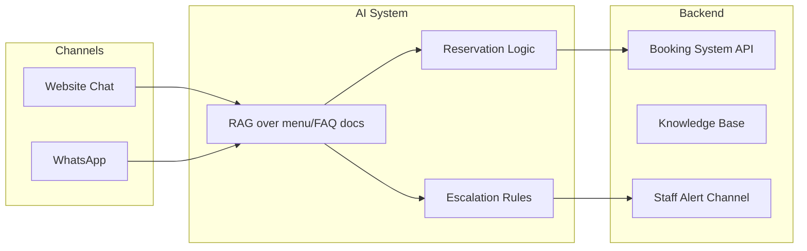
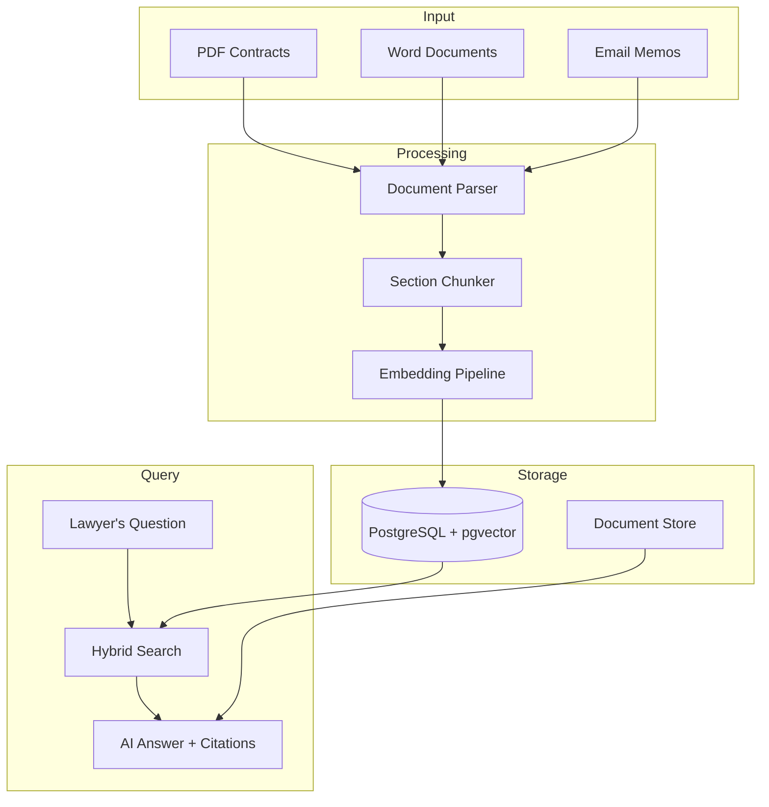

# Chapter 13: Real Client Projects

## Learning Objectives

By the end of this chapter, you will:

- [ ] Scope and estimate AI projects for real businesses
- [ ] Build complete AI solutions for 6 different industries
- [ ] Identify the highest-ROI AI opportunities in any business
- [ ] Deliver production-ready projects with documentation and handoff
- [ ] Avoid common pitfalls in client-facing AI work
- [ ] Price projects based on value delivered, not hours worked

## Prerequisites

- Chapters 1–12 (all technical foundations)
- Understanding of prompt engineering, RAG, automation, and deployment

## Estimated Time

- Reading: 60 minutes
- Exercises: 30 minutes
- Project: 6–10 hours (choose one full project to build)

---

## From Skills to Deliverables

You now have the technical skills. This chapter bridges the gap to client work by giving you complete project blueprints — the kind of work businesses will pay $5,000–$50,000 for.

Each project in this chapter follows the same structure:
1. **The Problem** — What the business struggles with
2. **The Solution** — What you build
3. **Technical Architecture** — How it works
4. **Implementation** — Key code and patterns
5. **Delivery** — What you hand off to the client
6. **Pricing** — How to price this work

> 🔑 **Key Concept**
>
> Clients don't buy "AI." They buy solutions to problems: time saved, errors reduced, revenue increased, customers retained. Frame every project in terms of the business outcome it produces, not the technology underneath.

---

## Project 1: Restaurant AI Booking & FAQ System

### The Problem

A restaurant group (3 locations) receives 200+ calls and messages daily. Staff spends 2–3 hours answering the same questions: hours, menu items, allergen info, reservation availability. During peak hours, calls go unanswered → lost revenue.

### The Solution

An AI system that:
- Answers FAQs via website chat widget and WhatsApp
- Handles reservation requests (checks availability, books tables)
- Knows the menu, allergens, dietary options, and daily specials
- Escalates complex requests to human staff

### Technical Architecture



*Figure 1: Restaurant AI system connecting customer channels to booking and knowledge*

### Key Implementation

```python
RESTAURANT_SYSTEM_PROMPT = """You are the AI assistant for Bella Vista Restaurant.

INFORMATION YOU KNOW:
- Menu, pricing, and allergen information (from knowledge base)
- Opening hours: Tue-Sun 11:30am-10pm, closed Mondays
- Locations: Downtown (123 Main St), Waterfront (456 Harbor Dr), Uptown (789 Oak Ave)
- Reservation policy: Walk-ins welcome, reservations recommended for 5+ guests

CAPABILITIES:
1. Answer questions about menu, hours, location, parking
2. Check reservation availability (use check_availability tool)
3. Make reservations (use create_reservation tool)
4. Forward special requests to staff (use notify_staff tool)

RULES:
- Never make up menu items or prices — only reference what's in the knowledge base
- For allergen questions, always recommend confirming with kitchen staff
- Maximum reservation size via AI: 10 guests. Larger groups → notify staff
- If unsure about anything, say "Let me connect you with our team" and use notify_staff
- Be warm, professional, and brief (2-3 sentences per response)
- Don't discuss competitor restaurants
"""

# Tools for the restaurant agent
RESTAURANT_TOOLS = [
    {
        "type": "function",
        "function": {
            "name": "check_availability",
            "description": "Check table availability for a specific date, time, and party size",
            "parameters": {
                "type": "object",
                "properties": {
                    "date": {"type": "string", "description": "Date in YYYY-MM-DD format"},
                    "time": {"type": "string", "description": "Time in HH:MM format (24h)"},
                    "party_size": {"type": "integer", "description": "Number of guests"},
                    "location": {"type": "string", "enum": ["downtown", "waterfront", "uptown"]}
                },
                "required": ["date", "time", "party_size"]
            }
        }
    },
    {
        "type": "function",
        "function": {
            "name": "create_reservation",
            "description": "Create a reservation after confirming with the customer",
            "parameters": {
                "type": "object",
                "properties": {
                    "name": {"type": "string"},
                    "phone": {"type": "string"},
                    "date": {"type": "string"},
                    "time": {"type": "string"},
                    "party_size": {"type": "integer"},
                    "location": {"type": "string"},
                    "special_requests": {"type": "string"}
                },
                "required": ["name", "phone", "date", "time", "party_size", "location"]
            }
        }
    },
    {
        "type": "function",
        "function": {
            "name": "notify_staff",
            "description": "Send a message to restaurant staff for requests requiring human attention",
            "parameters": {
                "type": "object",
                "properties": {
                    "message": {"type": "string", "description": "What the staff needs to know"},
                    "priority": {"type": "string", "enum": ["low", "normal", "high"]},
                    "customer_contact": {"type": "string", "description": "Customer phone or name"}
                },
                "required": ["message", "priority"]
            }
        }
    }
]
```

### Delivery Package

```
restaurant-ai/
├── src/                      # Application code
├── knowledge_base/
│   ├── menu.md              # Full menu with prices and allergens
│   ├── faq.md               # Common questions and answers
│   └── policies.md          # Reservation, cancellation, dress code
├── docs/
│   ├── setup_guide.md       # How to deploy and configure
│   ├── updating_menu.md     # How staff updates the knowledge base
│   └── troubleshooting.md   # Common issues and fixes
├── docker-compose.yml
└── README.md
```

### Pricing

| Component | Effort | Value to Client |
|-----------|--------|----------------|
| Initial build | 20–30 hours | Saves 2–3 hours staff time daily |
| Knowledge base setup | 5 hours | Accurate, consistent answers 24/7 |
| Booking integration | 10 hours | Captures reservations at off-hours |
| Monthly maintenance | 2–4 hours | Keeps system current |

**Suggested pricing:** $8,000–$12,000 build + $500–$1,000/month maintenance.
**ROI for client:** At $20/hour saved staff time × 3 hours/day × 30 days = $1,800/month minimum saved.

---

## Project 2: Law Firm Document Assistant

### The Problem

A mid-size law firm (20 lawyers) spends 30% of associate time searching through precedents, contracts, and case files. Finding relevant clauses across thousands of documents takes hours.

### The Solution

A RAG-based knowledge system that:
- Ingests all firm documents (contracts, briefs, memos, precedents)
- Answers natural language questions with source citations
- Compares clauses across multiple documents
- Drafts standard sections based on firm templates
- Maintains strict confidentiality (no data leaves the firm's infrastructure)

### Technical Architecture



*Figure 2: Law firm RAG system — ingest, embed, search, answer with citations*

### Key Implementation Decisions

```python
# Law-specific chunking: respect document structure
class LegalDocumentChunker:
    """Chunk legal documents preserving section structure."""
    
    SECTION_PATTERNS = [
        r'^(?:ARTICLE|SECTION|CLAUSE)\s+\d+',   # ARTICLE 1, SECTION 2.3
        r'^\d+\.\s+[A-Z]',                       # 1. DEFINITIONS
        r'^[A-Z][A-Z\s]+$',                       # ALL CAPS HEADING
    ]
    
    def chunk(self, document: str, doc_title: str) -> list[dict]:
        """Chunk preserving legal section boundaries."""
        sections = self._split_by_sections(document)
        
        chunks = []
        for section in sections:
            # Each chunk includes: document title + section heading + content
            enriched_text = f"Document: {doc_title}\nSection: {section['heading']}\n\n{section['content']}"
            
            # Split large sections further
            if len(enriched_text) > 2000:
                sub_chunks = self._split_large_section(enriched_text)
                chunks.extend(sub_chunks)
            else:
                chunks.append({
                    "text": enriched_text,
                    "metadata": {
                        "document": doc_title,
                        "section": section["heading"],
                        "type": "legal_clause",
                    }
                })
        
        return chunks


# Legal RAG prompt — strict grounding, citation required
LEGAL_RAG_PROMPT = """You are a legal research assistant for [Firm Name].

CRITICAL RULES:
1. ONLY cite information from the provided documents
2. Always reference the specific document and section: [Document Name, Section X]
3. If the documents don't contain relevant information, state: "I could not find relevant provisions in the indexed documents."
4. NEVER provide legal advice — present findings for the lawyer to evaluate
5. Flag any conflicting clauses across documents
6. Distinguish between standard clauses and negotiated/custom language

You are a research tool, not a lawyer. Present information; don't opine.
"""
```

### Privacy Architecture

```python
# Self-hosted deployment — no data leaves the firm
# Option A: pgvector on firm's server
# Option B: Qdrant on-premise
# Option C: Azure OpenAI (data stays in firm's Azure tenant)

class PrivacyConfig:
    """Enforce data residency requirements."""
    
    # Use Azure OpenAI for firms requiring data to stay in specific regions
    AZURE_OPENAI_ENDPOINT = "https://firmname.openai.azure.com/"
    AZURE_DEPLOYMENT_NAME = "gpt-4o"
    
    # Self-hosted embedding for maximum privacy
    # Run sentence-transformers locally instead of calling OpenAI embeddings
    USE_LOCAL_EMBEDDINGS = True
    LOCAL_EMBEDDING_MODEL = "all-MiniLM-L6-v2"
```

### Pricing

**Suggested pricing:** $25,000–$50,000 build + $2,000–$5,000/month maintenance.
**ROI for client:** 20 lawyers × 2 hours saved/week × $200/hour billing rate = $8,000/week recovered capacity.

> 🏢 **Industry Note**
>
> Law firms are high-value AI clients because: (1) their hourly rates make ROI obvious, (2) they deal with massive document volumes, (3) accuracy with citations aligns perfectly with RAG capabilities, and (4) they'll pay premium prices for data privacy guarantees. The key requirement: the system must be self-hosted or on their own cloud tenant.

---

## Project 3: Accounting Firm — Invoice Processing

### The Problem

An accounting firm processes 500+ invoices/month for clients. Each invoice requires: data entry, coding to correct GL accounts, approval routing, and reconciliation. A bookkeeper spends 5–10 minutes per invoice.

### The Solution

AI-powered invoice processing that:
- Extracts all line items, amounts, dates, and vendor info (vision + OCR)
- Auto-codes to GL accounts based on vendor history and description
- Routes for approval based on amount thresholds
- Flags anomalies (unusual amounts, new vendors, duplicate invoices)
- Exports to accounting software (QuickBooks, Xero)

### Key Implementation

```python
class InvoiceProcessor:
    """Complete invoice processing pipeline."""
    
    GL_CODING_PROMPT = """You are an accounting assistant. 
Given the invoice details and the chart of accounts, assign the correct GL code.

CHART OF ACCOUNTS:
{chart_of_accounts}

VENDOR HISTORY (past GL codings for this vendor):
{vendor_history}

INVOICE:
Vendor: {vendor}
Description: {description}
Amount: {amount}

Assign the GL code and provide confidence (high/medium/low).
If this is a new category, suggest the most appropriate code and flag for human review.

Return JSON: {{"gl_code": "XXXX", "gl_name": "Account Name", "confidence": "high/medium/low", "reasoning": "brief explanation"}}
"""
    
    async def process(self, invoice_image_path: str, client_config: dict) -> dict:
        """Full pipeline: extract → code → validate → route."""
        
        # Step 1: Extract data (Vision API)
        extracted = await self._extract_invoice_data(invoice_image_path)
        
        # Step 2: GL coding (per line item)
        for item in extracted.get("line_items", []):
            coding = await self._assign_gl_code(
                item, 
                extracted["vendor_name"],
                client_config["chart_of_accounts"],
                client_config.get("vendor_history", {})
            )
            item["gl_code"] = coding["gl_code"]
            item["gl_confidence"] = coding["confidence"]
        
        # Step 3: Anomaly detection
        anomalies = self._detect_anomalies(extracted, client_config)
        
        # Step 4: Determine routing
        total = extracted.get("total", 0)
        approval_needed = total > client_config.get("auto_approve_threshold", 1000)
        needs_review = any(item["gl_confidence"] != "high" for item in extracted.get("line_items", []))
        
        return {
            "extracted_data": extracted,
            "anomalies": anomalies,
            "needs_approval": approval_needed,
            "needs_review": needs_review,
            "status": "review_required" if (needs_review or anomalies) else "auto_processed",
        }
    
    def _detect_anomalies(self, invoice: dict, config: dict) -> list[str]:
        """Flag potential issues."""
        anomalies = []
        
        vendor = invoice.get("vendor_name", "")
        total = invoice.get("total", 0)
        
        # New vendor check
        if vendor not in config.get("known_vendors", []):
            anomalies.append(f"New vendor: {vendor} — not in approved vendor list")
        
        # Amount threshold
        if total > config.get("anomaly_amount_threshold", 10000):
            anomalies.append(f"High amount: ${total:,.2f} exceeds typical range")
        
        # Duplicate detection (by vendor + amount + date)
        invoice_key = f"{vendor}_{total}_{invoice.get('date')}"
        if invoice_key in config.get("recent_invoices", set()):
            anomalies.append("Possible duplicate: matching vendor, amount, and date")
        
        return anomalies
```

### Pricing

**Suggested pricing:** $15,000–$25,000 build + $1,000–$2,000/month.
**ROI for client:** 500 invoices × 7 min saved × $40/hour bookkeeper = $2,300/month saved. Payback in 6–10 months.

---

## Project 4: HR Department — Resume Screening

### The Problem

An HR team receives 300+ applications per open position. Screening takes 5–10 minutes per resume. Qualified candidates get lost in the volume. Time-to-hire is too long.

### The Solution

AI-powered resume screening that:
- Parses resumes (PDF/DOCX) and extracts structured data
- Scores candidates against job requirements
- Ranks and shortlists top candidates
- Generates screening summaries for recruiters
- Identifies potential bias indicators and flags them

### Key Implementation

```python
RESUME_SCORING_PROMPT = """You are an HR screening assistant.

JOB REQUIREMENTS:
{job_requirements}

CANDIDATE RESUME:
{resume_text}

Score this candidate on each requirement (0-10) and provide overall fit.

IMPORTANT RULES:
- Score ONLY on stated qualifications and experience
- Do NOT penalize for gaps in employment
- Do NOT factor in: name, address, graduation year, or personal details
- Focus on: skills match, experience relevance, achievement quality
- Flag any concern that requires human review

Return JSON:
{{
    "overall_score": 0-100,
    "requirement_scores": [{{"requirement": "...", "score": 0-10, "evidence": "quoted from resume"}}],
    "strengths": ["list"],
    "gaps": ["list of missing requirements"],
    "recommendation": "shortlist" | "maybe" | "pass",
    "flags": ["any concerns for human reviewer"],
    "summary": "2-sentence screening summary"
}}
"""
```

### Pricing

**Suggested pricing:** $10,000–$20,000 build + $500–$1,500/month.
**ROI:** Reduces screening time from 40+ hours per role to 2–3 hours of review.

> ⚠️ **Common Mistake**
>
> AI resume screening carries legal risk (bias in hiring decisions). Always: (1) make the AI a recommender, not a decision-maker, (2) audit for bias regularly, (3) include a human review step, (4) document the criteria and process for compliance. Make these limitations clear to the client upfront.

---

## Project 5: Education — AI Tutor

### The Problem

An online education platform wants personalized tutoring at scale. Human tutors cost $50–$100/hour and can't be available 24/7. Students get stuck on homework and give up without immediate help.

### The Solution

An AI tutor that:
- Guides students through problems step-by-step (never just gives answers)
- Adapts explanations to the student's level
- Tracks knowledge gaps and recommends practice areas
- Supports multiple subjects (math, science, writing)
- Provides encouragement and growth mindset framing

### Key Implementation

```python
TUTOR_SYSTEM_PROMPT = """You are a patient, encouraging tutor for {subject} at the {level} level.

PEDAGOGY RULES:
1. NEVER give the direct answer. Guide the student to discover it.
2. Ask leading questions when the student is stuck.
3. Break complex problems into smaller, manageable steps.
4. When the student makes an error, ask "What happens if...?" rather than saying "That's wrong."
5. Celebrate progress: "Great thinking on that step!"
6. If the student is frustrated, acknowledge it and simplify.

TEACHING APPROACH:
- Start by asking what they've tried or what they understand so far
- Provide hints that are one logical step ahead of where they are
- Use analogies and real-world examples
- After they solve it, ask them to explain their reasoning (reinforces learning)

BOUNDARIES:
- Only help with academic subjects (no writing essays for them)
- If asked to do homework for them: "I'm here to help you learn, not do it for you. Let's work through it together."
- Inappropriate content: redirect to the topic

STUDENT CONTEXT:
{student_context}
"""


class TutorController:
    """AI tutor with memory of student progress."""
    
    def __init__(self, subject: str, level: str):
        self.subject = subject
        self.level = level
        self.client = OpenAI()
        self.student_knowledge: dict = {}  # Track what they know/struggle with
    
    async def respond(self, student_message: str, conversation_history: list) -> dict:
        """Generate a tutoring response."""
        
        # Build student context from tracked knowledge
        student_context = self._build_context()
        
        system_prompt = TUTOR_SYSTEM_PROMPT.format(
            subject=self.subject,
            level=self.level,
            student_context=student_context
        )
        
        messages = [{"role": "system", "content": system_prompt}] + conversation_history
        messages.append({"role": "user", "content": student_message})
        
        response = self.client.chat.completions.create(
            model="gpt-4o",  # Quality matters for education
            messages=messages,
            temperature=0.5,
            max_tokens=500,
        )
        
        tutor_reply = response.choices[0].message.content
        
        # Track learning signals
        await self._update_knowledge(student_message, tutor_reply)
        
        return {
            "response": tutor_reply,
            "knowledge_update": self.student_knowledge,
        }
    
    def _build_context(self) -> str:
        strengths = [k for k, v in self.student_knowledge.items() if v.get("mastery", 0) > 7]
        struggles = [k for k, v in self.student_knowledge.items() if v.get("mastery", 0) < 4]
        
        context = ""
        if strengths:
            context += f"Student is strong in: {', '.join(strengths)}\n"
        if struggles:
            context += f"Student needs help with: {', '.join(struggles)}\n"
        return context or "New student — no prior history."
```

### Pricing

**Suggested pricing:** $15,000–$30,000 build + $1,000–$3,000/month (depends on student volume).
**ROI:** Replaces $50/hour tutors at scale. At 1,000 student sessions/month × $0.05 AI cost = $50/month vs. $50,000+ in tutor fees.

---

## Project 6: Customer Support Knowledge Base

### The Problem

A SaaS company's support team answers 200 tickets/day. 60% are repetitive questions already answered in documentation. Average first-response time: 4 hours. Customer satisfaction dropping.

### The Solution

AI-powered support that:
- Ingests all documentation, past tickets, and product knowledge
- Suggests answers to agents (human-in-the-loop)
- Auto-resolves simple questions via chat widget
- Escalates complex or sensitive issues to humans
- Learns from agent corrections to improve over time

### Key Implementation

```python
class SupportAssistant:
    """AI support with human-in-the-loop and learning."""
    
    CONFIDENCE_THRESHOLDS = {
        "auto_respond": 0.85,    # High confidence → respond directly
        "suggest_to_agent": 0.60, # Medium → show suggestion to agent
        "escalate": 0.0,          # Low → hand to human immediately
    }
    
    async def handle_ticket(self, ticket: dict) -> dict:
        """Process a support ticket through the AI pipeline."""
        question = ticket["subject"] + "\n" + ticket["body"]
        
        # Step 1: RAG retrieval
        chunks = await self.rag_pipeline.retrieve(question, top_k=5)
        top_score = chunks[0]["score"] if chunks else 0
        
        # Step 2: Determine action based on confidence
        if top_score >= self.CONFIDENCE_THRESHOLDS["auto_respond"]:
            response = await self._generate_response(question, chunks)
            return {"action": "auto_respond", "response": response, "confidence": top_score}
        
        elif top_score >= self.CONFIDENCE_THRESHOLDS["suggest_to_agent"]:
            suggestion = await self._generate_response(question, chunks)
            return {"action": "suggest", "suggestion": suggestion, "confidence": top_score}
        
        else:
            return {"action": "escalate", "reason": "Low confidence in available documentation"}
    
    async def learn_from_correction(self, original_suggestion: str, agent_response: str, ticket: dict):
        """When an agent corrects the AI, store for improvement."""
        # Add the corrected response to the knowledge base for future retrieval
        await self.knowledge_base.add_document(
            title=f"Support resolution: {ticket['subject']}",
            content=f"Question: {ticket['body']}\nResolution: {agent_response}",
            metadata={"type": "resolved_ticket", "category": ticket.get("category")}
        )
```

### Pricing

**Suggested pricing:** $20,000–$40,000 build + $2,000–$4,000/month.
**ROI:** 60% auto-resolution × 200 tickets/day × 15 min saved = 30 hours/day saved. At $25/hour support agent = $750/day = $22,500/month saved.

---

## The Discovery Process

Before building any client project, conduct a discovery process to scope correctly.

### Discovery Questions

| Category | Questions |
|----------|-----------|
| **Problem** | What's the most time-consuming repetitive task? What costs you the most? |
| **Data** | What documents/data exist? How structured is it? How sensitive? |
| **Volume** | How many [emails/invoices/tickets/calls] per day/week/month? |
| **Current cost** | What's this costing in people hours? In errors? In lost revenue? |
| **Success criteria** | How do we know this worked? What does success look like in 3 months? |
| **Constraints** | Data privacy requirements? Existing tools that must be integrated? Budget? |
| **Human-in-the-loop** | Which decisions MUST have human review? What can be fully automated? |

### Scoping Template

```markdown
## Project Scope: [Client Name] — [Project Title]

### Problem Statement
[1–2 sentences: what hurts and why]

### Proposed Solution
[What you'll build, at a high level]

### Deliverables
1. [Specific deliverable]
2. [Specific deliverable]
3. Documentation and handoff

### Technical Approach
- AI Model: [which and why]
- Architecture: [direct API / RAG / automation / agent]
- Data sources: [what gets ingested]
- Integrations: [what it connects to]

### Timeline
- Week 1–2: Setup, data ingestion, initial prototype
- Week 3–4: Core functionality, testing
- Week 5: Polish, documentation, deployment
- Week 6: Handoff, training, monitoring setup

### Pricing
- Build: $[X]
- Monthly maintenance: $[Y]
- Includes: [what's covered]
- Not included: [what's out of scope]

### Success Metrics
- [Measurable outcome 1]
- [Measurable outcome 2]
- Review at 30/60/90 days
```

> 💡 **Developer Insight**
>
> The discovery process is where you earn trust and justify premium pricing. A 30-minute discovery call that shows you understand the business problem (not just the tech) differentiates you from "I can hook up ChatGPT to your data." Clients pay for solutions, not API wrappers.

---

## Common Client Pitfalls

### Pitfall 1: Scope Creep

The client asks for an FAQ chatbot. Mid-project they want: multi-language support, CRM integration, sentiment analysis dashboard, and a mobile app.

**Prevention:** Define scope in writing before starting. Use the scoping template above. Any additions are change requests with separate pricing.

### Pitfall 2: "Make It Perfect"

AI output is probabilistic. Clients expecting 100% accuracy will be disappointed.

**Prevention:** Set expectations upfront. "The system will handle 80% of queries accurately. The remaining 20% gets escalated to your team. Over time, with your feedback, accuracy improves." Frame as human-AI collaboration, not replacement.

### Pitfall 3: No Data Readiness

Client says "we have all the documentation" — turns out it's scattered across 5 Google Drives, some in PDFs from 2018, some in someone's head.

**Prevention:** In discovery, ask to SEE the actual data. Ask: "Can you share 10 examples of [documents/emails/tickets] right now?" If they can't, budget extra time for data gathering.

### Pitfall 4: Ignoring Maintenance

The AI works great at launch. Six months later, the knowledge base is outdated, the API costs are ignored, and nobody updates the prompts.

**Prevention:** Always sell a maintenance retainer. Include in your proposal: monthly knowledge base updates, prompt monitoring, cost review, and quarterly optimization.

---

## Production Notes

- **Start with the smallest valuable scope.** A working FAQ bot deployed in 2 weeks is better than a perfect multi-agent system proposed for 3 months. Ship fast, iterate based on real usage.
- **Document everything for handoff.** Your client isn't technical. Write: "How to update the FAQ," "How to check if it's working," "What to do when it breaks," "Who to contact."
- **Measure ROI from day one.** Track: queries answered, tickets deflected, time saved, errors caught. Present these numbers monthly. This justifies your maintenance fee and leads to referrals.
- **Build the simplest architecture that solves the problem.** Most client projects need: RAG + good prompts + structured output + human escalation. Not agents. Not multi-model routing. Not fine-tuning. Simple works.

## Common Mistakes

1. **Over-engineering the first version.** Client needs an FAQ bot, you build a multi-agent system with RAG, caching, re-ranking, and evaluation. Ship the simple version first.

2. **Not involving the client in testing.** You test with synthetic queries. The client's real customers ask things you never imagined. Get real queries into your eval set early.

3. **Underpricing.** If the project saves the client $5,000/month, charging $3,000 total undervalues your work. Price based on value delivered, not hours spent.

4. **No maintenance plan.** AI systems need ongoing care: knowledge base updates, prompt adjustments, cost monitoring. Without a retainer, the system degrades and you get blamed.

5. **Promising "it will handle everything."** Set realistic expectations. 80% automation with 20% human escalation is excellent. Promising 100% leads to disappointment.

## Best Practices

1. **Always start with discovery.** 30–60 minutes understanding the business problem saves weeks of building the wrong thing.

2. **Prototype in 1 week, validate with real data.** Don't spend a month building before the client sees anything. Show a working prototype early and iterate.

3. **Include human-in-the-loop by default.** Every client project should have an escalation path to humans. This handles edge cases and builds trust.

4. **Measure and report.** Monthly reports showing queries handled, accuracy rate, cost, and time saved justify your ongoing value.

5. **Build for handoff.** Document how to update content, where to find logs, and how to turn it off in an emergency. The client should never feel locked in.

6. **Get testimonials and case studies.** Every successful project is marketing material. Ask permission to write a case study with metrics.

---

## Hands-On Exercises

### Exercise 1: Discovery Simulation

**Difficulty:** ⭐
**Time:** 15 minutes

Pick a local business (restaurant, clinic, agency). Write:
1. Five discovery questions you'd ask in the first call
2. The most likely AI use case based on their industry
3. A one-paragraph proposal summary
4. Estimated pricing and ROI justification

### Exercise 2: Scope a Real Project

**Difficulty:** ⭐⭐
**Time:** 20 minutes

Using the scoping template, write a complete project scope for:
- **Scenario:** A real estate agency wants AI to generate property listing descriptions from bullet-point features and photos.
- Include: deliverables, timeline, technical approach, pricing, success metrics.

### Exercise 3: Build a Vertical RAG

**Difficulty:** ⭐⭐⭐
**Time:** 60 minutes

Pick one industry from this chapter. Build a minimal RAG system:
1. Create 10 realistic documents for that domain
2. Chunk and embed them
3. Build the RAG pipeline with domain-specific prompts
4. Test with 5 realistic questions
5. Measure: answer quality, retrieval accuracy, response time

---

## Mini Project

**Title:** Complete Client-Ready AI System
**Difficulty:** ⭐⭐⭐⭐
**Time:** 6 hours
**What you'll build:** Choose ONE project from this chapter (restaurant, law firm, accounting, HR, education, or support) and build it end-to-end with documentation, deployment, and a demo.

### Requirements

1. **Working system:** Deployed and accessible via URL
2. **Knowledge base:** Realistic sample data (10+ documents)
3. **Core AI feature:** RAG, classification, or automation working correctly
4. **Human escalation:** Clear path for edge cases
5. **Documentation:** Setup guide, user guide, and maintenance guide
6. **Demo script:** A 5-minute walkthrough showing the system in action
7. **Pricing proposal:** Written proposal you could send to a real client

---

## Challenge Project

**Title:** Multi-Industry AI Platform
**Difficulty:** ⭐⭐⭐⭐⭐
**Time:** 2 weeks
**What you'll build:** A configurable platform that can be customized for different industries with minimal code changes — essentially your own AI product that you deploy for each client.

### Requirements

1. **Configurable:** Industry-specific prompts, knowledge bases, and tools loaded from config
2. **Multi-tenant:** Multiple clients on one platform with data isolation
3. **Admin dashboard:** Client can update knowledge base, view analytics
4. **Standard features:** Chat, RAG, escalation, usage tracking
5. **Deployment template:** One-click deployment for new clients
6. **Three industry configs:** Restaurant, support, and one of your choice
7. **Client portal:** Simple web UI for each client to interact with their system

---

## Portfolio Milestone

After this chapter, you should have:
- At least one complete, deployed, client-ready AI project
- A pricing framework for AI consulting work
- A discovery process you can run with any potential client
- A scoping template for proposals
- Understanding of the most common industry use cases

---

## Chapter Summary

- Real client projects succeed by solving specific, measurable business problems — not by showcasing AI technology.
- Six high-value verticals: restaurant (booking/FAQ), law (document search), accounting (invoice processing), HR (resume screening), education (tutoring), and customer support (ticket deflection).
- Discovery before building. Understand the problem, see the real data, define success metrics, and set scope boundaries before writing code.
- Price on value, not hours. If the project saves $5,000/month, a $15,000 build fee is a 3-month payback — easy to justify.
- Always include human-in-the-loop and maintenance. AI systems need ongoing care, and edge cases need human fallback.
- The simplest architecture wins. RAG + good prompts + structured output handles 80% of real client needs.

---

## Cheat Sheet

| Industry | Top Use Case | Architecture | Typical Budget |
|----------|-------------|--------------|---------------|
| Restaurant | Booking + FAQ bot | RAG + Function calling | $8K–$15K |
| Law firm | Document search | RAG (self-hosted) | $25K–$50K |
| Accounting | Invoice processing | Vision + Automation | $15K–$25K |
| HR | Resume screening | Extraction + Scoring | $10K–$20K |
| Education | AI tutoring | Chat + Memory | $15K–$30K |
| SaaS support | Ticket deflection | RAG + Classification | $20K–$40K |
| Real estate | Listing generation | Generation + Templates | $5K–$10K |
| E-commerce | Product descriptions | Batch generation | $5K–$10K |

---

## Glossary

| Term | Definition |
|------|-----------|
| Discovery | The process of understanding a client's problem, data, constraints, and success criteria before building. |
| Scope creep | When project requirements expand beyond the original agreement without corresponding budget/timeline changes. |
| Human-in-the-loop | Design where AI suggests or drafts, but a human reviews and approves before action is taken. |
| Value-based pricing | Setting prices based on the value delivered to the client (time saved, revenue gained) rather than hours worked. |
| Retainer | A recurring monthly fee for ongoing maintenance, updates, and support. |
| Vertical | A specific industry or market segment with particular needs and workflows. |
| Handoff | The process of delivering a completed project to the client with documentation and training. |
| ROI | Return on Investment. The ratio of value gained vs. cost paid. Clients need clear ROI to justify AI spending. |

---

## References

- [AI for Small Business (McKinsey)](https://www.mckinsey.com/capabilities/quantumblack/our-insights) — Research on AI adoption in SMBs.
- [OpenAI Use Cases](https://openai.com/use-cases) — Real-world application examples.
- [Anthropic Case Studies](https://www.anthropic.com/customers) — Enterprise AI implementations.

## Further Reading

- [The Mom Test](http://momtestbook.com/) — How to talk to customers and learn if your business idea is good (essential for discovery).
- [Value-Based Pricing for Consultants](https://www.alanweiss.com/) — Alan Weiss's framework for pricing on value.
- [Running Lean](https://leanstack.com/books/running-lean) — Systematic approach to validating business models.

---

## Next Chapter Preview

In **Chapter 14: Freelancing as an AI Engineer**, we'll turn your technical skills and project experience into a freelancing business. You'll learn how to find clients, price your services, run discovery calls, write proposals, manage projects, and build toward a sustainable consulting practice or agency.
