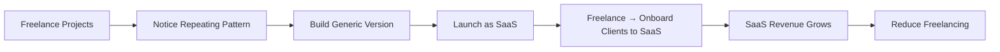
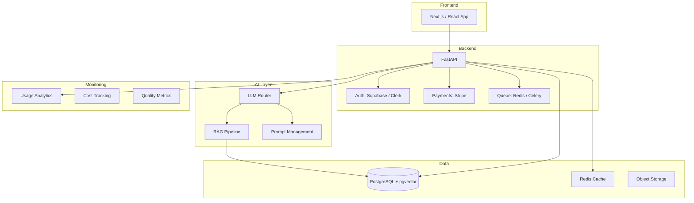

# Chapter 15: Building AI SaaS

## Learning Objectives

By the end of this chapter, you will:

- [ ] Design an AI SaaS product architecture (multi-tenant, subscription-based)
- [ ] Implement authentication, payments (Stripe), and subscription management
- [ ] Build usage-based billing tied to AI costs (tokens, API calls)
- [ ] Design a go-to-market strategy for an AI product
- [ ] Implement analytics and monitoring for product decisions
- [ ] Launch, iterate, and grow toward your first 100 paying customers
- [ ] Manage AI-specific SaaS challenges (cost scaling, quality maintenance)

## Prerequisites

- Chapter 8: Databases (multi-tenancy, user management)
- Chapter 12: Deployment (production infrastructure)
- Chapter 13: Real Client Projects (understanding what people pay for)
- Chapter 14: Freelancing (understanding the market)

## Estimated Time

- Reading: 60 minutes
- Exercises: 45 minutes
- Project: ongoing (building a real product)

---

## From Freelance to Product

Freelancing trades time for money. SaaS trades building once for recurring revenue from many customers.

| Dimension | Freelancing | SaaS |
|-----------|-------------|------|
| Revenue model | Per-project + retainer | Monthly subscriptions |
| Scalability | Limited by your time | Limited by infrastructure |
| Income cap | ~$200K–$500K/year (solo) | Unlimited (in theory) |
| Time to revenue | Days (sign a client) | Months (build + find market) |
| Risk | Low (paid per project) | High (invest before revenue) |
| Exit potential | Low (you are the business) | High (sellable asset) |

The best path: use freelancing to validate what people pay for, then productize the most common pattern into a SaaS.



*Figure 1: The freelance-to-SaaS transition — validate through services, productize what works*

> 🔑 **Key Concept**
>
> Don't build a SaaS based on what you THINK people want. Build it based on what you've PROVEN people pay for through freelance work. If you've built 5 invoice processing systems for 5 different accounting firms, that's your SaaS.

---

## AI SaaS Architecture

### The Stack



*Figure 2: AI SaaS architecture — frontend, backend, AI layer, data, and monitoring*

### Multi-Tenant Database Schema

```sql
-- Organizations (tenants)
CREATE TABLE organizations (
    id UUID PRIMARY KEY DEFAULT gen_random_uuid(),
    name TEXT NOT NULL,
    slug TEXT UNIQUE NOT NULL,
    plan TEXT NOT NULL DEFAULT 'free',  -- free, starter, pro, enterprise
    stripe_customer_id TEXT,
    stripe_subscription_id TEXT,
    token_budget_monthly INT NOT NULL DEFAULT 50000,
    tokens_used_this_period INT DEFAULT 0,
    billing_period_start DATE,
    created_at TIMESTAMPTZ DEFAULT NOW()
);

-- Organization members
CREATE TABLE org_members (
    id UUID PRIMARY KEY DEFAULT gen_random_uuid(),
    org_id UUID REFERENCES organizations(id) ON DELETE CASCADE,
    user_id UUID REFERENCES auth.users(id) ON DELETE CASCADE,
    role TEXT NOT NULL DEFAULT 'member',  -- owner, admin, member
    created_at TIMESTAMPTZ DEFAULT NOW(),
    UNIQUE(org_id, user_id)
);

-- API keys for programmatic access
CREATE TABLE api_keys (
    id UUID PRIMARY KEY DEFAULT gen_random_uuid(),
    org_id UUID REFERENCES organizations(id) ON DELETE CASCADE,
    key_hash TEXT NOT NULL,  -- SHA-256 of the actual key
    name TEXT NOT NULL,
    last_used_at TIMESTAMPTZ,
    expires_at TIMESTAMPTZ,
    rate_limit_per_minute INT DEFAULT 60,
    created_at TIMESTAMPTZ DEFAULT NOW()
);

-- Usage tracking (granular, for billing)
CREATE TABLE usage_events (
    id BIGSERIAL PRIMARY KEY,
    org_id UUID REFERENCES organizations(id),
    user_id UUID,
    event_type TEXT NOT NULL,  -- 'chat', 'search', 'embed', 'generate'
    model TEXT,
    input_tokens INT DEFAULT 0,
    output_tokens INT DEFAULT 0,
    cost_cents INT DEFAULT 0,  -- Store in cents to avoid float issues
    metadata JSONB DEFAULT '{}',
    created_at TIMESTAMPTZ DEFAULT NOW()
);

-- Index for billing aggregation
CREATE INDEX idx_usage_org_period ON usage_events(org_id, created_at);
```

---

## Payments with Stripe

### Subscription Plans

```python
import stripe
from dataclasses import dataclass

stripe.api_key = os.getenv("STRIPE_SECRET_KEY")


@dataclass
class Plan:
    name: str
    stripe_price_id: str
    monthly_tokens: int
    price_cents: int  # Monthly price in cents
    features: list[str]


PLANS = {
    "free": Plan(
        name="Free",
        stripe_price_id="",  # No Stripe for free
        monthly_tokens=50_000,
        price_cents=0,
        features=["50K tokens/month", "1 knowledge base", "Community support"],
    ),
    "starter": Plan(
        name="Starter",
        stripe_price_id="price_starter_monthly",
        monthly_tokens=500_000,
        price_cents=2900,  # $29/month
        features=["500K tokens/month", "5 knowledge bases", "Email support", "API access"],
    ),
    "pro": Plan(
        name="Pro",
        stripe_price_id="price_pro_monthly",
        monthly_tokens=5_000_000,
        price_cents=9900,  # $99/month
        features=["5M tokens/month", "Unlimited knowledge bases", "Priority support", "Custom prompts"],
    ),
    "enterprise": Plan(
        name="Enterprise",
        stripe_price_id="price_enterprise_monthly",
        monthly_tokens=50_000_000,
        price_cents=49900,  # $499/month
        features=["50M tokens/month", "SSO", "Dedicated support", "SLA", "Custom integrations"],
    ),
}


class StripeService:
    """Handle Stripe subscription management."""
    
    async def create_checkout_session(self, org_id: str, plan: str, success_url: str, cancel_url: str) -> str:
        """Create a Stripe Checkout session for subscription."""
        plan_config = PLANS[plan]
        
        session = stripe.checkout.Session.create(
            mode="subscription",
            line_items=[{"price": plan_config.stripe_price_id, "quantity": 1}],
            success_url=success_url + "?session_id={CHECKOUT_SESSION_ID}",
            cancel_url=cancel_url,
            metadata={"org_id": org_id, "plan": plan},
        )
        
        return session.url
    
    async def handle_webhook(self, payload: bytes, sig_header: str) -> dict:
        """Process Stripe webhook events."""
        event = stripe.Webhook.construct_event(
            payload, sig_header, os.getenv("STRIPE_WEBHOOK_SECRET")
        )
        
        if event["type"] == "checkout.session.completed":
            session = event["data"]["object"]
            org_id = session["metadata"]["org_id"]
            plan = session["metadata"]["plan"]
            
            # Update organization plan
            await self._activate_subscription(org_id, plan, session["subscription"])
            return {"action": "subscription_activated", "org_id": org_id}
        
        elif event["type"] == "invoice.payment_failed":
            subscription = event["data"]["object"]["subscription"]
            # Downgrade to free plan after grace period
            await self._handle_payment_failure(subscription)
            return {"action": "payment_failed"}
        
        elif event["type"] == "customer.subscription.deleted":
            subscription_id = event["data"]["object"]["id"]
            await self._cancel_subscription(subscription_id)
            return {"action": "subscription_cancelled"}
        
        return {"action": "unhandled", "type": event["type"]}
    
    async def _activate_subscription(self, org_id: str, plan: str, subscription_id: str):
        """Activate a subscription for an organization."""
        plan_config = PLANS[plan]
        await db.execute("""
            UPDATE organizations 
            SET plan = $1, stripe_subscription_id = $2, 
                token_budget_monthly = $3, billing_period_start = NOW()
            WHERE id = $4
        """, plan, subscription_id, plan_config.monthly_tokens, org_id)
```

### Usage-Based Billing (Overages)

```python
class UsageBilling:
    """Track usage and handle overages."""
    
    OVERAGE_RATE_PER_1K_TOKENS = 0.002  # $0.002 per 1K tokens over limit
    
    async def check_and_record(self, org_id: str, tokens_used: int, model: str) -> dict:
        """Check budget, record usage, handle overages."""
        
        org = await db.get_org(org_id)
        plan = PLANS[org["plan"]]
        
        current_usage = org["tokens_used_this_period"]
        new_total = current_usage + tokens_used
        
        # Within plan limits
        if new_total <= plan.monthly_tokens:
            await self._record_usage(org_id, tokens_used, model, overage=False)
            return {"status": "within_plan", "remaining": plan.monthly_tokens - new_total}
        
        # Overage (if plan allows)
        if org["plan"] in ("pro", "enterprise"):
            overage_tokens = new_total - plan.monthly_tokens
            overage_cost = (overage_tokens / 1000) * self.OVERAGE_RATE_PER_1K_TOKENS
            await self._record_usage(org_id, tokens_used, model, overage=True)
            await self._add_overage_charge(org_id, overage_cost)
            return {"status": "overage", "overage_cost": overage_cost}
        
        # Hard limit for free/starter
        return {"status": "limit_reached", "error": "Monthly token limit exceeded. Upgrade your plan."}
```

---

## Go-To-Market Strategy

### The AI SaaS Launch Playbook

| Phase | Duration | Goal | Activities |
|-------|----------|------|-----------|
| **Pre-launch** | 4–6 weeks | Validate demand | Landing page, waitlist, talk to 20 prospects |
| **Beta** | 4–8 weeks | Product-market fit | 10–20 beta users, daily feedback, rapid iteration |
| **Launch** | 1 week | Initial traction | Product Hunt, content marketing, community posts |
| **Growth** | Ongoing | Scale to 100 customers | SEO, content, partnerships, paid ads |

### Pricing Strategy for AI SaaS

```
The AI SaaS pricing formula:
  Your price = AI cost × markup + platform value

Example (invoice processing SaaS):
  AI cost per invoice: ~$0.03 (GPT-4o-mini for extraction)
  Markup: 10-50x (standard for SaaS)
  Platform value: workflow, dashboard, integrations
  
  Customer processes 500 invoices/month
  Your AI cost: $15/month
  You charge: $99/month (for the platform value)
  Gross margin: 85%
```

### Pricing Principles

1. **Price on value, not cost.** Your AI costs $0.03/invoice but saves the customer $5/invoice in labor. Charge $0.50–$1.00/invoice.
2. **Offer a free tier.** Low-usage tier with limits builds pipeline and trust. Convert to paid when they hit limits.
3. **Usage-based component for heavy users.** Base subscription + per-unit overage prevents one customer from destroying your margins.
4. **Annual discounts.** Offer 20% off for annual billing. This improves cash flow and reduces churn.

> 💡 **Developer Insight**
>
> The biggest risk in AI SaaS pricing: your AI costs scale with customer usage, but your price might not. If a customer on your $99/month plan uses $200/month in API calls, you lose money on them. Always model your unit economics: what does each customer cost you at different usage levels?

---

## Analytics and Product Decisions

### Metrics That Matter

| Metric | What It Tells You | Target |
|--------|-------------------|--------|
| **MRR** | Monthly Recurring Revenue | Growing month-over-month |
| **Churn rate** | % of customers leaving per month | <5% for SMB, <2% for enterprise |
| **CAC** | Cost to Acquire a Customer | < 3 months of their revenue |
| **LTV** | Lifetime Value of a customer | > 3× CAC |
| **Gross margin** | Revenue minus AI/infrastructure costs | >70% |
| **DAU/MAU** | Daily/Monthly Active Users | >30% ratio (engagement) |
| **Feature adoption** | % using each feature | Guides roadmap |
| **NPS** | Net Promoter Score | >40 |

### Tracking Implementation

```python
class ProductAnalytics:
    """Track product metrics for decision-making."""
    
    async def track_event(self, org_id: str, user_id: str, event: str, properties: dict = None):
        """Track a product event."""
        await db.execute("""
            INSERT INTO analytics_events (org_id, user_id, event, properties, created_at)
            VALUES ($1, $2, $3, $4, NOW())
        """, org_id, user_id, event, json.dumps(properties or {}))
    
    async def get_mrr(self) -> float:
        """Calculate current MRR."""
        result = await db.fetchrow("""
            SELECT SUM(
                CASE plan
                    WHEN 'starter' THEN 29
                    WHEN 'pro' THEN 99
                    WHEN 'enterprise' THEN 499
                    ELSE 0
                END
            ) as mrr
            FROM organizations
            WHERE plan != 'free' AND stripe_subscription_id IS NOT NULL
        """)
        return float(result["mrr"] or 0)
    
    async def get_churn_rate(self, period_days: int = 30) -> float:
        """Calculate churn rate for the period."""
        start_count = await db.fetchval("""
            SELECT COUNT(*) FROM organizations 
            WHERE plan != 'free' AND created_at < NOW() - INTERVAL '%s days'
        """ % period_days)
        
        churned = await db.fetchval("""
            SELECT COUNT(*) FROM organizations
            WHERE plan = 'free' 
            AND updated_at > NOW() - INTERVAL '%s days'
            AND created_at < NOW() - INTERVAL '%s days'
        """ % (period_days, period_days))
        
        return churned / max(1, start_count)
```

---

## Launching and Growing

### Pre-Launch Checklist

- [ ] Landing page with clear value proposition and waitlist signup
- [ ] Demo video (2 minutes) showing the product solving a real problem
- [ ] 10+ beta users committed to testing
- [ ] Pricing page with 3–4 tiers
- [ ] Stripe integration tested (test mode → production)
- [ ] Onboarding flow: signup → first value in <5 minutes
- [ ] Support system: email or chat for beta users
- [ ] Terms of Service and Privacy Policy

### Growth Channels for AI SaaS

| Channel | Cost | Timeline | Best For |
|---------|------|----------|----------|
| SEO / content marketing | Low (time) | 3–6 months to see results | Long-term organic growth |
| Product Hunt launch | Free | One-day spike + tail | Initial visibility |
| LinkedIn content | Free (time) | 1–3 months to build audience | B2B products |
| Partnerships | Low | 1–2 months to set up | Existing audiences |
| Cold email | Low | Immediate results | Targeted B2B outreach |
| Paid ads (Google) | High | Immediate | Proven product-market fit |
| Referral program | Low per acquisition | Ongoing | High-satisfaction products |

### The "First 100 Customers" Playbook

```
Customers 1-10:    Personal network + freelance clients → convert to SaaS
Customers 11-30:   Content marketing + Product Hunt + direct outreach
Customers 31-50:   Referrals from happy early customers + SEO starting to work
Customers 51-100:  Compounding: SEO + referrals + partnerships + case studies
```

> 🏢 **Industry Note**
>
> Most successful AI SaaS products started as consulting projects. Jasper started by writing copy for agencies. Notion AI was built on years of understanding user workflows. The pattern: build for one client → realize others need it → productize. Don't skip the validation step by jumping straight to building a product nobody wants.

---

## AI-Specific SaaS Challenges

### Challenge 1: Cost Scaling

Your AI costs grow with usage. If a customer's usage spikes, so do your costs.

**Solution:** Usage-based pricing tiers + hard caps on free/cheap plans + overage billing on premium plans.

### Challenge 2: Quality Maintenance

LLM providers update models. Your prompts may perform differently after an update.

**Solution:** Continuous evaluation (run eval suite daily). Pin model versions for production. Test new versions before switching.

### Challenge 3: Data Privacy

Customers want assurance their data isn't used to train models or accessible to other tenants.

**Solution:** Use API providers with data privacy guarantees (OpenAI's API terms, Azure OpenAI). Implement strict tenant isolation. Be transparent in your privacy policy.

### Challenge 4: Differentiation

"AI-powered X" is now a crowded category. Having AI isn't a differentiator anymore.

**Solution:** Differentiate on: vertical specialization, integration depth, workflow design, or output quality — not "we use AI."

---

## Production Notes

- **Start with manual onboarding.** For your first 20 customers, onboard them personally. You'll learn more in those calls than in months of analytics.
- **Build the billing system before launch.** "We'll add payments later" usually means losing early customers who are ready to pay.
- **Monitor unit economics weekly.** Know exactly what each customer costs you in AI API calls. Some usage patterns are unprofitable — identify and address them early.
- **Ship weekly.** In the early stage, ship improvements every week. Speed of iteration is your competitive advantage over larger companies.
- **Talk to churned customers.** Every customer who cancels is a learning opportunity. Ask why (briefly, respectfully).

## Common Mistakes

1. **Building for 6 months before showing anyone.** Ship an MVP in 4–6 weeks. Real user feedback is worth more than perfect code.

2. **Pricing too low.** $9/month SaaS attracts price-sensitive customers who churn fast and demand a lot of support. Start at $29+ for B2B.

3. **Ignoring unit economics.** Revenue means nothing if each customer costs you more in AI API calls than they pay you. Model this before launch.

4. **No free tier AND no paid tier.** Both extremes fail. No free tier means no viral growth. No paid tier means no revenue. Offer both.

5. **Over-building features.** Your first version needs: the core AI feature, auth, billing, and basic analytics. Everything else can wait.

## Best Practices

1. **Validate before building.** Talk to 20 potential customers. Would they pay? How much? What's the minimum they'd need?

2. **Time to first value < 5 minutes.** A new user should experience the AI working on their problem within 5 minutes of signing up.

3. **Build in public.** Share your journey (metrics, learnings, challenges) on social media. This attracts early adopters and builds trust.

4. **Implement usage alerts.** Email customers when they're approaching their plan limit. This drives upgrades better than hard cutoffs.

5. **Offer annual billing early.** 20% discount for annual = better cash flow and lower churn. Offer it from day one.

6. **Invest in onboarding.** The #1 cause of churn in AI SaaS is customers who never set up the product properly. Guide them to success.

---

## Hands-On Exercises

### Exercise 1: SaaS Idea Validation

**Difficulty:** ⭐⭐
**Time:** 30 minutes

Based on your freelance experience (or Chapter 13 projects):
1. Identify a repeating pattern you could productize
2. Write the product's one-sentence value proposition
3. Define 3 pricing tiers with specific feature/limit differences
4. List 5 potential early customers (real companies/people you could reach)
5. Calculate unit economics: what does each customer cost you in AI?

### Exercise 2: Landing Page Copy

**Difficulty:** ⭐⭐
**Time:** 20 minutes

Write the landing page for your AI SaaS:
1. Headline (under 10 words, problem-focused)
2. Sub-headline (one sentence, how you solve it)
3. Three benefit bullets (outcome-focused, not feature-focused)
4. Social proof placeholder (what metric will you show?)
5. CTA button text and pricing teaser

### Exercise 3: Stripe Integration

**Difficulty:** ⭐⭐⭐
**Time:** 30 minutes

Using Stripe's test mode:
1. Create 3 subscription products (starter, pro, enterprise)
2. Implement a checkout session creation endpoint
3. Handle the `checkout.session.completed` webhook
4. Verify: create subscription → webhook fires → org plan updates

---

## Mini Project

**Title:** AI SaaS MVP
**Difficulty:** ⭐⭐⭐⭐
**Time:** 1–2 weeks
**What you'll build:** A minimal but complete AI SaaS application with auth, billing, the core AI feature, and a dashboard.

### Requirements

1. **Auth:** Supabase or Clerk (signup, login, org management)
2. **Core AI feature:** One valuable AI capability (choose from Chapter 13)
3. **Billing:** Stripe subscriptions with 3 tiers
4. **Usage tracking:** Token counting with plan limits
5. **Dashboard:** Show usage, plan status, quick access to the AI feature
6. **Onboarding:** Guide new users to their first successful AI interaction
7. **Landing page:** Clear value prop, pricing, and signup CTA

---

## Challenge Project

**Title:** Full AI SaaS Product Launch
**Difficulty:** ⭐⭐⭐⭐⭐
**Time:** 4–6 weeks
**What you'll build:** A complete, launched AI SaaS product with real paying customers.

### Requirements

1. Everything from the Mini Project, plus:
2. **API access:** API keys with rate limiting for programmatic access
3. **Team features:** Multiple users per organization with role-based access
4. **Analytics dashboard:** Usage trends, feature adoption, cost breakdown
5. **Referral system:** Give 1 month free for each referral that converts
6. **Email sequences:** Onboarding drip (day 1, 3, 7, 14)
7. **Changelog:** Public changelog showing regular updates
8. **Support:** Help docs + email support system
9. **Launch:** Product Hunt + LinkedIn content + direct outreach
10. **Target:** 10 paying customers within 30 days of launch

---

## Portfolio Milestone

After this chapter, you should have:
- A designed (or launched) AI SaaS product
- Understanding of subscription billing with Stripe
- Unit economics model for your AI product
- Go-to-market plan with specific channels and timeline
- The complete skill set: from AI fundamentals to shipping a product

---

## Chapter Summary

- AI SaaS is the logical evolution from freelancing: productize what you've proven people pay for.
- The architecture combines: multi-tenant database, auth, Stripe billing, AI layer, and usage tracking.
- Pricing must account for AI costs that scale with usage. Use subscription + overage model.
- Validate before building. Talk to prospects, confirm willingness to pay, then build the minimum.
- First 100 customers come from: personal network → content → referrals → organic search.
- Unit economics matter from day one. Know what each customer costs you in AI API calls.
- Ship fast, iterate based on real data. A launched imperfect product beats an unfinished perfect one.

---

## Cheat Sheet

| Component | Recommended Stack |
|-----------|-------------------|
| Frontend | Next.js or React |
| Backend | FastAPI (Python) |
| Auth | Supabase Auth or Clerk |
| Database | Supabase (PostgreSQL + pgvector) |
| Payments | Stripe |
| AI | OpenAI + Anthropic (fallback) |
| Hosting | Railway or Vercel + Railway |
| Email | Resend or SendGrid |
| Analytics | PostHog or Mixpanel |
| Monitoring | Langfuse + Sentry |

| Pricing Tier | Typical AI SaaS (B2B) |
|-------------|----------------------|
| Free | Limited features, 50K tokens/month |
| Starter ($29/month) | Core features, 500K tokens/month |
| Pro ($99/month) | Full features, 5M tokens/month |
| Enterprise ($499+/month) | Custom limits, SSO, SLA |

---

## Glossary

| Term | Definition |
|------|-----------|
| MRR | Monthly Recurring Revenue. The predictable revenue from all active subscriptions. |
| Churn | The rate at which customers cancel their subscriptions (typically measured monthly). |
| CAC | Customer Acquisition Cost. Total marketing/sales spend divided by new customers acquired. |
| LTV | Lifetime Value. The total revenue a customer generates before they churn. |
| Unit economics | The revenue and costs associated with a single customer. Determines if the business is sustainable. |
| Product-market fit | When your product solves a real problem for an identifiable market willing to pay for it. |
| Overage | Charges for usage beyond the plan's included limits. |
| Gross margin | Revenue minus direct costs (AI API calls, hosting) as a percentage of revenue. |
| Go-to-market (GTM) | The strategy for reaching and acquiring customers with your product. |
| Freemium | Business model offering a free tier to acquire users who later convert to paid plans. |

---

## References

- [Stripe Billing Documentation](https://stripe.com/docs/billing) — Subscription management and webhooks.
- [Supabase Auth Documentation](https://supabase.com/docs/guides/auth) — Authentication implementation.
- [PostHog](https://posthog.com/docs) — Open-source product analytics.
- [Product Hunt](https://www.producthunt.com/launch) — Product launch platform.

## Further Reading

- [The Lean Startup](https://www.amazon.com/Lean-Startup-Entrepreneurs-Continuous-Innovation/dp/0307887898) — Eric Ries on validated learning and MVP methodology.
- [Indie Hackers](https://www.indiehackers.com/) — Community of bootstrapped SaaS founders sharing revenue and strategies.
- [SaaS Metrics 2.0](https://www.forentrepreneurs.com/saas-metrics-2/) — David Skok's comprehensive guide to SaaS metrics.
- [Zero to Sold](https://www.amazon.com/Zero-Sold-Start-Bootstrapped-Business/dp/B08GS5SGXD) — Arvid Kahl on building and selling a bootstrapped SaaS.

---

## Book Conclusion

You've completed the journey from "I know how to build software" to "I can build, deploy, and sell production AI systems."

Here's what you've covered:

| Module | Skill Acquired |
|--------|---------------|
| 1–2 | Understanding the AI landscape and LLM fundamentals |
| 3–4 | Working with APIs and engineering effective prompts |
| 5 | Building complete AI applications |
| 6–7 | Embeddings, semantic search, and RAG pipelines |
| 8 | Database design for AI applications |
| 9–10 | AI automation and agent systems |
| 11 | Mobile AI with Flutter |
| 12 | Production deployment and operations |
| 13–14 | Real client projects and freelancing |
| 15 | Building scalable AI SaaS products |

The field is moving fast. Models improve monthly. Costs decrease quarterly. New capabilities emerge continuously. But the engineering fundamentals — architecture, evaluation, error handling, cost management, user experience — remain constant.

Build things. Ship them. Measure the results. Iterate based on data. That's the practice.

Good luck building.
