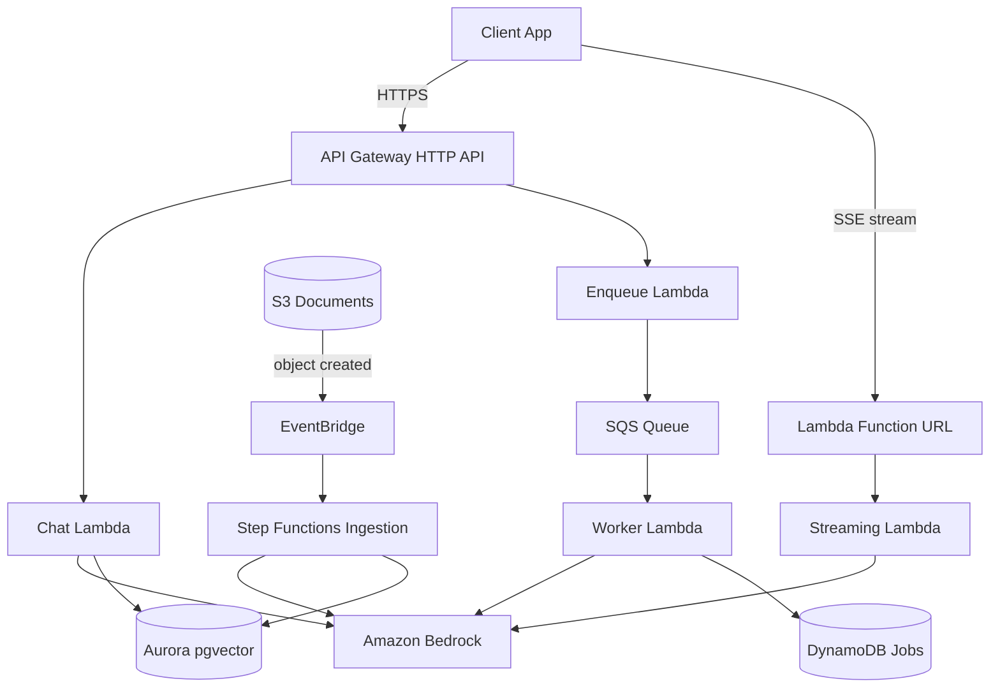
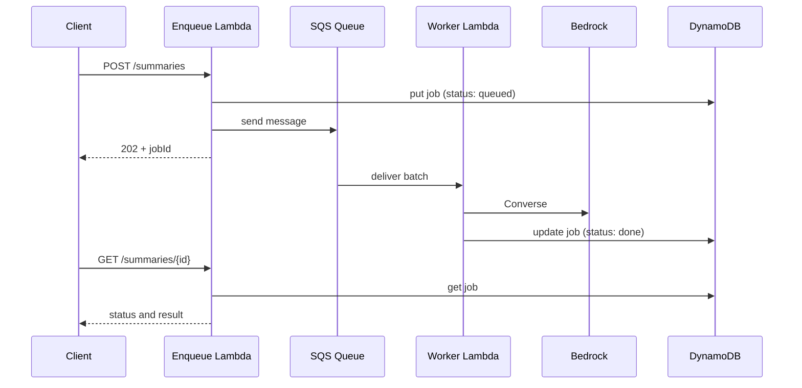
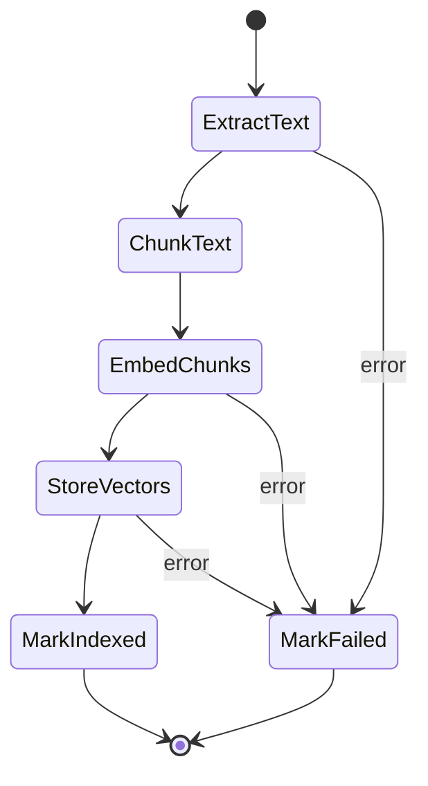

# Chapter 17: AWS Cloud + AI

## Learning Objectives

By the end of this chapter, you will:

- [ ] Choose between Amazon Bedrock and direct provider APIs for LLM access
- [ ] Call foundation models from Node.js with the Bedrock Converse API, including streaming
- [ ] Run AI endpoints on AWS Lambda behind API Gateway or a Lambda function URL
- [ ] Build asynchronous AI pipelines with SQS, EventBridge, DynamoDB, and Step Functions
- [ ] Implement RAG with Bedrock embeddings and either pgvector on Aurora or OpenSearch
- [ ] Apply least-privilege IAM, Secrets Manager, and network controls to AI workloads
- [ ] Define the infrastructure with the AWS CDK and monitor cost and behavior with CloudWatch

## Prerequisites

- Chapter 7: RAG Pipelines (retrieval concepts)
- Chapter 12: Deployment (containers, secrets, monitoring)
- Chapter 16: Node.js + AI (TypeScript service patterns, streaming, budgets)
- An AWS account, the AWS CLI configured with a non-root identity, and basic familiarity with IAM

## Estimated Time

- Reading: 90 minutes
- Exercises: 90 minutes
- Project: 6 hours

---

## Why AWS for AI Backends

You can run every pattern from **Chapter 16: Node.js + AI** on a single container host. AWS becomes attractive when your company already runs on it, when data must stay inside a cloud account boundary, or when you want managed building blocks for queues, storage, and identity.

The main AI-specific service is Amazon Bedrock. It gives API access to foundation models from several providers through one AWS-native interface. Requests use IAM for authentication, so your application holds no provider API key. Bedrock's data handling terms and regional controls are documented by AWS. Review them against your compliance requirements.

| Factor | Bedrock | Direct Provider API |
|--------|---------|--------------------|
| Authentication | IAM roles, no API key | API key in a secret |
| Model choice | Several providers behind one API | One provider per integration |
| Billing | AWS bill, consolidated | Separate vendor invoice |
| Newest features | May arrive later than the provider's own API | Usually first |
| Data boundary | Stays within your AWS account and Region setup | Leaves to the provider |
| Portability | AWS-specific | Portable |

> 📐 **Architecture Decision**
>
> We use Bedrock in this chapter because IAM-based access removes secret management for model calls, and one API covers several model families. If you need a provider feature Bedrock lacks, keep both paths behind the same interface you built in Chapter 16.

Do not choose AWS only to run a prototype. A single container on a simple platform is faster to build and cheaper to operate. Use AWS when you need its integrations, controls, or scale.

---

## Reference Architecture

The architecture below combines a synchronous path for chat, an asynchronous path for long work, and an ingestion pipeline for RAG.



*Figure 1: Reference architecture for an AWS AI backend*

| Component | Role |
|-----------|------|
| API Gateway | Authentication, throttling, and routing for request-response endpoints |
| Lambda function URL | Response streaming for chat |
| Bedrock | Text generation and embeddings |
| SQS | Buffer and retry for slow AI jobs |
| DynamoDB | Job status, conversation state, and usage counters |
| S3 | Source documents and large results |
| EventBridge and Step Functions | Trigger and coordinate the ingestion workflow |
| Aurora PostgreSQL with pgvector | Vector search |

We build each piece in the sections that follow. You do not need all of them for every product. Start with one path and add others when a requirement demands it.

---

## Project Setup

### Account and Region Preparation

Before writing code, complete these steps in the AWS console or CLI:

1. Create an IAM Identity Center user or an IAM role for development. Do not use the root user.
2. Pick one Region where your chosen models are available. Model availability varies by Region.
3. In the Bedrock console, review the model catalog and confirm access to the models you plan to use. Some models need an access request or acceptance of provider terms.
4. Set an AWS Budget alert before you run anything (see *Cost Management* later in this chapter).

```bash
aws configure sso                 # sets up a profile for Identity Center
aws sts get-caller-identity       # confirm which identity you are using
aws bedrock list-foundation-models --region us-east-1 \
  --query "modelSummaries[].modelId" --output text
```

### Dependencies

```bash
mkdir ai-aws && cd ai-aws
npm init -y
npm install @aws-sdk/client-bedrock-runtime @aws-sdk/client-dynamodb \
  @aws-sdk/lib-dynamodb @aws-sdk/client-sqs @aws-sdk/client-secrets-manager \
  pg zod
npm install -D typescript tsx esbuild @types/node @types/aws-lambda @types/pg \
  aws-cdk aws-cdk-lib constructs vitest
```

The AWS SDK for JavaScript v3 is modular. Install only the clients you use, because bundle size affects Lambda cold start time.

### Project Structure

```
ai-aws/
├── bin/
│   └── app.ts
├── lib/
│   └── ai-stack.ts
├── src/
│   ├── lib/
│   │   ├── bedrock.ts
│   │   ├── embeddings.ts
│   │   └── db.ts
│   └── handlers/
│       ├── chat.ts
│       ├── chat-stream.ts
│       ├── enqueue.ts
│       ├── worker.ts
│       └── ingest-embed.ts
├── test/
├── cdk.json
├── package.json
└── tsconfig.json
```

> ⚠ **Evolving Landscape**
>
> This chapter covers AWS services as of mid-2026. Model identifiers, quotas, Region availability, and prices change often. We read model IDs from environment variables for that reason. Check the AWS documentation for current values.

---

## Calling Models with Amazon Bedrock

### Which API to Use

Bedrock offers two ways to invoke text models.

| API | Behavior | Use When |
|-----|----------|----------|
| `InvokeModel` | Sends the provider's native request body | You need a provider-specific feature, or call embeddings |
| `Converse` and `ConverseStream` | One request and response shape for models that support messages | Chat, tool use, and swapping models (recommended default) |

We use Converse for text generation. The same code works with different models by changing the model ID. We use `InvokeModel` for embeddings, where each model defines its own body.

### Model IDs and Inference Profiles

Some models require an *inference profile* instead of a base model ID. A cross-Region inference profile routes your request to capacity in several Regions. Its ID carries a geography prefix, such as `us.` followed by the model name. Look up the exact identifier for your model and Region in the console, then store it in configuration.

### A Converse Client

```typescript
// src/lib/bedrock.ts
import {
  BedrockRuntimeClient,
  ConverseCommand,
  ConverseStreamCommand,
  type Message,
} from "@aws-sdk/client-bedrock-runtime";

const client = new BedrockRuntimeClient({
  // Region comes from the Lambda environment (AWS_REGION) automatically.
  maxAttempts: 3, // SDK retries throttling and transient errors
});

const MODEL_ID = process.env.BEDROCK_MODEL_ID;
if (!MODEL_ID) throw new Error("BEDROCK_MODEL_ID is not set");

export type Turn = { role: "user" | "assistant"; text: string };

const toMessages = (turns: Turn[]): Message[] =>
  turns.map((t) => ({ role: t.role, content: [{ text: t.text }] }));

export async function converse(system: string, turns: Turn[]) {
  const res = await client.send(
    new ConverseCommand({
      modelId: MODEL_ID,
      system: [{ text: system }],
      messages: toMessages(turns),
      inferenceConfig: { maxTokens: 800, temperature: 0.2 },
    }),
  );
  const text = res.output?.message?.content?.map((b) => b.text ?? "").join("") ?? "";
  return { text, usage: res.usage }; // usage has inputTokens and outputTokens
}
```

The response includes `usage` with input and output token counts. Record it in logs and metrics from the first day.

### Streaming

```typescript
// src/lib/bedrock.ts (continued)
export async function* converseStream(
  system: string,
  turns: Turn[],
): AsyncGenerator<{ text?: string; outputTokens?: number }, void, void> {
  const res = await client.send(
    new ConverseStreamCommand({
      modelId: MODEL_ID,
      system: [{ text: system }],
      messages: toMessages(turns),
      inferenceConfig: { maxTokens: 800 },
    }),
  );

  for await (const event of res.stream ?? []) {
    const delta = event.contentBlockDelta?.delta?.text;
    if (delta) yield { text: delta };
    if (event.metadata?.usage) yield { outputTokens: event.metadata.usage.outputTokens };
  }
}
```

The Lambda response stream in our handler does not expose a client disconnect event, so this function cannot cancel the upstream request when the client leaves. Keep `maxTokens` low to bound the cost of abandoned streams. In a long-running Node.js server, as in **Chapter 16: Node.js + AI**, you can pass an `abortSignal` to `client.send`.

The stream is a sequence of typed events. Text arrives in `contentBlockDelta`, and token usage arrives in the final `metadata` event.

### Bedrock Guardrails

Guardrails apply configurable policies to input and output: denied topics, content filters, sensitive information filters, and word filters. You create a guardrail in Bedrock and pass its identifier and version in the `guardrailConfig` field of a Converse request.

Use guardrails as one layer. They reduce risk but do not replace input validation, output validation, and access control in your own code.

> 💰 **Cost Note**
>
> Bedrock bills on-demand inference per input and output token, with prices that differ by model. Guardrails and other features add their own charges. Compare current prices on the Bedrock pricing page before choosing a default model.

---

## Lambda Handlers

AWS Lambda runs your code per request without servers to manage. It scales to zero, so idle endpoints cost nothing. That fits AI backends with bursty traffic.

Lambda has limits that shape the design. A function runs for at most 15 minutes. Each invocation has memory and payload limits. Cold starts add latency on the first request after idle time. Long-lived connections need special handling.

### A Request-Response Handler

```typescript
// src/handlers/chat.ts
import type { APIGatewayProxyEventV2, APIGatewayProxyResultV2 } from "aws-lambda";
import { z } from "zod";
import { converse } from "../lib/bedrock.js";

const Body = z.object({
  messages: z
    .array(z.object({ role: z.enum(["user", "assistant"]), text: z.string().min(1).max(8_000) }))
    .min(1)
    .max(40),
});

const json = (statusCode: number, body: unknown): APIGatewayProxyResultV2 => ({
  statusCode,
  headers: { "content-type": "application/json" },
  body: JSON.stringify(body),
});

export const handler = async (event: APIGatewayProxyEventV2): Promise<APIGatewayProxyResultV2> => {
  const parsed = Body.safeParse(JSON.parse(event.body ?? "{}"));
  if (!parsed.success) return json(400, { error: "invalid_request" });

  try {
    const { text, usage } = await converse("You are a concise assistant.", parsed.data.messages);
    console.log(JSON.stringify({ msg: "converse", ...usage, requestId: event.requestContext.requestId }));
    return json(200, { reply: text });
  } catch (err) {
    const name = (err as Error).name;
    console.error(JSON.stringify({ msg: "bedrock_error", name }));
    if (name === "ThrottlingException") return json(503, { error: "busy" });
    return json(502, { error: "upstream_error" });
  }
};
```

Initialize SDK clients outside the handler, as `bedrock.ts` does. Lambda reuses the module scope across invocations, which saves connection setup time. Structured JSON logs go to CloudWatch Logs and are searchable.

`JSON.parse` can throw on malformed input. In production code, wrap it or use a middleware library such as Middy.

### Streaming Responses

API Gateway has an integration timeout, which defaults to 29 seconds, and it traditionally buffers responses. For token streaming, use a Lambda function URL with response streaming enabled. Node.js managed runtimes expose `awslambda.streamifyResponse` for this purpose.

```typescript
// src/handlers/chat-stream.ts
import type { APIGatewayProxyEventV2 } from "aws-lambda";
import { converseStream } from "../lib/bedrock.js";

// `awslambda` is a global provided by the Lambda Node.js runtime.
declare const awslambda: {
  streamifyResponse: (
    fn: (event: APIGatewayProxyEventV2, stream: NodeJS.WritableStream, ctx: unknown) => Promise<void>,
  ) => unknown;
  HttpResponseStream: {
    from: (s: NodeJS.WritableStream, meta: { statusCode: number; headers: Record<string, string> }) => NodeJS.WritableStream;
  };
};

export const handler = awslambda.streamifyResponse(async (event, responseStream) => {
  const out = awslambda.HttpResponseStream.from(responseStream, {
    statusCode: 200,
    headers: { "content-type": "text/event-stream", "cache-control": "no-cache" },
  });
  try {
    const { message } = JSON.parse(event.body ?? "{}") as { message?: string };
    if (!message) throw new Error("message required");
    for await (const part of converseStream("You are a concise assistant.", [{ role: "user", text: message }])) {
      if (part.text) out.write(`data: ${JSON.stringify({ token: part.text })}\n\n`);
    }
    out.write("data: [DONE]\n\n");
  } catch (err) {
    out.write(`event: error\ndata: ${JSON.stringify({ error: "upstream_failed" })}\n\n`);
  } finally {
    out.end();
  }
});
```

The SSE format matches Chapter 16 and the Flutter parser in **Chapter 11: Flutter + AI**. Clients do not need to change.

Function URLs support two authentication modes: `AWS_IAM` and `NONE`. Never use `NONE` for an endpoint that calls a paid model unless you add your own authentication inside the function. For browser and mobile clients, put CloudFront in front, or use Amazon Cognito and validate tokens in the handler.

| Option | Streaming | Auth | Throttling | Use When |
|--------|-----------|------|-----------|----------|
| API Gateway HTTP API + Lambda | Buffered | JWT authorizer, IAM, Lambda authorizer | Built in | Request-response endpoints |
| Lambda function URL | Yes | IAM or none | Only function concurrency | Streaming chat |
| ALB + containers (ECS Fargate) | Yes | Cognito or OIDC | Via WAF | Long streams, steady traffic |
| Direct container on Fargate | Yes | Your code | Your code | Reuse of Chapter 16 service unchanged |

> 💡 **Developer Insight**
>
> You can run the Fastify service from Chapter 16 on ECS Fargate with no code changes. Choose Lambda for spiky traffic and short work. Choose containers for steady traffic, long-lived streams, or when you want one code path for local and cloud.

---

## Asynchronous Pipelines

Lambda handlers should return quickly. Slow AI work belongs in an asynchronous flow: accept the request, queue it, process it, and store the result.



*Figure 2: Asynchronous summarization with SQS and DynamoDB*

### SQS and Dead-Letter Queues

Amazon SQS stores messages until a consumer processes them. If a function fails, the message becomes visible again and retries. After a maximum receive count, SQS moves it to a dead-letter queue (DLQ) where you can inspect it. Set the queue's visibility timeout to at least six times the function timeout, as AWS recommends for Lambda event sources.

```typescript
// src/handlers/enqueue.ts
import { SQSClient, SendMessageCommand } from "@aws-sdk/client-sqs";
import { DynamoDBClient } from "@aws-sdk/client-dynamodb";
import { DynamoDBDocumentClient, PutCommand } from "@aws-sdk/lib-dynamodb";
import { randomUUID } from "node:crypto";

const sqs = new SQSClient({});
const ddb = DynamoDBDocumentClient.from(new DynamoDBClient({}));

export async function createJob(clientId: string, text: string): Promise<string> {
  const jobId = randomUUID();
  await ddb.send(new PutCommand({
    TableName: process.env.JOBS_TABLE,
    Item: {
      pk: `CLIENT#${clientId}`, sk: `JOB#${jobId}`,
      status: "queued", createdAt: Date.now(),
      ttl: Math.floor(Date.now() / 1000) + 7 * 86_400, // DynamoDB TTL, epoch seconds
    },
  }));
  await sqs.send(new SendMessageCommand({
    QueueUrl: process.env.QUEUE_URL,
    MessageBody: JSON.stringify({ clientId, jobId, text }),
  }));
  return jobId;
}
```

Note that SQS limits message size (256 KiB at the time of writing). Store large documents in S3 and send the object key instead. This is the claim-check pattern.

### The Worker

```typescript
// src/handlers/worker.ts
import type { SQSEvent, SQSBatchResponse } from "aws-lambda";
import { DynamoDBClient } from "@aws-sdk/client-dynamodb";
import { DynamoDBDocumentClient, UpdateCommand } from "@aws-sdk/lib-dynamodb";
import { converse } from "../lib/bedrock.js";

const ddb = DynamoDBDocumentClient.from(new DynamoDBClient({}));

export const handler = async (event: SQSEvent): Promise<SQSBatchResponse> => {
  const failures: SQSBatchResponse["batchItemFailures"] = [];

  for (const record of event.Records) {
    const { clientId, jobId, text } = JSON.parse(record.body) as {
      clientId: string; jobId: string; text: string;
    };
    try {
      const { text: summary, usage } = await converse(
        "Summarize the document in five bullet points.",
        [{ role: "user", text }],
      );
      await ddb.send(new UpdateCommand({
        TableName: process.env.JOBS_TABLE,
        Key: { pk: `CLIENT#${clientId}`, sk: `JOB#${jobId}` },
        UpdateExpression: "SET #s = :s, result = :r, tokens = :t",
        ExpressionAttributeNames: { "#s": "status" }, // "status" is a reserved word
        ExpressionAttributeValues: { ":s": "done", ":r": summary, ":t": usage?.totalTokens ?? 0 },
      }));
    } catch (err) {
      console.error(JSON.stringify({ msg: "job_failed", jobId, name: (err as Error).name }));
      failures.push({ itemIdentifier: record.messageId }); // only this message retries
    }
  }
  return { batchItemFailures: failures };
};
```

Reporting partial batch failures avoids reprocessing messages that already succeeded. To enable it, set `reportBatchItemFailures` on the event source mapping. The CDK stack below does this.

Messages can be delivered more than once. Make workers idempotent: running the same job twice must not corrupt data or double-charge a customer. Writing the result by a fixed key, as above, achieves this.

### Choosing a Messaging Service

| Service | Model | Use When |
|---------|-------|----------|
| SQS | Queue, one consumer group | Work distribution with retries |
| SNS | Pub/sub fan-out | One event, many subscribers |
| EventBridge | Event bus with routing rules | Reacting to AWS events, such as S3 uploads, and decoupling services |
| Step Functions | Workflow state machine | Multi-step flows with branching, retries, and waiting |

---

## Document Ingestion with S3, EventBridge, and Step Functions

For RAG, documents must be split, embedded, and stored. We trigger this when a file lands in S3.



*Figure 3: Ingestion workflow states*

1. Enable EventBridge notifications on the S3 bucket.
2. Create an EventBridge rule that matches `Object Created` events for the `uploads/` prefix.
3. Set a Step Functions state machine as the rule target.
4. Each state invokes a Lambda function. Failures route to a `MarkFailed` state that records the error.

Step Functions gives you per-step retries, a visual execution history, and the ability to wait or run steps in parallel. A single Lambda would be simpler for small documents. Use Step Functions when steps have different timeouts or failure handling, or when you need an audit trail of each run.

Alternatively, an S3 event notification can trigger a Lambda function directly. That is enough when ingestion is one short step.

> ⚠ **Common Mistake**
>
> Triggering a Lambda function on S3 events from the same bucket and prefix it writes to. The function's own output triggers it again and creates a loop that can run up a large bill. Write results to a different prefix or bucket, and filter triggers by prefix.

### Generating Embeddings with Bedrock

```typescript
// src/lib/embeddings.ts
import { BedrockRuntimeClient, InvokeModelCommand } from "@aws-sdk/client-bedrock-runtime";

const client = new BedrockRuntimeClient({});
const EMBED_MODEL = process.env.EMBED_MODEL_ID ?? "amazon.titan-embed-text-v2:0";

export async function embed(text: string): Promise<number[]> {
  const res = await client.send(
    new InvokeModelCommand({
      modelId: EMBED_MODEL,
      contentType: "application/json",
      accept: "application/json",
      body: JSON.stringify({ inputText: text, dimensions: 1024, normalize: true }),
    }),
  );
  const payload = JSON.parse(new TextDecoder().decode(res.body)) as { embedding: number[] };
  return payload.embedding;
}
```

Titan Text Embeddings V2 accepts a `dimensions` value of 256, 512, or 1024 and a `normalize` flag. Smaller dimensions reduce storage and speed up search at some cost in accuracy. Whatever you pick, use the same model and dimension for documents and queries. Mixing them returns meaningless results.

---

## Vector Search for RAG

AWS offers several places to store vectors. We covered the concepts in **Chapter 6: Embeddings and Semantic Search** and **Chapter 8: Databases for AI Applications**.

| Option | Strengths | Weaknesses | Use When |
|--------|-----------|-----------|----------|
| Aurora PostgreSQL + pgvector | SQL, joins, transactions, one database for app and vectors | You manage indexes and tuning | Under a few million vectors, relational data nearby |
| Amazon OpenSearch (Service or Serverless) | Hybrid keyword and vector search, scale | More to operate, serverless has a minimum cost floor | Large corpora, keyword plus vector ranking |
| Bedrock Knowledge Bases | Managed ingestion, chunking, retrieval, and optional answer generation | Less control over chunking and ranking | You want RAG without building a pipeline |
| DynamoDB or S3 + in-memory | Cheap, simple | Not real vector search at scale | Tiny datasets, prototypes |

> 📐 **Architecture Decision**
>
> We use Aurora PostgreSQL with pgvector. Most backend teams already know PostgreSQL, and tenant filters, metadata, and vectors live in one query. Move to OpenSearch when you need hybrid ranking or tens of millions of vectors. Try Knowledge Bases first if you want a working RAG system in an afternoon.

### The Schema

```sql
-- Run once per database
CREATE EXTENSION IF NOT EXISTS vector;

CREATE TABLE chunks (
  id          BIGSERIAL PRIMARY KEY,
  tenant_id   TEXT NOT NULL,
  source      TEXT NOT NULL,
  content     TEXT NOT NULL,
  embedding   vector(1024) NOT NULL
);

CREATE INDEX ON chunks (tenant_id);
CREATE INDEX ON chunks USING hnsw (embedding vector_cosine_ops);
```

### Connecting from Lambda

Each Lambda instance holds its own database connections. Under load, hundreds of instances can exhaust PostgreSQL connections. Put Amazon RDS Proxy between Lambda and Aurora to pool them. Keep the pool size at one per instance.

```typescript
// src/lib/db.ts
import pg from "pg";
import { GetSecretValueCommand, SecretsManagerClient } from "@aws-sdk/client-secrets-manager";

const secrets = new SecretsManagerClient({});
let pool: pg.Pool | undefined;

export async function getPool(): Promise<pg.Pool> {
  if (pool) return pool; // reused across warm invocations
  const res = await secrets.send(new GetSecretValueCommand({ SecretId: process.env.DB_SECRET_ARN }));
  const cred = JSON.parse(res.SecretString ?? "{}") as { username: string; password: string };
  pool = new pg.Pool({
    host: process.env.DB_PROXY_ENDPOINT,
    database: "app",
    user: cred.username,
    password: cred.password,
    ssl: { rejectUnauthorized: true },
    max: 1, // one connection per Lambda instance
  });
  return pool;
}
```

Placing Lambda in a VPC is required to reach a private database. It also means the function needs a route to Bedrock. Use a VPC interface endpoint for Bedrock Runtime so traffic does not leave the AWS network and you avoid NAT gateway charges.

### Retrieval

```typescript
// retrieval function used by the ask handler
import { embed } from "./embeddings.js";
import { getPool } from "./db.js";

export async function retrieve(question: string, tenantId: string, k = 5) {
  const vector = await embed(question);
  const pool = await getPool();
  const { rows } = await pool.query(
    `SELECT source, content, 1 - (embedding <=> $1::vector) AS score
       FROM chunks WHERE tenant_id = $2
      ORDER BY embedding <=> $1::vector LIMIT $3`,
    [JSON.stringify(vector), tenantId, k], // pgvector accepts the '[0.1,0.2]' text format
  );
  return rows as { source: string; content: string; score: number }[];
}
```

The rest of the handler is the same grounded-prompt pattern from Chapter 16, with `converse` in place of the OpenAI call.

---

## Security

### IAM Least Privilege

Each Lambda function gets its own role with only the permissions it needs. A chat function needs to invoke one chat model and, for RAG, one embedding model. It does not need S3 or DynamoDB access.

```json
{
  "Version": "2012-10-17",
  "Statement": [
    {
      "Effect": "Allow",
      "Action": [
        "bedrock:InvokeModel",
        "bedrock:InvokeModelWithResponseStream"
      ],
      "Resource": [
        "arn:aws:bedrock:us-east-1::foundation-model/amazon.titan-embed-text-v2:0",
        "arn:aws:bedrock:us-east-1::foundation-model/YOUR_CHAT_MODEL_ID",
        "arn:aws:bedrock:us-east-1:111122223333:inference-profile/YOUR_PROFILE_ID"
      ]
    }
  ]
}
```

The Converse APIs use the `InvokeModel` and `InvokeModelWithResponseStream` permissions. Scope `Resource` to specific model and inference profile ARNs. When you use a cross-Region inference profile, the policy must also allow the underlying foundation model in each Region the profile can route to. Check the Bedrock documentation for the exact ARNs, and test the policy before deploying.

Avoid `"Resource": "*"` and `bedrock:*`. A leaked role with those permissions could run up charges on every model in the account.

### Secrets Manager and Parameter Store

Bedrock needs no API key, but you will still have secrets: database credentials, third-party API keys, and signing keys.

| Store | Rotation | Cost | Use For |
|-------|----------|------|---------|
| Secrets Manager | Built-in for supported databases | Per secret per month plus API calls | Database credentials, API keys |
| Systems Manager Parameter Store | Manual | Standard parameters are free | Non-secret configuration, simple secrets |
| Lambda environment variables | None | Free | Non-secret values such as table names and model IDs |

Fetch secrets at runtime and cache them in module scope, as `db.ts` does. Do not put secrets in plain environment variables or in code. Grant `secretsmanager:GetSecretValue` on the single secret ARN.

### Network and Data Protection

- Encrypt S3 buckets, DynamoDB tables, and Aurora with AWS KMS keys. These services encrypt by default, and customer-managed keys add control and audit.
- Block public access on S3 buckets that hold documents.
- Use private subnets and VPC endpoints for Bedrock, S3, DynamoDB, and Secrets Manager.
- Put AWS WAF in front of public endpoints for rate-based rules and common attack filters.
- Authenticate end users with Amazon Cognito or your identity provider, and derive the tenant ID from the verified token, never from the request body.
- Enable model invocation logging in Bedrock only if you accept that prompts and completions will be stored. Set bucket encryption and retention accordingly.

> ⚠ **Common Mistake**
>
> Taking `tenantId` from the request body. A caller can then read another tenant's documents. Read it from the verified JWT claims, and apply it in every query.

---

## Infrastructure as Code with the AWS CDK

The AWS Cloud Development Kit (CDK) defines infrastructure in TypeScript and synthesizes it to CloudFormation. Backend developers can reuse their language, type checking, and testing tools. Alternatives include Terraform and OpenTofu, which are provider-neutral, and AWS SAM, which is simpler but focused on serverless.

Console-created resources cannot be reviewed, repeated, or rolled back. Define everything in code from the start.

```typescript
// lib/ai-stack.ts (part 1: storage, queue, and function)
import * as cdk from "aws-cdk-lib";
import { Construct } from "constructs";
import * as dynamodb from "aws-cdk-lib/aws-dynamodb";
import * as sqs from "aws-cdk-lib/aws-sqs";
import * as lambda from "aws-cdk-lib/aws-lambda";
import { NodejsFunction } from "aws-cdk-lib/aws-lambda-nodejs";
import { SqsEventSource } from "aws-cdk-lib/aws-lambda-event-sources";
import * as iam from "aws-cdk-lib/aws-iam";

export class AiStack extends cdk.Stack {
  constructor(scope: Construct, id: string, props?: cdk.StackProps) {
    super(scope, id, props);
    const modelId = this.node.tryGetContext("bedrockModelId") as string;

    const jobs = new dynamodb.Table(this, "Jobs", {
      partitionKey: { name: "pk", type: dynamodb.AttributeType.STRING },
      sortKey: { name: "sk", type: dynamodb.AttributeType.STRING },
      billingMode: dynamodb.BillingMode.PAY_PER_REQUEST,
      timeToLiveAttribute: "ttl",
    });

    const dlq = new sqs.Queue(this, "JobsDlq", { retentionPeriod: cdk.Duration.days(14) });
    const queue = new sqs.Queue(this, "JobsQueue", {
      visibilityTimeout: cdk.Duration.minutes(6), // 6x the 60-second worker timeout
      deadLetterQueue: { queue: dlq, maxReceiveCount: 3 },
    });
```

```typescript
    // part 2: worker function with scoped permissions
    const worker = new NodejsFunction(this, "Worker", {
      entry: "src/handlers/worker.ts",
      runtime: lambda.Runtime.NODEJS_22_X,
      timeout: cdk.Duration.seconds(60),
      memorySize: 512,
      environment: {
        JOBS_TABLE: jobs.tableName,
        BEDROCK_MODEL_ID: modelId,
      },
      bundling: { minify: true, sourceMap: true },
    });

    jobs.grantWriteData(worker); // least privilege: write only
    worker.addToRolePolicy(new iam.PolicyStatement({
      actions: ["bedrock:InvokeModel", "bedrock:InvokeModelWithResponseStream"],
      resources: [`arn:aws:bedrock:${this.region}::foundation-model/*`], // tighten per model
    }));

    worker.addEventSource(new SqsEventSource(queue, {
      batchSize: 5,
      maxConcurrency: 5, // caps parallel Lambda invocations, protects Bedrock quota
      reportBatchItemFailures: true,
    }));
```

```typescript
    // part 3: streaming chat via function URL
    const chatStream = new NodejsFunction(this, "ChatStream", {
      entry: "src/handlers/chat-stream.ts",
      runtime: lambda.Runtime.NODEJS_22_X,
      timeout: cdk.Duration.minutes(2),
      environment: { BEDROCK_MODEL_ID: modelId },
    });
    chatStream.addToRolePolicy(new iam.PolicyStatement({
      actions: ["bedrock:InvokeModel", "bedrock:InvokeModelWithResponseStream"],
      resources: [`arn:aws:bedrock:${this.region}::foundation-model/*`], // tighten per model
    }));
    const url = chatStream.addFunctionUrl({
      authType: lambda.FunctionUrlAuthType.AWS_IAM,
      invokeMode: lambda.InvokeMode.RESPONSE_STREAM,
    });
    new cdk.CfnOutput(this, "ChatStreamUrl", { value: url.url });
  }
}
```

The example uses a wildcard on foundation models to stay short. Replace it with the exact model ARNs for your account, as shown in the *Security* section.

Deploy with the CDK CLI:

```bash
npx cdk bootstrap                                  # once per account and Region
npx cdk diff -c bedrockModelId=YOUR_MODEL_ID      # review changes first
npx cdk deploy -c bedrockModelId=YOUR_MODEL_ID
```

Always run `cdk diff` before `cdk deploy` and read the IAM and security group changes. Deploy from CI with a role that has narrower permissions than an administrator.

---

## Observability with CloudWatch

CloudWatch collects logs, metrics, and alarms for every service in this chapter.

- **Logs.** Lambda writes `console.log` output to CloudWatch Logs. Log JSON so you can query it with CloudWatch Logs Insights.
- **Metrics.** Bedrock publishes invocation count, latency, throttles, and token counts under the `AWS/Bedrock` namespace. SQS, Lambda, and API Gateway publish their own.
- **Custom metrics.** Emit business metrics such as tokens per tenant using the Embedded Metric Format (EMF) in log lines, or the Powertools for AWS Lambda library.
- **Tracing.** Enable AWS X-Ray or OpenTelemetry to see time spent in each downstream call.
- **Alarms.** Alert on DLQ depth, Lambda errors, Bedrock throttles, and p95 latency.

```sql
-- CloudWatch Logs Insights: tokens by client over the last day
fields @timestamp, clientId, inputTokens, outputTokens
| filter msg = "converse"
| stats sum(inputTokens) as inTok, sum(outputTokens) as outTok by clientId
| sort outTok desc
```

Set a log retention period on every log group. The default is to keep logs forever, and you pay for the storage.

Prompts and completions can contain personal data. As in Chapter 16, log metadata by default and treat full-text logging as an exception with redaction and short retention.

---

## Cost Management

AI workloads cost money in several places at once. Model tokens usually dominate, but other items surprise teams.

| Cost Driver | Control |
|-------------|---------|
| Bedrock tokens | Smaller models for easy tasks, `maxTokens` limits, caching, per-tenant budgets |
| Lambda duration | Right-size memory, avoid waiting on slow upstreams in sync paths |
| NAT gateways | Use VPC endpoints for AWS services, remove unused gateways |
| OpenSearch Serverless or provisioned domains | Minimum capacity charges apply while idle. Check pricing before choosing |
| Aurora and RDS Proxy | Use Aurora Serverless v2 scaling limits for dev, stop dev clusters |
| CloudWatch Logs | Set retention, avoid logging full prompts |
| Data transfer | Keep resources in one Region where possible |

Practical steps:

1. Create an AWS Budget with email alerts at 50, 80, and 100 percent of your monthly limit.
2. Enable cost allocation tags such as `project` and `env`, and tag every resource through the CDK (`cdk.Tags.of(app).add("project", "ai-aws")`).
3. Turn on AWS Cost Anomaly Detection to catch runaway spend, such as the S3 trigger loop mentioned earlier.
4. Set Lambda reserved concurrency and SQS `maxConcurrency` so a traffic spike cannot create unlimited parallel model calls.
5. Track tokens per tenant in DynamoDB with atomic counters, and enforce budgets as in Chapter 16.
6. Review Bedrock options for lower-cost inference, such as batch inference for non-urgent jobs and prompt caching on supported models. Check current availability and discounts.

> 💰 **Cost Note**
>
> Provisioned Throughput reserves model capacity at an hourly rate for a commitment period. It makes sense only for steady, high volume traffic or custom models. Start with on-demand inference and measure.

> ⚠ **Common Mistake**
>
> Leaving a development stack running. An idle Aurora cluster, NAT gateway, or OpenSearch domain bills by the hour. Destroy dev stacks with `npx cdk destroy` when you finish for the day, and tag everything so you can find leftovers.

---

## Production Notes

- **Know your quotas.** Bedrock enforces per-model, per-Region limits on requests and tokens per minute. Check Service Quotas, request increases early, and handle `ThrottlingException` with backoff and queues.
- **Use more than one Region for resilience only when needed.** Cross-Region inference profiles add capacity and availability for supported models without you managing multi-Region infrastructure.
- **Keep model IDs in configuration.** Models are deprecated on a published schedule. Plan migrations and re-run your evaluation set before switching.
- **Control cold starts.** Bundle with esbuild (as `NodejsFunction` does), keep dependencies small, and consider provisioned concurrency only for latency-critical paths.
- **Set timeouts deliberately.** Function timeout, SQS visibility timeout, API Gateway timeout, and client timeout must be consistent with each other.
- **Separate environments.** Use separate AWS accounts for development and production, managed through AWS Organizations.
- **Test IAM policies.** Use the IAM policy simulator or a staging deployment. Permission errors on cross-Region profiles are common.

---

## Common Mistakes

1. **Using `bedrock:*` on all resources.** A compromised role can call any model. Scope to specific model ARNs.
2. **Buffering a stream behind API Gateway.** Users see no output until the end. Use a function URL or containers for token streaming.
3. **Hardcoding model IDs.** Models retire. Read IDs from configuration.
4. **Forgetting RDS Proxy.** Lambda concurrency exhausts database connections.
5. **Unbounded concurrency.** A spike of queued messages triggers hundreds of parallel model calls and throttling. Cap it.
6. **Non-idempotent workers.** SQS delivers at least once. Duplicate processing must be safe.
7. **Trusting a tenant ID from the client.** Derive it from verified identity.
8. **Triggering a function from its own output.** An S3 loop can generate a very large bill.
9. **Retaining logs forever.** Set retention on every log group.
10. **Creating resources by hand in the console.** You cannot reproduce or review them.

---

## Best Practices

1. Use IAM roles for model access. Do not distribute provider API keys when Bedrock meets your needs.
2. Give each function its own role with resource-scoped permissions.
3. Use Converse and ConverseStream by default, and keep model IDs in configuration.
4. Keep synchronous handlers short. Send slow AI work through SQS.
5. Add a dead-letter queue and an alarm on its depth to every queue.
6. Make workers idempotent and report partial batch failures.
7. Pool database connections with RDS Proxy and use VPC endpoints for AWS services.
8. Define all infrastructure in the CDK, run `cdk diff` before every deploy, and tag all resources.
9. Log token usage as structured JSON and build CloudWatch dashboards and alarms from it.
10. Set budgets, anomaly detection, concurrency caps, and per-tenant token limits before launch.

---

## Hands-On Exercises

### Exercise 1: First Bedrock Call

**Difficulty:** ⭐
**Time:** 20 minutes

Call a model from a local Node.js script.

1. Confirm model access in the Bedrock console and note the model ID or inference profile ID.
2. Write a script using `ConverseCommand` that asks a question and prints the reply and token usage.
3. Change `maxTokens` to 20 and observe the `stopReason`.
4. Print `usage.inputTokens` and `usage.outputTokens`.

**Expected outcome:** The script prints a reply and token counts. With `maxTokens` at 20, `stopReason` is `max_tokens`.

### Exercise 2: Least-Privilege Role

**Difficulty:** ⭐⭐
**Time:** 30 minutes

Create an IAM role that can invoke only one model.

1. Write a policy scoped to the ARN of one model or inference profile.
2. Assume the role with `aws sts assume-role` and run your script from Exercise 1.
3. Change the script to a different model ID and run it again.

**Expected outcome:** The first model succeeds. The second returns `AccessDeniedException`.

### Exercise 3: Streaming Function URL

**Difficulty:** ⭐⭐
**Time:** 30 minutes

Deploy the streaming handler with the CDK.

1. Create the stack with a `NodejsFunction` and a function URL in `RESPONSE_STREAM` mode with `AWS_IAM` auth.
2. Deploy it with `cdk deploy`.
3. Call it with `curl --aws-sigv4` and your credentials. Use `-N` to disable buffering.
4. Confirm that tokens arrive incrementally.

**Expected outcome:** Tokens print one by one in the terminal, followed by `[DONE]`.

### Exercise 4: Queue with Dead-Letter Queue

**Difficulty:** ⭐⭐
**Time:** 30 minutes

Build the asynchronous summarization flow.

1. Deploy the SQS queue, DLQ, worker, and DynamoDB table.
2. Send a valid message and confirm the job reaches `done`.
3. Send a malformed message and confirm it lands in the DLQ after three receives.
4. Add a CloudWatch alarm on the DLQ's `ApproximateNumberOfMessagesVisible` metric.

**Expected outcome:** Valid jobs complete, the malformed message appears in the DLQ, and the alarm fires.

---

## Mini Project

**Title:** Serverless Document Q&A on AWS
**Difficulty:** ⭐⭐⭐
**Time:** 6 hours
**What you'll build:** A serverless RAG backend. Uploading a document to S3 indexes it, and an API answers questions with citations.

### Requirements

1. **Ingestion:** An S3 upload triggers a Step Functions workflow that extracts text, chunks it, embeds each chunk with Bedrock, and stores vectors in Aurora PostgreSQL with pgvector.
2. **Ask endpoint:** An API retrieves the top chunks for a tenant and answers using Converse, returning source references.
3. **Streaming:** A Lambda function URL streams answers over SSE.
4. **Async summaries:** A queue-backed endpoint produces document summaries and stores them in DynamoDB.
5. **Security:** Least-privilege IAM per function, database credentials in Secrets Manager, tenant ID from Cognito JWT claims, and S3 public access blocked.
6. **Observability:** JSON logs with token usage, a Logs Insights query for cost per tenant, and alarms on DLQ depth and Lambda errors.
7. **Cost control:** An AWS Budget, concurrency caps, and per-tenant daily token limits.
8. **IaC:** The whole stack deploys with `cdk deploy` and removes with `cdk destroy`.

### Deliverables

```
serverless-doc-qa/
├── bin/app.ts
├── lib/
│   ├── storage-stack.ts
│   ├── ingest-stack.ts
│   └── api-stack.ts
├── src/
│   ├── handlers/
│   └── lib/
├── test/
├── docs/
│   └── architecture.md
├── cdk.json
├── package.json
└── README.md
```

---

## Challenge Project

**Title:** Multi-Tenant AI Platform with Usage Billing
**Difficulty:** ⭐⭐⭐⭐
**Time:** 8 hours
**What you'll build:** A multi-tenant AI API on AWS that meters each tenant's token usage, enforces plan limits, and produces a monthly usage report.

### Requirements

1. **Tenant isolation:** Per-tenant identity, data partitioning, and verified tenant claims on every request.
2. **Metering:** Record input and output tokens per request in DynamoDB with atomic counters.
3. **Plans:** Free and paid plans with different model access, rate limits, and token quotas.
4. **Enforcement:** Reject requests over quota before calling Bedrock.
5. **Reporting:** A scheduled EventBridge rule runs a function that writes monthly CSV reports to S3.
6. **Failure handling:** Throttle handling with backoff, DLQs, and a replay procedure.
7. **Operations:** Dashboards, alarms, and a runbook for quota exhaustion and model deprecation.
8. **Cost proof:** A short document comparing your measured cost per 1,000 requests against a single-container deployment of Chapter 16.

---

## Portfolio Milestone

After this chapter, you should have:

- A serverless AI backend that calls Amazon Bedrock with IAM-based access
- An ingestion pipeline and a RAG endpoint using pgvector
- Infrastructure defined in CDK that others can deploy
- A documented security model with least-privilege roles
- A cost and observability setup you can describe in detail

> 🚀 **Portfolio Tip**
>
> Include an architecture diagram, the `cdk diff` output summary, and a table of monthly costs at low, medium, and high traffic. Hiring managers value evidence that you can run AI features on a budget.

---

## Chapter Summary

- Bedrock provides model access through IAM, so your application needs no provider API key.
- Use Converse and ConverseStream for text generation, and read model IDs from configuration because they change.
- Lambda suits bursty, short requests. Use function URLs with response streaming for SSE, or containers for long streams.
- Send slow AI work through SQS with a dead-letter queue, partial batch failure reporting, and idempotent workers.
- Step Functions and EventBridge coordinate multi-step ingestion for RAG.
- Aurora with pgvector is a practical default vector store. OpenSearch and Bedrock Knowledge Bases cover larger or more managed needs.
- Apply least-privilege IAM per function, keep secrets in Secrets Manager, and derive tenant IDs from verified tokens.
- Define infrastructure in the CDK and review `cdk diff` before deploying.
- Log token usage as JSON and monitor with CloudWatch metrics, Logs Insights, and alarms.
- Control cost with budgets, anomaly detection, concurrency caps, VPC endpoints, and per-tenant token limits.

---

## Cheat Sheet

| Need | AWS Service | Notes |
|------|------------|-------|
| Text generation | Bedrock Converse | IAM auth, model ID from config |
| Streaming | ConverseStream + Lambda function URL | `RESPONSE_STREAM` invoke mode |
| Embeddings | Bedrock `InvokeModel` | Same model for documents and queries |
| REST endpoints | API Gateway HTTP API + Lambda | Buffered responses |
| Job queue | SQS + DLQ | Idempotent workers |
| Job state | DynamoDB with TTL | Reserved word `status` needs an alias |
| Event routing | EventBridge | S3 events, schedules |
| Multi-step workflow | Step Functions | Per-step retries |
| Vector search | Aurora pgvector or OpenSearch | RDS Proxy for Lambda |
| Secrets | Secrets Manager | Cache in module scope |
| Infrastructure | AWS CDK | `cdk diff` before `cdk deploy` |
| Monitoring | CloudWatch | Logs Insights, alarms, retention |

| Failure | Handling |
|---------|----------|
| `ThrottlingException` | Backoff, queue, request quota increase |
| `AccessDeniedException` | Check model access, role ARNs, inference profile permissions |
| `ValidationException` | Check model ID, Region, request shape |
| Poison message | Route to DLQ after max receives |

---

## Glossary

| Term | Definition |
|------|-----------|
| Amazon Bedrock | AWS service that provides foundation models through a managed API. |
| Converse API | Bedrock API with one request and response shape across models that support messages. |
| Inference profile | A Bedrock resource that routes requests to a model, optionally across Regions. |
| Guardrails | Bedrock policies that filter or block content in prompts and completions. |
| Lambda | AWS serverless compute that runs code per event. |
| Function URL | A dedicated HTTPS endpoint for a Lambda function. |
| API Gateway | Managed service for publishing, securing, and throttling APIs. |
| SQS | Simple Queue Service. A managed message queue. |
| DLQ | Dead-letter queue. Holds messages that failed processing repeatedly. |
| EventBridge | Event bus that routes events between AWS services and applications. |
| Step Functions | Managed workflow service that coordinates steps as state machines. |
| Idempotent | Safe to run more than once with the same result. |
| RDS Proxy | Managed connection pool for RDS and Aurora databases. |
| IAM | Identity and Access Management. Controls who can do what in AWS. |
| Secrets Manager | AWS service that stores and rotates secrets. |
| CDK | Cloud Development Kit. Defines AWS infrastructure in programming languages. |
| CloudWatch | AWS service for logs, metrics, and alarms. |
| Claim-check pattern | Storing a large payload elsewhere and sending only a reference in the message. |

---

## References

- [Amazon Bedrock User Guide](https://docs.aws.amazon.com/bedrock/latest/userguide/) — Official Bedrock documentation.
- [Bedrock Converse API](https://docs.aws.amazon.com/bedrock/latest/APIReference/API_runtime_Converse.html) — Request and response reference.
- [Bedrock Inference Profiles](https://docs.aws.amazon.com/bedrock/latest/userguide/inference-profiles.html) — Cross-Region inference.
- [Amazon Titan Text Embeddings Models](https://docs.aws.amazon.com/bedrock/latest/userguide/titan-embedding-models.html) — Embedding request format and dimensions.
- [Amazon Bedrock Pricing](https://aws.amazon.com/bedrock/pricing/) — Current model and feature prices.
- [AWS Lambda Response Streaming](https://docs.aws.amazon.com/lambda/latest/dg/configuration-response-streaming.html) — Streaming with function URLs.
- [AWS SDK for JavaScript v3](https://docs.aws.amazon.com/AWSJavaScriptSDK/v3/latest/) — Client reference.
- [AWS CDK Developer Guide](https://docs.aws.amazon.com/cdk/v2/guide/home.html) — Constructs, deployment, and testing.
- [Amazon SQS Developer Guide](https://docs.aws.amazon.com/AWSSimpleQueueService/latest/SQSDeveloperGuide/) — Queues, DLQs, visibility timeout.
- [pgvector](https://github.com/pgvector/pgvector) — Vector search for PostgreSQL.

## Further Reading

- [AWS Well-Architected Framework](https://docs.aws.amazon.com/wellarchitected/latest/framework/welcome.html) — Reliability, security, and cost pillars.
- [Powertools for AWS Lambda (TypeScript)](https://docs.powertools.aws.dev/lambda/typescript/latest/) — Logging, metrics, and tracing utilities.
- [Amazon Bedrock Knowledge Bases](https://docs.aws.amazon.com/bedrock/latest/userguide/knowledge-base.html) — Managed RAG.
- [Serverless Land](https://serverlessland.com/) — Patterns for Lambda, EventBridge, and Step Functions.

---

## Next Chapter Preview

This is the final chapter of the handbook's core path. Return to **Chapter 12: Deployment** and **Chapter 15: Building AI SaaS** to apply these backend patterns to a full product. The Document Q&A API from **Chapter 16: Node.js + AI** and the serverless version from this chapter make strong foundations for a SaaS launch.
